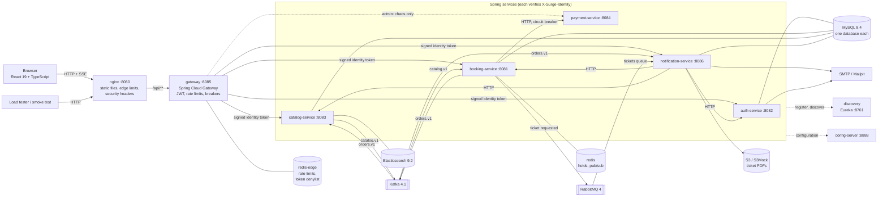

# Surge: the learning guide

This guide explains Surge from top to bottom: phase 1 (the booking core) and phase 2 (the microservices platform around it). For every part it answers five questions: what is it, why does Surge need it, where is it in the code, how can I see it working, and what will an interviewer ask about it.

It covers only what is **built**. Things that are planned for later phases are listed in [section 6](#6-coming-in-later-phases) and are always marked as planned.

How to use it:

1. Read sections 1 to 3 first. Together they tell the whole story of one booking, from the browser through the gateway to the ticket email.
2. Start the stack ([section 10](#10-how-to-run-everything)) and try the "How to see it" commands as you read.
3. Before an interview, reread [section 7](#7-design-decisions-and-trade-offs) (design decisions), [section 8](#8-design-bookmyshow-interview-script) (the BookMyShow script), [section 9](#9-the-numbers-and-how-to-explain-them) (the numbers and the load-test debugging story), [section 5.31](#531-security) (security) and the Q&As of each technology.

Commands in this guide are written for **Git Bash** (or any bash shell) and use two small helpers, `dc` (Docker Compose with the right files and profiles) and `TOKEN`/`ADMIN` (sign-in tokens); [section 10](#10-how-to-run-everything) defines them. In Windows PowerShell, type `curl.exe` instead of `curl`, and use `.\mvnw.cmd` instead of `./mvnw`.

## Table of contents

1. [What Surge is](#1-what-surge-is)
2. [Architecture](#2-architecture)
3. [Walkthrough: one booking, end to end](#3-walkthrough-one-booking-end-to-end)
4. [Code map](#4-code-map)
5. [Technologies](#5-technologies)
   - 5.1 [Core Java and OOP](#51-core-java-and-oop)
   - 5.2 [Collections](#52-collections)
   - 5.3 [Multithreading](#53-multithreading)
   - 5.4 [Virtual threads](#54-virtual-threads)
   - 5.5 [REST API and OpenAPI](#55-rest-api-and-openapi)
   - 5.6 [Date-Time API](#56-date-time-api)
   - 5.7 [Files](#57-files)
   - 5.8 [Functional programming and Streams](#58-functional-programming-and-streams)
   - 5.9 [Spring Boot](#59-spring-boot)
   - 5.10 [MySQL, Hibernate and Flyway](#510-mysql-hibernate-and-flyway)
   - 5.11 [Redis](#511-redis)
   - 5.12 [Docker and Compose](#512-docker-and-compose)
   - 5.13 [Nginx](#513-nginx)
   - 5.14 [Testing and CI](#514-testing-and-ci)
   - 5.15 [The web app (React)](#515-the-web-app-react)
   - Phase 2:
   - 5.16 [Spring Cloud Gateway](#516-spring-cloud-gateway)
   - 5.17 [JWT and JWKS (RS256)](#517-jwt-and-jwks-rs256)
   - 5.18 [Eureka and client-side load balancing](#518-eureka-and-client-side-load-balancing)
   - 5.19 [Config Server](#519-config-server)
   - 5.20 [Kafka](#520-kafka)
   - 5.21 [RabbitMQ](#521-rabbitmq)
   - 5.22 [Kafka vs RabbitMQ in Surge](#522-kafka-vs-rabbitmq-in-surge)
   - 5.23 [Elasticsearch](#523-elasticsearch)
   - 5.24 [S3 and S3Mock](#524-s3-and-s3mock)
   - 5.25 [PDF tickets and QR codes](#525-pdf-tickets-and-qr-codes)
   - 5.26 [Email](#526-email)
   - 5.27 [Circuit breaker, retry, timeout and bulkhead](#527-circuit-breaker-retry-timeout-and-bulkhead)
   - 5.28 [Rate limiting at the edge vs in the service](#528-rate-limiting-at-the-edge-vs-in-the-service)
   - 5.29 [The shared outbox module](#529-the-shared-outbox-module)
   - 5.30 [The audit log (Files and Date-Time)](#530-the-audit-log-files-and-date-time)
   - 5.31 [Security](#531-security)
6. [Coming in later phases](#6-coming-in-later-phases)
7. [Design decisions and trade-offs](#7-design-decisions-and-trade-offs)
8. [Design BookMyShow: interview script](#8-design-bookmyshow-interview-script)
9. [The numbers and how to explain them](#9-the-numbers-and-how-to-explain-them)
10. [How to run everything](#10-how-to-run-everything)
11. [How to run the tests](#11-how-to-run-the-tests)
12. [Troubleshooting](#12-troubleshooting)
13. [Glossary](#13-glossary)

---

## 1. What Surge is

When tickets for a big concert go on sale, thousands of people click "Book" in the same second, but there are only a few hundred seats. Surge is a ticket-booking backend built for that moment.

It has one hard rule: **a seat is never sold twice** (no overselling), even when 10,000 buyers race for 500 seats. It also has to stay responsive, free up seats that people hold but never pay for, and show every buyer a live seat map.

What a user does:

1. Signs up, and enters the 6-digit code that arrives by email.
2. Searches for an event (typos are fine: "coldply" finds "Coldplay Tribute Live") and opens its seat map.
3. Selects up to 8 seats and clicks **Hold**. The seats are reserved for 5 minutes at a locked price.
4. Clicks **Pay**. The order is confirmed and the seats become sold.
5. Everyone else looking at the same event sees those seats turn "held", then "sold", live.
6. A few seconds later an email arrives with a PDF ticket and a signed QR code.

**Phase 1** built the core, which is still the heart of the system:

- **booking-service**: one Spring Boot 4 service on Java 25 with all the booking logic.
- **Redis**: takes the rush. Seat holds, rate limits, idempotency keys and live-update messages live here.
- **MySQL**: keeps the truth. Seats, orders and the outbox live here.
- **web**: a small React app, served by Nginx.
- **tools/loadtest**: a command-line tool that simulates 10,000 buyers at once.

**Phase 2** built the platform around it:

- **gateway** (Spring Cloud Gateway): the one entry point behind nginx. It checks the user's JWT, rate-limits, protects services with circuit breakers, and signs a short-lived identity token for the one service each request goes to.
- **auth-service**: users, sign-up with email verification, login, JWTs and the public keys (JWKS) to check them.
- **catalog-service**: the source of events. CSV import, Elasticsearch search, seats left and daily sales.
- **payment-service**: a fake payment provider with "chaos" settings, called by booking through a circuit breaker.
- **notification-service**: turns each order into a PDF ticket in S3 and an email, through a RabbitMQ queue with retries and a dead-letter queue; keeps a daily audit log of order events from Kafka.
- **discovery** (Eureka) and **config-server**: services find each other by name and get their configuration from one place.
- **Kafka** (order and catalog events) and **RabbitMQ** (ticket jobs), fed by a shared transactional **outbox** module.
- **Security throughout**: every service verifies the gateway's identity token, every store and broker has its own credentials, containers are hardened, CI scans dependencies and images.
- **tools/smoke**: an end-to-end test of the whole flow.

The measured result: 10,000 buyers for 500 seats, through nginx and the gateway, **500 sold, 0 oversold, 0 seat-by-seat mismatches, 1 error in 10,000 buyers** (run on one Windows machine; see [section 9](#9-the-numbers-and-how-to-explain-them)).

What Surge does **not** do yet: real payments (payment-service is a stand-in), more than one instance of each service, metrics dashboards and tracing (phase 3). See [section 7.11](#711-known-limits-of-phase-2).

## 2. Architecture

Phase 1 was one service with Redis and MySQL. Phase 2 puts it inside a platform:



The key idea of phase 1 still holds: **Redis absorbs the rush, MySQL keeps the truth, and MySQL still refuses a double sale even if Redis gets it wrong.** Phase 2 adds two more:

- **Nothing behind the gateway trusts the network.** The gateway is the only place that reads the user's JWT. For each request it signs a 60-second identity token for exactly one service, and every service checks it ([section 5.31](#531-security)).
- **Services talk through events where they can.** The only synchronous calls are booking to payment (the buyer is waiting for the answer) and notification looking up the order, the user's email and the event. Everything else (new events, sales, ticket jobs, the audit log) travels over Kafka or RabbitMQ from a transactional outbox, so a slow or broken consumer never fails a checkout.

### Containers

Only nginx publishes a port (`127.0.0.1:8080`). The development overlay [compose.dev.yaml](compose.dev.yaml) adds Mailpit and S3Mock and debug ports, all bound to `127.0.0.1`, so nothing is reachable from your network.

| Container | Built from | Debug port (dev overlay) | Job |
|---|---|---|---|
| `web` | [web/Dockerfile](web/Dockerfile) (nginx 1.30.7, unprivileged) | 8080 (the one real port) | Serves the React app, forwards `/api` to the gateway, edge limits and headers |
| `gateway` | [docker/service.Dockerfile](docker/service.Dockerfile) | 8085 | JWT check, rate limits, circuit breakers, identity tokens, logout |
| `auth-service` | same | none | Users, sign-up, email codes, JWT, JWKS |
| `catalog-service` | same | none | Events, CSV import, search, sales stats |
| `booking-service` | same | 8081 | Holds, checkout, live seat stream |
| `payment-service` | same | none | Fake payment provider with chaos settings |
| `notification-service` | same | none | Ticket PDFs, S3, email, dead-letter queue, audit log |
| `discovery`, `config-server` | same | 8761 (Eureka) | Service registry; configuration from [config-repo/](config-repo/) |
| `mysql` | `mysql:8.4.13` | 3307 | One database and one user per service |
| `redis`, `redis-edge` | `redis:7.4.12-alpine` | 6379 (booking's) | booking's holds and pub/sub; the gateway's rate limits and token denylist |
| `kafka` (+ one-shot `kafka-init`) | `apache/kafka:4.1.2` | none | `orders.v1`, `catalog.v1` and their dead-letter topics; users and ACLs |
| `rabbitmq` | `rabbitmq:4.3.7-management` | 15672 (UI) | The ticket exchange, queue and dead-letter queue |
| `elasticsearch` (+ one-shot `es-init`) | Elasticsearch 9.2.8 | 9200 | The `events` search index |
| `mailpit`, `s3mock` (dev overlay only) | `axllent/mailpit`, `adobe/s3mock` | 8025, 9090 | Fake email and fake S3 |
| `loadtest`, `smoke` (run on demand) | [tools/loadtest/Dockerfile](tools/loadtest/Dockerfile), [tools/smoke/Dockerfile](tools/smoke/Dockerfile) | none | The 10,000-buyer test; the end-to-end checks |

All of them are defined in [compose.yaml](compose.yaml); base and third-party images are pinned by digest (the images built from this repository are tagged `surge/<name>:local`). Profiles: `core` is MySQL, Redis and booking-service; `platform` is everything else; `smoke` and the load-test overlay [compose.loadtest.yaml](compose.loadtest.yaml) add the two test tools.

### What lives in Redis

All key names come from one class, [RedisKeys.java](booking-service/src/main/java/dev/surge/booking/hold/RedisKeys.java).

| Key | Redis type | Holds | Expires |
|---|---|---|---|
| `seat:{eventId}:{seatId}` | string | the hold id that holds this seat | after 5 min |
| `hold:{holdId}` | hash | `userId`, `eventId`, `seats`, `prices` (locked per seat), `expiresAt`, `member` | after 5 min |
| `userhold:{eventId}:{userId}` | string | the user's current hold for this event | after 5 min |
| `userholds:{userId}` | sorted set | the user's active holds in every event (hold id, scored by expiry), for the cap of 3 events at once | members pruned by `hold.lua` |
| `holds:expiry` | sorted set | one member per hold (`eventId:holdId:seatIds`), score = expiry time in ms | members removed by the sweeper or at checkout |
| `sold:{eventId}` | set | ids of sold seats (rebuilt from MySQL at startup) | never |
| `idem:{userId}:{key}` | string | `IN_PROGRESS`, then the order id | `IN_PROGRESS` after 120 s; the order id after 24 h |
| `rate:holds:{userId}` | hash | token bucket: `tokens`, `ts` | after 5 s idle |
| `seats:{eventId}` | pub/sub channel | live seat changes as JSON | (messages are not stored) |
| `loadtest:latest` | string | the latest load-test report as JSON | never |

The gateway has its own Redis, `redis-edge`, with only two kinds of keys: Spring Cloud Gateway's rate-limit buckets (`request_rate_limiter.{<bucket>:<client>}.tokens` and `.timestamp`) and the logout denylist (`surge:jwt:revoked:<jti>`, until the token would have expired anyway). It is separate so that booking's hold scripts and the gateway's per-request checks never queue behind each other ([section 9](#9-the-numbers-and-how-to-explain-them) tells why), and so a compromised booking cannot touch the denylist.

### What lives in MySQL

One MySQL server, one database per service, and one MySQL user per database that can touch only its own ([01-databases.sql](docker/mysql-init/01-databases.sql), [02-users.sh](docker/mysql-init/02-users.sh)). Each service owns its schema through its own Flyway migrations: `auth` (users, email verification codes), `catalog` (venues, events, daily sales, its outbox, processed messages), `notification` (tickets, processed messages) and `booking`.

booking's tables are created by Flyway from [V1__schema.sql](booking-service/src/main/resources/db/migration/V1__schema.sql) and filled by [V2__seed.sql](booking-service/src/main/resources/db/migration/V2__seed.sql). Phase 2 added `processed_message` (idempotent consumers, V4), `payment_in_doubt` (charges whose outcome was lost in a timeout, V5), new outbox destinations (V3) and binary collation for user ids and keys (V6).

| Table | One row per | Important columns and constraints |
|---|---|---|
| `event_ref` | event | `sale_opens_at` (UTC), `zone_id` (venue time zone) |
| `seat` | seat | `status` (`AVAILABLE`/`SOLD`), `version` (optimistic lock), unique `(event_id, row_label, number)` |
| `orders` | purchase | `total_inr` `DECIMAL(12,2)`, unique `(user_id, idempotency_key)` |
| `order_item` | sold seat | **unique `seat_id`** |
| `outbox` | message to send later | `payload` JSON, `published_at` (NULL until sent) |

Seed data: three events in three time zones. Event 1 (Delhi, `Asia/Kolkata`) has 500 seats: rows A to T, 25 seats each, ids 1 to 500. Rows A to D are PLATINUM (₹4999), E to L are GOLD (₹2999), M to T are SILVER (₹1499). Events 2 (Dubai) and 3 (Singapore) have 100 seats each, ids 501 to 600 and 601 to 700. Prices come from [application.yml](booking-service/src/main/resources/application.yml). In phase 2, catalog-service is the source of events: its seed ([V2__seed.sql](catalog-service/src/main/resources/db/migration/V2__seed.sql)) has 30 events whose first three equal booking's, and booking creates the seats of every other event when catalog announces it on `catalog.v1`.

## 3. Walkthrough: one booking, end to end

This is the most important section. If you can explain this flow on a whiteboard, you can defend the project. It follows one signed-in, verified user who holds two seats and pays, from the browser to the ticket email.

```mermaid
sequenceDiagram
    participant B as Browser
    participant N as nginx
    participant G as gateway
    participant S as booking-service
    participant R as Redis
    participant P as payment-service
    participant M as MySQL
    B->>N: POST /api/bookings/holds (Authorization: Bearer JWT)
    N->>G: proxy: blanks X-User-*, sets X-Request-Id and X-Forwarded-For
    G->>G: verify JWT (RS256, JWKS), denylist, rate limits
    G->>S: X-Surge-Identity (ES256, for booking-service only, 60 s)
    S->>S: verify identity token; email verified?
    S->>R: token_bucket.lua (booking's own rate limit)
    S->>S: price seats (early bird, surge): the price lock
    S->>R: hold.lua (all seats or none, prices stored)
    S->>R: PUBLISH seats:1 (HELD)
    R-->>S: message delivered to every instance
    S-->>B: SSE event "seats" to every open seat map
    S-->>B: 201 holdId, expiresAt, quotedTotalInr
    B->>N: POST /api/bookings/orders with Idempotency-Key
    N->>G: proxy
    G->>S: a fresh identity token
    S->>R: SET idem key NX (IN_PROGRESS)
    S->>R: read hold hash (seats and locked prices)
    S->>P: charge (signed svc:booking; circuit breaker, retry, 2 s timeout)
    S->>M: one transaction: seats SOLD (version check), order, items, outbox rows
    S->>R: finalize.lua, PUBLISH seats:1 (SOLD), idem key = order id
    S-->>B: 201 order
    Note over S,M: Every 0.5 s the outbox relay sends new rows to Kafka and RabbitMQ
    Note over S,R: Every 1 s the sweeper announces expired holds
```

### Part A: signing in and opening the event page

1. **Sign-in.** The user signed up at `/signup` ([SignupPage.tsx](web/src/pages/SignupPage.tsx)) and entered the emailed code at `/verify` ([VerifyPage.tsx](web/src/pages/VerifyPage.tsx)). Both answers carry a JWT, which [session.ts](web/src/auth/session.ts) keeps in `sessionStorage` (`surge.session`) until it expires. From now on [client.ts](web/src/api/client.ts) sends `Authorization: Bearer <token>` on every call. The token is signed by auth-service with RS256, lives 30 minutes, and says who the user is (`sub`, for example `u-42`), their roles and whether their email is verified (`ev`).
2. **The event page.** The browser opens `/events/1`. [EventPage.tsx](web/src/pages/EventPage.tsx) asks catalog for the title and venue (`GET /api/catalog/events/1`) and booking for the seat map (`GET /api/bookings/events/1`), and opens a live stream with `new EventSource('/api/bookings/events/1/stream')` ([useSeatStream.ts](web/src/hooks/useSeatStream.ts)). These are public routes: the gateway still signs an identity token for them, an anonymous one with no user.
3. [SeatMapService.detail](booking-service/src/main/java/dev/surge/booking/event/SeatMapService.java) builds the seat map from three sources:
   - seat facts (row, number, tier) from [InventoryCache](booking-service/src/main/java/dev/surge/booking/inventory/InventoryCache.java), an in-memory copy of data that never changes during a sale;
   - which seats are `SOLD`, from MySQL;
   - which seats are `HELD`, from Redis, with one `MGET` over all `seat:{eventId}:{seatId}` keys.
4. [EventController.stream](booking-service/src/main/java/dev/surge/booking/event/EventController.java) registers the browser's connection in [SeatStreamRegistry](booking-service/src/main/java/dev/surge/booking/stream/SeatStreamRegistry.java), which keeps one `SseEmitter` per open page (at most 5,000 per event and 15,000 in total).

### Part B: holding seats

5. The user selects seats and clicks **Hold**. The browser sends `POST /api/bookings/holds` with body `{"eventId":1,"seatIds":[3,4]}` and the bearer token.
6. **nginx** ([nginx.conf](web/nginx.conf), [api.conf](web/nginx/api.conf)) matches `location /api/`, applies its per-IP request limit (20 per second, bursts of 40), and proxies to the gateway. It blanks any `X-User-*` header the client sent, overwrites `X-Forwarded-For` with the real peer address, and sets `X-Request-Id` to its own `$request_id`.
7. **The gateway checks the request** ([SecurityConfig](gateway/src/main/java/dev/surge/gateway/security/SecurityConfig.java)):
   - [PathGuardFilter](gateway/src/main/java/dev/surge/gateway/security/PathGuardFilter.java) refuses paths with `..`, encoded slashes or `;`, which a servlet container might normalise into a different path than the one the rules saw;
   - the rule table says `/api/bookings/holds/**` needs the `USER` role; no token: **401** `unauthorized`;
   - the JWT must be RS256, signed by a key from auth-service's JWKS ([JwksCache](gateway/src/main/java/dev/surge/gateway/security/JwksCache.java)), with issuer `surge-auth`, audience `surge-api`, an expiry, a `jti` and a safe user id;
   - the `jti` must not be on the logout denylist in `redis-edge` ([TokenDenylist](gateway/src/main/java/dev/surge/gateway/security/TokenDenylist.java)). If Redis does not answer within 3 s (or the key set cannot be fetched), the answer is **503** `auth-unavailable` with `Retry-After: 1`: a token that might have been revoked is never let through, and clients may retry.
8. **The gateway routes the request** ([RouteConfig](gateway/src/main/java/dev/surge/gateway/config/RouteConfig.java)), route `booking-holds`:
   - two token buckets in `redis-edge`: 2 holds per second per user (bursts of 10) and 20 per minute per client IP. Empty: **429** `rate-limited` with `Retry-After`;
   - the circuit breaker `booking` and its bulkhead (at most 5,000 calls in flight to booking; checkout has its own breaker, `booking-orders`, and its own bulkhead, so slow holds at the sale's peak cannot turn away buyers who already hold seats). Bulkhead full: **503** `service-busy` with `Retry-After: 1` at once ([section 5.27](#527-circuit-breaker-retry-timeout-and-bulkhead));
   - [IdentityHeadersFilter](gateway/src/main/java/dev/surge/gateway/security/IdentityHeadersFilter.java) removes `X-User-*` and `Authorization`, and [InternalIdentityFilter](gateway/src/main/java/dev/surge/gateway/security/InternalIdentityFilter.java) adds `X-Surge-Identity`: an ES256 token signed with the gateway's key, addressed to `booking-service` only, valid 60 seconds, carrying `sub`, `roles` and `ev`. The signature happens just before the load balancer picks an instance, after the rate limits and the bulkhead, so a `429` or a busy refusal costs no signature;
   - `lb://booking-service` is resolved to an address through Eureka ([section 5.18](#518-eureka-and-client-side-load-balancing)).
9. **booking checks it again.** [RequestIdFilter](common/src/main/java/dev/surge/common/web/RequestIdFilter.java) keeps the request id (if it is well formed), puts it in the logging MDC and echoes it in the response header; any error body will carry it as `requestId`. The shared security chain ([InternalSecurityAutoConfiguration](common/src/main/java/dev/surge/common/security/InternalSecurityAutoConfiguration.java)) verifies the identity token: wrong signature, wrong audience, older than 60 s, or missing: **401**. booking's [AccessRulesConfig](booking-service/src/main/java/dev/surge/booking/config/AccessRulesConfig.java) says holds need a gateway user.
10. **Controller.** [HoldController](booking-service/src/main/java/dev/surge/booking/hold/HoldController.java) runs.
    - [CurrentUserArgumentResolver](booking-service/src/main/java/dev/surge/booking/web/CurrentUserArgumentResolver.java) takes the user id from the verified token (never from a header). `@CurrentUser(verifiedEmail = true)` also requires `ev: true`: otherwise **403** `email-unverified`.
    - `@Valid` checks [HoldRequest](booking-service/src/main/java/dev/surge/booking/hold/HoldRequest.java): event id present, 1 to 8 seat ids. Otherwise **400** `validation-failed`.
11. **Rate limit, again.** booking keeps its own limiter (defence in depth): [RateLimiter](booking-service/src/main/java/dev/surge/booking/ratelimit/RateLimiter.java) runs [token_bucket.lua](booking-service/src/main/resources/redis/token_bucket.lua) on `rate:holds:{userId}`, a bucket of 10 tokens that refills at 2 per second. Empty: **429** `rate-limited`.
12. **Checks in Java.** [HoldService](booking-service/src/main/java/dev/surge/booking/hold/HoldService.java):
    - unknown event: **404** `event-not-found`;
    - a seat that is not in this event, or the same seat twice: **400** `invalid-seats`;
    - the current time (from the injected `Clock`) is before `saleOpensAt`: **409** `sale-not-open`.

    Then it **prices every seat now** (the price lock). For each seat, [PriceCalculator](booking-service/src/main/java/dev/surge/booking/pricing/PriceCalculator.java) starts from the tier price and applies the rules in order:
    - [EarlyBirdRule](booking-service/src/main/java/dev/surge/booking/pricing/EarlyBirdRule.java): 10% off in the first 15 minutes after the sale opens;
    - [SurgeRule](booking-service/src/main/java/dev/surge/booking/pricing/SurgeRule.java): 20% more when fewer than 20% of seats are left (available = total seats minus `SCARD sold:{eventId}`);
    - then it rounds to whole rupees (`HALF_UP`). Example: a PLATINUM seat in the early-bird window costs 4999 x 0.90 = 4499.10, so ₹4499.

    The time is read once from the `Clock`, so the sale-open check and the price agree.
13. **The atomic hold.** [HoldStore.tryHold](booking-service/src/main/java/dev/surge/booking/hold/HoldStore.java) creates a hold id (a UUID) and runs [hold.lua](booking-service/src/main/resources/redis/hold.lua) with the seat ids and their prices. Redis runs the whole script without running any other command in between:
    1. If `userhold:{eventId}:{userId}` exists, the user already holds seats for this event: return `HOLD_EXISTS` (**409** `hold-exists`, with the existing `holdId`). If the user already holds seats in 3 other events (`userholds:{userId}`): **409** `too-many-holds`.
    2. For every seat: if it is in `sold:{eventId}` or its `seat:` key exists, it is taken. If any are taken, return `TAKEN` and the taken ids. Nothing is held (**409** `seat-taken`, with `seatIds`).
    3. Otherwise set every `seat:{eventId}:{seatId}` to the hold id with a 5-minute expiry, write the `hold:{holdId}` hash (including the locked `prices`), set `userhold:{eventId}:{userId}`, and add the hold to `holds:expiry` and `userholds:{userId}`. A hold therefore never exists without its prices.
14. The script's answer becomes a [HoldResult](booking-service/src/main/java/dev/surge/booking/hold/HoldResult.java), a sealed interface with three records. `HoldService` handles it with a pattern-matching `switch`.
15. **Live update.** [SeatEventPublisher](booking-service/src/main/java/dev/surge/booking/stream/SeatEventPublisher.java) publishes `{"eventId":1,"seatIds":[3,4],"state":"HELD"}` on the Redis channel `seats:1`. Every instance of booking-service is subscribed to `seats:*` ([RedisListenerConfig](booking-service/src/main/java/dev/surge/booking/config/RedisListenerConfig.java)). [SeatChannelListener](booking-service/src/main/java/dev/surge/booking/stream/SeatChannelListener.java) receives it and `SeatStreamRegistry.broadcast` sends an SSE event named `seats` to every open page for event 1. Other users' seat maps turn those seats "held".
16. The response is **201** `{"holdId":"...","eventId":1,"seatIds":[3,4],"expiresAt":"...","quotedTotalInr":9998.00,"lines":[{"seatId":3,"priceInr":4999.00},{"seatId":4,"priceInr":4999.00}]}` (two PLATINUM seats, no early bird or surge). The page starts a 5-minute [Countdown](web/src/components/Countdown.tsx), shows **Pay ₹9998** (the quote, which is exactly what checkout will charge) and creates an idempotency key with `crypto.randomUUID()` for the payment.

MySQL was not touched in steps 9 to 16. (The first request for an event loads its seat facts into `InventoryCache`; after that they come from memory.) This is how the rush is absorbed.

### Part C: paying

17. The user clicks **Pay**. The browser sends `POST /api/bookings/orders` with body `{"holdId":"..."}`, the bearer token and an `Idempotency-Key` header. nginx and the gateway do what they did in steps 6 to 8 (the gateway's `orders` bucket is 2 per second per user), and the gateway signs a fresh identity token. [OrderController](booking-service/src/main/java/dev/surge/booking/order/OrderController.java) rejects a missing key, or one that does not match `^[A-Za-z0-9_-]{8,64}$`, with **400**.
18. **Idempotency.** [CheckoutService.checkout](booking-service/src/main/java/dev/surge/booking/order/CheckoutService.java) calls [IdempotencyStore.begin](booking-service/src/main/java/dev/surge/booking/order/IdempotencyStore.java), which does `SET idem:{userId}:{key} IN_PROGRESS NX` with a 120-second expiry (short, so a crashed request frees its key soon).
    - Key already holds an order id and that order exists: this is a repeat. Return that order with **200** and the header `Idempotent-Replayed: true`. Nothing is charged again.
    - Key holds an order id but the order is gone (an admin reset deletes orders and keeps keys): the id is stale. A small Lua script swaps it for `IN_PROGRESS` only if the key still holds that id (compare-and-set), and the request continues as a new one.
    - Key holds `IN_PROGRESS`: the same request is still running. **409** `request-in-progress`.
    - Key claimed: continue.
19. **Database fallback.** Redis might have lost the key (restart, flush). So the service also looks in MySQL for an order with this `(user_id, idempotency_key)`. If one exists, it replays it.
20. **Load the hold.** The service reads the time once from the `Clock` (for `createdAt`), reads the `hold:{holdId}` hash and checks it belongs to this user. Missing, expired (Redis already deleted it) or someone else's: **404** `hold-not-found`.
21. **Price: the locked quote.** Checkout does **not** price again. It charges the per-seat prices stored in the hold hash in step 13, so the amount on the Pay button is exactly the amount charged, even if the early-bird window closed or surge started in the meantime.
22. **Payment, over HTTP.** [PaymentGateway.charge](booking-service/src/main/java/dev/surge/booking/payment/PaymentGateway.java) is called **before** any database transaction starts. In the Compose stack the implementation is [HttpPaymentGateway](booking-service/src/main/java/dev/surge/booking/payment/HttpPaymentGateway.java) (tests use the in-process [FakePaymentGateway](booking-service/src/main/java/dev/surge/booking/payment/FakePaymentGateway.java)). It sends `POST lb://payment-service/api/payments` with the reference `userId:key`, signed with booking's own key as `svc:booking`; payment-service accepts charges from no one else, and treats the same reference as the same charge.
    - Connect timeout 1 s, read timeout 2 s; one retry, only on I/O errors and 5xx; a circuit breaker named `payment` around each attempt ([section 5.27](#527-circuit-breaker-retry-timeout-and-bulkhead)).
    - Declined (a normal answer, never counted as a failure): **402** `payment-failed`. The hold stays, and the idempotency key is released so the user can retry.
    - Payment unreachable or the circuit open: **503** `payment-unavailable` with `Retry-After`. Nothing was charged, the hold stays.
    - A read timeout leaves the outcome unknown (the charge may exist): also **503**, and booking records the charge in `payment_in_doubt`. A retry with the same key reaches the same charge; if no order appears, [PaymentReconciler](booking-service/src/main/java/dev/surge/booking/payment/PaymentReconciler.java) refunds it after the hold's lifetime has passed.
23. **The one database transaction.** [OrderWriter.confirm](booking-service/src/main/java/dev/surge/booking/order/OrderWriter.java) is the only write transaction in checkout (the order lookups in [OrderReader](booking-service/src/main/java/dev/surge/booking/order/OrderReader.java) are short read-only transactions):
    1. Load the seats. Each must be `AVAILABLE` and belong to this event.
    2. Set them `SOLD` and flush. Hibernate's update includes `WHERE id = ? AND version = ?` because [Seat](booking-service/src/main/java/dev/surge/booking/event/Seat.java) has a `@Version` field. If another checkout changed the row first, zero rows match and Hibernate throws.
    3. Insert the `orders` row and one `order_item` per seat. `order_item.seat_id` is unique.
    4. Insert two `outbox` rows: `OrderConfirmed` (destination `kafka:orders.v1`) and `TicketRequested` (`rabbit:surge.tickets/ticket.requested`). The payloads are the records in [common/messaging](common/src/main/java/dev/surge/common/messaging/).
    5. Commit. All of it is saved, or none of it.
24. **Losing the race.** If the version check or a unique constraint fails, `OrderWriter` turns it into a `SeatConflictException`. `CheckoutService` refunds the payment, releases the hold and returns **409** `seat-taken`. Releasing runs [release.lua](booking-service/src/main/resources/redis/release.lua): the same compare-and-delete clean-up as `finalize.lua`, and it also adds to the sold set the seats MySQL already has as SOLD (the ones this checkout lost), so Redis stops offering them; open seat maps are then told the MySQL truth. So the buyer can pick other seats at once instead of waiting 5 minutes. (If the unique violation was on the idempotency key, the order already exists, so it replays that order instead.) If any other error happens, it first checks whether the commit actually succeeded before refunding.
25. **After the commit.** The database is now the source of truth, so nothing after this point may fail the request:
    - [finalize.lua](booking-service/src/main/resources/redis/finalize.lua) adds the seats to `sold:{eventId}` and deletes the hold's keys that still belong to it;
    - a `SOLD` change is published, so every seat map shows the seats as sold;
    - `IdempotencyStore.complete` stores the order id under the key for 24 hours.
    Errors in these steps are logged, not thrown.
26. The response is **201** with the order. The page shows "Booked! Order #… — ₹…".

### Part D: after the response

27. **Outbox relay.** Every 0.5 s, [OutboxPoller](outbox/src/main/java/dev/surge/outbox/OutboxPoller.java) calls `relayBatch()` on [OutboxRelay](outbox/src/main/java/dev/surge/outbox/OutboxRelay.java), from the shared [outbox](outbox/) module ([section 5.29](#529-the-shared-outbox-module)). In one transaction it runs `SELECT ... WHERE published_at IS NULL ORDER BY id LIMIT 100 FOR UPDATE SKIP LOCKED` ([OutboxRepository](outbox/src/main/java/dev/surge/outbox/OutboxRepository.java)), hands each row to [RoutingOutboxPublisher](outbox/src/main/java/dev/surge/outbox/routing/RoutingOutboxPublisher.java) and sets `published_at`. The publisher reads the destination: `kafka:orders.v1` goes to Kafka with the event id as the key, waiting for the broker's acknowledgement; `rabbit:surge.tickets/ticket.requested` goes to RabbitMQ, waiting for the broker's confirm. If a broker is down, the batch stops and the rows wait for the next poll.
28. **Kafka `orders.v1`: two independent readers** ([section 5.20](#520-kafka)).
    - catalog-service (consumer group `catalog-orders`, [SalesHandler](catalog-service/src/main/java/dev/surge/catalog/messaging/SalesHandler.java)) lowers the event's `seatsLeft` in MySQL and in the search index, and adds the tickets and revenue to `sales_daily` for that day in the venue's time zone.
    - notification-service (group `notification-audit`, [OrdersAuditListener](notification-service/src/main/java/dev/surge/notification/audit/OrdersAuditListener.java)) appends one JSON line to today's audit file ([section 5.30](#530-the-audit-log-files-and-date-time)).

    Each first records the message id in its own `processed_message` table, in the same transaction as its work, so a message delivered twice has exactly one effect.
29. **RabbitMQ: the ticket job** ([section 5.21](#521-rabbitmq)). The exchange `surge.tickets` routes `ticket.requested` to the queue `tickets`. notification-service's [TicketWorkflow](notification-service/src/main/java/dev/surge/notification/messaging/TicketWorkflow.java), in one transaction:
    1. claims the message id (a duplicate stops here);
    2. asks booking for the order (`GET /internal/orders/{id}?userId=…`), auth for the user's email and catalog for the event, each call signed as `svc:notification`;
    3. renders an A6 PDF with a signed QR code ([section 5.25](#525-pdf-tickets-and-qr-codes)) and stores it in S3 as `tickets/<orderId>.pdf` ([section 5.24](#524-s3-and-s3mock));
    4. saves the `ticket` row, emails the PDF ([section 5.26](#526-email)), marks the row emailed and commits.

    Any failure rolls it all back and the message is retried, five attempts in all with growing waits (1, 2, 4 and 8 s: about 15 s, enough to outlast the startup discovery gap); after that it is dead-lettered to `tickets.dlq`, where an admin can see the reason and replay it. Other tickets keep flowing.
30. **The ticket link.** On the event page, [TicketLink](web/src/components/TicketLink.tsx) checks every 2 seconds (for up to a minute) whether `GET /api/notifications/tickets/<orderId>.pdf` exists, then shows **Download ticket (PDF)**. notification-service serves it only to the buyer (anyone else gets 404), with `Cache-Control: no-store`.
31. **If the user never pays.** After 5 minutes Redis deletes the seat keys, the hold hash and the `userhold` key by itself. Every second, [HoldExpirySweeper](booking-service/src/main/java/dev/surge/booking/stream/HoldExpirySweeper.java) reads the `holds:expiry` members whose time has passed and runs [sweep.lua](booking-service/src/main/resources/redis/sweep.lua) for each. The script removes the member first (`ZREM`); if it was already gone, another instance or a checkout handled it, so it stops. Otherwise it returns the seats that are really free (key gone, not sold), and the sweeper publishes them as `AVAILABLE` and increments the `holds_expired_total` metric.

## 4. Code map

Paths below `booking/` mean [booking-service/src/main/java/dev/surge/booking/](booking-service/src/main/java/dev/surge/booking/).

| Where | What is in it |
|---|---|
| [BookingApplication.java](booking-service/src/main/java/dev/surge/booking/BookingApplication.java) | `main`, `@EnableScheduling` |
| [booking/hold/](booking-service/src/main/java/dev/surge/booking/hold/) | `HoldController`, `HoldService`, `HoldStore` (Redis), `HoldResult` (sealed), `RedisKeys` |
| [booking/order/](booking-service/src/main/java/dev/surge/booking/order/) | `OrderController`, `CheckoutService` (orchestration), `IdempotencyStore`, `OrderWriter` (the transaction), `OrderReader`, `Order` and `OrderItem` entities |
| [booking/event/](booking-service/src/main/java/dev/surge/booking/event/) | `EventController` (list, detail, SSE stream), `SeatMapService`, `Seat` and `EventRef` entities, enums |
| [booking/inventory/](booking-service/src/main/java/dev/surge/booking/inventory/) | `InventoryCache` (seat facts in memory), `SoldSeatsWarmer` (rebuilds sold sets at startup) |
| [booking/pricing/](booking-service/src/main/java/dev/surge/booking/pricing/) | `PricingRule`, `EarlyBirdRule`, `SurgeRule`, `PriceCalculator`, `TierPrices` |
| [booking/payment/](booking-service/src/main/java/dev/surge/booking/payment/) | `PaymentGateway` interface, `FakePaymentGateway` (tests), `HttpPaymentGateway` and `PaymentClientConfig` (the real client, circuit breaker), `PaymentReconciler` (charges in doubt) |
| [booking/messaging/](booking-service/src/main/java/dev/surge/booking/messaging/) | `CatalogEventsListener` and `EventScheduledHandler` (events from `catalog.v1`), `ProcessedMessage` (idempotent consumer) |
| [outbox/](outbox/src/main/java/dev/surge/outbox/) (shared module) | `OutboxPoller` (scheduled entry point), `OutboxRelay` (transactional batch), `OutboxRepository`, `OutboxMessage` entity, `routing/` (Kafka and RabbitMQ senders) |
| [booking/stream/](booking-service/src/main/java/dev/surge/booking/stream/) | `SeatEventPublisher`, `SeatChannelListener`, `SeatStreamRegistry` (SSE), `HoldExpirySweeper` |
| [booking/ratelimit/](booking-service/src/main/java/dev/surge/booking/ratelimit/) | `RateLimiter`, `RateLimitProperties` |
| [booking/admin/](booking-service/src/main/java/dev/surge/booking/admin/) | `AdminController` (integrity, reset, load-test report), `EventResetService` |
| [booking/error/](booking-service/src/main/java/dev/surge/booking/error/) | `ApiExceptionHandler` and one exception class per error |
| [booking/web/](booking-service/src/main/java/dev/surge/booking/web/) | `@CurrentUser` annotation and its resolver (reads the verified identity token) |
| [booking/config/](booking-service/src/main/java/dev/surge/booking/config/) | `ClockConfig`, `RedisScripts`, `RedisListenerConfig`, `AccessRulesConfig`, `MessagingConfig`, `KafkaErrorHandlingConfig` |
| [resources/redis/](booking-service/src/main/resources/redis/) | The five Lua scripts |
| [resources/db/migration/](booking-service/src/main/resources/db/migration/) | Flyway migrations `V1__schema.sql` to `V6__binary_collation.sql` |
| [application.yml](booking-service/src/main/resources/application.yml) | Local defaults; [config-repo/booking-service.yml](config-repo/booking-service.yml) wins when the config server is up |

The phase 2 modules, each under `<module>/src/main/java/dev/surge/<name>/`:

| Where | What is in it |
|---|---|
| [gateway/](gateway/src/main/java/dev/surge/gateway/) | `config/RouteConfig` (routes, rate limits, breakers), `config/BulkheadConfig`, `config/RedisClientConfig`, `security/` (`SecurityConfig`, `JwksCache`, `TokenDenylist`, `LogoutConfig`, `InternalIdentityFilter`, `IdentityHeadersFilter`, `PathGuardFilter`), `ratelimit/`, `fallback/FallbackController`, `error/` |
| [auth-service/](auth-service/src/main/java/dev/surge/auth/) | `api/` (`AuthController`, `AuthService`, `LoginThrottle`, `PasswordPolicy`), `verify/` (email codes), `jwt/` (`TokenService`, `KeyConfig`), `user/` (`User`, `AdminSeeder`), `internal/InternalUserController`, `admin/TestTokenController`, `config/StartupGuards` |
| [catalog-service/](catalog-service/src/main/java/dev/surge/catalog/) | `event/`, `venue/`, `importer/` (CSV), `publish/EventScheduledPublisher`, `search/` (Elasticsearch), `messaging/` (`OrdersListener`, `SalesHandler`), `stats/` |
| [payment-service/](payment-service/src/main/java/dev/surge/payment/) | `PaymentController`, `PaymentStore` (in memory, idempotent by reference), `ChaosController`, `ChaosSettings` |
| [notification-service/](notification-service/src/main/java/dev/surge/notification/) | `messaging/` (`TicketQueueConfig`, `TicketRequestedListener`, `TicketWorkflow`, `RetryConfig`, `DlqController`), `ticket/` (`TicketPdfRenderer`, `QrCodes`, `TicketQr`, `TicketStore`), `mail/TicketMailer`, `audit/`, `booking/`, `catalog/`, `user/` (signed HTTP clients), `api/TicketController` |
| [discovery/](discovery/src/main/java/dev/surge/discovery/), [config-server/](config-server/src/main/java/dev/surge/config/) | Eureka server and Config Server, each with HTTP Basic |
| [common/](common/src/main/java/dev/surge/common/) | `security/` (internal identity tokens, access rules, `CurrentIdentity`, `AdminAudit`, `SurgeEnv`, `StoreCredentials`), `web/` (`RequestIdFilter`, `Problems`), `messaging/` (message records), auto-configuration |
| [tools/loadtest/](tools/loadtest/src/main/java/dev/surge/loadtest/), [tools/smoke/](tools/smoke/src/main/java/dev/surge/smoke/) | The load tester (`LoadTestMain`, `Buyer`, `BookingApi`, ...) and the smoke test (`SmokeMain`, `checks/`) |
| [web/src/](web/src/) | React app: pages, components, the SSE hook, the API client, `auth/` (session, sign-in) |
| [compose.yaml](compose.yaml) and its overlays, [docker/](docker/), [web/Dockerfile](web/Dockerfile), [nginx.conf](web/nginx.conf) | How it all runs |
| [.github/workflows/](.github/workflows/) | CI, CodeQL, security scans |

---

## 5. Technologies

Each section follows the same pattern: what it is, why Surge needs it, where it is in the code, how to see it, and interview questions with answers. Sections 5.1 to 5.15 cover what phase 1 built (mostly inside booking-service), updated where phase 2 changed it; sections 5.16 to 5.31 cover phase 2. The commands use the `dc`, `env_get`, `secret_get`, `TOKEN` and `ADMIN` helpers from [section 10](#10-how-to-run-everything).

### 5.1 Core Java and OOP

**What it is.** The Java language and object-oriented design: classes, interfaces, encapsulation, polymorphism. Modern Java (15 to 21) added records, sealed types, pattern-matching `switch` and text blocks. Surge uses all of them.

**Why Surge needs it.** The booking rules are plain Java objects. Clean design keeps them easy to test, and it lets later phases swap parts (for example, a real payment service) without changing the code that calls them.

**Where it is in the code.**

| Idea | Where |
|---|---|
| Interface with a swappable implementation | [PaymentGateway](booking-service/src/main/java/dev/surge/booking/payment/PaymentGateway.java) with [FakePaymentGateway](booking-service/src/main/java/dev/surge/booking/payment/FakePaymentGateway.java) and [HttpPaymentGateway](booking-service/src/main/java/dev/surge/booking/payment/HttpPaymentGateway.java); [OutboxPublisher](outbox/src/main/java/dev/surge/outbox/OutboxPublisher.java) with [LoggingOutboxPublisher](outbox/src/main/java/dev/surge/outbox/LoggingOutboxPublisher.java) and [RoutingOutboxPublisher](outbox/src/main/java/dev/surge/outbox/routing/RoutingOutboxPublisher.java) |
| Strategy pattern | [PricingRule](booking-service/src/main/java/dev/surge/booking/pricing/PricingRule.java), [EarlyBirdRule](booking-service/src/main/java/dev/surge/booking/pricing/EarlyBirdRule.java), [SurgeRule](booking-service/src/main/java/dev/surge/booking/pricing/SurgeRule.java), applied by [PriceCalculator](booking-service/src/main/java/dev/surge/booking/pricing/PriceCalculator.java) |
| Sealed interface + records + pattern-matching `switch` | [HoldResult](booking-service/src/main/java/dev/surge/booking/hold/HoldResult.java), handled in [HoldService](booking-service/src/main/java/dev/surge/booking/hold/HoldService.java) |
| Records as immutable data carriers | [HoldRequest](booking-service/src/main/java/dev/surge/booking/hold/HoldRequest.java), [OrderResponse](booking-service/src/main/java/dev/surge/booking/order/OrderResponse.java), [PricingContext](booking-service/src/main/java/dev/surge/booking/pricing/PricingContext.java), [ActiveHold](booking-service/src/main/java/dev/surge/booking/hold/ActiveHold.java) and more |
| Record with a compact constructor (defensive copy) | [EventInventory](booking-service/src/main/java/dev/surge/booking/inventory/EventInventory.java) |
| Enums | [Tier](booking-service/src/main/java/dev/surge/booking/event/Tier.java), [SeatStatus](booking-service/src/main/java/dev/surge/booking/event/SeatStatus.java) (stored), [SeatState](booking-service/src/main/java/dev/surge/booking/event/SeatState.java) (shown; adds `HELD`), [OrderStatus](booking-service/src/main/java/dev/surge/booking/order/OrderStatus.java) |
| Encapsulation of a parent and its children | `Order.addItem` sets both sides of the relation ([Order.java](booking-service/src/main/java/dev/surge/booking/order/Order.java)) |
| Custom unchecked exceptions mapped to HTTP | [booking/error/](booking-service/src/main/java/dev/surge/booking/error/) and [ApiExceptionHandler](booking-service/src/main/java/dev/surge/booking/error/ApiExceptionHandler.java) |
| Utility classes: `final` with a private constructor | [RedisKeys](booking-service/src/main/java/dev/surge/booking/hold/RedisKeys.java), [Problems](common/src/main/java/dev/surge/common/web/Problems.java), [ReportWriter](tools/loadtest/src/main/java/dev/surge/loadtest/ReportWriter.java) |
| `BigDecimal` for money | [PriceCalculator](booking-service/src/main/java/dev/surge/booking/pricing/PriceCalculator.java), [TierPrices](booking-service/src/main/java/dev/surge/booking/pricing/TierPrices.java), [HoldService](booking-service/src/main/java/dev/surge/booking/hold/HoldService.java) (prices the hold), [CheckoutService](booking-service/src/main/java/dev/surge/booking/order/CheckoutService.java) (sums the locked prices) |
| Text blocks | `ReportWriter.markdown`, `LoadTestConfig.USAGE` ([LoadTestConfig.java](tools/loadtest/src/main/java/dev/surge/loadtest/LoadTestConfig.java)) |
| A custom annotation | [CurrentUser](booking-service/src/main/java/dev/surge/booking/web/CurrentUser.java) |

Note the two seat enums. `SeatStatus` (`AVAILABLE`, `SOLD`) is what MySQL stores. `SeatState` (`AVAILABLE`, `HELD`, `SOLD`) is what the API shows. `HELD` exists only in Redis, so it never reaches the database.

**How to see it.** Run the pricing tests (no Docker needed):

```bash
./mvnw -B -pl booking-service -am test -Dtest=PriceCalculatorTest -Dsurefire.failIfNoSpecifiedTests=false
```

**Interview questions.**

**Q1. Why is `HoldResult` a sealed interface?**
The hold script has exactly three outcomes: held, seats taken, or the user already holds seats. `sealed ... permits Held, SeatsTaken, HoldExists` tells the compiler that list is complete. The `switch` in `HoldService` then needs no `default` branch, and if someone adds a fourth outcome, the code stops compiling until they handle it. It turns a forgotten case into a compile error instead of a runtime bug.

**Q2. Why `BigDecimal` and not `double` for prices?**
`double` is binary floating point and cannot store most decimal fractions exactly, so money sums drift (0.1 + 0.2 is not 0.3). `BigDecimal` does exact decimal arithmetic, and the rounding is explicit: `PriceCalculator` rounds to whole rupees with `RoundingMode.HALF_UP`. The database column is `DECIMAL(12,2)` to match.

**Q3. Which design pattern is the pricing?**
Strategy. Each rule implements one interface, `PricingRule`, and `PriceCalculator` applies all of them in order, each one taking the previous price. To add a rule you write a new `@Component` class; you do not edit `PriceCalculator` (open/closed principle). The order comes from `@Order(1)` and `@Order(2)`.

**Q4. Why depend on a `PaymentGateway` interface?**
`CheckoutService` only knows the interface. Phase 1 plugged in a fake; phase 2 added `HttpPaymentGateway`, chosen by one setting (`surge.payment.mode=http`), and `CheckoutService` did not change. Tests wrap the gateway in a Mockito spy to simulate a decline and to check that a refund happened. This is dependency inversion: high-level code depends on an abstraction, not on a concrete class.

**Q5. When do you use a record, and why are the JPA entities not records?**
Records are for immutable data: request and response bodies, messages, results. You get the constructor, accessors, `equals`, `hashCode` and `toString` for free. JPA entities like `Seat` and `Order` must be mutable (Hibernate changes `status` and `version`), need a no-argument constructor (here `protected`), and may be proxied by Hibernate, so they stay normal classes.

### 5.2 Collections

**What it is.** The `java.util` data structures (lists, sets, maps) and their thread-safe versions in `java.util.concurrent`.

**Why Surge needs it.** The right structure makes code simpler and safe under concurrency. Surge has shared in-memory state (a cache, a list of open SSE connections) read by many request threads at the same time.

**Where it is in the code.**

| Collection | Where | Why this one |
|---|---|---|
| `EnumMap<Tier, BigDecimal>` | [TierPrices](booking-service/src/main/java/dev/surge/booking/pricing/TierPrices.java) | Keys are an enum: compact, fast, type-safe |
| `ConcurrentHashMap` | [InventoryCache](booking-service/src/main/java/dev/surge/booking/inventory/InventoryCache.java), [SeatStreamRegistry](booking-service/src/main/java/dev/surge/booking/stream/SeatStreamRegistry.java) | Many threads read and write at once |
| `CopyOnWriteArrayList` | [SeatStreamRegistry](booking-service/src/main/java/dev/surge/booking/stream/SeatStreamRegistry.java) | Iterated on every broadcast, changed rarely |
| `LinkedHashMap` | [EventInventory](booking-service/src/main/java/dev/surge/booking/inventory/EventInventory.java), `CheckoutService.priceSeats` | Keeps seats in display order |
| `HashSet` + `LinkedHashSet` | [HoldService](booking-service/src/main/java/dev/surge/booking/hold/HoldService.java) | Spot duplicate seat ids; report offenders in request order |
| `List.of`, `List.copyOf`, `Stream.toList()`, `Collections.unmodifiableMap` | everywhere | Immutable results that nobody can change by accident |

**How to see it.** Open two tabs on the same event. Each tab's stream is one `SseEmitter` in the `CopyOnWriteArrayList` for that event. A hold in one tab is broadcast to both.

**Interview questions.**

**Q1. Why `ConcurrentHashMap` in `InventoryCache`?**
Thousands of request threads call `get(eventId)` at the same time. A plain `HashMap` is not safe for concurrent writes and can corrupt itself. `ConcurrentHashMap` allows concurrent reads without locking and locks only a small part of the map on writes. `computeIfAbsent` loads an event's seats once and stores the result atomically.

**Q2. Why a `CopyOnWriteArrayList` for SSE connections?**
The list is read far more often than it changes: every seat change and every 20-second heartbeat walks it, while it changes only when a page opens or closes. Copy-on-write makes a fresh copy on each change, so readers iterate a stable snapshot with no locks and no `ConcurrentModificationException`.

**Q3. `HashMap` vs `LinkedHashMap` vs `TreeMap`?**
`HashMap` has no order. `LinkedHashMap` keeps insertion order; Surge uses it because the database already returns seats sorted by row and number, and that order must survive. `TreeMap` sorts by key in O(log n); Surge does not need it because the data arrives sorted.

**Q4. Why does `EventInventory` copy the map in its constructor?**
The record is cached and shared by every thread. The compact constructor wraps a copy in `Collections.unmodifiableMap`, so neither the caller (who might change the original map later) nor any reader can change the cached data. Immutable shared data needs no locks.

**Q5. Why `EnumMap` for tier prices?**
The keys are a fixed enum. `EnumMap` is backed by an array indexed by the enum's ordinal, so it is smaller and faster than a `HashMap`, keeps enum order, and rejects keys of the wrong type.

### 5.3 Multithreading

**What it is.** Running work at the same time on several threads, and keeping shared data correct while doing it.

**Why Surge needs it.** A sale is many requests at once, plus background jobs (outbox relay, hold-expiry sweeper, SSE heartbeat). The load tester also needs thousands of buyers running at the same moment.

**Where it is in the code.**

| Tool | Where |
|---|---|
| `CountDownLatch` as a start gate | [LoadTestMain](tools/loadtest/src/main/java/dev/surge/loadtest/LoadTestMain.java), [Buyer](tools/loadtest/src/main/java/dev/surge/loadtest/Buyer.java) (`startGate.await()`), [ConcurrentBookingTest](booking-service/src/test/java/dev/surge/booking/order/ConcurrentBookingTest.java) |
| `ExecutorService` + `Future` | `LoadTestMain` submits 10,000 `Buyer` tasks and collects results with `f.get()` |
| `@Scheduled` background jobs | [OutboxPoller.poll](outbox/src/main/java/dev/surge/outbox/OutboxPoller.java) (every 0.5 s), `HoldExpirySweeper.scheduledSweep` (every 1 s), `SeatStreamRegistry.heartbeat` (every 20 s); enabled by `@EnableScheduling` in [BookingApplication](booking-service/src/main/java/dev/surge/booking/BookingApplication.java) |
| Thread-safe collections | `ConcurrentHashMap`, `CopyOnWriteArrayList` (see 5.2) |
| `ThreadLocalRandom` | [FakePaymentGateway](booking-service/src/main/java/dev/surge/booking/payment/FakePaymentGateway.java), `ConcurrentBookingTest` |
| Atomicity outside the JVM | Redis Lua scripts and MySQL transactions (sections 5.10 and 5.11) |

The main lesson: **Java locks protect one JVM only.** Two instances of booking-service behind Nginx would not see each other's `synchronized` blocks. So Surge puts the "check and reserve" step in Redis (one script runs at a time) and the "sell" step in MySQL (row locks and version checks). The booking code has no `synchronized` blocks at all.

**How to see it.** Run the concurrency test (needs Docker):

```bash
./mvnw -B -pl booking-service -am test -Dtest=ConcurrentBookingTest -Dsurefire.failIfNoSpecifiedTests=false
```

Look for the log line `Concurrency proof: 2000 buyers, 100 bought, ... ms`.

**Interview questions.**

**Q1. Why does the load tester use a `CountDownLatch`?**
To make all buyers start at the same instant, like a real sale opening. All 10,000 tasks are submitted first and each one waits on `startGate.await()`. Then a single `countDown()` releases them together. Without the gate, early buyers would finish before late ones started, and there would be much less contention to test.

**Q2. Why not use `synchronized` to stop double booking?**
It only works inside one JVM. With two instances, two requests for the same seat could run in different JVMs at the same time. It also makes threads wait in line. Surge uses a Redis Lua script, which is atomic for every instance that talks to that Redis, and the database version check as a backup.

**Q3. What race condition does Surge prevent, exactly?**
"Check then act". Two buyers both ask "is seat 42 free?", both hear "yes", and both reserve it. Surge removes the gap between the check and the write: in `hold.lua` the check and the reservation happen in one atomic script, and in MySQL the `UPDATE ... WHERE version = ?` checks and writes in one statement.

**Q4. What happens if a scheduled job throws an exception?**
`OutboxPoller.poll` and `HoldExpirySweeper.scheduledSweep` catch `RuntimeException` and log a warning (`WARN`). That run is skipped and the next run tries again, for example after Redis or MySQL comes back. The relay also stops a batch at the first failed message and keeps the rest for the next poll, so messages stay in order.

**Q5. `fixedDelay` or `fixedRate`?**
`fixedDelay` waits the given time after the previous run finishes, so runs never overlap. The outbox relay and the sweeper use it. `fixedRate` starts a run every N milliseconds regardless; the SSE heartbeat uses it because it only needs a rough beat.

### 5.4 Virtual threads

**What it is.** Since Java 21, the JVM can run millions of cheap "virtual" threads on a few operating-system threads (called carrier threads). When a virtual thread waits for I/O (an HTTP call, a Redis reply, a database query), the JVM takes it off its carrier and runs another virtual thread there. You write normal blocking code and still handle a huge number of concurrent requests.

**Why Surge needs it.** In a flash sale, thousands of requests arrive together and spend most of their time waiting on Redis or MySQL. Tomcat's classic pool of 200 platform threads would make the rest queue up. With virtual threads, each request gets its own thread, and a waiting thread costs very little. The load tester needs 10,000 buyers running at once: 10,000 virtual threads are cheap, 10,000 platform threads are not.

**Where it is in the code.**

| What | Where |
|---|---|
| `spring.threads.virtual.enabled: true`, so Tomcat runs each request on a virtual thread | [application.yml](booking-service/src/main/resources/application.yml) |
| `server.tomcat.max-connections: 20000` and `accept-count: 1000`, so Tomcat accepts the burst | [application.yml](booking-service/src/main/resources/application.yml) |
| `Executors.newVirtualThreadPerTaskExecutor()` | [LoadTestMain](tools/loadtest/src/main/java/dev/surge/loadtest/LoadTestMain.java) (one per buyer), [BookingApi](tools/loadtest/src/main/java/dev/surge/loadtest/BookingApi.java) (the `HttpClient`'s executor), [ConcurrentBookingTest](booking-service/src/test/java/dev/surge/booking/order/ConcurrentBookingTest.java) |

**Why Java 25 matters here (JEP 491).** Up to JDK 23, a virtual thread that blocked while inside a `synchronized` block stayed "pinned" to its carrier thread, so that carrier could not run anything else. Many libraries (drivers, pools, logging) use `synchronized`, so under load pinning could use up every carrier and stall the app. JDK 24 shipped JEP 491, which lets virtual threads release their carrier even inside `synchronized`. Surge runs on Java 25, the LTS release after that fix, so this problem is gone.

**The limit to remember.** Virtual threads do not create database connections. The Hikari pool has 30 (`maximum-pool-size: 30`). If 10,000 requests needed MySQL at once, almost all of them would wait for a connection (up to the 10 s `connection-timeout`). That is why holds use only Redis, and only buyers who already hold a seat ever reach MySQL. Virtual threads make waiting cheap; they do not make the database bigger.

**How to see it.** Run the load test ([section 10](#10-how-to-run-everything)), or the concurrency test above, which runs 2,000 buyers on virtual threads in a few seconds. (In phase 1 you could also watch `jvm_threads_live_threads` on `/actuator/prometheus`; phase 2 refuses that endpoint to every caller until phase 3 adds a scrape identity.) Every business service in phase 2 (auth, booking, catalog, payment, notification) runs on virtual threads; the gateway is the exception, because Spring Cloud Gateway is built on WebFlux and Netty's event loops ([section 5.16](#516-spring-cloud-gateway)).

**Interview questions.**

**Q1. What is the difference between a virtual thread and a platform thread?**
A platform thread is a wrapper around an OS thread: about a megabyte of stack reserved up front, and creating thousands is expensive. A virtual thread is a JVM object whose stack lives on the heap and grows as needed. The JVM mounts it on a carrier thread to run and unmounts it while it waits. Millions can exist.

**Q2. Why virtual threads and not reactive programming (WebFlux)?**
Both handle many waiting requests with few OS threads. Virtual threads let Surge keep plain blocking code: JPA, JDBC, `RedisTemplate`, normal stack traces, normal debugging. JDBC is blocking anyway, so a reactive stack would need a different database driver. For I/O-bound work like this, virtual threads give similar scalability with simpler code.

**Q3. What is pinning, and what changed in JDK 24?**
Pinning is when a virtual thread cannot unmount from its carrier while it blocks. Before JDK 24 this happened inside `synchronized` blocks (and still happens in native code). JEP 491 in JDK 24 removed the `synchronized` case. Surge runs on Java 25 and has no `synchronized` blocks of its own.

**Q4. If threads are cheap now, what still limits checkout?**
The database connection pool (30 connections) and the database itself. Virtual threads move the bottleneck; they do not remove it. Surge's design keeps the flood away from MySQL: holds are Redis-only, and only buyers with a hold reach the single checkout transaction.

**Q5. Should you put virtual threads in a pool?**
No. They are meant to be created per task (`newVirtualThreadPerTaskExecutor`). If you need to limit how many tasks do something at once, limit the resource (a connection pool, a `Semaphore`), not the threads.

### 5.5 REST API and OpenAPI

**What it is.** REST models the system as resources (events, holds, orders) handled with HTTP methods and status codes. OpenAPI is a standard, machine-readable description of an API; Swagger UI turns it into an interactive web page.

**Why Surge needs it.** The browser and the load tester talk to booking-service over HTTP. Clear status codes let each client react correctly: on `409 seat-taken` pick another seat, on `429` wait for `Retry-After`, on a replayed `200` show the existing order.

**Where it is in the code.**

| What | Where |
|---|---|
| Controllers | [EventController](booking-service/src/main/java/dev/surge/booking/event/EventController.java), [HoldController](booking-service/src/main/java/dev/surge/booking/hold/HoldController.java), [OrderController](booking-service/src/main/java/dev/surge/booking/order/OrderController.java), [AdminController](booking-service/src/main/java/dev/surge/booking/admin/AdminController.java) |
| Input validation | `@NotNull`, `@NotEmpty`, `@Size(max = 8)` on [HoldRequest](booking-service/src/main/java/dev/surge/booking/hold/HoldRequest.java), `@NotBlank` on [CheckoutRequest](booking-service/src/main/java/dev/surge/booking/order/CheckoutRequest.java) |
| Errors as Problem Details | [ApiExceptionHandler](booking-service/src/main/java/dev/surge/booking/error/ApiExceptionHandler.java), [Problems](common/src/main/java/dev/surge/common/web/Problems.java) |
| Swagger UI and the OpenAPI spec | springdoc, configured under `springdoc:` in [application.yml](booking-service/src/main/resources/application.yml) |

The status codes Surge uses:

| Status | Problem `type` ends with | When |
|---|---|---|
| 201 | | Hold created; order created |
| 200 + `Idempotent-Replayed: true` | | Same `Idempotency-Key` sent again; returns the same order |
| 204 | | Admin reset; report upload |
| 400 | `validation-failed`, `invalid-seats`, `missing-idempotency-key`, `malformed-request` | Bad input, including a value of the wrong type (`/events/abc`, `?opensInSeconds=abc`) |
| 401 | `unauthorized`, `missing-user` | No valid identity token, or an anonymous one on a user route (phase 1: a missing `X-User-Id`) |
| 402 | `payment-failed` | Payment declined |
| 403 | `forbidden`, `email-unverified` | Not an admin; the user's email is not verified yet (holds) |
| 404 | `event-not-found`, `hold-not-found`, `order-not-found`, `report-not-found`; `not-found` for an unknown route | Not there (or not yours) |
| 405 | `method-not-allowed` | Wrong HTTP method for the path (the `Allow` header lists the right ones) |
| 409 | `seat-taken`, `hold-exists`, `sale-not-open`, `request-in-progress`, `too-many-holds` | Conflicts with the current state |
| 413 | `report-too-large` | Report over 256 KB |
| 415 | `unsupported-media-type` | `Content-Type` is not JSON |
| 429 | `rate-limited` | Too many hold attempts; see `Retry-After` |
| 500 | `internal-error` | A bug or an infrastructure failure; logged in full, but the body never contains the exception message |
| 503 | `payment-unavailable`, `service-unavailable`, `stream-capacity` | Payment service down, its circuit open or the outcome unknown (the hold is kept; `Retry-After`); booking's own Redis or database did not answer within its timeout (`Retry-After: 1`; these were `500` before); too many open seat streams. The gateway adds `service-busy` (a full bulkhead) and `auth-unavailable` (the denylist or key set did not answer), both with `Retry-After: 1` |

`ApiExceptionHandler` extends Spring's `ResponseEntityExceptionHandler`. Surge's own exceptions have explicit handlers with the slugs above. Errors that Spring MVC raises by itself (unknown route, wrong method, bad parameter) are built by the base class and pass through one overridden method, `createResponseEntity`, which gives them a Surge `type` derived from the status, the `requestId` and `application/problem+json`. So every error has the same shape, whoever raised it. `ApiErrorsTest` checks the 400, 404, 405 and 500 cases.

A real error body, taken from the running stack:

```json
{"detail":"Seats already taken: [601]","instance":"/api/bookings/holds","status":409,
 "title":"Seat taken","type":"https://surge.dev/problems/seat-taken",
 "requestId":"5ef975b3417e430f841520b6f83f04a1","seatIds":[601]}
```

**How to see it.** Hold and buy two seats with curl, as the admin (whose email counts as verified; `$ADMIN` comes from [section 10](#10-how-to-run-everything)):

```bash
HOLD=$(curl -s -X POST localhost:8080/api/bookings/holds \
  -H "Authorization: Bearer $ADMIN" -H "Content-Type: application/json" \
  -d '{"eventId":1,"seatIds":[3,4]}' | sed -E 's/.*"holdId":"([^"]+)".*/\1/')
echo "$HOLD"

curl -s -i -X POST localhost:8080/api/bookings/orders \
  -H "Authorization: Bearer $ADMIN" -H "Idempotency-Key: try-0001" -H "Content-Type: application/json" \
  -d "{\"holdId\":\"$HOLD\"}"
```

The first checkout returns `201`. Run the last command again: you get `200`, the header `Idempotent-Replayed: true` and the same order. (If event 1 is sold out after a load test, reset it first; see [section 10](#10-how-to-run-everything).) Swagger UI exists only in development (`SURGE_ENV=dev`), for example when you run booking-service by hand with `SURGE_ENV=dev ./mvnw -pl booking-service spring-boot:run`: then it is at http://localhost:8081/api/bookings/docs. The Compose stack runs every service with `SURGE_ENV=prod`, where booking refuses the docs.

**Interview questions.**

**Q1. Why does a repeated checkout return 200 and not 201?**
`201 Created` means this request created something. A replay creates nothing; it returns the order the first request created. The `Idempotent-Replayed: true` header tells the client so. The body is byte-for-byte the same as the first response; `CheckoutTest.replayReturnsSameOrder` checks that.

**Q2. Why 409 for "seat taken" and not 400?**
`400` means the request itself is wrong. Here the request is fine; it conflicts with the current state of the seat. `409 Conflict` says exactly that, and the body lists the conflicting `seatIds` so the client can update its seat map.

**Q3. What are Problem Details?**
A standard JSON shape for HTTP errors, defined in RFC 7807 and updated by RFC 9457. It has `type` (a URI naming the error kind), `title`, `status`, `detail` and `instance`, and you can add fields. Surge adds `requestId` to every error, plus fields like `seatIds`, `holdId` or `reason`. Clients branch on `type`; the web app reads the last part of it.

**Q4. How is input validated?**
With Jakarta Bean Validation annotations on the request records and `@Valid` on the controller parameter. A failure throws `MethodArgumentNotValidException`, which `ApiExceptionHandler` turns into a `400` with a map of field errors. Rules that need data (does this seat belong to this event?) are checked in `HoldService` and return `400 invalid-seats`.

**Q5. What does a client get for an error Spring raises itself, or for a bug?**
The same Problem Details shape. Try `curl -s localhost:8080/api/bookings/events/abc`: a `400` with `type` `.../validation-failed`, `detail` `Invalid value for 'eventId'` and a `requestId`. An unknown path gives `404 not-found`, a wrong method `405 method-not-allowed`. An unexpected exception becomes `500 internal-error` with a generic `detail`: the stack trace goes to the log (with the same request id), never to the client, because exception messages can contain internals such as SQL or hostnames.

**Q6. How do you know who the user is?**
In phase 1, from an `X-User-Id` header that anyone could set: a stand-in for real login. In phase 2, from the gateway's signed identity token. The gateway checks the user's JWT and signs a 60-second ES256 token for booking only; booking's security chain verifies it, and `CurrentUserArgumentResolver` hands the user id from it to any controller parameter marked `@CurrentUser`. No header is ever read, so a forged `X-User-Id` does nothing ([section 5.31](#531-security)). The parameter is declared before the request body, so a missing user (`401`) is reported before a bad body (`400`).

### 5.6 Date-Time API

**What it is.** The `java.time` package: `Instant` (a point on the UTC timeline), `Duration` (an amount of time), `ZoneId` (a time zone), `LocalDateTime` (a date and time with no zone), `Clock` (a source of the current time) and formatters.

**Why Surge needs it.** Holds expire after a duration. Sales open at an instant. Venues are in different time zones. Prices depend on the current time. Mixing these up causes bugs that only show at midnight or across zones.

**Where it is in the code.**

| What | Where |
|---|---|
| `Instant` for every timestamp | `HoldResponse.expiresAt`, `EventRef.saleOpensAt`, `Order.createdAt`, `PricingContext.now` |
| `Duration` from config | `surge.hold.ttl: PT5M` is injected as a `Duration` into [HoldService](booking-service/src/main/java/dev/surge/booking/hold/HoldService.java); the 15-minute window in [EarlyBirdRule](booking-service/src/main/java/dev/surge/booking/pricing/EarlyBirdRule.java); the 120 s `IN_PROGRESS` and 24 h order-id lifetimes in [IdempotencyStore](booking-service/src/main/java/dev/surge/booking/order/IdempotencyStore.java) |
| One injected `Clock` | [ClockConfig](booking-service/src/main/java/dev/surge/booking/config/ClockConfig.java) (`Clock.systemUTC()`), used by `HoldService`, `HoldStore`, `CheckoutService`, `OutboxRelay`, `HoldExpirySweeper`, `EventResetService` |
| `ZoneId` per venue | `event_ref.zone_id`, loaded into [EventInventory](booking-service/src/main/java/dev/surge/booking/inventory/EventInventory.java) |
| Show times in the venue's zone | [format.ts](web/src/format.ts) (`Intl.DateTimeFormat` with `timeZone`) |
| `DateTimeFormatter` with a zone | [ReportWriter](tools/loadtest/src/main/java/dev/surge/loadtest/ReportWriter.java): file names like `loadtest-20261113-142133` in `Asia/Kolkata` |
| UTC in the database | `hibernate.jdbc.time_zone: UTC` in [application.yml](booking-service/src/main/resources/application.yml); `LocalDateTime.ofInstant(..., ZoneOffset.UTC)` in [EventResetService](booking-service/src/main/java/dev/surge/booking/admin/EventResetService.java) |
| `truncatedTo(ChronoUnit.MICROS)` | [CheckoutService](booking-service/src/main/java/dev/surge/booking/order/CheckoutService.java) |

**How to see it.** On the Ops page (http://localhost:8080/ops), pick event 1, set **opens in (seconds)** to 60 and click **Reset event**. The event page shows a countdown. When it reaches zero you can hold seats, and for the next 15 minutes the early-bird price applies (a ₹4999 seat costs ₹4499).

**Interview questions.**

**Q1. Why inject a `Clock` instead of calling `Instant.now()`?**
All time reads go through one bean, so a test or a later phase can swap in a fixed or shifted clock without touching the services. It also makes the dependency on time visible in each constructor. (Today's tests use the real UTC clock and move the sale time with `TestData.setSaleOpensAt` instead.) `CheckoutService` reads the clock once per checkout, so the price and the order's `createdAt` use the same instant.

**Q2. `Instant` vs `LocalDateTime` vs `ZonedDateTime`?**
`Instant` is an exact moment in UTC; use it for storage and logic. `LocalDateTime` has no zone, so it is ambiguous on its own; Surge only uses it to write UTC values into MySQL `DATETIME` columns. `ZonedDateTime` is an instant seen in a specific zone; it is for display.

**Q3. How do you handle events in different time zones?**
Store the moment in UTC (`sale_opens_at`) and the venue's zone separately (`zone_id`, for example `Asia/Dubai`). Logic compares instants. Only the display converts to the venue's local time. The web app does that with `Intl.DateTimeFormat`.

**Q4. Why is `createdAt` truncated to microseconds?**
MySQL `DATETIME(6)` stores microseconds, but `Instant` can carry nanoseconds. If the first response used the full value and a replay read the stored value, the two `createdAt` strings would differ. Truncating before saving keeps the replay identical to the first response.

**Q5. Why is the hold time `PT5M` in config?**
It is an ISO-8601 duration that Spring converts straight into a `Duration`. Changing it needs no code change, and the integration tests override a similar setting (`surge.hold.sweep-interval`) the same way.

### 5.7 Files

**What it is.** Reading and writing files with `java.nio.file` (`Path`, `Files`), and loading files packaged inside the application (classpath resources).

**Why Surge needs it.** The load tester saves every run as a JSON file and a Markdown report, so results can be compared and quoted. The service ships its Lua scripts and SQL migrations as files inside the jar. Phase 2 adds three file-heavy features, each with its own section: the CSV event import ([section 5.23](#523-elasticsearch) and `CsvEventImporter`, which streams the upload instead of loading it whole), PDF tickets ([section 5.25](#525-pdf-tickets-and-qr-codes)) and the daily audit log ([section 5.30](#530-the-audit-log-files-and-date-time)).

**Where it is in the code.**

| What | Where |
|---|---|
| `Files.createDirectories`, `Files.writeString`, `Path.resolve` | [ReportWriter.write](tools/loadtest/src/main/java/dev/surge/loadtest/ReportWriter.java) |
| Timestamped file names | `loadtest-yyyyMMdd-HHmmss.json` and `.md` in `reports/` |
| Container writes reach your disk | `./reports:/app/reports` volume in [compose.loadtest.yaml](compose.loadtest.yaml) |
| Reports stay out of git | [.gitignore](.gitignore): `reports/*` but keep `reports/.gitkeep` |
| Classpath resources | [RedisScripts](booking-service/src/main/java/dev/surge/booking/config/RedisScripts.java) loads `redis/*.lua` with `ClassPathResource`; Flyway reads `db/migration/*.sql` |

**How to see it.** After a load test, list `reports/`:

```bash
ls reports/
cat reports/loadtest-*.md
```

**Interview questions.**

**Q1. Why `Files.writeString` instead of `FileWriter`?**
It is one call, uses UTF-8 by default, opens and closes the file for you, and reports problems as `IOException`. `ReportWriter.write` lets that `IOException` through, and [LoadTestMain](tools/loadtest/src/main/java/dev/surge/loadtest/LoadTestMain.java) treats it as a warning, not a failure: by then the report has already been printed and stored for the Ops page, so a full disk or a read-only folder must not throw away a finished 10,000-buyer run. It prints `WARN: could not write the report files ...` with a hint and still exits with the run's verdict.

**Q2. Why `Path.resolve` instead of string concatenation?**
It builds a correct path for the operating system (Windows and Linux use different separators) and handles trailing slashes.

**Q3. The load tester runs in a container. How does its report reach your machine?**
Through a bind mount: `./reports:/app/reports` maps the container's folder onto the repo's `reports/` folder. The Dockerfile also creates `/app/reports` and gives it to the non-root user, so the process can write there. On Docker Desktop (Windows, macOS) that is enough. On native Linux the bind mount keeps the host folder's owner, so user 10001 may not be allowed to write it. `compose.loadtest.yaml` therefore runs the container as `${UID:-10001}`: run `export UID` first and it writes as you, or make the folder writable with `chmod o+w reports`.

**Q4. Why are the Lua scripts separate files instead of Java strings?**
They are easier to read and review, and editors highlight them. Spring loads each once from the classpath. The one-line "compare and delete" and "compare and set" scripts in `IdempotencyStore` are kept inline because they are tiny.

### 5.8 Functional programming and Streams

**What it is.** Treating behaviour as values (lambdas, method references, functional interfaces) and processing collections as a pipeline of steps (`map`, `filter`, `reduce`) with the Streams API.

**Why Surge needs it.** It keeps transformations short and readable: summing prices, parsing ids, building responses. Pricing rules are small functions applied in sequence.

**Where it is in the code.**

| Idea | Where |
|---|---|
| A functional interface | [PricingRule](booking-service/src/main/java/dev/surge/booking/pricing/PricingRule.java) is a `@FunctionalInterface`: one method, `apply(current, ctx)` |
| Applying functions in sequence | `PriceCalculator.price` passes each rule's result to the next |
| `reduce` to sum money | `prices.values().stream().reduce(BigDecimal.ZERO, BigDecimal::add)` in [CheckoutService](booking-service/src/main/java/dev/surge/booking/order/CheckoutService.java) and [OrderWriter](booking-service/src/main/java/dev/surge/booking/order/OrderWriter.java) |
| `filter` + `map` + `toArray` | [SoldSeatsWarmer](booking-service/src/main/java/dev/surge/booking/inventory/SoldSeatsWarmer.java) |
| `map` + `toList` | [HoldStore.find](booking-service/src/main/java/dev/surge/booking/hold/HoldStore.java), `OrderResponse.from` |
| `sorted` for percentiles | [LatencyStats.of](tools/loadtest/src/main/java/dev/surge/loadtest/LatencyStats.java) |
| `Optional` chaining | `holds.find(holdId).filter(h -> h.userId().equals(userId)).orElseThrow(HoldNotFoundException::new)` in `CheckoutService` |
| Lambdas as callbacks | `emitter.onCompletion(remove)` in [SeatStreamRegistry](booking-service/src/main/java/dev/surge/booking/stream/SeatStreamRegistry.java); `Thread::sleep` passed as a `Sleeper` in [Buyer](tools/loadtest/src/main/java/dev/surge/loadtest/Buyer.java) |
| Switch expressions and arrow-form `switch` | `HoldService.hold` (pattern matching), `HoldStore.tryHold`, `LoadTestConfig.parse` |

**How to see it.** Read `PriceCalculator.price` and `PricingRule` side by side: the calculator is a fold over a list of functions.

**Interview questions.**

**Q1. What is a functional interface? Show one from Surge.**
An interface with exactly one abstract method, so a lambda can implement it. `PricingRule` has `BigDecimal apply(BigDecimal current, PricingContext ctx)`. The real rules are classes (they are Spring beans with an order), but a test could pass `(price, ctx) -> price.add(BigDecimal.TEN)` as a rule.

**Q2. How does `reduce` sum the prices?**
`reduce(BigDecimal.ZERO, BigDecimal::add)` starts from zero (the identity) and combines each price into the running total with `add`. `BigDecimal` is immutable, so each step returns a new value; nothing is shared or mutated.

**Q3. Why does `CheckoutService` filter the `Optional` by owner?**
So another user's hold looks exactly like a missing hold: both give `404 hold-not-found`. The service does not reveal that someone else's hold id exists.

**Q4. When does Surge use a loop instead of a stream?**
When there are side effects or early exits. `HoldService` collects invalid seat ids in a loop, and `OrderWriter` throws on the first unavailable seat. A plain loop says that more clearly than a stream would.

**Q5. Is the list from `Stream.toList()` mutable?**
No. Since Java 16, `Stream.toList()` returns an unmodifiable list. Adding to it throws `UnsupportedOperationException`. `Collectors.toList()` does not promise that.

### 5.9 Spring Boot

**What it is.** A framework on top of Spring that wires your objects together (dependency injection), configures common pieces automatically (web server, database, Redis, JSON) and adds production features (health checks, metrics).

**Why Surge needs it.** It gives Surge an HTTP server, transactions, JPA, Redis access, scheduling, validation and metrics with very little setup code, so the code can focus on booking logic.

**Where it is in the code.**

| Feature | Where |
|---|---|
| Constructor injection (no field injection in main code) | every service, for example [CheckoutService](booking-service/src/main/java/dev/surge/booking/order/CheckoutService.java) |
| Your own auto-configuration | [CommonAutoConfiguration](common/src/main/java/dev/surge/common/CommonAutoConfiguration.java), registered in [AutoConfiguration.imports](common/src/main/resources/META-INF/spring/org.springframework.boot.autoconfigure.AutoConfiguration.imports): any servlet app that depends on `common` gets the request-id filter (and, in phase 2, the internal identity security chain); [OutboxAutoConfiguration](outbox/src/main/java/dev/surge/outbox/OutboxAutoConfiguration.java) does the same for the outbox |
| `@ConfigurationProperties` | [TierPrices](booking-service/src/main/java/dev/surge/booking/pricing/TierPrices.java) (`surge.pricing`), [RateLimitProperties](booking-service/src/main/java/dev/surge/booking/ratelimit/RateLimitProperties.java) (a record) |
| `@Value` | `surge.hold.ttl` in `HoldService`, `surge.outbox.batch-size` in `OutboxRelay` |
| `@Transactional` | [OrderWriter.confirm](booking-service/src/main/java/dev/surge/booking/order/OrderWriter.java), [OrderReader](booking-service/src/main/java/dev/surge/booking/order/OrderReader.java) (`readOnly`), [OutboxRelay.relayBatch](outbox/src/main/java/dev/surge/outbox/OutboxRelay.java) |
| Injecting a list of beans in order | `PriceCalculator(List<PricingRule> rules)` with `@Order` on each rule |
| Work at startup | [SoldSeatsWarmer](booking-service/src/main/java/dev/surge/booking/inventory/SoldSeatsWarmer.java) implements `ApplicationRunner` |
| Global error handling | [ApiExceptionHandler](booking-service/src/main/java/dev/surge/booking/error/ApiExceptionHandler.java) (`@RestControllerAdvice`) |
| Custom argument resolver | [CurrentUserArgumentResolver](booking-service/src/main/java/dev/surge/booking/web/CurrentUserArgumentResolver.java), registered in [WebConfig](booking-service/src/main/java/dev/surge/booking/web/WebConfig.java) |
| Redis pub/sub listener | [RedisListenerConfig](booking-service/src/main/java/dev/surge/booking/config/RedisListenerConfig.java) |
| Actuator and Micrometer metrics | counter `holds_expired_total` in `HoldExpirySweeper`; gauge `outbox_backlog` in `OutboxRelay`. Phase 2's security chain answers only `/actuator/health` and refuses every other actuator endpoint, `/actuator/prometheus` included, until phase 3 adds a scrape identity |
| Config from environment variables with defaults | `${MYSQL_URL:jdbc:mysql://localhost:3307/booking}`, `${REDIS_HOST:localhost}` in `application.yml` |
| Jackson 3 | Spring Boot 4 uses Jackson 3 (package `tools.jackson`); Surge injects its `JsonMapper` |

**Why `CheckoutService` is not `@Transactional`.** Payment and the Redis calls must stay outside the database transaction (see [section 7.3](#73-payment-outside-the-database-transaction)). Only `OrderWriter.confirm` is transactional, and it lives in a separate bean on purpose. Spring applies `@Transactional` through a proxy around the bean. A call from one method to another inside the same class skips the proxy, so it would run without a transaction. Calling another bean goes through its proxy, so the transaction starts. The outbox uses the same split: `OutboxPoller` (scheduled) calls `OutboxRelay.relayBatch()` (transactional). Q1 below tells the bug that taught this.

**How to see it.**

```bash
curl -s localhost:8081/actuator/health          # booking's debug port (dev overlay): {"status":"UP"}
curl -s -o /dev/null -w "%{http_code}\n" localhost:8081/actuator/prometheus   # 401: refused until phase 3
```

**Interview questions.**

**Q1. How does `@Transactional` work, and what is the self-invocation trap?**
Spring wraps the bean in a proxy. When a caller invokes a `@Transactional` method through the proxy, it opens a transaction, calls the real method, and commits, or rolls back on a `RuntimeException`. A call from inside the same object does not pass through the proxy, so no transaction starts. That is why the transactional step of checkout is its own bean, `OrderWriter`.

Surge hit this trap for real. In the first version, the `@Scheduled` method lived inside `OutboxRelay` and called `this.relayBatch()`. The proxy was skipped, so `relayBatch()` ran without its transaction: `published_at` was set on entities that were no longer managed, and the change was never saved. Every poll re-sent the same rows; the running stack showed all 1,004 outbox rows still unpublished and the `outbox_backlog` gauge stuck at 1004. The unit test missed it because it called `relayBatch()` through the proxy. The fix moved the schedule into a separate bean, [OutboxPoller](outbox/src/main/java/dev/surge/outbox/OutboxPoller.java), which calls `relay.relayBatch()` through the injected proxy. A regression test, `OutboxRelayTest.scheduledEntryPointCommitsPublishedRows`, now calls `poller.poll()` (the scheduler's entry point) and checks that the rows are marked published. The lesson: test the method the framework actually calls.

**Q2. What is auto-configuration? Did you write any?**
Spring Boot looks at what is on the classpath and creates sensible beans (a `DataSource` if there is a JDBC driver, and so on). Surge's `common` module has its own: `CommonAutoConfiguration` is listed in `META-INF/spring/...AutoConfiguration.imports` and registers the `RequestIdFilter`, only in servlet web apps (`@ConditionalOnWebApplication`). Services get it just by adding the dependency.

**Q3. `@ConfigurationProperties` or `@Value`?**
`@ConfigurationProperties` binds a whole group of settings into a typed object, which suits structured config like tier prices (`EnumMap<Tier, BigDecimal>`) or the rate-limit bucket record. `@Value` is fine for one value, like the hold TTL. `PricingBindingTest` checks that the real `application.yml` prices bind correctly.

**Q4. Why `spring.jpa.open-in-view: false`?**
With open-in-view on, a database session stays open for the whole web request, so lazy loading can quietly run queries while the response is being written, and a connection is held longer than needed. With it off, data access must happen inside a transaction. That is why `OrderReader` is `@Transactional(readOnly = true)`: it loads the lazy order items inside the transaction.

**Q5. What does `ddl-auto: validate` do?**
At startup Hibernate checks that the entities match the tables Flyway created, and fails fast if they do not. It never changes the schema; only Flyway migrations do.

**Q6. How would you add a new pricing rule?**
Write a class that implements `PricingRule`, mark it `@Component` and `@Order(3)`. Spring injects it into `PriceCalculator`'s list in that order. No existing class changes.

### 5.10 MySQL, Hibernate and Flyway

**What it is.** MySQL is the relational database. Hibernate is the JPA implementation that maps Java entities to tables. Spring Data JPA writes repository code for you. Flyway applies versioned SQL migrations so every database has the same schema.

**Why Surge needs it.** Orders are money and must never be lost or duplicated. MySQL gives transactions, row locks and unique constraints, which are the final guarantee against overselling.

**Where it is in the code.**

| What | Where |
|---|---|
| Entities | [Seat](booking-service/src/main/java/dev/surge/booking/event/Seat.java) (with `@Version`), [EventRef](booking-service/src/main/java/dev/surge/booking/event/EventRef.java), [Order](booking-service/src/main/java/dev/surge/booking/order/Order.java) (`@OneToMany`, cascade, orphan removal), [OrderItem](booking-service/src/main/java/dev/surge/booking/order/OrderItem.java) (lazy `@ManyToOne`), [OutboxMessage](outbox/src/main/java/dev/surge/outbox/OutboxMessage.java) (JSON column) |
| Repositories with derived queries | [SeatRepository](booking-service/src/main/java/dev/surge/booking/event/SeatRepository.java) (`countByEventIdAndStatus`), [OrderRepository](booking-service/src/main/java/dev/surge/booking/order/OrderRepository.java) (`findByUserIdAndIdempotencyKey`) |
| A native locking query | [OutboxRepository.lockUnpublished](outbox/src/main/java/dev/surge/outbox/OutboxRepository.java) (`FOR UPDATE SKIP LOCKED`) |
| The selling transaction | [OrderWriter](booking-service/src/main/java/dev/surge/booking/order/OrderWriter.java) |
| Constraints and indexes | [V1__schema.sql](booking-service/src/main/resources/db/migration/V1__schema.sql): `uq_order_item_seat`, `uq_orders_user_idem`, `uq_seat_position`, `idx_seat_event_status`, `idx_outbox_published_id` |
| Seed data with a recursive CTE | [V2__seed.sql](booking-service/src/main/resources/db/migration/V2__seed.sql) generates all 700 seats |
| Plain SQL with `JdbcTemplate` | [AdminController.integrity](booking-service/src/main/java/dev/surge/booking/admin/AdminController.java), [EventResetService](booking-service/src/main/java/dev/surge/booking/admin/EventResetService.java) |
| Connection pool | Hikari, `maximum-pool-size: 30` in [application.yml](booking-service/src/main/resources/application.yml) |

**Optimistic locking, step by step.** `Seat` has `@Version private long version`. When `OrderWriter` sets a seat to `SOLD` and flushes, Hibernate sends an update shaped like this:

```sql
UPDATE seat SET status = 'SOLD', version = 1, ... WHERE id = 42 AND version = 0;
```

Suppose two checkouts both read seat 42 at version 0. MySQL (InnoDB) lets the first `UPDATE` lock the row; the second waits. The first commits, so the row now has version 1. The second `UPDATE` then finds no row with `version = 0`, updates zero rows, and Hibernate throws an optimistic-locking exception. `OrderWriter` turns that into `SeatConflictException`, the transaction rolls back, the payment is refunded and the buyer gets `409`. One seat, one sale.

**The last safety net.** `order_item.seat_id` is `UNIQUE`. Even if a bug skipped both the Redis hold and the version check, MySQL would reject a second order line for the same seat. `SchemaSeedTest.orderItemSeatIsUnique` proves the constraint exists.

**How to see it.**

```bash
# booking's own MySQL user, which can read only the booking database
SQL() { dc exec -T -e MYSQL_PWD="$(secret_get mysql_booking_password)" mysql mysql -ubooking booking -e "$1"; }

# Which migrations ran
SQL "SELECT version, description, success FROM flyway_schema_history;"

# Sold seats and their version numbers
SQL "SELECT id, row_label, number, status, version FROM seat WHERE event_id = 1 AND status = 'SOLD' LIMIT 10;"

# The oversell check the load tester uses: oversold must be 0 and consistent true
curl -s -H "Authorization: Bearer $ADMIN" localhost:8080/api/bookings/admin/events/1/integrity
```

The integrity endpoint counts with plain SQL: `soldSeats` (seats with status `SOLD`), `orderItems`, `distinctSeatsSold` (distinct seats in order lines), `oversold = orderItems - distinctSeatsSold`, and `consistent = (soldSeats == distinctSeatsSold)`. Section 9 explains why both numbers are there.

**Interview questions.**

**Q1. Optimistic or pessimistic locking? Which did you choose and why?**
Pessimistic locking (`SELECT ... FOR UPDATE`) locks the row when you read it, and others wait. Optimistic locking does not lock on read; it checks a version number when writing and fails if someone else changed the row. Surge uses optimistic locking at checkout because the conflicts left at that point are rare (Redis holds already separated buyers), the transaction is short, and no lock is held while a buyer thinks or pays. A pessimistic lock held for the 5-minute hold would tie up rows and connections.

**Q2. Walk me through two checkouts racing for the same seat.**
Both read version 0. The first `UPDATE ... WHERE version = 0` locks the row and succeeds. The second waits for that lock. After the first commits, the second sees version 1, updates zero rows and fails. Its transaction rolls back (no order, no outbox rows), the payment is refunded, and the client gets `409 seat-taken`. `CheckoutTest.redisFlushCannotCauseDoubleSale` covers the database side of this: it wipes Redis after a sale so a second buyer can hold the same seat, and checks that MySQL refuses the second sale and that a refund happened. (In that test the first sale has already committed, so the `AVAILABLE` status check catches it; the version check covers the case where both checkouts are in flight at once.)

**Q3. Why a unique constraint on `order_item.seat_id` when you already have the version check?**
Defence in depth. The version check depends on the code doing the right thing. The constraint is enforced by the database for every writer: a future bug, a manual script, a new code path. It is the cheapest and strongest guarantee you can have.

**Q4. What does `FOR UPDATE SKIP LOCKED` do in the outbox query?**
`FOR UPDATE` locks the selected rows until the transaction ends. `SKIP LOCKED` makes another relay skip rows that are already locked instead of waiting for them. So several relay instances can share the work, each taking a different batch, without sending the same row twice.

**Q5. How do you change the schema safely?**
Add a new Flyway file, for example `V3__add_column.sql`. Never edit a migration that has already run: Flyway stores a checksum of each applied file in `flyway_schema_history` and refuses to start if one changes. Hibernate's `ddl-auto: validate` then confirms the entities still match.

**Q6. Why do the entities use `GenerationType.IDENTITY`, and what is the cost?**
The ids come from MySQL's `AUTO_INCREMENT`, which is simple and fits the schema. The cost: Hibernate has to run each `INSERT` right away to learn the id, so it cannot batch inserts for those entities. With at most 8 seats per order, that does not matter here.

### 5.11 Redis

**What it is.** An in-memory data store with rich data types (strings, hashes, sets, sorted sets), key expiry, server-side Lua scripts and publish/subscribe messaging. It executes commands one at a time, which makes each command, and each script, atomic.

**Why Surge needs it.** It is the shock absorber. Every hold attempt, every rate-limit check and every live seat update goes to Redis, which keeps its data in memory, so each of these is a small, fast operation. MySQL only sees the few requests that turn into orders.

**Where it is in the code.**

| Use | Where |
|---|---|
| Key names | [RedisKeys](booking-service/src/main/java/dev/surge/booking/hold/RedisKeys.java) |
| Atomic hold of several seats | [hold.lua](booking-service/src/main/resources/redis/hold.lua), called from [HoldStore.tryHold](booking-service/src/main/java/dev/surge/booking/hold/HoldStore.java) |
| Mark sold and clean up after checkout | [finalize.lua](booking-service/src/main/resources/redis/finalize.lua), called from `HoldStore.finalizeSold` |
| Give a hold back without selling it (checkout lost the seats; adds the seats MySQL already has as SOLD to the sold set) | [release.lua](booking-service/src/main/resources/redis/release.lua), called from `HoldStore.release` |
| Announce expired holds exactly once | [sweep.lua](booking-service/src/main/resources/redis/sweep.lua), called from [HoldExpirySweeper](booking-service/src/main/java/dev/surge/booking/stream/HoldExpirySweeper.java) |
| Token-bucket rate limit | [token_bucket.lua](booking-service/src/main/resources/redis/token_bucket.lua), called from [RateLimiter](booking-service/src/main/java/dev/surge/booking/ratelimit/RateLimiter.java) |
| Idempotency keys (`SET NX`, compare-and-delete, compare-and-set) | [IdempotencyStore](booking-service/src/main/java/dev/surge/booking/order/IdempotencyStore.java) |
| Pub/sub for live seat updates | [SeatEventPublisher](booking-service/src/main/java/dev/surge/booking/stream/SeatEventPublisher.java) (publish), [SeatChannelListener](booking-service/src/main/java/dev/surge/booking/stream/SeatChannelListener.java) (subscribe) |
| Rebuild sold sets from MySQL at startup | [SoldSeatsWarmer](booking-service/src/main/java/dev/surge/booking/inventory/SoldSeatsWarmer.java) |
| Read all hold states in one round trip (`MGET`) | [SeatMapService.detail](booking-service/src/main/java/dev/surge/booking/event/SeatMapService.java) |
| Script registration | [RedisScripts](booking-service/src/main/java/dev/surge/booking/config/RedisScripts.java) |

**Lua atomicity.** Redis runs a Lua script as one unit: no other client's command runs in the middle of it. `hold.lua` first checks every requested seat, and only if all are free does it write every key. Two buyers asking for the same seat at the same moment are simply run one after the other; the second sees the first one's keys and gets `TAKEN`. All seats or none, with no partial holds to clean up.

**Expiry (TTL).** Every hold key is written with a 5-minute expiry (`PX` on `SET`, `PEXPIRE` on the hash). Redis deletes them by itself, so an abandoned hold frees its seats even if the service crashes. The sweeper does not free anything; it only notices expiries so it can tell browsers.

**Exactly-once expiry announcements.** `holds:expiry` is a sorted set scored by expiry time. The sweeper asks for members with a score up to now (`ZRANGEBYSCORE`, at most 500 at a time). For each one, `sweep.lua` first runs `ZREM`. If that removed nothing, someone else already handled this hold (another instance's sweeper, or a checkout's `finalize.lua` or `release.lua`), so it returns nothing. Only the caller whose `ZREM` succeeded announces it. The script also leaves out seats that someone has re-held or bought since, so a seat is never wrongly shown as free.

**Pub/sub for SSE.** A browser's SSE connection lives on one instance, but the hold that changes a seat may be handled by another. So every change goes through Redis: `PUBLISH seats:{eventId}`, and each instance listens on the pattern `seats:*` and forwards to its own open connections. This is designed to work with several instances; phase 1 runs one. Pub/sub is fire-and-forget: a message is lost if nobody listens, which is fine because a page loads the full seat map when it opens. Publishing never fails a request (`SeatEventPublisherTest` checks that).

**Token bucket.** Each user has a bucket of 10 tokens that refills at 2 tokens per second. Each hold attempt takes one token; an empty bucket means `429`. The script reads the time with Redis `TIME`, never from the app server, so several instances share one clock and their clock drift does not matter. An idle bucket key expires after 5 seconds, the time it takes to refill completely. The token is taken before the hold runs, so failed holds cost a token too.

**Idempotency keys.** `SET idem:{userId}:{key} IN_PROGRESS NX` with a 120-second expiry claims a key; it succeeds for exactly one request. The short expiry means a request that crashed half-way frees its key within two minutes. On success the value becomes the order id, kept for 24 hours. On failure a tiny Lua script deletes the key **only if** it still says `IN_PROGRESS` (compare-and-delete), so a finished order id can never be deleted by a late error. If the stored order id points at an order that no longer exists (an admin reset deletes orders but leaves these keys), a second tiny script swaps it for `IN_PROGRESS` **only if** it still holds that id (compare-and-set), and the request runs as a new one. If Redis loses the key, MySQL's unique `(user_id, idempotency_key)` is the backstop.

**What if Redis loses its data?** Holds disappear and buyers hold again. The sold sets come back from MySQL at the next startup (`SoldSeatsWarmer`). In between, a buyer could hold a seat that is already sold, but the checkout would fail at MySQL with `409`, a refund and the hold released at once. Redis protects MySQL from load; it is not the source of truth.

**How to see it.**

In phase 2 Redis refuses anonymous clients, and booking's ACL user may run only the commands booking uses (no `KEYS`, `MONITOR`, `FLUSHALL` or `CONFIG`), so these commands sign in as `booking`:

```bash
RCLI() { dc exec -T redis redis-cli --no-auth-warning --user booking --pass "$(secret_get redis_booking_password)" "$@"; }
RCLI --scan --pattern 'seat:1:*'            # seats held right now
RCLI ZRANGE holds:expiry 0 -1 WITHSCORES    # holds waiting to expire
RCLI SCARD sold:1                           # sold seats in event 1
RCLI PSUBSCRIBE 'seats:*'                   # live seat messages (Ctrl+C to stop)
dc exec -T redis redis-cli PING             # NOAUTH Authentication required: anonymous clients get nothing
```

Watch the rate limiters: 12 quick holds as one user. The first succeeds, the next ones get `409 hold-exists`, and after about 10 attempts a bucket is empty and you get `429`. In phase 2 the gateway's bucket (2 per second, bursts of 10) usually answers first; booking's own bucket is the same size and stays as a second layer ([section 5.28](#528-rate-limiting-at-the-edge-vs-in-the-service)).

```bash
for i in $(seq 1 12); do
  curl -s -o /dev/null -w "%{http_code} " -X POST localhost:8080/api/bookings/holds \
    -H "Authorization: Bearer $ADMIN" -H "Content-Type: application/json" -d '{"eventId":2,"seatIds":[501]}'
done; echo
```

**Interview questions.**

**Q1. How do you guarantee only one person holds a seat?**
The check ("is every seat free?") and the write ("reserve them all") run in one Lua script, `hold.lua`. Redis runs scripts one at a time, so no other request can change those keys between the check and the write. If any seat is taken, nothing is reserved.

**Q2. Why a Lua script and not `SETNX` per seat, or `MULTI`/`EXEC`?**
`SETNX` per seat would hold seats one by one; if the third seat was taken you would have to undo the first two, and another buyer could see them in between. `MULTI`/`EXEC` queues commands but cannot decide anything based on values read inside it; you would need `WATCH` and retries, which loop badly under heavy contention. A script can read, decide and write in one atomic step.

**Q3. How do holds expire, and how do other users find out?**
Redis deletes the keys after the TTL. That alone frees the seat. To update open seat maps, the hold is also in the `holds:expiry` sorted set. A sweeper runs every second, and `sweep.lua` removes each due member with `ZREM` first, so only one instance announces it. Then it publishes `AVAILABLE` over pub/sub, and every open page updates.

**Q4. Explain your rate limiter.**
A token bucket per user, in `token_bucket.lua`: capacity 10, refill 2 per second. The script computes how many tokens have refilled since the last call, takes one if it can, and saves the new state, all atomically. It returns how long to wait, which becomes the `Retry-After` header. It uses Redis `TIME` so all instances agree on the clock.

**Q5. Why route SSE updates through Redis pub/sub?**
Because the browser that needs the update may be connected to a different instance than the one that handled the hold. Every instance subscribes to `seats:*` and forwards messages to its own connections, so it does not matter which instance did the work.

**Q6. What would you change to run on Redis Cluster?**
In a cluster, all keys used by one script must live in the same hash slot. Surge's keys would need hash tags, for example `seat:{1}:42` and `sold:{1}`, so one event's keys stay together, and the single `holds:expiry` set would become one set per event. Phase 1 runs a single Redis node, so this is not done yet.

### 5.12 Docker and Compose

**What it is.** Docker packages an application and everything it needs into an image that runs the same way everywhere. Compose describes several containers (and how they connect) in one file and starts them with one command.

**Why Surge needs it.** With the development overlay, phase 2 starts 19 containers: eight Spring services (auth, catalog, booking, payment, notification, the gateway, discovery and the config server), nginx, MySQL, two Redis instances, Kafka, RabbitMQ, Elasticsearch, Mailpit, S3Mock and two one-shot set-up jobs; 17 of them stay running. With Compose, anyone with Docker Desktop can start all of them, in the right order and with the right credentials, with one command. Testcontainers also uses Docker to give the tests real databases and brokers.

**Where it is in the code.**

| What | Where |
|---|---|
| One image for every Spring service: multi-stage build, layered jar, non-root user, health check | [docker/service.Dockerfile](docker/service.Dockerfile) (build arguments `MODULE` and `PORT`) |
| Load tester and smoke test images | [tools/loadtest/Dockerfile](tools/loadtest/Dockerfile), [tools/smoke/Dockerfile](tools/smoke/Dockerfile) |
| Web image: Node build stage, then nginx run unprivileged | [web/Dockerfile](web/Dockerfile) |
| The platform: profiles, networks, health checks, secrets, hardening | [compose.yaml](compose.yaml) |
| Local overlay (Mailpit, S3Mock, debug ports) and load-test overlay | [compose.dev.yaml](compose.dev.yaml), [compose.loadtest.yaml](compose.loadtest.yaml) |
| Every credential and key, generated | [docker/gen-secrets.sh](docker/gen-secrets.sh); [.env.example](.env.example) lists the names, with no values |
| Store set-up: databases and users, Redis ACLs, RabbitMQ definitions, Kafka users and ACLs, Elasticsearch users | [docker/](docker/) |
| Keep the build context small | [.dockerignore](.dockerignore), [web/.dockerignore](web/.dockerignore) |

How a service image is built (one Dockerfile for all eight, `docker build --build-arg MODULE=auth-service --build-arg PORT=8082 ...`):

1. **Build stage** on `eclipse-temurin:25-jdk` (pinned by digest): runs `./mvnw -pl $MODULE -am package -DskipTests`. A BuildKit cache mount keeps the Maven repository between builds, shared by all eight builds.
2. It splits the jar into layers with `java -Djarmode=tools -jar app.jar extract --layers --launcher`: `dependencies`, `spring-boot-loader`, `snapshot-dependencies`, `application`.
3. **Run stage** on `eclipse-temurin:25-jre` (no compiler, smaller): copies the layers in that order, runs as user `surge` (uid 10001), and starts `JarLauncher`. The health check opens a TCP connection with bash's `/dev/tcp` (the JRE image has no `curl`) and expects `"status":"UP"` from `/actuator/health`.

How Compose starts things in the right order: every container has a health check, and `depends_on: condition: service_healthy` chains them: the stores first; then the one-shot `kafka-init` (topics, users, ACLs) and `es-init` (Elasticsearch users), which must finish successfully; then config-server and discovery; then the services; then the gateway (after `redis-edge` and auth, whose JWKS it needs); and finally nginx.

What every container gets ([compose.yaml](compose.yaml), the `x-hardened` block): all Linux capabilities dropped, `no-new-privileges`, a read-only root file system (writes go to a small `tmpfs` or a named volume), pid and memory limits, rotated logs. Secrets (the JWT key, the identity keys, the Redis ACL files) are mounted read-only at `/run/secrets/`, each into only the container that needs it.

**How to see it.**

```bash
dc ps                                            # every container and its health
dc logs -f booking-service                       # follow one service's log (Ctrl+C to stop)
dc exec booking-service id                       # uid=10001(surge): not root
docker inspect "$(dc ps -q booking-service)" --format '{{.HostConfig.CapDrop}} {{.HostConfig.ReadonlyRootfs}}'   # [ALL] true
docker image history surge/booking-service:local # one image layer per COPY of a jar layer
```

**Interview questions.**

**Q1. Why a multi-stage Dockerfile?**
The build needs a JDK and Maven; running needs only a JRE and the app. The first stage builds, the second copies only the result. The final image is smaller and has no build tools in it, which also means less to attack.

**Q2. What are layered jars, and why bother?**
A Spring Boot jar holds your code plus many library jars. Copied as one file, any code change makes Docker rebuild and push that whole layer. Extracted into layers ordered from "changes rarely" (dependencies) to "changes often" (your classes), a code change only rebuilds the small last layer; the big dependency layer comes from cache. In phase 1, `docker image history` showed booking's dependencies layer at 78.4 MB and the application layer at 659 kB.

**Q3. Why one Dockerfile for eight services?**
They are all Spring Boot jars built the same way; only the Maven module and the port differ. Two build arguments keep one tested recipe instead of eight copies that drift apart. CI builds each service with the same file and scans each image.

**Q4. How do containers find each other, and who can reach whom?**
Compose gives each service a hostname on the networks it joins. Surge uses several networks on purpose: `edge` (nginx and the gateway) and `app` (the services) are internal, and each store has its own internal network that only its users join (`data-mysql`, `data-redis`, `data-kafka`, ...). So the web container cannot reach booking or MySQL, and booking cannot reach Elasticsearch. Only nginx publishes a port, through `public`, a non-internal network that only web joins; besides web, only auth and notification have a route out, through `egress` (SMTP and S3). The development overlay changes this: every container with a debug port also joins its own non-internal `devhost-*` network, so the dev stack is not cut off from the internet. Services find each other through Eureka, which hands out their addresses on the `app` network (`10.30.251.0/24`, a fixed subnet).

**Q5. Why are the ports written as `"127.0.0.1:8080:8080"`?**
A plain `"8080:8080"` publishes on every network interface (`0.0.0.0`), so anyone on the same Wi-Fi could reach it. Prefixing `127.0.0.1` binds the port to the loopback interface only: your browser and tools on this machine still work, and the rest of the network sees nothing. The dev overlay's debug ports (MySQL, Redis, Eureka, ...) use the same prefix. A production server publishes 80 and 443 through its own overlay instead.

**Q6. `entrypoint` or `command` for the load tester?**
Arguments given to `docker compose run loadtest ...` replace the service's `command`. Surge first put `--base-url http://web` in `command`, so `--users 10000` wiped it out and the tester called the wrong address. The fix (see the comment in [compose.loadtest.yaml](compose.loadtest.yaml)) puts the fixed arguments in `entrypoint`, so your arguments are added after them.

**Q7. Where do the passwords come from?**
Not from the repository: `docker/gen-secrets.sh` generates a random value for every credential and writes each one to its own file in `docker/secrets/` (directory mode 700, git-ignored). `.env` (mode 600, also git-ignored) holds only user names and settings. Compose mounts each file read-only into only the containers that use it, at `/run/secrets/env/<VARIABLE>`, and a small start-up hook in the shared module ([SecretFiles](common/src/main/java/dev/surge/common/security/SecretFiles.java)) turns each file into the property of that name, so `${MYSQL_PASSWORD}` in a config file resolves as if it were an environment variable while `docker inspect` and `/proc/1/environ` show nothing. Compose refuses to start while `.env` lacks a name (`${EUREKA_USER:?run docker/gen-secrets.sh first}`) or a secret file is missing, and a service refuses to start with a variable set both ways or an empty file, naming the variable and never a value. The services run with `SURGE_ENV=prod`, so a missing credential or a development key stops them at start-up instead of running insecurely. The one exception is auth under the load-test overlay: auth refuses to mint test tokens in prod, so that overlay runs it with `SURGE_ENV=dev`, which also skips its production start-up guards (it still gets the real credentials and keys). That is why the overlay is for a private machine only.

### 5.13 Nginx

**What it is.** A fast web server and reverse proxy. It serves files and forwards requests to backend servers.

**Why Surge needs it.** One front door on port 8080, and in phase 2 the only container with a published port. It serves the built React app and forwards `/api` calls to the gateway. Because the page and the API share one origin, the browser needs no CORS setup. It is also the first line of defence: security headers, body-size limits, timeouts and per-IP limits all apply before a request reaches Java. The load tester and the smoke test go through it too, so they see the same path as real users.

**Where it is in the code.** [web/nginx.conf](web/nginx.conf) and the snippets it includes from [web/nginx/](web/nginx/), copied into the image by [web/Dockerfile](web/Dockerfile).

| Setting | Why |
|---|---|
| `location / { try_files $uri /index.html; }` | Single-page app: any unknown path (like `/events/1` after a refresh) gets `index.html`, and React's router takes over |
| `location /api/` proxies to `upstream gateway { server gateway:8085; keepalive ...; }` with `proxy_http_version 1.1` and `Connection ""` | Reverse proxy to the gateway only (never to a service), reusing TCP connections |
| [api.conf](web/nginx/api.conf): `X-User-*` set to `""`, `X-Forwarded-For $remote_addr` (overwritten, not appended), `X-Request-Id $request_id` | A client cannot pass identity headers or a fake client IP through; every request gets an id |
| A regex `location` for `/api/bookings/events/{id}/stream` with `proxy_buffering off`, `proxy_read_timeout 15m`, `limit_conn sse 4` | SSE must reach the browser immediately and stay open; at most 4 streams per client IP |
| `limit_req_zone ... zone=api rate=20r/s` (bursts of 40), `zone=signin rate=1r/s` for login and sign-up, `limit_conn perip 50` | Per-IP request and connection limits before anything reaches Java |
| `client_max_body_size 64k` (16k for `/api/auth/`, 6m only for the CSV import, which has its own `upload` connection limit) | Big bodies are refused with `413` at the edge |
| `client_header_timeout`, `client_body_timeout`, `send_timeout`, `proxy_*_timeout` | Slow clients cannot hold connections open |
| [security-headers.conf](web/nginx/security-headers.conf): CSP, `X-Frame-Options DENY`, `nosniff`, `no-referrer`, Permissions-Policy, COOP; `server_tokens off` | Browser hardening on every page; no version in the `Server` header |
| [api-response-headers.conf](web/nginx/api-response-headers.conf): `Cache-Control: no-store` and `default-src 'none'` | API answers are never cached and can never run as a page |
| `listen 8080 backlog=16384`, `worker_connections 16384` | Room for 10,000 buyers connecting in the same instant ([section 9](#9-the-numbers-and-how-to-explain-them)) |
| JSON access log | One structured line per request, ready for the log pipeline of phase 3 |

**How to see it.** Watch the raw stream through nginx, then hold a seat in the browser:

```bash
curl -N --max-time 60 localhost:8080/api/bookings/events/1/stream
```

You will see `:connected`, then lines like `event:seats` and `data:{"eventId":1,"seatIds":[3],"state":"HELD"}`, and a `:hb` heartbeat comment every 20 seconds. Then look at the headers and a forged header:

```bash
curl -sI localhost:8080/ | grep -iE "server|content-security|x-frame"          # Server: nginx, no version
curl -s -o /dev/null -w "%{http_code}\n" -X POST localhost:8080/api/bookings/holds \
  -H "X-User-Id: someone-else" -H "Content-Type: application/json" -d '{"eventId":1,"seatIds":[1]}'   # 401
```

**Interview questions.**

**Q1. Why turn off proxy buffering for SSE?**
By default nginx collects the backend's response in a buffer before sending it on. For a normal response that is fine. For a stream that never ends, events would sit in the buffer and arrive late or in bursts. `proxy_buffering off` sends each event the moment it arrives.

**Q2. How long does a stream stay open, and how is it kept alive?**
nginx closes a proxied connection after a period of silence, so the stream location raises `proxy_read_timeout` to 15 minutes and the service sends a heartbeat comment every 20 seconds (`SeatStreamRegistry.heartbeat`). booking ends each stream after 10 minutes (the `SseEmitter` timeout), and the browser's `EventSource` reconnects by itself.

**Q3. Why does nginx overwrite `X-Forwarded-For` instead of appending to it?**
The gateway keys its per-IP rate limits on the client address. If nginx appended, a client could send its own `X-Forwarded-For: 1.2.3.4` and get a fresh bucket on every request. Overwriting with `$remote_addr` (the real TCP peer) means the header holds exactly one trustworthy address, and the gateway trusts it only when the request comes from nginx's fixed address ([section 5.28](#528-rate-limiting-at-the-edge-vs-in-the-service)).

**Q4. Why does the React app need `try_files $uri /index.html`?**
Routes like `/events/1` exist only in the browser. On a refresh, the browser asks the server for `/events/1`, which is not a file. The fallback returns `index.html`, the app loads, and its router shows the right page.

**Q5. Why rate-limit in nginx when the gateway already does?**
They protect different things. nginx's limits are cheap, per IP and coarse: they stop floods before any Java code runs and keep connection counts bounded. The gateway's limits know the user (from the verified JWT) and the route, so they can be precise: 2 holds per second per user, 3 sign-ups per minute per IP. Each layer covers what the other cannot see.

### 5.14 Testing and CI

**What it is.** Automated tests at several levels (unit tests for pure logic, integration tests against real databases and brokers, a concurrency test, end-to-end checks against the running stack) and a CI pipeline that runs them on every change.

**Why Surge needs it.** The core claim, "no seat is sold twice", must be proven, not just stated, and so must the phase 2 claims: a forged identity is refused, a duplicate message has one effect, a slow payment service cannot hang checkout. The tests run against real MySQL, Redis, Kafka, RabbitMQ, Elasticsearch, S3Mock and Mailpit, because Lua scripts, `SKIP LOCKED`, consumer groups, dead-lettering and fuzzy search cannot be faked convincingly.

**Where it is in the code.**

Test counts at the end of phase 2. This table is the one place the counts are kept; the rest of the repo refers here. The backend counts are the totals of the final `./mvnw -B verify` (build success, no failures); the web count is the final `npx vitest run`.

| Module | Tests | What kind |
|---|---|---|
| `common` | 135 | Unit: identity token signer and verifier (every rejection rule), key loading, the security auto-configuration, store credentials, request-id filter, Problem Details, message JSON |
| `outbox` | 20 | Auto-configuration, destination parsing, Kafka and RabbitMQ senders |
| `discovery` | 13 | Eureka starts; HTTP Basic required |
| `config-server` | 13 | Serves `config-repo`; HTTP Basic required |
| `booking-service` | 193 | Unit (pricing) and integration: MySQL, Redis, Kafka and RabbitMQ via Testcontainers, HTTP via MockMvc, payment-service as a `MockWebServer` |
| `auth-service` | 121 | Sign-up, login, JWKS, email codes (Mailpit container), login throttle, password policy, start-up guards, test tokens |
| `catalog-service` | 68 | Elasticsearch search, CSV import, `catalog.v1` publishing, sales from `orders.v1` (MySQL, Kafka, Elasticsearch containers) |
| `payment-service` | 34 | Charges, refunds, chaos settings, who may call |
| `notification-service` | 105 | The ticket workflow (MySQL, RabbitMQ, Kafka, S3Mock, Mailpit containers), dead-letter queue, audit log, PDF and QR |
| `gateway` | 116 | Routing, JWT rules, identity tokens, rate limits, bulkheads, denylist (Redis container, downstreams as `MockWebServer`s) |
| `tools/loadtest` | 87 | Unit, plus a small stub HTTP server ([StubServer](tools/loadtest/src/test/java/dev/surge/loadtest/StubServer.java)), including the wait for the gateway to route |
| `tools/smoke` | 66 | Unit, plus a stub server for every check and for the wait for the gateway to route |
| `web` | 162 | Vitest and Testing Library in jsdom |
| **Total** | **1,133** | 971 backend (`./mvnw -B verify`, 12 modules) + 162 web (`npx vitest run`) |

**One shared Spring context per service.** Every integration test class in a service carries that service's `@IntegrationTest` meta-annotation (for example booking's [IntegrationTest](booking-service/src/test/java/dev/surge/booking/support/IntegrationTest.java)), which bundles `@SpringBootTest`, the Testcontainers configuration ([booking's TestcontainersConfig](booking-service/src/test/java/dev/surge/booking/support/TestcontainersConfig.java)), type-level Mockito spies and test data helpers. Because every class uses exactly the same configuration, Spring's test-context cache builds the application context **once** and reuses it, with one set of containers for the whole run. `@ServiceConnection` points Spring at the containers automatically. Eureka and the config client are switched off in tests, and identity tokens are signed with committed test keys (`IdentityTokens` in common's test jar). Background jobs (the outbox relay, the sweeper) are slowed down so they never race the tests; tests trigger them themselves.

The tests worth showing an interviewer:

| Test | What it proves |
|---|---|
| [ConcurrentBookingTest](booking-service/src/test/java/dev/surge/booking/order/ConcurrentBookingTest.java) | 2,000 buyers on virtual threads, 100 seats: exactly 100 sold, 100 distinct seats |
| [CheckoutTest](booking-service/src/test/java/dev/surge/booking/order/CheckoutTest.java) `redisFlushCannotCauseDoubleSale` | With Redis wiped after a sale, MySQL still refuses a second sale, and the payment is refunded |
| `CheckoutTest.replayReturnsSameOrder`, `priceIsLockedAtHoldTimeAndNotRepriced` | Same key, charged once; the quote is what is charged |
| [OutboxRelayTest](booking-service/src/test/java/dev/surge/booking/outbox/OutboxRelayTest.java) `scheduledEntryPointCommitsPublishedRows` | Calling the scheduler's entry point really marks rows published; the regression test for the self-invocation bug in [section 5.9](#59-spring-boot) |
| [GatewayRoutingTest](gateway/src/test/java/dev/surge/gateway/GatewayRoutingTest.java) `forgedHeadersAreReplaced`, `adminRouteNeedsAdminRole` | A forged `X-User-Id` or `X-User-Roles` never reaches a service; a USER token gets 403 on admin routes |
| [InternalTokenVerifierTest](common/src/test/java/dev/surge/common/security/InternalTokenVerifierTest.java) | Every rule of the identity token: wrong audience, 61 s old, `alg=none`, HS256 with the public key, booking's key claiming to be the gateway, and more |
| [CircuitBreakerBulkheadTest](gateway/src/test/java/dev/surge/gateway/CircuitBreakerBulkheadTest.java) | Far more than 25 concurrent holds all reach booking; a full bulkhead answers `503 service-busy` at once |
| [DecoderDenylistTest](gateway/src/test/java/dev/surge/gateway/security/DecoderDenylistTest.java), [TokenLifecycleTest](gateway/src/test/java/dev/surge/gateway/TokenLifecycleTest.java) | A revoked token is refused within a second; a hanging Redis fails closed; the request continues off the Redis reply thread |
| [HttpPaymentGatewayTest](booking-service/src/test/java/dev/surge/booking/payment/HttpPaymentGatewayTest.java) `slowPaymentTimesOutWithin2s`, `declineIsNotAFailure`, `circuitClosesAfterRecovery` | The payment client's timeout, retry and circuit breaker |
| [EventScheduledHandlerTest](booking-service/src/test/java/dev/surge/booking/messaging/EventScheduledHandlerTest.java), [SalesHandlerTest](catalog-service/src/test/java/dev/surge/catalog/SalesHandlerTest.java) `duplicateMessageIsIgnored` | A message delivered twice has exactly one effect |
| [TicketWorkflowTest](notification-service/src/test/java/dev/surge/notification/messaging/TicketWorkflowTest.java) `poisonMessageGoesToDlqAfterFiveAttempts`, `replayFromDlqDeliversTicket` | Five attempts, then the dead-letter queue; replay delivers the ticket |
| [SearchTest](catalog-service/src/test/java/dev/surge/catalog/SearchTest.java) `typoStillFindsEvent`, `geoRadiusFilter` | "coldply" finds "Coldplay Tribute Live"; only Dubai events near Dubai |
| [AccountProtectionTest](auth-service/src/test/java/dev/surge/auth/AccountProtectionTest.java) | Six failures from rotating IPs lock that email; an unknown email gets the same answer; five wrong codes lock the code |
| [LoadTestMainTest](tools/loadtest/src/test/java/dev/surge/loadtest/LoadTestMainTest.java) | Exit code 1 if anything is oversold, nothing is sold, errors pass 1%, or the 201 count differs from the seats sold |

**CI.** Every workflow runs with read-only permissions, and every action is pinned to a commit SHA.

- [ci.yml](.github/workflows/ci.yml), on every push and pull request to `main`:
  - `backend`: Temurin JDK 25 with a Maven cache, then `./mvnw -B verify`, which runs all 12 modules (GitHub's Ubuntu runners have Docker, so Testcontainers works);
  - `web`: Node 24, `npm ci`, `npx vitest run`, `npm run build` in `web/`;
  - `images`: after both pass, builds each of the 11 images and scans it with Trivy, failing on any HIGH or CRITICAL vulnerability that has a fix;
  - `compose`: checks that every Compose file and overlay is valid and that the platform publishes exactly one port, nginx's `127.0.0.1:8080`;
  - `config-repo-secrets`: fails if `config-repo/` (served to every service) contains anything that looks like a password, token or key.
- [security.yml](.github/workflows/security.yml): OSV-Scanner on the Maven and npm manifests, `npm audit` for production dependencies, Trivy secret scanning (gating) and misconfiguration scanning (advisory).
- [codeql.yml](.github/workflows/codeql.yml): CodeQL for Java and TypeScript.
- [dependabot.yml](.github/dependabot.yml): weekly update pull requests for Maven, npm, Actions, the Dockerfiles' base images and Compose's images.

**How to see it.** See [section 11](#11-how-to-run-the-tests).

**Interview questions.**

**Q1. Why Testcontainers instead of H2 or an embedded Redis or Kafka?**
Surge depends on behaviour only the real engines have: Redis Lua scripts and ACLs, MySQL row locking and `FOR UPDATE SKIP LOCKED`, Kafka consumer groups and dead-letter topics, RabbitMQ dead-letter exchanges, Elasticsearch analysers and fuzzy matching. Fakes would let tests pass that fail in production. Testcontainers starts the same images Compose uses.

**Q2. How do you keep integration tests fast with real databases?**
One shared Spring context and one set of containers per service for the whole run, thanks to the identical `@IntegrationTest` configuration. Tests reset the data they use instead of restarting anything.

**Q3. How do you test concurrency?**
`ConcurrentBookingTest` releases 2,000 virtual threads through a `CountDownLatch`, each trying up to 10 random seats out of 100. Afterwards it checks the database directly: exactly 100 order items, 100 distinct seats, 100 seats with status `SOLD`. Any double sale would make the counts differ.

**Q4. How do you test a circuit breaker without a real payment provider?**
`HttpPaymentGatewayTest` points the real HTTP client at an OkHttp `MockWebServer` and builds the breaker from the same settings as production. It queues slow, failing or declining answers and checks the outcome: a 5-second answer times out in under 2.5 s, ten declines leave the circuit closed, enough failures open it, and after the wait a few successes close it again.

**Q5. How do you test the gateway's security?**
`GatewayRoutingTest` runs the real gateway with `MockWebServer`s as the services and a test key served as the JWKS. It sends real HTTP requests with forged headers, expired tokens, wrong issuers and USER tokens on admin routes, then reads what the mock service actually received. The proof is on the receiving side: the forged header never arrives.

**Q6. What does CI check before a change is merged?**
That every backend module compiles and passes against real containers, that the web tests pass and the production build works, that every image builds and has no fixable HIGH or CRITICAL vulnerability, that Compose publishes only nginx, and that no secret sits in the shared configuration. Separately, CodeQL and the dependency scans run on every change.

### 5.15 The web app (React)

A single-page app built with Vite, React 19 and TypeScript, kept deliberately simple. It exists to demo the backend.

| Piece | What it does |
|---|---|
| [App.tsx](web/src/App.tsx) | Routes (`/`, `/search`, `/events/:id`, `/tickets/:orderId`, `/login`, `/signup`, `/verify`, `/ops` for admins) and the header with the user menu |
| [auth/session.ts](web/src/auth/session.ts), [AuthContext.tsx](web/src/auth/AuthContext.tsx) | The signed-in session (token, expiry, user) in `sessionStorage`; an expired token counts as signed out |
| [api/client.ts](web/src/api/client.ts) | `fetch` wrapper: adds `Authorization: Bearer`, turns Problem Details into an `ApiError`, sends a `401` to the login page |
| [api/busyRetry.ts](web/src/api/busyRetry.ts) | Retries a hold or checkout that got `503 service-busy` or `503 auth-unavailable`, at most 3 times, showing "Busy, retrying…" |
| [LoginPage.tsx](web/src/pages/LoginPage.tsx), [SignupPage.tsx](web/src/pages/SignupPage.tsx), [VerifyPage.tsx](web/src/pages/VerifyPage.tsx) | Sign-in and sign-up; entering the emailed code, with a Resend button and a hint to check Spam |
| [SearchPage.tsx](web/src/pages/SearchPage.tsx) | Search box (debounced 300 ms), city, category, max price and dates; results as cards |
| [EventPage.tsx](web/src/pages/EventPage.tsx) | Seat selection, hold, countdown, pay the locked quote; one idempotency key per hold; on `seat-taken` at checkout it drops the hold and reloads the map |
| [TicketLink.tsx](web/src/components/TicketLink.tsx), [TicketPage.tsx](web/src/pages/TicketPage.tsx) | Waits for the ticket PDF after checkout, then offers the download (a link cannot carry the bearer token, so it fetches the PDF and offers it as a blob) |
| [SeatMap.tsx](web/src/components/SeatMap.tsx), [Countdown.tsx](web/src/components/Countdown.tsx), [useSeatStream.ts](web/src/hooks/useSeatStream.ts) | Seat grid (at most 8 selected), sale-opens and hold-expires timers, the `EventSource` |
| [OpsPage.tsx](web/src/pages/OpsPage.tsx) | Admin only: integrity check, event reset, payment chaos, the ticket dead-letter queue with replay, the latest load-test report with its PASS/FAIL verdict |
| [vite.config.ts](web/vite.config.ts) | In `npm run dev`, proxies `/api` to the gateway on `localhost:8085` |

**Q1. How does the seat map update live?**
`useSeatStream` opens an `EventSource` on the event's stream URL and listens for `seats` events. Each event lists seat ids and a new state, and the page updates just those seats. `EventSource` reconnects by itself if the connection drops.

**Q2. What stops a double payment from a double click?**
The Pay button is disabled while a request is in flight, and every attempt for the same hold sends the same `Idempotency-Key` (made once with `crypto.randomUUID()` when the hold succeeds). If two requests still reach the server, the second one gets either the same order back or `409 request-in-progress`.

**Q3. The Pay button shows a price. Is that what the user pays?**
Yes, exactly. The button shows `quotedTotalInr` from the hold response: the server priced each seat (early bird, surge) when the hold was made and stored those prices with the hold. Checkout charges the stored prices and never re-prices, so the amount cannot change between the click on Pay and the charge. `EventPage.test.tsx` uses a quote that differs from the seat's base price to prove the button shows the quote.

**Q4. Where is the token kept, and why not in `localStorage` or a cookie?**
In `sessionStorage`: it is gone when the tab closes, and it is not shared with other tabs. A cookie would be sent automatically with every request, which brings CSRF into play; a bearer header is sent only when the code adds it. The strict Content-Security-Policy (no inline or third-party script) is what protects the token from cross-site scripting. Logout also asks the gateway to revoke the token, so a copied token stops working too.

---

### 5.16 Spring Cloud Gateway

**What it is.** An API gateway built on Spring WebFlux and Netty. It receives every request, matches it against **routes** (a predicate such as "path is `/api/bookings/holds/**`" plus a target URI), runs **filters** before and after forwarding it (rate limits, circuit breakers, header changes), and proxies it to the target service. It is reactive: a few event-loop threads serve thousands of open connections, because no thread waits for a downstream answer.

**Why Surge needs it.** Phase 2 has five services, and browsers should not need to know where any of them lives. The gateway is the one door behind nginx: it is the **only** component that reads the user's JWT, it applies the per-user and per-IP rate limits, it protects booking and catalog with circuit breakers, and it turns the verified JWT into a short-lived identity token for the one service each request goes to. Services never see the user's token, and nothing outside can reach them directly.

**Where it is in the code.**

| What | Where |
|---|---|
| The route table: paths, targets (`lb://<service>`), rate limits, breakers, the audience of each route | [RouteConfig](gateway/src/main/java/dev/surge/gateway/config/RouteConfig.java) |
| Who may call what (deny by default), JWT decoding and validation | [SecurityConfig](gateway/src/main/java/dev/surge/gateway/security/SecurityConfig.java) |
| Refuses ambiguous paths (`..`, encoded slashes, `;`); `404` for `/api/payments/**` | [PathGuardFilter](gateway/src/main/java/dev/surge/gateway/security/PathGuardFilter.java) |
| Removes client-sent identity headers; signs `X-Surge-Identity` | [IdentityHeadersFilter](gateway/src/main/java/dev/surge/gateway/security/IdentityHeadersFilter.java), [InternalIdentityFilter](gateway/src/main/java/dev/surge/gateway/security/InternalIdentityFilter.java) |
| Request ids (keep a well-formed one, else make one; echo it) | [RequestIdFilter](gateway/src/main/java/dev/surge/gateway/RequestIdFilter.java) |
| Rate-limit filter and client address | [RateLimitFilter](gateway/src/main/java/dev/surge/gateway/ratelimit/RateLimitFilter.java), [KeyResolvers](gateway/src/main/java/dev/surge/gateway/ratelimit/KeyResolvers.java), [ClientAddress](gateway/src/main/java/dev/surge/gateway/ratelimit/ClientAddress.java) |
| Circuit breaker fallbacks (`service-busy`, `service-unavailable`) and bulkheads | [FallbackController](gateway/src/main/java/dev/surge/gateway/fallback/FallbackController.java), [BulkheadConfig](gateway/src/main/java/dev/surge/gateway/config/BulkheadConfig.java) |
| Every error as Problem Details | [ProblemErrorHandler](gateway/src/main/java/dev/surge/gateway/error/ProblemErrorHandler.java), [SecurityProblemHandlers](gateway/src/main/java/dev/surge/gateway/error/SecurityProblemHandlers.java) |
| Logout (answered by the gateway itself) and the denylist | [LogoutConfig](gateway/src/main/java/dev/surge/gateway/security/LogoutConfig.java), [TokenDenylist](gateway/src/main/java/dev/surge/gateway/security/TokenDenylist.java) |
| Settings: JWKS URI, trusted proxies, bulkhead sizes, breaker timeout | [application.yml](gateway/src/main/resources/application.yml) |

The access rules, first match wins (from `SecurityConfig`):

| Path | Who |
|---|---|
| `/actuator/health` | anyone |
| `/api/*/admin/**` (auth, payments, bookings, catalog, notifications) | `ADMIN` |
| `/api/payments/**` | nobody (only booking calls payment, inside the network) |
| `/api/auth/me`, `POST /api/auth/verify`, `POST /api/auth/verify/resend` | `USER` |
| `POST /api/auth/logout` | any valid token |
| `/api/auth/**` (sign-up, login, JWKS) | anyone |
| `GET /api/catalog/**`, `GET /api/bookings/events/**` (including the SSE stream) | anyone |
| `/api/bookings/holds/**`, `/api/bookings/orders/**`, `GET /api/notifications/tickets/**` | `USER` |
| anything else | nobody |

A route existing never makes a path reachable: security runs first and denies anything it does not name. Every route also names the service it goes to (its *audience*); the gateway refuses to start if one does not, so a request can never be forwarded without an identity token.

**How to see it.** (`$TOKEN` is a signed-in, non-admin user; [section 10](#10-how-to-run-everything).)

```bash
curl -s "localhost:8080/api/catalog/events?size=1" | head -c 200; echo                       # public: 200
curl -s -X POST localhost:8080/api/bookings/holds -H "Content-Type: application/json" -d '{}'   # 401 unauthorized, as Problem Details
curl -s -o /dev/null -w "%{http_code}\n" -H "Authorization: Bearer $TOKEN" \
  localhost:8080/api/bookings/admin/events/1/integrity                                       # 403: a USER on an admin route
curl -s -o /dev/null -w "%{http_code}\n" localhost:8080/api/payments/anything                # 404: payments are not routed
curl -si "localhost:8080/api/catalog/events?size=1" | grep -i x-request-id                     # the id nginx made, echoed back
```

**Interview questions.**

**Q1. Why put a gateway in front of the services?**
One place for the cross-cutting work every request needs: authentication, rate limits, timeouts and circuit breakers, request ids, error format. Without it, each service would repeat that code and the browser would need to know every service's address. It also hides the internal layout: the client sees one origin and stable paths, and services can move or scale behind it.

**Q2. The services use virtual threads. Why is the gateway reactive?**
Spring Cloud Gateway's mature server is built on WebFlux and Netty. A gateway does almost nothing but wait on the network (the client, Redis, the service), which is exactly where an event loop shines: a handful of threads hold tens of thousands of connections. The cost is that nothing may block or do long work on those threads. Surge learned that the hard way ([section 9](#9-the-numbers-and-how-to-explain-them)): work that ran on the Redis client's reply thread delayed every other request's Redis answers.

**Q3. Walk me through what the gateway does to one request.**
`PathGuardFilter` rejects ambiguous paths. Spring Security matches the rule table and, if the route needs a user, decodes the JWT (RS256, known key, issuer, audience, expiry, `jti`) and checks the denylist. The route's filters run: rate limits, then the circuit breaker and its bulkhead. The global filters remove any identity header the client sent and add the signed `X-Surge-Identity`. Then `lb://booking-service` is resolved through Eureka and the request is proxied. Any failure along the way is written as Problem Details with the request id.

**Q4. How do you stop a client from claiming to be someone else?**
Three layers. nginx blanks `X-User-*`. The gateway removes them again and never forwards the user's JWT. And the services do not read headers at all: they only trust `X-Surge-Identity`, which only the gateway's private key can sign, which expires in 60 seconds, and which is addressed to one service. `GatewayRoutingTest.forgedHeadersAreReplaced` checks what the mock service actually receives.

**Q5. What happens when booking is down or overloaded?**
Down: the circuit breaker counts failures, and after enough of them it opens and answers `503 service-unavailable` at once for 10 seconds instead of waiting on a dead service; then it lets three trial calls through. Overloaded: booking's bulkhead allows 5,000 calls in flight for holds (checkout has its own breaker and bulkhead of the same size); one more gets `503 service-busy` with `Retry-After: 1` immediately, a signal clients retry ([section 5.27](#527-circuit-breaker-retry-timeout-and-bulkhead)).

**Q6. Why does the gateway not decide everything, if it already checked the role?**
Because the network is not trusted. If anything inside could reach a service directly (a compromised container, a misconfigured port), gateway-only checks would be bypassed. So every service checks the identity token and the role again (deny by default), and admin handlers check `ADMIN` once more in code. The gateway's rules are a fast first filter, not the only lock.

### 5.17 JWT and JWKS (RS256)

**What it is.** A JSON Web Token is three base64url parts, `header.payload.signature`. The payload holds **claims** (who, for what, until when) and the signature proves who issued it and that nothing was changed. With **RS256** the issuer signs with an RSA private key and anyone can verify with the public key. A **JWKS** (JSON Web Key Set) is a URL that publishes those public keys, each with a key id (`kid`) that the token's header names.

**Why Surge needs it.** The gateway must check every signed-in request without calling auth-service each time. With a signed token it only needs auth's public key, fetched once from the JWKS and cached. Auth keeps the only private key, so no other component can mint a user token.

**Where it is in the code.**

| What | Where |
|---|---|
| Issuing tokens: `iss surge-auth`, `aud surge-api`, `sub` (for example `u-42`), `email`, `roles`, `ev` (email verified), `jti`, 30-minute `exp` | [TokenService](auth-service/src/main/java/dev/surge/auth/jwt/TokenService.java) |
| The key: loaded from `SURGE_JWT_KEY_FILE` with a stable `kid`; the JWKS also serves the previous key | [KeyConfig](auth-service/src/main/java/dev/surge/auth/jwt/KeyConfig.java), [JwtKeys](auth-service/src/main/java/dev/surge/auth/jwt/JwtKeys.java), [docker/gen-jwt-key.sh](docker/gen-jwt-key.sh) |
| The JWKS endpoint `GET /api/auth/.well-known/jwks.json` | [AuthController](auth-service/src/main/java/dev/surge/auth/api/AuthController.java) |
| Verifying: RS256 only, issuer as a string, audience, `exp`, `jti`, safe `sub`, the denylist | [SecurityConfig](gateway/src/main/java/dev/surge/gateway/security/SecurityConfig.java) |
| Fetching keys: cached, refetched at most once per 30 s, 2 s timeouts | [JwksCache](gateway/src/main/java/dev/surge/gateway/security/JwksCache.java) |
| Logout: `POST /api/auth/logout` puts the `jti` on a Redis denylist until the token expires | [LogoutConfig](gateway/src/main/java/dev/surge/gateway/security/LogoutConfig.java), [TokenDenylist](gateway/src/main/java/dev/surge/gateway/security/TokenDenylist.java) |
| Roles claim to Spring authorities (`ROLE_USER`, `ROLE_ADMIN`) | [JwtClaims](gateway/src/main/java/dev/surge/gateway/security/JwtClaims.java) |

**How to see it.**

```bash
echo "$TOKEN" | cut -d. -f2 | tr '_-' '/+' | base64 -d 2>/dev/null; echo   # the claims (base64url without padding: the end may be cut)
curl -s localhost:8080/api/auth/.well-known/jwks.json                     # {"keys":[{"kty":"RSA","kid":"...","n":"...","e":"AQAB",...}]}
curl -s -o /dev/null -w "%{http_code}\n" -X POST -H "Authorization: Bearer $TOKEN" localhost:8080/api/auth/logout   # 204
curl -s -o /dev/null -w "%{http_code}\n" -H "Authorization: Bearer $TOKEN" localhost:8080/api/auth/me              # 401: revoked
```

(After this, sign in again to get a new `$TOKEN`.)

**Interview questions.**

**Q1. What does the gateway check on a token?**
The signature with a key from auth's JWKS, and only RS256; issuer `surge-auth`; audience contains `surge-api`; `exp` present and not passed (with the default 60 s clock skew); a well-formed `jti`; a `sub` that is a valid user id; and that the `jti` is not on the denylist. Load-test tokens (claim `lt`) are refused unless the load-test overlay turned them on.

**Q2. Why RS256 and not HS256?**
HS256 uses one shared secret to sign and to verify, so every verifier could also mint tokens; leaking it from the gateway would let anyone become admin. With RS256 only auth holds the private key; the gateway, or any future verifier, gets the public key and can only check.

**Q3. What is `kid`, and how do you rotate the signing key?**
The token header names the key that signed it. To rotate, auth publishes the new key next to the old one in the JWKS and starts signing with the new one. Tokens signed with the old key keep verifying until they expire (30 minutes); then the old key can go. The gateway refetches the JWKS when it sees an unknown `kid`, but at most once per 30 seconds, so a flood of tokens with random `kid`s cannot turn into a flood of requests to auth (`TokenLifecycleTest.aHundredRandomKidTokensFetchTheKeySetAtMostOncePer30Seconds`).

**Q4. JWTs are stateless. How does logout work?**
A signed token stays valid until it expires, so logout needs a little state: the gateway stores the token's `jti` in Redis until the token's `exp` (plus the clock skew), and every signed-in request checks it. Only the id is stored, never the token, and the list never grows past the tokens still alive. If Redis cannot answer within 3 seconds, the request gets `503 auth-unavailable` with `Retry-After: 1`: failing open would let a revoked token through.

**Q5. What is the `alg` confusion attack, and why is Surge not open to it?**
A verifier that believes the token's own `alg` header can be tricked: `alg: none` (no signature), or `HS256` using the RSA public key as the HMAC secret (the attacker has the public key). Surge pins the algorithm: the gateway's decoder accepts RS256 only, and the internal tokens ES256 only. `InternalTokenVerifierTest` includes `rejectsAlgNone` and `rejectsHs256SignedWithThePublicKeyBytes`.

**Q6. Why check `iss` and `aud`?**
The issuer says who made the token; the audience says what it is for. If auth one day signs other kinds of tokens (for an email link, say), checking `aud` stops one of those being used as an API login. The issuer is compared as a plain string, because `surge-auth` is not a URL.

**Q7. What happens to signed-in users when auth-service restarts?**
Nothing: the key comes from a file, so tokens survive. In development, when no key file is set, auth generates a key per start and everyone has to sign in again; production refuses to start without the file.

### 5.18 Eureka and client-side load balancing

**What it is.** Eureka is a service registry. Each service instance registers its address at start-up and renews it with a heartbeat; clients fetch the registry and keep a local copy. **Client-side load balancing** (Spring Cloud LoadBalancer) means the caller itself picks one of the registered instances for each request (round robin by default), instead of going through a separate load balancer.

**Why Surge needs it.** Services call each other by name: the gateway forwards to `lb://booking-service`, booking calls `http://payment-service`, notification calls booking, auth and catalog. No address is hard-coded, and a second instance of a service would be used as soon as it registers.

**Where it is in the code.**

| What | Where |
|---|---|
| The registry (`@EnableEurekaServer`), standalone, HTTP Basic | [DiscoveryApplication](discovery/src/main/java/dev/surge/discovery/DiscoveryApplication.java), [DiscoverySecurity](discovery/src/main/java/dev/surge/discovery/DiscoverySecurity.java), [application.yml](discovery/src/main/resources/application.yml) |
| Each service's registration: credentials in the `defaultZone` URL, `prefer-ip-address` | for example [booking's application.yml](booking-service/src/main/resources/application.yml) (`eureka:`) |
| Register the `app` network address, not a store network's | `SPRING_CLOUD_INETUTILS_PREFERREDNETWORKS: "10.30.251."` in [compose.yaml](compose.yaml) |
| The gateway's `lb://` routes | [RouteConfig](gateway/src/main/java/dev/surge/gateway/config/RouteConfig.java) |
| `@LoadBalanced RestClient.Builder` for service-to-service calls | [PaymentClientConfig](booking-service/src/main/java/dev/surge/booking/payment/PaymentClientConfig.java), [ClientsConfig](notification-service/src/main/java/dev/surge/notification/config/ClientsConfig.java) |

**How to see it.** Open http://localhost:8761 and sign in with `EUREKA_USER` from `.env` and the password in `docker/secrets/eureka_password`: every service is listed with its address. Or:

```bash
curl -s -u "$(env_get EUREKA_USER):$(secret_get eureka_password)" -H "Accept: application/json" \
  localhost:8761/eureka/apps | grep -o '"app":"[A-Z-]*"' | sort -u
curl -s -o /dev/null -w "%{http_code}\n" localhost:8761/eureka/apps    # 401 without credentials
```

**Interview questions.**

**Q1. Client-side or server-side load balancing: what is the difference?**
Server-side: callers send everything to one load balancer (nginx, a cloud LB), which picks a backend; simple for clients, but one more hop and one more thing to scale. Client-side: each caller knows the instances (from the registry) and picks one itself; no extra hop, and the caller can retry on another instance, but every client needs the library. Surge uses nginx (server-side) at the edge and client-side balancing inside.

**Q2. What happens when an instance dies?**
It stops sending heartbeats, and Eureka evicts it after its lease runs out; clients drop it at their next registry fetch. In between, a caller may still pick the dead instance: the call fails fast with a connection error, which booking's retry and circuit breaker handle ([section 5.27](#527-circuit-breaker-retry-timeout-and-bulkhead)). Surge's single registry turns self-preservation off, so dead instances are evicted promptly instead of being kept "just in case".

**Q3. Why does Eureka need a password?**
An open registry lets anyone register an instance called `payment-service` with their own address, and `lb://` routing would start sending payments there. The security audit found exactly that, so both registering and reading need HTTP Basic, and production refuses the development credentials. One limit is accepted: every Spring service shares the one Eureka credential, and Eureka does not restrict which application name an authenticated client may register, so a compromised container on the internal network could register as `PAYMENT-SERVICE` and receive the signed identity tokens (60 s, one audience) sent there. The fix is static Docker DNS names on a single VM, or one Eureka user per service limited to its own name; [accepted-risks.md](docs/security/accepted-risks.md#n2-medium-one-eureka-credential-for-every-service-and-any-client-may-register-under-any-name) has the details.

**Q4. Why do services register an IP address from one particular network?**
A service on several Docker networks has several addresses (the `app` network, its store networks). If it registered a store network's address, the gateway, which is not on that network, could not reach it. `prefer-ip-address` plus the preferred network `10.30.251.` makes every service register its `app` address.

**Q5. Would you use Eureka on Kubernetes?**
Usually not: Kubernetes Services and DNS already do registration, health-based routing and load balancing. Eureka makes sense on plain VMs or Compose, which is where Surge runs today; phase 5's Kubernetes manifests would replace it.

### 5.19 Config Server

**What it is.** Spring Cloud Config Server serves configuration to the services over HTTP. Surge runs it in `native` mode: it reads YAML files from a folder ([config-repo/](config-repo/)); the same server can also read from a Git repository. A service fetches its settings at start-up with `spring.config.import: optional:configserver:...`; values from the config server outrank the service's own `application.yml`.

**Why Surge needs it.** Business settings that operators may want to change (the hold time, rate limits, tier prices, the payment client's breaker and retry) live in one reviewed place instead of inside each jar. Each service still carries local defaults, so it runs without the config server too (the `optional:` prefix).

**Where it is in the code.**

| What | Where |
|---|---|
| The server (`@EnableConfigServer`, native profile), HTTP Basic | [ConfigServerApplication](config-server/src/main/java/dev/surge/config/ConfigServerApplication.java), [ConfigServerSecurity](config-server/src/main/java/dev/surge/config/ConfigServerSecurity.java), [application.yml](config-server/src/main/resources/application.yml) |
| Shared settings and booking's settings | [config-repo/application.yml](config-repo/application.yml), [config-repo/booking-service.yml](config-repo/booking-service.yml) |
| A client: import plus credentials | `spring.config.import` and `spring.cloud.config.username/password` in [booking's application.yml](booking-service/src/main/resources/application.yml) |
| CI fails if `config-repo/` contains anything like a secret | the `config-repo-secrets` job in [ci.yml](.github/workflows/ci.yml) |

**How to see it.** Run the server's own test, which asks it for booking's settings (no Docker needed):

```bash
./mvnw -B -pl config-server -am test -Dtest=ConfigServerTest -Dsurefire.failIfNoSpecifiedTests=false
```

Or change `surge.hold.ttl` in [config-repo/booking-service.yml](config-repo/booking-service.yml) to `PT2M`, run `dc restart booking-service`, and hold a seat: `expiresAt` is now two minutes away. (Put it back afterwards.)

**Interview questions.**

**Q1. Why central configuration?**
One place to see and change settings for every service and every environment, under version control and review, without rebuilding images. The same jar runs everywhere; only the configuration differs.

**Q2. What if the config server is down?**
`optional:configserver:` lets a service start with its own `application.yml` defaults, which match `config-repo` for booking. In Compose the services still wait for it to be healthy, so normally they get the central values. Settings are read once at start-up; Surge does not refresh them at runtime (that would take `@RefreshScope` and a refresh trigger such as Spring Cloud Bus).

**Q3. Where do the secrets go, then?**
Not in `config-repo`: it is committed to Git and served to every service, so anything in it is readable by all of them. Secrets come from secret files mounted into each container, generated per installation ([section 5.31](#531-security)), and a CI job fails if `config-repo/` contains anything that looks like a password, token or key.

**Q4. Native files or a Git backend?**
Native is simplest for one Compose stack: the folder is mounted read-only into the server. A Git backend adds history, review and per-environment branches without redeploying the server, which is what you would use with several environments.

### 5.20 Kafka

**What it is.** A distributed, append-only log. Producers write **records** to a **topic**; a topic is split into **partitions**, and every record with the same **key** goes to the same partition, in order. Records stay on disk for the retention period whether or not anyone has read them. **Consumers** read at their own pace and remember their position (the **offset**). Consumers in the same **consumer group** share the partitions (each partition goes to one of them); different groups each get every record.

**Why Surge needs it.** An order is a fact that several services care about. catalog needs it to lower seats-left and count daily sales; notification needs it for the audit log; a future analytics service would want it too. With Kafka, booking writes the fact once and every interested service reads it independently, now or later, without booking knowing who they are. The same goes for `catalog.v1`: catalog announces events and booking builds their seats.

**Where it is in the code.**

| What | Where |
|---|---|
| Topics, partitions, users and ACLs (topic auto-creation is off) | [docker/kafka/init.sh](docker/kafka/init.sh), [docker/kafka/start.sh](docker/kafka/start.sh) |
| `orders.v1` (3 partitions, key = event id): `OrderConfirmed`, `SalesReset` | written by booking's outbox; records in [common/messaging](common/src/main/java/dev/surge/common/messaging/) |
| `catalog.v1` (3 partitions, key = event id): `EventScheduled` | written by catalog's outbox ([EventScheduledPublisher](catalog-service/src/main/java/dev/surge/catalog/publish/EventScheduledPublisher.java)) |
| The producer: key, `type` and `messageId` headers, waits for the acknowledgement; `acks: all`, idempotence on | [KafkaOutboxSender](outbox/src/main/java/dev/surge/outbox/routing/KafkaOutboxSender.java), `spring.kafka.producer` in each service's `application.yml` |
| Consumer group `booking-catalog` on `catalog.v1` | [CatalogEventsListener](booking-service/src/main/java/dev/surge/booking/messaging/CatalogEventsListener.java), [EventScheduledHandler](booking-service/src/main/java/dev/surge/booking/messaging/EventScheduledHandler.java) |
| Consumer group `catalog-orders` on `orders.v1` | [OrdersListener](catalog-service/src/main/java/dev/surge/catalog/messaging/OrdersListener.java), [SalesHandler](catalog-service/src/main/java/dev/surge/catalog/messaging/SalesHandler.java) |
| Consumer group `notification-audit` on `orders.v1` | [OrdersAuditListener](notification-service/src/main/java/dev/surge/notification/audit/OrdersAuditListener.java) |
| Retries and dead-letter topics (`catalog.v1.DLT`, `orders.v1.catalog.DLT`, `orders.v1.audit.DLT`) | [booking's KafkaErrorHandlingConfig](booking-service/src/main/java/dev/surge/booking/config/KafkaErrorHandlingConfig.java), [catalog's](catalog-service/src/main/java/dev/surge/catalog/config/KafkaErrorHandlingConfig.java), [AuditKafkaConfig](notification-service/src/main/java/dev/surge/notification/audit/AuditKafkaConfig.java) |
| Idempotent consumers: a `processed_message` row per message id and consumer | booking's [ProcessedMessage](booking-service/src/main/java/dev/surge/booking/messaging/ProcessedMessage.java), and the same table in catalog and notification |

How the four ideas fit together in Surge:

- **Partitions and keys.** Both topics are keyed by event id, so all messages about one event land in one partition and are read in order (an `OrderConfirmed` never overtakes the `SalesReset` before it). Three partitions allow up to three consumers per group to share the work.
- **Consumer groups.** `orders.v1` has two groups, `catalog-orders` and `notification-audit`. Each gets every order; neither slows the other down.
- **Dead-letter topics.** A record that fails is retried twice, one second apart (booking's `catalog.v1` consumer and notification's audit consumer), then copied to a dead-letter topic and skipped, so one bad record cannot block its partition. Catalog's `orders.v1` consumer is more patient: it makes 5 attempts, waiting 1, 2, 4 and 8 s between them (about 15 s), so a slow Elasticsearch or database has time to come back before a sale count is dead-lettered. In all three, a record that cannot be parsed, or makes no sense (a 101-row layout, a sale moved after seats were sold), goes to the dead-letter topic at once. Each consumer has its own DLT name, so two groups' failures never mix.
- **Idempotent consumers.** Delivery is at least once (the outbox may send twice; a consumer may crash after its work and before committing its offset). So each consumer first inserts the message id into its own `processed_message` table, in the same transaction as its work. A second copy hits the primary key and is skipped: exactly one effect.

**How to see it.** Buy two seats, then watch the two readers of `orders.v1` react:

```bash
curl -s localhost:8080/api/catalog/events/1 | grep -o '"seatsLeft":[0-9]*'                    # lower after the order
curl -s -H "Authorization: Bearer $ADMIN" "localhost:8080/api/notifications/admin/audit?tail=1"   # the order's line
dc logs kafka-init                                                                               # topics, partitions and ACLs
```

The duplicate and dead-letter cases are tested: `EventScheduledHandlerTest.duplicateMessageIsIgnored`, `SalesHandlerTest.malformedMessageGoesToCatalogDeadLetterTopic`.

**Interview questions.**

**Q1. Why is the key the event id?**
Kafka keeps order only within a partition, and the key decides the partition. Keying by event keeps all of one event's messages in order, which is the order that matters (sales and resets of the same event), while different events spread across partitions and are processed in parallel.

**Q2. catalog and notification both need every order. How?**
They use different consumer groups. Kafka tracks an offset per group, so each group reads the whole topic independently. Within one group, the partitions are divided between its instances, which is how a group scales out.

**Q3. What does at-least-once mean here, and how do you get exactly one effect?**
Every message arrives, but some may arrive twice: the outbox relay can publish and crash before marking the row, and a consumer can finish its work and crash before committing its offset. Exactly-once delivery is not the goal; exactly-once *effect* is. Each consumer records the message id in `processed_message` in the same database transaction as its work, so a duplicate finds the id already there and does nothing.

**Q4. When does a message go to a dead-letter topic, and why not retry forever?**
After the retries (two, one second apart; catalog's `orders.v1` consumer makes four, at 1, 2, 4 and 8 s), or immediately when the payload cannot be parsed or is invalid. Retrying a message that will never succeed would block every message behind it in that partition (a "poison pill"). The DLT keeps the evidence for a human and lets the partition move on.

**Q5. Why `acks: all` and idempotence on the producer?**
`acks: all` means the broker confirms only when the record is safely written (to all in-sync replicas, one in this local setup). Idempotence lets the broker drop duplicates caused by the producer's own retries. Together with the outbox, which waits for that confirmation before marking a row sent, a message is never lost and producer retries do not add copies.

**Q6. How is Kafka secured?**
SASL/SCRAM-SHA-512 users per service, and ACLs per topic and group: booking may write `orders.v1` and read `catalog.v1` as `booking-catalog`, and nothing else (writing `catalog.v1` gets `TopicAuthorizationException`). Topic auto-creation is off, so a typo cannot create a topic. The broker sits on its own internal network that only its three users join. Traffic inside that network is not encrypted (`SASL_PLAINTEXT`); TLS between services is a later step.

### 5.21 RabbitMQ

**What it is.** A message broker built around queues. Producers publish to an **exchange**; the exchange routes each message by its **routing key** to the **queues** bound to it (a *direct* exchange matches the key exactly, a *fanout* exchange copies to every bound queue). Consumers take messages from a queue and **acknowledge** them; an unacknowledged message is delivered again. A queue can name a **dead-letter exchange** (DLX): rejected messages go there instead of being dropped.

**Why Surge needs it.** "Make and email this order's ticket" is a job, done once by one worker, that may fail for a while (S3 or SMTP down) and must not be lost. A work queue with retries and a dead-letter queue fits that exactly.

**Where it is in the code.**

| What | Where |
|---|---|
| Exchange `surge.tickets` (direct), queue `tickets` bound with `ticket.requested`, DLX `surge.tickets.dlx` (fanout) to `tickets.dlq` | [TicketQueueConfig](notification-service/src/main/java/dev/surge/notification/messaging/TicketQueueConfig.java); also predeclared, with the users, vhost `surge` and permissions, in [definitions.json.template](docker/rabbitmq/definitions.json.template) |
| Publishing with confirms and `mandatory` (an unroutable message is a failure) | [RabbitOutboxSender](outbox/src/main/java/dev/surge/outbox/routing/RabbitOutboxSender.java) |
| The worker | [TicketRequestedListener](notification-service/src/main/java/dev/surge/notification/messaging/TicketRequestedListener.java), [TicketWorkflow](notification-service/src/main/java/dev/surge/notification/messaging/TicketWorkflow.java) |
| Retries: 5 attempts, waiting 1, 2, 4 then 8 s; what is not worth retrying | `spring.rabbitmq.listener.simple.retry` in [application.yml](notification-service/src/main/resources/application.yml), [RetryConfig](notification-service/src/main/java/dev/surge/notification/messaging/RetryConfig.java) |
| Listing and replaying the dead-letter queue (admin) | [DlqController](notification-service/src/main/java/dev/surge/notification/messaging/DlqController.java), [DlqOperations](notification-service/src/main/java/dev/surge/notification/messaging/DlqOperations.java) |

The life of a ticket message: booking's outbox publishes it to `surge.tickets` with routing key `ticket.requested` and waits for the broker's confirm. The broker puts it in `tickets`. notification takes it and runs `TicketWorkflow`. On an exception the listener retries in place (1, 2, 4, then 8 s). After the fifth failure, or at once for a message that can never succeed (bad JSON, an invalid user id), it rejects the message without requeueing, and the broker moves it through `surge.tickets.dlx` into `tickets.dlq`. An admin lists it with the failure reason and replays it once the cause is fixed.

**How to see it.** Open the RabbitMQ UI at http://localhost:15672 (`surge-admin`, password in `docker/secrets/rabbit_admin_password`) and look at the queues `tickets` and `tickets.dlq`. To watch the dead-letter path, take S3 away, buy a ticket, and bring it back:

```bash
dc stop s3mock                              # the ticket's PDF cannot be stored now
# ... hold and pay for a seat in the browser ...
dc logs notification-service | tail -20     # five attempts, then the message is dead-lettered
curl -s -H "Authorization: Bearer $ADMIN" "localhost:8080/api/notifications/admin/dlq?limit=5"
dc start s3mock
curl -s -X POST -H "Authorization: Bearer $ADMIN" "localhost:8080/api/notifications/admin/dlq/replay?limit=5"   # {"replayed":1}
```

The ticket email arrives in Mailpit after the replay. The Ops page has the same controls.

**Interview questions.**

**Q1. Exchange, routing key, queue: why three things?**
They separate who sends from who receives. booking only knows the exchange and a routing key; which queues receive the message is decided by bindings in the broker. Today one queue is bound; tomorrow an SMS worker could bind its own queue to the same key without any change to booking.

**Q2. What happens when ticket generation keeps failing?**
Five attempts with growing waits, then the broker dead-letters the message to `tickets.dlq` with the failure reason. The other tickets keep flowing: one broken message never blocks the queue. Once the cause is fixed, an admin replays the dead-lettered messages (`TicketWorkflowTest.poisonMessageGoesToDlqAfterFiveAttempts`, `replayFromDlqDeliversTicket`).

**Q3. Why not just requeue a failed message until it works?**
A message that can never succeed (a bad payload) would loop forever, burning CPU and filling the logs, and with some settings it would block the messages behind it. Bounded retries plus a dead-letter queue turn an endless loop into a visible, fixable item.

**Q4. How does booking know a ticket job really reached the broker?**
Publisher confirms: the broker acknowledges each message once it has taken responsibility for it, and the outbox waits for that before marking the row sent. `mandatory` makes an unroutable message (no queue bound) come back as a failure instead of being silently dropped. Either way the outbox row stays unpublished and is tried again.

**Q5. The same ticket message arrives twice. What happens?**
`TicketWorkflow` first claims the message id in `processed_message`; the second copy finds it and stops. The PDF upload overwrites the same S3 key, so even a retry after a partial failure leaves one object. The one accepted gap: if the database commit fails after the email was sent, the retry sends a second, identical email.

**Q6. How is RabbitMQ secured?**
No `guest` user; a vhost `surge`; per-service users with exact permissions: booking may configure and write `surge.tickets` and read nothing, notification may read its queues. The management UI has its own admin user, and the broker sits on an internal network that only booking and notification join.

### 5.22 Kafka vs RabbitMQ in Surge

Surge uses both on purpose, for two different kinds of message:

| | Kafka (`orders.v1`, `catalog.v1`) | RabbitMQ (`tickets`) |
|---|---|---|
| Kind of message | A **fact** ("order 42 was confirmed") | A **job** ("make and email order 42's ticket") |
| Who reads it | Every interested service, each at its own pace (consumer groups) | Exactly one worker takes each message (competing consumers) |
| After reading | Stays in the log until retention ends; a new consumer can read history | Removed once acknowledged |
| Ordering | Per partition (per event id, in Surge) | Per queue, roughly; not relied on |
| Failure handling | The consumer retries, then writes a dead-letter topic itself | The broker dead-letters rejected messages (DLX) |
| Strength | Fan-out to many readers, replay, throughput | Per-message acknowledgement, routing, retries and DLQ built in |

**Interview questions.**

**Q1. Why use two brokers instead of one?**
Because the two messages need different things. An order event needs several independent readers and could be replayed for a new service, which is what a log does well. A ticket job needs one worker, acknowledgements, retries and a dead-letter queue with replay, which a queue broker gives out of the box. In a real company the choice is often driven by what already runs; here it also shows both models.

**Q2. Could Surge use only Kafka?**
Yes: a `tickets` topic with one consumer group. Retries and dead-lettering would be the consumer's job (Spring Kafka has them, as the DLTs show), and a stuck ticket would hold up its partition while it retries. It works; RabbitMQ just fits a job queue more naturally.

**Q3. Could it use only RabbitMQ?**
Also yes: a fanout exchange with one queue per reader. But each new reader needs its own queue created before the messages it wants, and messages are gone once read, so a new service could not catch up on history.

**Q4. Which one keeps order, and does Surge depend on it?**
Kafka, within a partition, and Surge does: all of an event's sales and resets share a partition, so catalog applies them in order. The ticket queue does not need order: each ticket is independent.

### 5.23 Elasticsearch

**What it is.** A search engine built on Lucene. Documents are stored in an **index** with a **mapping** that says how each field is indexed: `text` fields are run through an **analyser** (split into words, lower-cased, stop words removed, stemmed) for full-text search; `keyword` fields are kept whole for exact filters and sorting. Queries are scored by relevance; **filters** are yes/no and cached.

**Why Surge needs it.** People type "coldply", "arijit night" or "comedy delhi" and expect results. SQL `LIKE '%...%'` cannot rank, ignore word forms or forgive typos, and it scans every row. Elasticsearch does all of that, plus price, date and distance filters, in milliseconds.

**Where it is in the code.**

| What | Where |
|---|---|
| The mapping: `english` analyser with a `keyword` subfield for title, artist, venue and description; `city` as keyword with a lower-case, accent-folding normaliser; `geo_point` location; `scaled_float` prices; `dynamic: false` | [events-mapping.json](catalog-service/src/main/resources/elasticsearch/events-mapping.json) |
| Create the index if missing, reindex everything from MySQL at start-up and after an import | [EventIndexer](catalog-service/src/main/java/dev/surge/catalog/search/EventIndexer.java), [EventDocument](catalog-service/src/main/java/dev/surge/catalog/search/EventDocument.java) |
| The query: `multi_match` with `fuzziness AUTO` and `operator and` over `title^3, artist^2, venueName, description`, plus `filter` clauses | [EventSearchService](catalog-service/src/main/java/dev/surge/catalog/search/EventSearchService.java) |
| Parameters and their limits (size at most 100; `lat`, `lon` and `radiusKm` together) | [SearchQuery](catalog-service/src/main/java/dev/surge/catalog/search/SearchQuery.java), [SearchController](catalog-service/src/main/java/dev/surge/catalog/search/SearchController.java) |
| `seatsLeft` kept current from `orders.v1` (a partial update) | [SalesHandler](catalog-service/src/main/java/dev/surge/catalog/messaging/SalesHandler.java) |
| CSV import (streamed, at most 5 MB and 1,000 rows, errors per line) | [CsvEventImporter](catalog-service/src/main/java/dev/surge/catalog/importer/CsvEventImporter.java), [sample/events.csv](catalog-service/src/main/resources/sample/events.csv) |
| Elasticsearch users: security on; `catalog` may read and write the `events` index only | [docker/elasticsearch/init.sh](docker/elasticsearch/init.sh) |

Four ideas to know:

- **Analysers.** The `english` analyser turns "Arijit Nights" into the terms `arijit` and `night`, so "arijit night" matches. The `keyword` subfield keeps the exact title for sorting or exact matches.
- **Fuzziness.** `AUTO` allows no typo in words of 1 or 2 characters, one edit in words of 3 to 5, and two edits in longer words. "coldply" is one insertion away from "coldplay", so it matches.
- **Filters vs queries.** The search words go in `must` and are scored (title counts three times as much as the description). City, category, dates, price and distance go in `filter`: they only include or exclude, are not scored, and Elasticsearch caches them. With no search words, results are sorted by start time.
- **Geo.** Each venue's coordinates are a `geo_point`; `geo_distance` keeps events within `radiusKm` of a given point.

**How to see it.**

```bash
curl -s "localhost:8080/api/catalog/events/search?q=coldply" | grep -o '"title":"[^"]*"'                       # Coldplay Tribute Live
curl -s "localhost:8080/api/catalog/events/search?city=delhi&category=concert&size=5" | grep -o '"title":"[^"]*"'
curl -s "localhost:8080/api/catalog/events/search?lat=25.2&lon=55.27&radiusKm=50" | grep -o '"city":"[^"]*"' | sort -u   # Dubai only
curl -s "localhost:8080/api/catalog/events/search?size=500"                                                    # 400 validation-failed
curl -s -u "elastic:$(secret_get elastic_password)" "localhost:9200/events/_mapping?pretty" | head -30
curl -s -H "Authorization: Bearer $ADMIN" -F "file=@catalog-service/src/main/resources/sample/events.csv" \
  localhost:8080/api/catalog/admin/events/import                                                          # {"imported":10,"errors":[]}
```

**Interview questions.**

**Q1. Why Elasticsearch and not SQL `LIKE`?**
`LIKE '%coldply%'` finds nothing, cannot rank the best match first, does not know "nights" and "night" are the same word, and cannot use an index for a leading wildcard. Elasticsearch builds an inverted index of analysed terms, ranks with BM25, forgives typos and still answers in milliseconds.

**Q2. How exactly does "coldply" find "Coldplay Tribute Live"?**
The query text is analysed like the field, giving the term `coldply`. With `fuzziness: AUTO`, a 7-letter term may differ by up to two edits; `coldplay` is one insertion away, so it matches. `operator: and` means every query word must match (with its fuzziness), which keeps multi-word searches precise. `SearchTest.typoStillFindsEvent` checks it.

**Q3. What is the difference between a query and a filter?**
A query answers "how well does this match?" and produces a score; a filter answers "does it match, yes or no?". Filters skip scoring and are cached, so they are cheaper. Surge puts the user's words in a query and every structured condition (city, category, dates, price, distance) in filters.

**Q4. `text` or `keyword`?**
`text` is analysed for full-text search; `keyword` is stored as one exact value for filters, sorting and aggregations. Titles get both (a multi-field). `city` is only a keyword, but with a normaliser that lower-cases and folds accents, so `delhi`, `Delhi` and `DELHI` all match.

**Q5. How do you keep the index in step with MySQL?**
MySQL is the source of truth. The index is rebuilt from MySQL at start-up and after each import (documents use the event id, so reindexing is safe to repeat), and each `OrderConfirmed` from Kafka updates `seatsLeft` with a partial update. Search is therefore eventually consistent: a sale shows up within about a second (the index's refresh interval), which is fine for search results.

**Q6. What if Elasticsearch is down?**
Search answers `503 search-unavailable`; the event list, the seat maps and checkout do not use Elasticsearch and keep working. A query that would page past Elasticsearch's 10,000-result window gets an empty page with the real total instead of an error. Odd input (very long text, wrong types, a city that does not exist) gives `400` or an empty page, never a `500` (`SearchTest.awkwardTextNeverCausesAServerError`).

### 5.24 S3 and S3Mock

**What it is.** Amazon S3 is object storage: files ("objects") stored under a key in a "bucket", read and written over an HTTP API. Adobe's S3Mock is a small server that speaks the same API, so the same client code runs locally without an AWS account.

**Why Surge needs it.** Ticket PDFs are files. Keeping them in MySQL would bloat the database and its backups; on a container's disk they would vanish with the container. Object storage is cheap, durable and made for exactly this.

**Where it is in the code.**

| What | Where |
|---|---|
| The client (AWS SDK v2): region `ap-south-1`, path-style addressing, an endpoint override only when `S3_ENDPOINT` is set; creates the bucket at start-up if it is missing, and fails start-up if S3 cannot be reached | [S3Config](notification-service/src/main/java/dev/surge/notification/config/S3Config.java) |
| Put and get `tickets/<orderId>.pdf` (`application/pdf`) | [TicketStore](notification-service/src/main/java/dev/surge/notification/ticket/TicketStore.java) |
| Settings: `S3_ENDPOINT` (empty = real AWS), `S3_REGION`, `S3_BUCKET`, `S3_ACCESS_KEY`, `S3_SECRET_KEY` | `surge.s3` in [application.yml](notification-service/src/main/resources/application.yml), [compose.yaml](compose.yaml) |
| S3Mock locally, with the bucket created and its store on a `tmpfs` | `s3mock` in [compose.dev.yaml](compose.dev.yaml) |
| The round trip against a real S3Mock container | [TicketStoreTest](notification-service/src/test/java/dev/surge/notification/ticket/TicketStoreTest.java) |

**How to see it.** After a purchase, list the bucket (S3Mock does not check credentials; real S3 would):

```bash
curl -s localhost:9090/surge-tickets | grep -o '<Key>[^<]*</Key>'     # <Key>tickets/1.pdf</Key> ...
```

**Interview questions.**

**Q1. Why not store the PDFs in MySQL?**
Large blobs make the database bigger, its backups slower and its buffer pool less useful for the rows that matter. Object storage is built for files: cheap per gigabyte, durable, and it serves them without touching the database. The database keeps only the key (`ticket.s3_key`).

**Q2. What is path-style addressing, and why force it?**
S3 normally addresses a bucket as a host name (`surge-tickets.s3.amazonaws.com`, "virtual-hosted style"). A local server such as S3Mock has no DNS for that, so the client puts the bucket in the path instead (`s3mock:9090/surge-tickets/...`). `forcePathStyle(true)` makes the same code work with both.

**Q3. How would you switch to real S3?**
Only configuration changes: leave `S3_ENDPOINT` empty, set the region, bucket and credentials (better: an IAM role on the server instead of keys). The production overlay and [docs/DEPLOY.md](docs/DEPLOY.md) cover this: the bucket is private and created by you, the keys are the files `docker/secrets/s3_access_key` and `s3_secret_key` (written with `docker/set-secret.sh`), and in a public deployment notification refuses the development keys and a plain-HTTP endpoint.

**Q4. Why does the browser download the ticket through notification-service instead of straight from S3?**
Because the ticket is personal: notification checks that the caller is the buyer (anyone else gets 404) and serves it with `Cache-Control: no-store`. The alternative is a presigned URL: S3 serves the file directly, and the link itself is the permission, valid for a few minutes. That scales better for big files, but whoever gets the link gets the ticket.

**Q5. What if S3 is down?**
At start-up, notification refuses to start (it cannot do its job). While running, storing a PDF fails, the ticket job is retried three times and then lands in the dead-letter queue, to be replayed when S3 is back ([section 5.21](#521-rabbitmq)). Checkout is not affected: the ticket is made after the order, from a queue.

### 5.25 PDF tickets and QR codes

**What it is.** OpenPDF is a Java library that writes PDF documents. ZXing ("zebra crossing") encodes and decodes barcodes, including QR codes. An HMAC (hash-based message authentication code) is a keyed checksum: only someone with the key can produce a valid one.

**Why Surge needs it.** A ticket should be a document the buyer can keep and show at the door, with a code a scanner can check. And the code must not be forgeable: order ids are sequential, so a plain "order 42, user u-7" could be printed by anyone.

**Where it is in the code.**

| What | Where |
|---|---|
| The A6 ticket: wordmark, event, venue, local start time in the venue's zone, seats, order id, total, QR | [TicketPdfRenderer](notification-service/src/main/java/dev/surge/notification/ticket/TicketPdfRenderer.java), [TicketData](notification-service/src/main/java/dev/surge/notification/ticket/TicketData.java) |
| QR code as PNG (`QRCodeWriter`, error correction level M) | [QrCodes](notification-service/src/main/java/dev/surge/notification/ticket/QrCodes.java) |
| The signed payload `orderId.userId.<HMAC-SHA256 over orderId\|userId\|eventId>`, and `verify` for a scanner | [TicketQr](notification-service/src/main/java/dev/surge/notification/ticket/TicketQr.java), [TicketQrConfig](notification-service/src/main/java/dev/surge/notification/config/TicketQrConfig.java) |
| Tests: text extracted from the PDF, the QR decoded back, forged and wrong-event payloads refused | [TicketPdfRendererTest](notification-service/src/test/java/dev/surge/notification/ticket/TicketPdfRendererTest.java), [QrCodesTest](notification-service/src/test/java/dev/surge/notification/ticket/QrCodesTest.java), [TicketQrTest](notification-service/src/test/java/dev/surge/notification/ticket/TicketQrTest.java) |

**How to see it.** Buy a seat and click **Download ticket (PDF)**, or open the PDF attached to the email in Mailpit. Scan the QR code with a phone: it reads `1.u-42.` followed by 43 characters of signature (base64url of 32 bytes).

**Interview questions.**

**Q1. What is in the QR code, and why sign it?**
`orderId.userId.MAC`, where the MAC is HMAC-SHA256 with a secret key (`SURGE_TICKET_QR_KEY`) over the order id, the user id and the event id. Without the key nobody can make a code that verifies, and because the event id is inside the MAC (but not printed), a ticket for one event does not scan at another. A venue scanner needs only the key and `TicketQr.verify`, no database.

**Q2. Why an HMAC and not a digital signature?**
An HMAC is simple and fast, and the same key creates and checks codes, so every scanner holding the key could also mint tickets. A digital signature (for example ECDSA, like the internal identity tokens) would let scanners verify with a public key they cannot sign with. With a handful of trusted scanners the HMAC is a fair trade; with many third-party scanners the signature would be better.

**Q3. How do you compare MACs safely?**
In constant time (`MessageDigest.isEqual`), so the time a comparison takes does not reveal how many leading characters were right. The key and the MACs are never logged, and production refuses to start with the development key.

**Q4. The amount says "INR 4,499", not "₹4,499". Why?**
The 14 standard PDF fonts (Helvetica and friends) use the WinAnsi character set, which has no rupee sign. Embedding a font file for one character would add licensing questions and file size; the currency code is unambiguous.

**Q5. How do you test a PDF?**
Read it back: OpenPDF's `PdfReader` and `PdfTextExtractor` pull out the text, and the test checks the title, a seat and the order id are there. The QR test decodes the generated PNG with ZXing's reader and compares it with the input text.

### 5.26 Email

**What it is.** Spring's `JavaMailSender` sends email over SMTP. Mailpit is a fake SMTP server with a web inbox and an HTTP API: it accepts every email and delivers none, so nothing leaves your machine.

**Why Surge needs it.** Two emails: the 6-digit verification code at sign-up (auth-service), and the ticket with its PDF after a purchase (notification-service).

**Where it is in the code.**

| What | Where |
|---|---|
| The verification code email (the code on a line of its own, a note on where to look if it goes missing) | [VerificationMailer](auth-service/src/main/java/dev/surge/auth/verify/VerificationMailer.java) |
| The ticket email: subject "Your Surge tickets — <event>", seats, a link to `/tickets/<orderId>`, the PDF attached | [TicketMailer](notification-service/src/main/java/dev/surge/notification/mail/TicketMailer.java) |
| SMTP settings `MAIL_HOST`, `MAIL_PORT`, with timeouts | `spring.mail` in each service's `application.yml` |
| Mailpit locally (UI on 8025), and in tests (a Mailpit container whose API the tests read) | [compose.dev.yaml](compose.dev.yaml), for example [notification's MailpitContainer](notification-service/src/test/java/dev/surge/notification/support/MailpitContainer.java) |
| The web page's hint to check Spam | `SpamHint` in [VerifyPage.tsx](web/src/pages/VerifyPage.tsx) |

**How to see it.** Sign up in the app and open http://localhost:8025: the code email is there. Buy a seat: the ticket email arrives with the PDF attached. The smoke test reads both through Mailpit's API.

**Interview questions.**

**Q1. Why Mailpit and not a real mail account during development?**
No credentials to manage, no chance of emailing real people from a test, every email visible at once, and an API that tests can assert on (`TicketWorkflowTest` checks the attachment). Production points `MAIL_*` at a real SMTP provider instead (the user name and `MAIL_FROM` in `.env`, the password in `docker/secrets/mail_password`), and a public deployment refuses to start unless SMTP AUTH and STARTTLS are on and the sender is not `@surge.local` ([docs/DEPLOY.md](docs/DEPLOY.md)).

**Q2. When is the ticket email sent: before or after the database commit?**
Inside the transaction, after everything else succeeded and just before the commit. A failed send rolls everything back and the retry starts clean. The other order (send after commit) could lose the email if the send failed after the commit. The cost of Surge's order: if the commit itself fails after the send, the retry sends a second, identical email. For a ticket, a duplicate is better than nothing.

**Q3. Why a 6-digit code instead of only a link?**
A code works when the email is read on a phone and the app is open on a laptop, and it cannot be "clicked" by an email scanner that follows links. It is stored only as a hash, works once, expires after 15 minutes and locks after 5 wrong tries.

**Q4. Users say the email never came. What do you check?**
First the Spam folder (the app and the email itself say so, including the Gmail app's ☰ → Spam). Then deliverability: the sending domain needs SPF, DKIM and DMARC records, or big providers will junk the mail. Then the logs: the send has timeouts and failures are logged without the address or the code.

**Q5. Can user input break an email?**
The event title goes into the subject, and a line break in a header could start a new header (header injection). `TicketMailer` collapses the title to one line before using it.

### 5.27 Circuit breaker, retry, timeout and bulkhead

**What it is.** Four patterns for calling something that may be slow or broken:

- **Timeout:** stop waiting after a fixed time.
- **Retry:** try again, but only on errors that may pass, and only when repeating the call is safe.
- **Circuit breaker:** count recent failures (and slow calls). When too many fail, stop calling for a while (**open**) and fail at once; then let a few trial calls through (**half-open**); if they work, go back to normal (**closed**).
- **Bulkhead:** cap how many calls may wait on one dependency at the same time, so one slow service cannot take every thread or connection (named after a ship's watertight compartments).

Surge uses Resilience4j for all four.

**Why Surge needs it.** Two calls matter. booking calls payment-service while a buyer waits: a hanging payment provider must turn into a quick, clear answer, not thousands of stuck checkouts. And the gateway calls booking and catalog: it must not wait forever on them, and it must not let one burst pile up unlimited work on booking.

**Where it is in the code.**

| What | Where |
|---|---|
| booking to payment: breaker `payment` (last 20 calls, at least 5, opens at 50% failures; a call of 2 s or more counts as slow; open 10 s; 3 trial calls), retry `payment` (2 attempts, 100 ms apart, only I/O errors and 5xx) | [config-repo/booking-service.yml](config-repo/booking-service.yml) |
| Connect timeout 1 s, read timeout 2 s, the signed load-balanced client | [PaymentClientConfig](booking-service/src/main/java/dev/surge/booking/payment/PaymentClientConfig.java) |
| `retry(circuitBreaker(call))`, a decline is not a failure, "in doubt" after a read timeout | [HttpPaymentGateway](booking-service/src/main/java/dev/surge/booking/payment/HttpPaymentGateway.java) |
| `503 payment-unavailable` with `Retry-After`; the hold is kept | [ApiExceptionHandler](booking-service/src/main/java/dev/surge/booking/error/ApiExceptionHandler.java) |
| Refunding charges whose outcome was never learned | [PaymentReconciler](booking-service/src/main/java/dev/surge/booking/payment/PaymentReconciler.java) |
| Gateway breakers `booking` (holds), `booking-orders` (checkout) and `catalog`, each with its own state (a 10 s time-based window, at least 100 calls in it, 50% failures, open 10 s, 3 trial calls; 10 s time limit; bulkhead refusals ignored) | `breakerDefaults` in [RouteConfig](gateway/src/main/java/dev/surge/gateway/config/RouteConfig.java) |
| Gateway bulkheads: holds 5,000 (`SURGE_GATEWAY_BULKHEAD_BOOKING`), checkout the same unless `SURGE_GATEWAY_BULKHEAD_ORDERS` is set, catalog 300, others 100 calls in flight, never waiting | [BulkheadConfig](gateway/src/main/java/dev/surge/gateway/config/BulkheadConfig.java) |
| Fallbacks: `503 service-busy` with `Retry-After: 1` when the bulkhead is full, else `503 service-unavailable`. A denylist or key-set outage is a different answer, `503 auth-unavailable` with `Retry-After: 1`, written before the request is routed ([ProblemErrorHandler](gateway/src/main/java/dev/surge/gateway/error/ProblemErrorHandler.java)) | [FallbackController](gateway/src/main/java/dev/surge/gateway/fallback/FallbackController.java) |
| Clients that retry `service-busy` and `auth-unavailable` | [Buyer](tools/loadtest/src/main/java/dev/surge/loadtest/Buyer.java) (load test), [busyRetry.ts](web/src/api/busyRetry.ts) (web) |
| Breaking payment on purpose: decline rate, error rate, latency | [ChaosController](payment-service/src/main/java/dev/surge/payment/ChaosController.java), the Ops page |

**The hidden bulkhead.** This is one of the best stories in the project. With `resilience4j-bulkhead` on the classpath, Spring Cloud CircuitBreaker silently wraps every reactive circuit breaker in a Resilience4j semaphore bulkhead, with the library's default of **25 concurrent calls and no waiting**. Nobody had configured it, and no test sent more than 25 requests at once. In the first live 10,000-buyer run through the gateway, booking's access log showed **29 holds in the whole run**: every other buyer got the breaker's fallback, which said "booking unavailable" although booking was idle. The fixes came in three steps, each found by review or by the next run:

1. A test that sends far more than 25 concurrent holds and expects all of them to reach booking (`CircuitBreakerBulkheadTest.manyMoreThanTwentyFiveConcurrentHoldsAllReachBooking`), then a limit set on purpose. The first choice, 20,000, was as big as booking's whole connection pool, so it protected nothing.
2. A share per service: holds 5,000 and checkout 5,000 (two breakers, so a slow burst of holds cannot open the breaker for buyers who already hold seats), catalog 300, everything else 100. A refused call never waits (the bulkhead takes its permit on a Netty thread; waiting there would stall every request on that thread). And a refusal is not a failure of the service: the breaker ignores `BulkheadFullException`. Otherwise one burst past the bulkhead would open the breaker and turn away every hold for 10 seconds, including the ones there was room for.
3. A ruling from the code review: **overload is an honest, retryable answer.** A full bulkhead now answers `503 service-busy` with `Retry-After: 1` at once, distinct from `service-unavailable`. The limit is never raised for the load test. Instead the clients behave like good clients: a load-test buyer waits `Retry-After` plus up to a second of random jitter and resends the same step (same seat, same `Idempotency-Key`), at most 30 times; the report counts these as `busyRetries`. The web page retries a busy hold or checkout up to 3 times, showing "Busy, retrying…". A checkout that fails in a way that may still have succeeded (a timeout or connection failure, `502`, `504`, a `503` that is not `service-busy`, or `409 request-in-progress`) is resent unchanged with the same `Idempotency-Key` up to 3 times within the run's deadline, waiting `Retry-After` or 1 to 2 s; booking replays the order if the first try went through, and a `200` with `Idempotent-Replayed: true` counts as a sale. A hold is never resent blindly; a `409 hold-exists` that carries the hold's id is adopted and checked out.

One consequence is kept on purpose: the gateway's rate limiters run before the breaker, so every retry spends a rate-limit token, and a client that retries too eagerly gets `429`. The limiters protect the bulkhead too.

**How to see it.** Break payment from the Ops page or with curl, as the admin, then pay for a held seat:

```bash
CHAOS() { curl -s -X PUT -H "Authorization: Bearer $ADMIN" -H "Content-Type: application/json" \
  -d "$1" localhost:8080/api/payments/admin/chaos; }
CHAOS '{"failureRate":0,"latencyMs":0,"errorRate":1}'   # every charge: HTTP 500
# Hold and pay a few times: 503 payment-unavailable, the seats stay held. Soon the answer comes at once: the circuit is open.
CHAOS '{"failureRate":0,"latencyMs":5000,"errorRate":0}' # every charge takes 5 s: checkout gives up after about 2 s
CHAOS '{"failureRate":0,"latencyMs":0,"errorRate":0}'   # healthy again; 10 s later the breaker lets trial calls through
```

The smoke test's check 6 does exactly this and measures it.

**Interview questions.**

**Q1. Explain the three states of a circuit breaker.**
Closed: calls go through and results are recorded in a sliding window (payment: the last 20 calls; the gateway's breakers: the last 10 seconds, at least 100 calls). When at least the minimum number of calls has been seen and the failure rate (or the slow-call rate) passes the threshold, the breaker opens. Open: every call fails immediately, without touching the service, for the wait duration (10 s). Half-open: a few trial calls (3) go through; if they succeed the breaker closes, if they fail it opens again. The point is to stop hammering a sick service and to give users a fast answer.

**Q2. A card is declined. Does that count as a failure for the breaker?**
No. A decline is a normal, correct answer (HTTP 200 with `approved: false`). Only I/O errors, timeouts and 5xx count. Otherwise a run of declined cards would open the circuit and block everyone's payments (`HttpPaymentGatewayTest.declineIsNotAFailure`).

**Q3. When is it safe to retry a payment?**
When the call is idempotent. booking sends a reference made of the user id and the idempotency key, and payment-service treats the same reference as the same charge, so a retry can never charge twice. Even so, Surge retries only errors that may pass (I/O, 5xx), never a decline, and only once.

**Q4. What does "in doubt" mean?**
If the read timeout fires after the request was sent, the charge may or may not have happened. booking answers `503` (retry with the same key, which reaches the same charge) and records the reference in `payment_in_doubt`. If no order appears for it once the hold's lifetime has passed, `PaymentReconciler` asks payment-service and refunds it. Under `FOR UPDATE SKIP LOCKED`, so two booking instances never refund the same charge.

**Q5. What is a bulkhead, and what went wrong with Surge's?**
A cap on concurrent calls to one dependency. Surge had one it did not know about: Spring Cloud CircuitBreaker adds a 25-call bulkhead when the bulkhead library is on the classpath. Under 10,000 buyers it let 29 holds through and answered everyone else with a misleading "unavailable". The lesson: know your framework's defaults, and test with concurrency above every limit you have, including the ones you did not set.

**Q6. Why does a full bulkhead answer at once instead of queueing the call?**
Queueing would hide overload as latency for everyone, and in the reactive gateway the wait would block a Netty thread that serves many other requests. A fast `503 service-busy` with `Retry-After: 1` is honest: the client knows the service is fine but full, and when to try again. Spreading retries with jitter stops all clients coming back in the same instant.

**Q7. Retry inside the breaker or outside?**
Outside: `retry(circuitBreaker(call))`. Each attempt is recorded by the breaker, and when the breaker is open the retry gets an immediate "not permitted" and does not keep trying. With the retry inside, the breaker would see one call where the service saw several.

**Q8. How do the timeouts fit together?**
Inner timeouts are shorter than outer ones, so the layer that knows most decides first. From the outside in: nginx waits up to 35 s for the gateway (`proxy_read_timeout`), the gateway waits up to 30 s for a downstream response, the gateway's breaker allows booking 10 s per call, and inside booking every dependency answers faster than that: a Redis command 2 s (connect 1 s), a database connection from the pool 3 s (Hikari's `connection-timeout`), payment about 2 s (1 s to connect, 2 s to read) plus one retry. Lettuce's own default command timeout is 60 s, far outside the 10 s breaker. With these limits a stuck Redis or database becomes booking's own `503 service-unavailable` with `Retry-After: 1` (before, such resource failures answered `500`), which clients may retry. If an outer timeout fired first, the client would get a generic error while booking was still finishing the work. Even so, a checkout slower than 10 s can get the gateway's `503` while booking completes it; retrying with the same `Idempotency-Key` returns that order.

### 5.28 Rate limiting at the edge vs in the service

**What it is.** A rate limit caps how many requests a client may make in a period. Surge uses **token buckets** everywhere: each client has a bucket of N tokens that refills at a fixed rate; each request takes a token; an empty bucket means `429 Too Many Requests` with `Retry-After`. Bursts up to N are allowed, the long-run rate is capped.

**Why Surge needs it.** At sale start a few clients could take all the capacity; bots guess passwords and verification codes; sign-up and "resend code" send emails, which cost money and reputation. Different layers know different things about the client, so Surge limits at four of them.

**Where it is in the code.**

| Layer | Where | Keyed by | What it limits | If its store fails |
|---|---|---|---|---|
| nginx | [nginx.conf](web/nginx.conf) | client IP | `/api/` 20 requests/s (bursts of 40); login and sign-up 1/s (bursts of 10); 50 connections; 4 seat streams; 1 upload | in memory |
| gateway | [RouteConfig](gateway/src/main/java/dev/surge/gateway/config/RouteConfig.java), [RateLimitFilter](gateway/src/main/java/dev/surge/gateway/ratelimit/RateLimitFilter.java), in `redis-edge` | user, or client IP | login 5/s per IP; sign-up 3/min per IP; code entry 10/min per user and 30/min per IP; resend 3/min per user and 5/min per IP; catalog 10/s per IP; booking events 20/s per IP; opening a stream 2/s per IP (bursts of 20); `/me` 2/s per user; tickets 1/s per user; holds 2/s per user and 20/min per IP; orders 2/s per user | login, sign-up and the code routes refuse (`503`); the others let requests through |
| booking | [RateLimiter](booking-service/src/main/java/dev/surge/booking/ratelimit/RateLimiter.java), [token_bucket.lua](booking-service/src/main/resources/redis/token_bucket.lua) | user | holds: 10 tokens, 2 per second | the hold fails |
| auth | [LoginThrottle](auth-service/src/main/java/dev/surge/auth/api/LoginThrottle.java) | the account (a hash of the email) | after 5 failures a 30 s lock, doubling up to 15 minutes | in memory |

Who the client is: [ClientAddress](gateway/src/main/java/dev/surge/gateway/ratelimit/ClientAddress.java) uses the TCP peer, unless the peer is nginx's fixed address (`SURGE_TRUSTED_PROXIES`); then it takes the last `X-Forwarded-For` hop, which nginx has just overwritten with the real peer. IPv6 clients are counted per /64. The load-test overlay exempts the load tester's fixed address in nginx and keys its per-IP hold bucket by user instead, because 10,000 buyers share one IP.

**How to see it.** The 12-hold loop in [section 5.11](#511-redis) shows the gateway's `429`, with `Retry-After` and `X-RateLimit-*` headers (`curl -i`). For the account throttle, try a wrong password repeatedly:

```bash
for i in $(seq 1 7); do
  curl -s -o /dev/null -w "%{http_code} " -X POST localhost:8080/api/auth/login \
    -H "Content-Type: application/json" -d '{"email":"nobody@example.com","password":"wrong-password"}'
done; echo        # 401 a few times, then 429: the account is locked (even though it does not exist)
```

**Interview questions.**

**Q1. Why rate-limit in four places?**
Each layer sees something different. nginx is cheapest and stops floods by IP before any Java code runs. The gateway knows the verified user and the route, so it can be precise and fair per user. booking's own bucket is defence in depth: it holds even if a request reaches booking some other way. auth's throttle follows the account, which is the only key that stops one password being guessed from a thousand IPs.

**Q2. How does a token bucket work, and how do you do "3 per minute" with it?**
Each key has a token count and a last-refill time in Redis. A Lua script adds `rate x elapsed` tokens (up to the capacity), takes one if it can, and saves the state, atomically. Spring Cloud Gateway's limiter counts whole tokens per second, so "3 per minute" is one token per second with each request costing 20 tokens and a capacity of 60.

**Q3. How do you get the client's real IP behind a proxy without letting clients fake it?**
Trust `X-Forwarded-For` only when the request comes from a known proxy, and then take the hop that proxy wrote, not the ones the client sent. nginx overwrites the header with the real peer address, and the gateway trusts it only from nginx's fixed address. A client talking to the gateway directly is keyed by its own socket address.

**Q4. Why count IPv6 clients per /64?**
One home or phone usually gets a whole /64, that is 2^64 addresses. Keyed per address, an attacker could use a fresh address for every request and never run out of buckets.

**Q5. Redis is down. Fail open or fail closed?**
It depends on what the limit protects. Login, sign-up and the email-code routes fail closed (`503`): an outage must not lift the limit on password guessing or let anyone send unlimited emails. Read-only routes fail open: a limiter outage should not take the catalog down. (Signed-in requests still need Redis for the token denylist, which fails closed.)

**Q6. Doesn't a per-account lock let an attacker lock out a real user?**
Partly, and that is the usual trade-off. Surge softens it: the lock is short at first (30 s) and grows only with repeated failures, it is forgotten after an hour of quiet, and a correct password resets the count. Unknown and known emails get exactly the same answers and the same BCrypt work, so the throttle cannot be used to find which emails are registered.

### 5.29 The shared outbox module

**What it is.** The transactional outbox (see [section 7.4](#74-transactional-outbox-instead-of-publishing-directly)) packaged as a library module, [outbox/](outbox/), that any service gets by adding the dependency. A message is written as a row in the same database transaction as the business change; a relay publishes unsent rows to Kafka or RabbitMQ and marks them sent.

**Why Surge needs it.** In phase 1 only booking had an outbox, and it only logged. In phase 2 both booking (orders, ticket jobs, sales resets) and catalog (new events) publish, to two brokers. One implementation means one set of tests and one behaviour to reason about.

**Where it is in the code.**

| What | Where |
|---|---|
| The row: aggregate id, type, destination, JSON payload, created and published times | [OutboxMessage](outbox/src/main/java/dev/surge/outbox/OutboxMessage.java); each service keeps its own `outbox` table in its own Flyway migrations |
| Lock a batch of unsent rows (`FOR UPDATE SKIP LOCKED`); count the backlog | [OutboxRepository](outbox/src/main/java/dev/surge/outbox/OutboxRepository.java) |
| Publish a batch in one transaction, stop at the first failure, keep what was sent; gauge `outbox_backlog` | [OutboxRelay](outbox/src/main/java/dev/surge/outbox/OutboxRelay.java) |
| Every 0.5 s (configurable), in its own bean so the transaction proxy applies | [OutboxPoller](outbox/src/main/java/dev/surge/outbox/OutboxPoller.java) |
| Wiring for any service that depends on the module | [OutboxAutoConfiguration](outbox/src/main/java/dev/surge/outbox/OutboxAutoConfiguration.java) (`@AutoConfigurationPackage` so the entity and repository are found), [OutboxRoutingAutoConfiguration](outbox/src/main/java/dev/surge/outbox/OutboxRoutingAutoConfiguration.java) |
| Destinations `kafka:<topic>` and `rabbit:<exchange>/<routingKey>`, parsed into a sealed type | [OutboxDestination](outbox/src/main/java/dev/surge/outbox/routing/OutboxDestination.java), [RoutingOutboxPublisher](outbox/src/main/java/dev/surge/outbox/routing/RoutingOutboxPublisher.java) |
| The senders: Kafka waits for the acknowledgement; RabbitMQ waits for the confirm and treats an unroutable message as a failure | [KafkaOutboxSender](outbox/src/main/java/dev/surge/outbox/routing/KafkaOutboxSender.java), [RabbitOutboxSender](outbox/src/main/java/dev/surge/outbox/routing/RabbitOutboxSender.java) |
| catalog's use: an `EventScheduled` row and the event's "published" flag in one transaction | [EventScheduledPublisher](catalog-service/src/main/java/dev/surge/catalog/publish/EventScheduledPublisher.java) |
| Proof against real brokers | [OutboxBrokerPublishingTest](booking-service/src/test/java/dev/surge/booking/outbox/OutboxBrokerPublishingTest.java) |

**How to see it.**

```bash
SQL "SELECT id, type, destination, published_at FROM outbox ORDER BY id DESC LIMIT 4;"   # SQL() from section 5.10
```

Every row has a `published_at` a fraction of a second after it was created. Stop Kafka (`dc stop kafka`), buy a seat, and run the query again: the new `OrderConfirmed` row stays unpublished, and the `TicketRequested` row behind it waits too (the batch stops at the first failure, keeping order). `dc start kafka`, and both are sent within a second or two of Kafka being back.

**Interview questions.**

**Q1. What problem does the outbox solve?**
The dual write: saving the order and publishing the event are two systems with no shared transaction. Commit first and the publish can fail (the event is lost); publish first and the commit can fail (an event for an order that does not exist). Writing the message as a row in the order's transaction makes "order saved" and "message will be sent" one atomic fact.

**Q2. How does a service get the outbox, and how does it choose a broker?**
It adds the `outbox` dependency and a table in its own migrations; Spring Boot auto-configuration does the rest. The broker is chosen per row by its destination string. The Kafka sender is created only when the service has a `KafkaTemplate`, the RabbitMQ sender only with a `RabbitTemplate`, and the routing publisher only when at least one sender exists; otherwise the logging publisher from phase 1 is used. A destination whose broker the service does not have is an error, never a silent drop.

**Q3. Why wait for the broker's acknowledgement before marking a row sent?**
Because "sent" must mean "the broker has it". If the relay marked rows after a fire-and-forget send, a broker failure a moment later would lose those messages for good. Waiting costs throughput, but a batch of up to 100 rows every half second is far more than Surge's orders need.

**Q4. What if a broker is down for an hour?**
The relay stops each batch at the first failure and tries again every half second; rows pile up in the table (the `outbox_backlog` gauge shows how many) and nothing is lost. Checkouts keep working, because they only write rows. When the broker returns, the backlog drains in order.

**Q5. Does the outbox guarantee order?**
Within one relay, rows are sent in id order and a failure stops the batch, so order is kept. With several instances, `SKIP LOCKED` lets each take a different batch at once, so batches can interleave. What really matters is per event, and Kafka's key (the event id) keeps one event's messages in one partition, in order.

### 5.30 The audit log (Files and Date-Time)

**What it is.** An append-only file per day with one JSON line for every message on `orders.v1`, written by notification-service as a second, independent Kafka consumer group. [Sections 5.6 and 5.7](#56-date-time-api) covered the Date-Time and Files APIs in phase 1; this is where phase 2 puts both to real work.

**Why Surge needs it.** An independent record of what was sold, outside the booking database, that support or finance can read with ordinary tools. It also shows a classic: writing to files correctly under concurrency, with a day boundary in a specific time zone.

**Where it is in the code.**

| What | Where |
|---|---|
| The consumer (group `notification-audit`) | [OrdersAuditListener](notification-service/src/main/java/dev/surge/notification/audit/OrdersAuditListener.java) |
| Claim the message id, then append, in one transaction | [AuditRecorder](notification-service/src/main/java/dev/surge/notification/audit/AuditRecorder.java) |
| `orders-<yyyy-MM-dd>.jsonl` with the date in `Asia/Kolkata`; `Files.writeString` with `CREATE` and `APPEND` under a `ReentrantLock`; a half-written line is truncated away; `tail` | [AuditLogWriter](notification-service/src/main/java/dev/surge/notification/audit/AuditLogWriter.java) |
| `GET /api/notifications/admin/audit?date=yyyy-MM-dd&tail=50` | [AuditController](notification-service/src/main/java/dev/surge/notification/audit/AuditController.java) |
| The files survive restarts | the `audit-data` volume at `/var/lib/surge/audit` in [compose.yaml](compose.yaml) |
| Tests with a fixed `Clock` and `@TempDir` | [AuditLogWriterTest](notification-service/src/test/java/dev/surge/notification/audit/AuditLogWriterTest.java) (`fileRollsOverAtIstMidnight`, `fiftyVirtualThreadsGiveFiftyWellFormedLines`, `aFailedAppendLeavesNoFragmentForTheRetryToMerge`) |

A line looks like `{"at":"2026-11-20T13:06:51.123Z","type":"OrderConfirmed","payload":{...the message as sent...}}`.

**How to see it.**

```bash
curl -s -H "Authorization: Bearer $ADMIN" "localhost:8080/api/notifications/admin/audit?tail=2"
dc exec notification-service ls -l /var/lib/surge/audit
```

**Interview questions.**

**Q1. Why does the file change at midnight in India and not at UTC midnight?**
The business day of an Indian ticket seller ends at IST midnight, and a file per business day is what people look for. The writer takes the instant from the injected `Clock`, converts it to the `Asia/Kolkata` date and picks the file name from that; 23:59 IST and 00:01 IST land in different files, although both are the same UTC date. The test moves a fixed clock across IST midnight and checks for two files.

**Q2. How do you stop two appends from mixing their lines?**
One lock for the file, shared by appends and by `tail`, so a line is always written whole and a reader never sees half a line. A test appends from 50 virtual threads at once and checks for 50 well-formed lines. It is a `ReentrantLock` rather than `synchronized`: the usual choice for code that runs on virtual threads, and it allows a timed `tryLock` later if needed.

**Q3. What if an append fails half way?**
The writer notes the file size before writing and, on failure, truncates the file back to it before rethrowing. The message is then retried, and the retry writes a whole line instead of gluing itself onto a fragment.

**Q4. The same Kafka message arrives twice. Two lines?**
No: the message id is claimed in `processed_message` (consumer `audit`) in the same transaction as the append, and a duplicate stops there. The one gap is a commit that fails after a successful append: the redelivery appends again. So a line can be duplicated but never lost, and every line carries the message id to spot it.

**Q5. Why JSON Lines?**
One complete record per line: appending never rewrites the file, `tail` and `grep` work, and a reader can stream it line by line. A single JSON array would need rewriting on every append.

### 5.31 Security

**What it is.** Defence in depth: many independent layers, so that one mistake or one compromised container does not hand over the system. [SECURITY.md](SECURITY.md) is the short version with links; this section explains it for an interview.

**Why Surge needs it.** The goal was a stack safe to put on one public server. A whole-repository audit assumed one VM running Compose with only nginx exposed, an attacker who can sign up and send any HTTP request, and possibly code execution in one container. It found 29 issues: services that trusted an `X-User-Id` header, an admin account seeded with a public default password, an open service registry, brokers and stores without real authentication, no browser security headers, unlimited seat streams. Phase 2's security track fixed them.

**Where it is in the code**, by layer:

| Layer | What | Where |
|---|---|---|
| Edge | nginx: headers and CSP, body limits, timeouts, per-IP limits, identity headers blanked | [nginx.conf](web/nginx.conf), [web/nginx/](web/nginx/) |
| User identity | RS256 JWT, JWKS, audience, denylist (fails closed), path guard | [gateway/security/](gateway/src/main/java/dev/surge/gateway/security/) |
| Internal identity | ES256 `X-Surge-Identity`, verifier, deny-by-default chain, per-service rules | [common/security/](common/src/main/java/dev/surge/common/security/), each service's `AccessRulesConfig` |
| Accounts | email codes, password policy, login throttle, admin seeding, start-up guards | [auth-service](auth-service/src/main/java/dev/surge/auth/) |
| Abuse | rate limits ([section 5.28](#528-rate-limiting-at-the-edge-vs-in-the-service)), seat-stream caps, hold caps | gateway, booking |
| Integrity | ownership checks, price lock, signed QR, guarded `catalog.v1` changes, admin audit trail | booking, notification, [AdminAudit](common/src/main/java/dev/surge/common/security/AdminAudit.java) |
| Platform | internal networks, per-store isolation, store and broker users and ACLs, hardened containers | [compose.yaml](compose.yaml), [docker/](docker/) |
| Secrets | generated per install, one file each; production refuses defaults | [gen-secrets.sh](docker/gen-secrets.sh), [SecretFiles](common/src/main/java/dev/surge/common/security/SecretFiles.java), [SurgeEnv](common/src/main/java/dev/surge/common/security/SurgeEnv.java), [StoreCredentials](common/src/main/java/dev/surge/common/security/StoreCredentials.java), [InternalKeys](common/src/main/java/dev/surge/common/security/InternalKeys.java) |
| Supply chain | pinned actions, Dependabot, CodeQL, OSV, npm audit, Trivy | [.github/](.github/) |

**Zero-trust internal identity.** The gateway is the only reader of the user's JWT. For every request it routes, it signs a fresh token in the `X-Surge-Identity` header:

- ES256 (ECDSA on P-256), `typ: surge-id+jwt`, issuer `gateway` and key id `gateway`;
- `aud`: exactly one service, the route's target (`booking-service`, ...);
- `sub` (the user id, absent for anonymous requests), `roles`, `ev` (email verified), `iat`, `exp` = `iat` + 60 s, `jti`, and `rid` (the request id).

Every service verifies it with the shared [InternalTokenVerifier](common/src/main/java/dev/surge/common/security/InternalTokenVerifier.java): ES256 only, no keys carried inside the token, the `kid` must equal `iss` and be on the service's allow-list, the signature must verify with that issuer's public key, the audience must be the service's own name, and the token must be at most 60 s old (5 s of clock skew). Services that call other services sign their own tokens with their own keys: booking as `svc:booking` (to payment), notification as `svc:notification` (to booking, auth and catalog). A service token speaks only for that service: its `sub` must equal its issuer, and it may carry no roles. Each callee names exactly which callers may use which endpoint: payment takes charges only from `svc:booking`; `/internal/orders` on booking and `/internal/users` on auth answer only `svc:notification`. Everything else is denied by default: without a valid token only `/actuator/health` answers, and a path no rule names is refused even with one.

**Accounts.** Passwords are BCrypt-hashed, 8 to 72 bytes, not on a list of common passwords, and must not contain the email's local part. Logins for unknown emails do the same BCrypt work and get the same answer. A per-account throttle locks an email after 5 failures (30 s, doubling up to 15 minutes). New accounts get a 6-digit email code: random, stored as a BCrypt hash, single use, 15 minutes, 5 attempts, checked under a row lock so parallel guesses are counted one by one, and limited resends. Holding seats needs a verified email (`ev`), and a user may hold seats in at most 3 events at once. Sign-up abuse is limited three ways. The display name is plain words (1 to 60 letters, digits, spaces and `. ' -`, and no dot between two words that would make it look like a web address), because the name is shown in the app and a code email must contain nothing the sender typed ([SignupRequest](auth-service/src/main/java/dev/surge/auth/api/SignupRequest.java)). A verification email goes to one address at most 10 times per 24 hours, counted over sign-ups and resends alike, however many accounts claimed it. And an account that never verifies gives its address up after 24 hours, so a stranger who signs up with your address cannot hold it forever; a verified account is never replaced. In production auth refuses to start with a short or default admin password, or with test tokens on; the admin password is re-hashed whenever it changes, so rotation works. A public deployment also refuses the default `@surge.local` admin email: anyone could sign up as `admin@surge.local` before the owner does and lock the admin out, so `SURGE_ADMIN_EMAIL` must be an address you own. Two limits are accepted and written up in [accepted-risks.md](docs/security/accepted-risks.md): `409 email-taken` lets anyone test whether an address has an account, and the token lives in `sessionStorage`.

**The denylist fails closed.** Logout stores the token's `jti` in the gateway's Redis until the token expires. Every signed-in request checks it; if Redis does not answer within 3 seconds (the gateway's one Redis command deadline, which `TokenDenylist` shares with the rate limiter), the request gets `503 auth-unavailable` with `Retry-After: 1`, and so does a request whose key set cannot be fetched. A possibly revoked token is never accepted because a dependency is slow, and the web app and the load tester retry that answer like `service-busy`. The cost is availability: Redis is on the critical path of every signed-in request, which is why the gateway has its own Redis ([section 9](#9-the-numbers-and-how-to-explain-them)).

**Containers and networks.**

- **Networks.** Only nginx publishes a port. `edge` (nginx and the gateway) and `app` (the services) are internal networks. Each store has its own internal network (`data-mysql`, `data-redis`, `data-redis-edge`, `data-kafka`, `data-rabbit`, `data-search`) joined only by its users, so booking cannot reach Elasticsearch. In the base Compose file only three containers have a route out: web, through `public` (the non-internal network that carries its published port), and auth and notification, through `egress` (SMTP and S3). Checked live: the gateway (which holds the identity signing key), booking, catalog and payment cannot reach the internet, while auth and web can; web cannot reach booking or MySQL; the gateway cannot reach booking's Redis. The development overlay is different: it puts every container with a debug port on its own non-internal `devhost-*` network, so the dev stack is not egress-isolated. One more reason to keep it off servers.
- **Per-store users.** MySQL: one user per database, granted only its own; root only from inside its container. Redis: the default user is off; booking's ACL user may run exactly the commands, keys and channels booking uses (no `KEYS`, `FLUSHALL`, `CONFIG`, `MONITOR`), and the gateway's user only its rate-limit and denylist keys. Kafka: SASL/SCRAM-SHA-512 users and ACLs per topic and consumer group, no topic auto-creation. RabbitMQ: no guest, vhost `surge`, per-service permissions. Elasticsearch: security on, and the `catalog` user may read and write the `events` index but not delete it or create others. Eureka and the config server need HTTP Basic.
- **Hardened containers.** Every container drops all Linux capabilities, sets `no-new-privileges`, runs as a non-root user on a read-only root file system (writes go to a small `tmpfs` or a volume), and has pid and memory limits. Base and third-party images are pinned by digest.

**Secrets.** [docker/gen-secrets.sh](docker/gen-secrets.sh) generates every password and key per installation; nothing is committed and nothing has a default. Each password and key is its own file in `docker/secrets/` (directory mode 700), and `.env` holds only user names and settings. Compose mounts each file read-only into only the containers that use it, at `/run/secrets/env/<VARIABLE>`, and [SecretFiles](common/src/main/java/dev/surge/common/security/SecretFiles.java) turns it into the property of that name at start-up, so no password is an environment variable and `docker inspect` shows none (two stay in their own container's process environment: MySQL's root password and Elasticsearch's `elastic` password, because those images' entrypoints export them). [docker/set-secret.sh](docker/set-secret.sh) writes one secret file from standard input, so a provider's password never appears in `ps` or shell history. With `SURGE_ENV=prod` (set for every service in Compose, except auth under the load-test overlay) a service refuses to start with a development key or credential, or with internal identity checks switched off. Nothing logs passwords, tokens, keys or codes: a check of every container log during the load-test run found none of the generated secrets. Rotation and backups are in [docs/DEPLOY.md](docs/DEPLOY.md).

**Production guards.** `compose.prod.yaml` sets `SURGE_PUBLIC_DEPLOYMENT=true` on every Spring service, and each guard refuses to start rather than run unsafely: the gateway needs `SURGE_TRUSTED_PROXIES` to name nginx's address and nothing wider (otherwise one attacker's failed logins would be counted against everyone behind nginx, or a client could pick its own rate-limit key with `X-Forwarded-For`) and refuses `SURGE_ALLOW_LOADTEST_SUBJECTS=true`; auth and notification refuse mail without SMTP AUTH, without required STARTTLS or with an `@surge.local` sender ([MailSettings](common/src/main/java/dev/surge/common/security/MailSettings.java)); notification refuses the development S3 keys and a plain-HTTP S3 endpoint, and a `PUBLIC_BASE_URL` that is not `https://` ([PublicBaseUrlGuard](notification-service/src/main/java/dev/surge/notification/config/PublicBaseUrlGuard.java)), because the ticket email links to it; and no service starts with `SURGE_ENV=dev`.

**Edge.** nginx sends `Content-Security-Policy` (no inline or third-party script; the image build fails if Vite ever emits inline code), `X-Frame-Options: DENY`, `nosniff`, `Referrer-Policy: no-referrer`, a Permissions-Policy and COOP; API answers get `no-store`. Bodies are capped (64 KB, 16 KB on auth, 6 MB only for the CSV import), slow clients are timed out, and per-IP request and connection limits apply. Responses are never buffered to disk (`proxy_max_temp_file_size 0`), because `/tmp` is a 64 MB `tmpfs` shared by the whole server. With the production overlay nginx runs [web/nginx-tls.conf](web/nginx-tls.conf) instead: TLS 1.2 and 1.3 on 443 with HSTS (one year), and port 80 serves only the Let's Encrypt challenge and redirects everything else to the one configured host name, never to a name the client sent. `docker/gen-selfsigned-cert.sh` makes a throwaway certificate, either for the local try-out (`compose.tls-local.yaml`, HSTS for 5 minutes) or as the placeholder nginx needs before certbot has issued the real one. The steps are in [docs/DEPLOY.md](docs/DEPLOY.md).

**Supply chain.** Every GitHub Action is pinned to a full commit SHA (a tag can be moved; a SHA cannot), workflows have read-only permissions and do not keep the checkout's credentials. Dependabot proposes updates for Maven, npm, Actions, the Dockerfiles' base images and Compose's images. CodeQL analyses the Java and TypeScript. OSV-Scanner and `npm audit` check dependencies; HIGH advisories found so far were fixed by upgrading, and any accepted one must be listed with a reason in [docs/security/accepted-risks.md](docs/security/accepted-risks.md) (today: none). Trivy scans every built image and fails on a fixable HIGH or CRITICAL, scans the repository for secrets, and checks misconfigurations (advisory).

**The nginx CVE story.** When the images job first ran, Trivy failed the web image: nginx 1.30.6 had six CVEs (four critical, two high), fixed in 1.30.7. Surge used `nginxinc/nginx-unprivileged`, which had no 1.30.7 build yet. There were three options:

1. Add the six CVEs to a Trivy ignore file with an expiry date. None of them was reachable with Surge's configuration (mail proxy, HTTP/3, HTTP/2, TLS and SSI are all unused), but it would have meant weakening a security gate, and the attempt was refused.
2. Wait for the unprivileged image: known CVEs in the meantime, and a red pipeline.
3. Use the official `nginx:1.30.7-alpine-slim` and do yourself what the unprivileged variant adds.

Surge took the third ([web/Dockerfile](web/Dockerfile)): run as the image's `nginx` user (uid 101), keep the pid file and temp paths in `/tmp`, listen on 8080, hand the cache directory to uid 101, and `apk upgrade` for Alpine fixes. The gate stayed strict, no ignore list was needed, and a security release is now usable the day it ships. The lesson: when a gate fails, change the input, not the gate.

**How to see it.**

```bash
# Straight to booking (dev overlay port), skipping nginx and the gateway: forged headers do nothing
curl -s -o /dev/null -w "%{http_code}\n" -X POST localhost:8081/api/bookings/holds \
  -H "X-User-Id: u-1" -H "X-User-Roles: ADMIN" -H "Content-Type: application/json" -d '{"eventId":1,"seatIds":[1]}'   # 401
curl -s -o /dev/null -w "%{http_code}\n" localhost:8081/api/bookings/admin/events/1/integrity -H "X-Surge-Identity: x.y.z"   # 401
dc exec -T redis redis-cli PING                                                       # NOAUTH Authentication required
curl -s -o /dev/null -w "%{http_code}\n" -u guest:guest localhost:15672/api/overview   # 401: no guest user
head -c 100000 /dev/zero | tr '\0' 'a' | curl -s -o /dev/null -w "%{http_code}\n" -X POST \
  -H "Content-Type: application/json" --data-binary @- localhost:8080/api/auth/login  # 413: body too large
docker inspect "$(dc ps -q gateway)" --format '{{.HostConfig.CapDrop}} {{.HostConfig.ReadonlyRootfs}} {{.Config.User}}'
```

**Interview questions.**

**Q1. Why not trust requests that come from inside the network?**
Because "inside" is only as safe as its weakest container. If one service is compromised, or a port is published by mistake, a network-trust design hands the attacker every other service: forge `X-User-Id: admin` and you are in. Zero trust means every request carries proof of who sent it and who it is for, and every service checks that proof. Surge's audit found exactly that hole in the first phase 2 design, and the identity token closed it.

**Q2. Why sign a new internal token instead of forwarding the user's JWT?**
The user's JWT is valid for the whole API for 30 minutes; a service that leaked it would leak a key to everything. The internal token is addressed to one service and lives 60 seconds, so a captured one is worth little. It also keeps one place, the gateway, in charge of checking user tokens (issuer, audience, denylist), and gives services a small, fixed set of claims to trust.

**Q3. booking is compromised. Can it act as an admin, or as a user?**
No. booking has its own signing key, and the verifier requires `kid` = `iss`, so booking's key can only produce tokens from `svc:booking`. A service token must have `sub` equal to its issuer and no roles, so it can never carry a user id or `ADMIN`. And each service accepts `svc:booking` only where it needs to: payment's charge endpoint. `InternalTokenVerifierTest.rejectsABookingKeyTokenClaimingToBeTheGateway` checks the first part.

**Q4. Can a captured internal token be replayed?**
Within its 60 seconds, against the one service it is addressed to, yes: the `jti` is not tracked, by design, because the window is short and the audience narrow. If a replay cache is ever added, it must key on `jti`, not on the token string: ECDSA signatures are malleable, so a valid token can be turned into a different string that still verifies.

**Q5. Why ES256 for internal tokens and RS256 for user tokens?**
Internal tokens are minted on every request, so signing speed and size matter: P-256 ECDSA keys and signatures are much smaller than RSA's and signing is cheaper. User tokens are minted once per login and verified by standard tooling that expects RS256 from a JWKS. Each choice is pinned on its verifier, so neither can be swapped for a weaker algorithm.

**Q6. How do you defend against password guessing and credential stuffing?**
Several layers: nginx and the gateway limit login per IP; auth limits per account, which stops one account being attacked from many IPs; BCrypt makes each guess expensive; a common-password list removes the first guesses an attacker tries; and identical answers for unknown and known emails mean the attacker cannot even learn which emails exist.

**Q7. What does each container setting buy you?**
`cap_drop: ALL` removes kernel privileges an exploit could use (raw sockets, changing file owners). `no-new-privileges` stops a set-uid binary from regaining them. A read-only root file system means malware cannot drop files or change the app. Non-root means a breakout starts as an unprivileged user. Memory and pid limits stop one container exhausting the host with a leak or a fork bomb. Internal networks limit where a compromised container can go next.

**Q8. Tell me about a security trade-off you made.**
The token denylist fails closed: if Redis is slow, signed-in requests get `503`. That chooses safety over availability, and it bit during the 10,000-buyer run, when slow Redis replies (caused by Surge's own thread usage, not by Redis) turned into thousands of `503`s. The fix was not to fail open, but to remove the cause: a separate Redis for the gateway and moving work off the Redis reply thread ([section 9](#9-the-numbers-and-how-to-explain-them)).

**Q9. A vulnerability scanner flags your base image and no fixed image exists. What do you do?**
Check whether it is reachable, but do not weaken the gate by default. Surge's nginx case: the fixed nginx version existed, only the convenience image lagged, so switching to the official image and running it unprivileged by hand fixed it the same day. An ignore entry is a last resort, with a reason and an expiry date, listed in [accepted-risks.md](docs/security/accepted-risks.md).

**Q10. What is still not done?**
Traffic between containers is not encrypted (it stays on internal Docker networks); production TLS ends at nginx. The login throttle and payment store are in memory, so those services stay single-instance. There is no web application firewall or bot detection beyond rate limits, and per-IP limits are weak against large botnets. Every Spring service shares one Eureka credential. The accepted risks, each with the reason and the fix, are in [docs/security/accepted-risks.md](docs/security/accepted-risks.md); production secret handling is in [docs/DEPLOY.md](docs/DEPLOY.md).

---

## 6. Coming in later phases

None of this is built yet. It is designed in the [spec](docs/superpowers/specs/2026-11-12-surge-design.md), and this guide will grow a section for each piece as it lands.

| Technology | Phase | Planned role |
|---|---|---|
| Prometheus, Grafana, Alertmanager | 3 | Dashboards and alerts on the metrics every service already counts |
| Logstash, Elasticsearch, Kibana | 3 | Central, searchable logs from every container |
| Zipkin (or OpenTelemetry) | 3 | Distributed traces of one request through nginx, the gateway and the services |
| LLM, RAG, MCP, agents | 4 | Customer assistant, an AI on-call agent that diagnoses incidents, RAG over runbooks, an MCP server |
| Kubernetes (kind), Jenkins, AWS EC2/S3 | 5 | Deployment manifests, a pipeline, a cloud guide and a recorded demo |

Phase 2 already leaves the seams these will plug into:

- Actuator and Micrometer in every service, with Surge's own counters (`payments_total{result}`, `holds_expired_total`, the `outbox_backlog` gauge). `/actuator/prometheus` is refused to every caller today; phase 3 adds a scrape identity or a separate management port.
- Request ids: nginx creates one, the gateway and every service keep it (it is also the `rid` claim of the identity token), put it in the logging MDC and return it in every error body. Phase 3's JSON logs will print it on every line.
- nginx already writes a JSON access log, one structured line per request.
- Structured events on Kafka: a new consumer group (an analytics or alerting service) can read `orders.v1` from the beginning without any change to booking, exactly as the audit log does.
- Elasticsearch already runs; phase 3 uses it for logs and phase 4 as a vector store.
- Eureka and Docker Compose would give way to Kubernetes services and manifests in phase 5.

## 7. Design decisions and trade-offs

### 7.1 Three layers against overselling

| Layer | Where | What it stops | If it fails |
|---|---|---|---|
| 1. Redis hold (atomic Lua) | [hold.lua](booking-service/src/main/resources/redis/hold.lua) | Two buyers holding the same seat; keeps the rush off MySQL | If Redis loses data, layer 2 still stops a double sale |
| 2. Status check + optimistic lock in one transaction | [OrderWriter](booking-service/src/main/java/dev/surge/booking/order/OrderWriter.java), `@Version` on [Seat](booking-service/src/main/java/dev/surge/booking/event/Seat.java) | Two checkouts for the same seat both committing | If code skips it, layer 3 still stops it |
| 3. `UNIQUE (seat_id)` on `order_item` | [V1__schema.sql](booking-service/src/main/resources/db/migration/V1__schema.sql) | Any second order line for a seat, from any code path | This is the last line |

Why not rely on layer 2 alone? It would be correct, but every click would become a database transaction. With 10,000 buyers and a pool of 30 connections, most requests would queue for a connection and could time out. Layer 1 answers the losing attempts from Redis without touching MySQL (in the recorded load test, 95,045 conflicts were answered with zero errors).

### 7.2 Holds in Redis instead of row locks in MySQL

| | Redis hold with TTL (chosen) | `SELECT ... FOR UPDATE` in MySQL |
|---|---|---|
| Cost per attempt | One in-memory script | A connection and a row lock |
| Lasts 5 minutes? | Yes, the TTL handles it | Would hold a lock and a connection for minutes, or need a separate "held until" column and a cleanup job |
| Abandoned holds | Expire by themselves | Need cleanup |
| Source of truth? | No, MySQL is | Yes |

The trade-off: there are now two stores to keep in step. Surge handles that by treating MySQL as the truth (layers 2 and 3), rebuilding the sold sets from MySQL at startup, and finishing the Redis side only after the database commit.

### 7.3 Payment outside the database transaction

Calling a payment provider can take seconds. Doing it inside the transaction would keep a connection (and row locks) busy for that whole time, out of a pool of 30. So `CheckoutService` charges first, then runs the short transaction in `OrderWriter`.

The cost: the buyer can be charged and then lose the race for the seat. In that case `CheckoutService` refunds immediately. If the refund call itself fails, it logs `REFUND FAILED, manual action needed` with the payment id. If an unexpected error surfaces, it first checks whether the order was in fact committed before deciding to refund.

### 7.4 Transactional outbox instead of publishing directly

After an order commits, other systems need to hear about it (in phase 2: Kafka for search and stats, RabbitMQ for tickets). Publishing straight to a broker after the commit has the dual-write problem: the commit can succeed and the publish fail (or the other way round), and the two systems disagree.

With the outbox, the message is a row written **in the same transaction** as the order: both are saved or neither is. A separate relay reads unsent rows in id order, publishes them, and marks them sent: [OutboxPoller](outbox/src/main/java/dev/surge/outbox/OutboxPoller.java) triggers it every 0.5 s, and [OutboxRelay](outbox/src/main/java/dev/surge/outbox/OutboxRelay.java) does each batch in one transaction. If publishing fails, it stops the batch and retries on the next poll, so order is kept **within one relay instance**. With several instances, `SKIP LOCKED` lets each take a different batch at the same moment, so messages from different batches can be published in parallel and arrive interleaved; consumers that need strict order rely on a per-aggregate key instead of global order: in phase 2, Kafka partitions by event id.

The trade-off is **at-least-once** delivery: if the relay publishes and then crashes before marking the row, the message is sent again. Consumers must ignore duplicates; each message carries a unique `messageId` ([OrderConfirmed](common/src/main/java/dev/surge/common/messaging/OrderConfirmed.java), [TicketRequested](common/src/main/java/dev/surge/common/messaging/TicketRequested.java)) for that. Messages also arrive a little later (up to one poll interval, 0.5 s). In phase 1 the publisher only logged; phase 2 moved the outbox into a shared module with Kafka and RabbitMQ publishers ([section 5.29](#529-the-shared-outbox-module)), and every consumer records message ids in `processed_message` to ignore duplicates.

### 7.5 Why virtual threads

See [section 5.4](#54-virtual-threads). In short: the work is I/O-bound (Redis, MySQL, HTTP), so most of each request's time is waiting. Virtual threads make waiting nearly free while keeping simple blocking code, and Java 25 includes the JEP 491 fix for pinning. The design still limits what matters (30 database connections), and that is why holds avoid MySQL.

### 7.6 One hold per user per event, at most 8 seats

`hold.lua` refuses a second hold if `userhold:{eventId}:{userId}` exists, and the request is limited to 8 seats. This stops one person from locking many seats with many parallel holds, which matters most in a flash sale. It also keeps the user experience simple: one countdown, one payment. The `409 hold-exists` reply includes the existing `holdId`, so a client can continue with it. The cost: a user who wants to change seats must pay or wait for the hold to expire.

### 7.7 Idempotency keys

Networks fail. A user may click Pay twice, or the response may be lost and the client retries. Without protection, that could charge twice or create two orders.

| Situation | What happens |
|---|---|
| First request | `SET NX` stores `IN_PROGRESS`; on success the value becomes the order id |
| Repeat after success | Redis has the order id: `200`, `Idempotent-Replayed: true`, same body, no new charge |
| Repeat while the first is still running | `409 request-in-progress` |
| First request failed (for example `402` or `409`) | Compare-and-delete removes the `IN_PROGRESS` marker only, so a retry can run |
| Redis lost the key | Lookup in MySQL by `(user_id, idempotency_key)` finds the order and replays it |
| The key holds an order id but that order is gone (an admin reset deleted it) | The id is stale: a compare-and-set script swaps it for `IN_PROGRESS` and the request runs as a new one (before this fix it answered `404 order-not-found` and left the new hold stuck for 5 minutes) |
| The first request crashed half-way | The `IN_PROGRESS` marker expires after 120 s, so the key can be used again |
| Two requests got past Redis at the same moment | The unique `(user_id, idempotency_key)` constraint fails the second insert; it is refunded and replays the first order |

Keys are scoped per user (`idem:{userId}:{key}`), so two users cannot collide. A completed key (the order id) lives 24 hours in Redis; an `IN_PROGRESS` marker only 120 seconds.

The load tester makes its keys unique per run: each run creates a `runId` (a UUID) and every buyer sends `runId + "-" + userId` (at most 50 characters, under the 64 limit). Its user ids (`lt-0` to `lt-9999`) repeat from run to run, so fixed keys would have pointed at the previous run's deleted orders.

### 7.8 Cache the facts, never the status

[InventoryCache](booking-service/src/main/java/dev/surge/booking/inventory/InventoryCache.java) keeps each event's seat facts (row, number, tier, sale time) in memory, because they do not change during a sale. Seat **status** is never cached in the JVM: sold comes from MySQL (or the Redis sold set), held comes from Redis. A stale cache can therefore never sell a seat. The cache is evicted when an event is reset.

### 7.9 Smaller decisions

- **Request ids everywhere.** Nginx creates one, the gateway and the service keep it (only if it is well formed: letters, digits, `.`, `_`, `-`, at most 64), puts it in the logging MDC and the response header, and every error body includes it, so a user can quote it. Note the limit: the MDC holds `requestId`, but Spring Boot's default log pattern does not print it, so today's log lines do not show it. Printing it in every log line comes with the JSON logs planned for phase 3.
- **Price locked when the hold is made.** The seats are priced (early bird, surge) when the hold succeeds and the prices are stored in the hold; checkout charges exactly that quote. The alternative, pricing at checkout, meant the Pay button could show one amount and the charge be up to 20% higher if surge started while the user was paying. Real ticketing sites lock the price for the length of the hold too. The cost: surge and early bird are judged at hold time, so a hold made one second before surge starts keeps the lower price for up to 5 minutes.
- **Problem Details for every error** (`application/problem+json`), including errors Spring raises itself and unexpected 500s, so clients branch on a stable `type` instead of parsing messages.
- **Best-effort side effects.** Publishing seat changes and the Redis cleanup after a commit never fail a request; they log instead. The database result is what counts.
- **Flyway owns the schema**; Hibernate only validates it.

### 7.10 Known limits of phase 1

The limits phase 1 stated about itself, and what phase 2 did about each (the ones marked "still" remain):

- **No authentication.** `X-User-Id` trusted the client, and the admin endpoints were open. **Fixed in phase 2:** JWT login, the gateway, signed identity tokens and admin checks in every service.
- **Fake payment.** It approved everything. **Phase 2:** a separate payment-service over HTTP, behind a circuit breaker; still a stand-in provider, not a real one.
- **No real broker.** The outbox relay only logged. **Fixed in phase 2:** Kafka and RabbitMQ.
- **Single instances (still).** One instance of each service, one Redis node, one MySQL. The pub/sub design supports more booking instances, but that has not been run.
- **Redis Cluster not supported yet.** Script keys have no hash tags, and `holds:expiry` is one global sorted set.
- **No cancellations.** `order_item.seat_id` is unique for good, so a cancelled seat could not be sold again without a schema change (for example, uniqueness only over active orders).
- **A hold can expire during checkout.** If someone else then buys the seat first, this buyer gets `409` and a refund. No oversell, but a bad experience; a real system might extend the hold while payment runs.
- **A hold is lost on page refresh.** The web app keeps the hold only in the page's memory. After a refresh the seats still show as held, like anyone else's, and the page no longer knows the hold id, so there is no Pay button, and a new hold gets `409 hold-exists` until the old one expires (up to 5 minutes). The `hold-exists` reply carries the `holdId`, so a fix would be to resume it (or store it in `sessionStorage`); neither phase does yet.
- **The load test ran on one laptop (still).** It shows correctness under contention, not production capacity.

### 7.11 Known limits of phase 2

- **One instance of everything.** One gateway, one of each service, one MySQL server (a database per service), one Kafka broker (replication factor 1), one RabbitMQ node, one Elasticsearch node. payment-service keeps payments in memory and auth keeps its login throttle in memory, so both must stay single-instance until that state moves to Redis.
- **A stand-in payment provider.** payment-service is fake, with chaos settings for demos.
- **No encryption inside the stack.** Traffic between containers stays on internal Docker networks but is plain (HTTP, `SASL_PLAINTEXT`). TLS ends at nginx, and only with the production overlay ([docs/DEPLOY.md](docs/DEPLOY.md)).
- **Retries cost rate-limit tokens.** The gateway's limiters run before its breaker, so a client that retries `503 service-busy` too eagerly gets `429`. A checkout slower than the gateway's 10-second breaker timeout can get `503` while booking completes it; retrying with the same key returns the order (the web app and the load tester do this).
- **At-least-once side effects.** The ticket email and the audit line can be repeated if a commit fails right after them; never lost.
- **No observability stack.** Health is open; metrics are refused until phase 3; request ids are propagated but not printed on every log line.
- **A captured internal token can be replayed** for up to 60 seconds against the one service it names (by design; see [section 5.31](#531-security)).
- **Local numbers.** The 10,000-buyer run saturated the laptop's CPU; its latencies are queueing, not service time.

### 7.12 Phase 2 decisions at a glance

| Decision | Why | Section |
|---|---|---|
| A gateway is the only reader of user JWTs; it signs a 60-second identity token per request, per service | Services never trust the network or a header | [5.16](#516-spring-cloud-gateway), [5.31](#531-security) |
| RS256 user tokens with a JWKS; a Redis denylist for logout that fails closed | Verifiers cannot mint; logout works at once; a slow Redis never lets a revoked token in | [5.17](#517-jwt-and-jwks-rs256) |
| Kafka for facts (`orders.v1`, `catalog.v1`), RabbitMQ for jobs (`tickets`) | Many independent readers and replay vs one worker with retries and a DLQ | [5.22](#522-kafka-vs-rabbitmq-in-surge) |
| One shared outbox module, at-least-once, idempotent consumers everywhere | No dual writes; one implementation; duplicates have one effect | [5.29](#529-the-shared-outbox-module) |
| catalog owns events; booking builds seats from `catalog.v1` | One source of truth for event data; booking keeps only what a sale needs | [3](#3-walkthrough-one-booking-end-to-end) |
| Payment over HTTP with timeout, retry (idempotent reference) and circuit breaker; "in doubt" charges reconciled | A slow provider gives a fast `503` and keeps the hold; nobody is charged twice | [5.27](#527-circuit-breaker-retry-timeout-and-bulkhead) |
| Bulkheads sized per service; a full one answers `503 service-busy` with `Retry-After` | Overload is an honest, retryable answer, never hidden as latency | [5.27](#527-circuit-breaker-retry-timeout-and-bulkhead) |
| Rate limits at nginx, the gateway, booking and auth | Each layer knows a different key: IP, user, account | [5.28](#528-rate-limiting-at-the-edge-vs-in-the-service) |
| One network per store, per-service credentials and ACLs, hardened containers | One compromised container reaches as little as possible | [5.31](#531-security) |
| The gateway gets its own Redis | Its per-request checks never queue behind booking's hold scripts | [9](#9-the-numbers-and-how-to-explain-them) |

## 8. Design BookMyShow: interview script

A first draft for the classic system-design question "Design BookMyShow (or Ticketmaster)", using Surge as the answer. Points marked **(built)** exist in this repo; points marked **(would add)** are design talk only.

**1. Clarify the requirements (2 minutes).**
- Functional: browse events, see a seat map, choose seats, pay, get a ticket.
- The hard non-functional ones: never sell a seat twice; survive a spike when a popular sale opens; free seats that are not paid for; show seat changes live; never charge twice for one order.
- Ask about scale: "How many seats per show, and how many people at sale open?" Then use Surge's numbers as the example: 500 seats, 10,000 buyers.

**2. Estimate the load (1 minute).**
- If 10,000 people each try about 10 seats, that is about 100,000 requests in a few seconds. Surge's recorded load test made 96,045 requests in 20.6 s on a laptop **(built)**.
- Almost all of them fail (only 500 can win). So the system must make failing cheap.

**3. API (2 minutes).**
- `GET /events/{id}` with the seat map; `GET /events/{id}/stream` for live updates; `POST /holds`; `POST /orders` with an `Idempotency-Key` **(built)**.
- Status codes: `409` for a taken seat, `429` for too many attempts, `402` for a failed payment **(built)**.

**4. Data model (2 minutes).**
- `seat` with a status and a version; `orders` and `order_item`, with `UNIQUE(seat_id)`; `outbox` **(built)**.
- Event data with times in UTC plus the venue's time zone **(built)**.

**5. The core problem: concurrency (5 minutes). Spend the most time here.**
- Two-step flow: hold, then pay. The hold is a temporary reservation with a TTL **(built)**.
- Layer 1: an atomic Redis Lua script holds all requested seats or none **(built)**.
- Layer 2: checkout's database transaction with optimistic locking (`@Version`) **(built)**.
- Layer 3: a unique constraint on the sold seat **(built)**.
- Why not database row locks for the hold: a lock held for minutes ties up connections; the pool would run out **(built: pool of 30)**.

**6. Checkout details (3 minutes).**
- Idempotency keys in Redis (`SET NX`), with the database as a fallback **(built)**.
- Payment outside the transaction; refund and release the hold if the seat is lost **(built)**.
- Price locked when the hold is made, so the amount shown is the amount charged **(built)**.
- One hold per user per event and at most 8 seats, to stop hoarding **(built)**.
- Rate limiting with a token bucket per user **(built)**.

**7. After the order (2 minutes).**
- Transactional outbox, so "order saved" and "message sent" cannot disagree **(built: a shared module)**.
- Kafka for order events (search counts, sales stats, audit log), RabbitMQ for ticket generation and email, with retries and a dead-letter queue; idempotent consumers **(built)**.
- PDF ticket with a signed QR code, stored in S3, emailed **(built)**.

**8. Live seat map (2 minutes).**
- Server-Sent Events: one-way, over plain HTTP, auto-reconnect; enough because the server only pushes **(built)**.
- Redis pub/sub so every instance can push to its own clients **(built)**.
- Nginx with buffering off for the stream **(built)**.

**9. Scaling out (3 minutes).**
- Stateless service instances behind a load balancer; state lives in Redis and MySQL **(built: stateless; run as one instance)**.
- Virtual threads for cheap concurrency, with the connection pool as the real limit **(built)**.
- A virtual waiting room that lets buyers in at a fixed rate when a sale opens **(would add)**.
- Partition by event: very hot events get their own Redis keys or shards; Redis Cluster with hash tags **(would add)**.
- An API gateway with per-user rate limits, circuit breakers and bulkheads in front of the services **(built)**.
- Catalog search in Elasticsearch, typo-tolerant **(built)**; read replicas and a CDN for the event pages **(would add)**.

**10. Failure modes (2 minutes).**
- Redis loses data: holds are lost, but MySQL still prevents overselling; sold sets are rebuilt from MySQL on startup **(built and tested)**.
- Redis down: holds and checkouts fail with errors, but nothing is oversold **(built: no fallback; would add replication or Sentinel)**.
- Slow payment provider: timeouts, one retry only on safe errors, a circuit breaker; the buyer gets a fast `503` and keeps the hold **(built and shown with chaos settings)**.
- Overload at sale start: the gateway's bulkhead answers `503 service-busy` with `Retry-After`, and clients retry with jitter **(built)**.
- A hold expires mid-checkout: the database decides; the loser gets `409` and a refund **(built)**.

**11. Proof (1 minute).**
- "I load-tested it: 10,000 concurrent buyers for 500 seats, through nginx and the gateway with a JWT each: 500 sold, 0 oversold, 0 seat-by-seat mismatches, 1 error in 10,000, on one machine. A smaller version, 2,000 buyers for 100 seats, runs in CI on every push." **(built)**
- "Getting that run through the gateway to pass found a hidden 25-call bulkhead, full accept queues, memory limits and a Redis threading problem" ([section 9](#9-the-numbers-and-how-to-explain-them)).

**12. What I would do next.** Metrics dashboards, alerts and tracing (phase 3), several instances of each service with shared state in Redis, then a waiting room for very large sales.

## 9. The numbers and how to explain them

### The 10,000-buyer load test through the gateway (phase 2)

Command (with the load-test overlay; [section 10](#10-how-to-run-everything)):

```bash
docker compose -f compose.yaml -f compose.dev.yaml -f compose.loadtest.yaml --profile core --profile platform \
  run --rm loadtest --users 10000 --event 1
```

The admin signs in, mints one 15-minute JWT per synthetic buyer (`lt-<run>-<n>`), and 10,000 buyers race for event 1's 500 seats through nginx and the gateway, exactly like browsers. The final run, on 2026-11-22 against a freshly installed stack (new Docker volumes; `up --wait` took 53 s and all 17 long-running containers were healthy on the first try), passed every check:

| Check | Result |
|---|---|
| Sold / oversold | 500 / 0 |
| Seats marked SOLD match order lines, seat by seat (mismatches) | yes (0) |
| Buyers who got a successful checkout = seats sold in the run | 500 = 500 |
| Errors / rate limited | 1 / 0 |
| Busy retries / checkout retries (same `Idempotency-Key`) | 0 / 2 |
| Requests / conflicts | 96,075 / 95,072 |
| Duration | 69.7 s |

| Latency (ms) | p50 | p95 | p99 | max |
|---|---|---|---|---|
| Hold | 3,357 | 11,956 | 14,866 | 36,008 |
| Checkout | 5,211 | 12,859 | 15,049 | 16,432 |

The smoke test passed 10 of 10 on the same stack: the ticket email with its PDF arrived, payment chaos gave 6 `503 payment-unavailable` and then a fail-fast answer (21 ms) on the 7th call, the breaker recovered 11 s after chaos was switched off, and 4 of 14 simultaneous holds got `429`.

**Where it ran.** One Windows 11 machine with 24 logical CPUs and 24 GB of RAM, Docker Desktop on WSL2. The load generator and the stack's 17 long-running containers shared it. After the run the gateway used 1.27 GiB of its 2 GiB limit, booking 1.24 GiB of 2 GiB and nginx 56 MiB of 512 MiB. The CPU was close to saturated at the sale's start.

**Run it on an idle machine.** On 2026-11-21 the same test failed with 3,806 errors while two Maven and Testcontainers builds ran in parallel (hold p50 6.2 s, p99 43 s). Every gateway error was a Redis command timeout, all in one burst at the peak: the CPU-starved gateway could not service its Redis connection in time. On a quiet machine it passed (499 sold, 1 error), and after the fixes it sold all 500. That episode is why the denylist deadline is now 3 s, and why an auth outage reaches clients as a retryable `503 auth-unavailable` rather than a generic failure.

**How to read it.** The counts are the result: every seat sold exactly once, the count of `201`s matches the seats sold, one error in 10,000 buyers. The times are mostly queueing on a saturated machine: every request now crosses nginx, the gateway (JWT check, denylist, two rate limits, a signed identity token) and booking, all competing for the same CPU as the 10,000 buyers. Compared with phase 1's run (booking alone, below), the run took about three and a half times as long for the same work (69.7 s against 20.6 s), though run-to-run variation on one machine is large (see below). Say "correctness under extreme contention", never "production latency".

**What the report adds in phase 2.** `busyRetries` (how many times buyers got `503 service-busy` or `auth-unavailable` and retried; above 0 means a bulkhead was really reached) and `rateLimited`, which must be read next to it, because each retry spends a rate-limit token. A checkout is also resent unchanged, with the same `Idempotency-Key`, up to 3 times within the run's deadline after a timeout or connection failure, a `502`, a `504`, a `503` that is not `service-busy`, or a `409 request-in-progress`; it waits `Retry-After`, else 1 to 2 s, and a `200` with `Idempotent-Replayed: true` counts as a sale. The report counts these as `checkoutRetries`, and `requests` includes them. A hold is never resent blindly; a `409 hold-exists` that carries the hold's id is adopted and checked out. The other new fields: `passed`, `soldInRun` (the seats this run sold), `soldBefore` (the seats SOLD when the buyers were released, read after the reset) and `seatMismatches`. `sold` is the total SOLD at the end, and the run is judged on `soldInRun`, so `--no-reset` on an event with earlier sales does not fail it. The Markdown report has the rows "Checkout retries (same Idempotency-Key)" and "Seat mismatches (SOLD vs order line)". The run fails if nothing is sold or if errors pass 1% of buyers, as well as on any oversell or inconsistency.

### Debugging the first run through the gateway

The first 10,000-buyer run through the gateway **sold nothing**, and the load tester said PASS. Getting to the result above took five layers of fixes, each found only after the one before it. This is the best interview story in the project: it shows reading evidence instead of guessing.

| # | Symptom | Evidence | Root cause | Fix |
|---|---|---|---|---|
| 0 | `PASS` with 0 sold and 10,000 errors | The report itself | The verdict only checked the oversell invariants, which are trivially true when nothing sells | FAIL when nothing is sold or errors pass 1% of buyers ([LoadTestMainTest](tools/loadtest/src/test/java/dev/surge/loadtest/LoadTestMainTest.java)) |
| 1 | Thousands of `503`s from the gateway | A thread dump caught Lettuce's single I/O thread inside `ECDSASigner.sign`; Redis had used under 0.5 s of CPU in the whole run | The gateway shares one Redis connection, and its one I/O thread was running each request's next steps (signing the identity token, routing). The token denylist's fail-closed check (a 1-second deadline then, 3 seconds now) timed out waiting for replies stuck behind that work | Deliver Redis replies on Lettuce's own scheduler ([RedisClientConfig](gateway/src/main/java/dev/surge/gateway/config/RedisClientConfig.java)) |
| 2 | nginx `504`s; booking's breaker opened | The gateway's kernel counted 9,433 `ListenOverflows` | About 10,000 connections arrive in the same instant on every hop; the default accept queue (`somaxconn` 4096) dropped the rest, and the 2 to 3 s connect timeouts failed them | `somaxconn` and `tcp_max_syn_backlog` 16384 on web, gateway and booking; nginx `backlog=16384`; Tomcat `accept-count` to match. Overflows went to 0 |
| 3 | Still almost nothing sold; booking idle | booking's access log: **29 holds** in the whole run | Spring Cloud CircuitBreaker's hidden Resilience4j bulkhead: 25 concurrent calls, no waiting. Everyone else got the "booking unavailable" fallback | A sized bulkhead per service, refusals ignored by the breaker, later `503 service-busy` ([section 5.27](#527-circuit-breaker-retry-timeout-and-bulkhead)) |
| 4 | Requests taking up to 40 s | The cgroups' `memory.max` counters: hit 1,603 times (gateway) and 1,150 times (booking); 2,534 major page faults | Heap plus direct (off-heap) buffers filled the containers' memory limits; the kernel evicted the JVM's own code pages and the JVMs thrashed | 2 GB for gateway and booking, with the heap (45 to 50%) and direct memory capped explicitly. `memory.max` events went to 0 |
| 5 | 3,315 errors left, all timeouts | A diagnostic build logged the exception of every failure: all were the denylist's `TimeoutException`; a separate client's Redis `PING` stayed under 8 ms | Fix 1 had only moved the problem: request work now queued on Lettuce's reply executors, still in front of other requests' replies | After each Redis reply, continue on Reactor's parallel scheduler (`publishOn(Schedulers.parallel())` in [TokenDenylist](gateway/src/main/java/dev/surge/gateway/security/TokenDenylist.java) and the rate-limit filter); the gateway gets its own Redis, `redis-edge`, so its checks never queue behind booking's hold scripts; CPU weights favour the request path |

Ruled out on the way, each with evidence: the per-IP limits (the load tester's address is exempted in nginx and its hold bucket is keyed per buyer; rate-limited was 0), unverified emails (test tokens carry `ev: true`), the 3-event hold cap (never hit), and a stale second booking instance in Eureka (only one was registered).

After the runs above, the code review changed two things: the 20,000-call bulkhead became per-service limits (booking 5,000), and a full bulkhead now answers `503 service-busy`, which the load tester and the web app retry (the review's ruling: never raise the limit for the test). The final run above measures that configuration.

**Interview questions.**

**Q1. Tell me about the hardest bug you fixed.**
Situation: the first 10,000-buyer run through my new gateway sold nothing, and my own tool said PASS. Task: find out why, without weakening any guarantee. Action: I first fixed the verdict, then worked from evidence each time: a thread dump, kernel counters, the service's access log, cgroup memory events, and a diagnostic build that recorded every failure's exception. Five different causes, each hidden behind the one before. Result: 500 sold, 0 oversold, 1 error in 10,000 buyers, and tests that pin each fix (for example `CircuitBreakerBulkheadTest`, `DecoderDenylistTest.theRequestContinuesOffTheRedisReplyThread`).

**Q2. How did you find the hidden bulkhead?**
By comparing two numbers that should have matched: 10,000 buyers made tens of thousands of hold attempts, but booking's own access log showed 29. So the requests never reached booking; something in the gateway answered for it. The answer was the circuit breaker's fallback, and reading Spring Cloud CircuitBreaker's source showed it wraps each breaker in a Resilience4j bulkhead with a default of 25 concurrent calls when that library is on the classpath. Nobody had set it, and no test had ever sent more than 25 requests at once.

**Q3. What is the accept queue, and why did it matter?**
When a client connects, the kernel completes the TCP handshake and puts the connection in the listening socket's accept queue until the application accepts it. Its length is capped by `somaxconn` (4096 by default here). 10,000 connections in the same millisecond overflowed it and the kernel dropped them; the client saw a connect timeout. Raising the cap (a namespaced sysctl, so no extra container privileges) and the servers' own backlog settings let every handshake complete.

**Q4. Why does slow work on one thread cause timeouts for everyone?**
In a reactive client, one I/O thread reads replies for many requests from a single connection, in order. If that thread then also runs a request's next steps (signing a token, routing), every reply queued behind it waits. Redis answered in milliseconds, but the replies reached the code late, so the denylist's 1-second timeout fired and the request failed closed. The rule: never do real work on the thread that delivered an I/O result; hand it to a worker scheduler.

**Q5. Why not make the denylist fail open, or raise the bulkhead for the test?**
Both would have made the run pass by weakening the system. Failing open would let a revoked token through whenever Redis is slow, which an attacker can arrange. Raising the limit only for the test would mean testing a configuration that is not deployed. Surge kept both and fixed the causes: the thread usage, a separate Redis for the gateway, and an honest `503 service-busy` that clients retry.

**Q6. What would you do differently next time?**
Load-test each new hop as soon as it exists, not at the end, and have per-hop metrics from day one: request counts and latency percentiles at nginx, the gateway and booking would have shown "the requests never reach booking" in minutes instead of hours. That is what phase 3 (Prometheus, Grafana, tracing) adds.

### The phase 1 run (booking alone)

Phase 1's command was `docker compose --profile core --profile loadtest run --rm loadtest --users 10000 --event 1`, with nginx in front of booking-service alone (no gateway, no login: buyers were identified by an `X-User-Id` header).
The recorded run is the second of two runs made back to back with that command (no manual clean-up in between; each run resets event 1 itself). Both passed every check.

| Check | Result |
|---|---|
| Oversold (a seat in two order lines) | 0 |
| Seats marked SOLD = distinct seats in orders (a count comparison when this run was made) | yes |
| Buyers who got a 201 = seats sold | 500 = 500 |

| Metric | Value |
|---|---|
| Buyers | 10,000 |
| Seats | 500 |
| Sold | 500 |
| Oversold | 0 |
| Errors | 0 |
| Requests | 96,045 |
| Conflicts | 95,045 |
| Rate limited | 0 |
| Duration | 20.6 s |

| Latency (ms) | p50 | p95 | p99 | max |
|---|---|---|---|---|
| Hold | 1675 | 3740 | 5975 | 7376 |
| Checkout | 2652 | 5367 | 6035 | 6739 |

The first run of the pair, started about a minute after the service, sold 500 with 0 oversold and 0 errors too, in 28.1 s (96,001 requests); the JVM was still warming up.

**Where it ran.** One laptop: Docker Desktop on WSL2, 12 GB of memory given to Docker, 24 CPU threads. The load generator, Nginx, booking-service, MySQL and Redis all ran on that one machine at the same time. The traffic went through Nginx, like browser traffic.

**What each buyer does** ([Buyer](tools/loadtest/src/main/java/dev/surge/loadtest/Buyer.java), [SeatPicker](tools/loadtest/src/main/java/dev/surge/loadtest/SeatPicker.java)): waits at the start gate, then tries to hold one seat. 70% of picks aim at the first 100 seats (the "best rows") to create heavy contention; the rest are spread over all seats. On `409 seat-taken` it tries another seat, up to 10 attempts. With a hold, it checks out once. Each buyer has its own user id, so the per-user rate limit (10 tokens) never triggers, which is why "rate limited" is 0.

**How to read the totals.** The report gives totals, not per-buyer counts, but the totals imply how the attempts split:
- 500 buyers won. Errors and rate limits were both 0, so a buyer could only stop without a seat by using all 10 attempts. That implies the other 9,500 each got `409` ten times: 9,500 x 10 = 95,000 conflicts.
- That leaves 45 conflicts for the 500 winners: they made 545 hold attempts in total (45 extra), then 500 checkouts with no conflict (a hold reserves its seat, so a winner's checkout cannot lose it).
- Check: hold requests 95,000 + 545 = 95,545, plus 500 checkouts = **96,045 requests**. Conflicts: 95,000 + 45 = **95,045**. Both match the report.
- On average that is about 4,700 requests per second (96,045 / 20.6 s).

**Why the latencies are in seconds.** All 10,000 buyers start in the same instant on one laptop that also runs the databases and the load generator, and nothing was tuned for speed. Checkout is slower than hold because it runs the database transaction, with 30 connections shared by everyone who got a hold. The run proves **correctness under extreme contention**, not speed. Do not quote these numbers as production performance.

**Run-to-run variation.** The very first recorded run of phase 1, earlier the same day, took 11.2 s (96,002 requests, hold p50 718 ms). The runs above took 28.1 s and 20.6 s. To check whether the price-lock change made holds slower, the code from before this change was rebuilt and run on the same laptop right afterwards: 27.0 s cold and 19.6 s warm, the same as the new code. So the difference comes from the laptop's state at the time, not from the code. This is one more reason to quote the counts, not the times.

**Isn't "oversold" always 0 by construction?** Yes, and it is worth saying so before an interviewer does. `oversold` is `orderItems - distinctSeatsSold`, the number of extra order lines for a seat that already has one. `order_item.seat_id` is `UNIQUE`, so MySQL can never store such a line, and that number cannot be anything but 0. It is still reported, because it proves the constraint exists in the running database. The checks that can actually fail are the other two. `consistent` is a per-seat check: for every seat of the event, "the seat is marked `SOLD`" must agree with "the seat has an order line". `seatMismatches` counts the seats where the two disagree, and `consistent` means it is 0. It would catch a seat marked sold without an order line and an order line on a seat still marked available (a seat of each kind counts 2, not 0, so the two cannot cancel out). `soldSeats` and `distinctSeatsSold` stay in the report for information only. The load tester also counts, on the client side, the buyers who got a successful checkout (`201`, or a `200` replay of the same `Idempotency-Key`) and requires that number to equal the seats sold in this run; each buyer buys one seat, so every success is a distinct seat. That is a count: it shows that what the buyers were told agrees with what the database holds, not who owns which seat. The guarantee that no seat is sold twice comes from the database's unique constraint; the per-seat check proves the books agree seat by seat. The run fails (exit code 1) if any of the three checks fails.

**Running it again.** Each run creates a fresh run id and sends `Idempotency-Key: <runId>-<userId>`, so a second run within 24 hours never reuses the first run's keys (whose orders the reset deleted). The service also copes if a client does reuse such a key: it treats a key that points at a deleted order as new.

**How to say it on a resume or in an interview.** "In a local load test, 10,000 concurrent buyers raced for 500 seats through nginx and the API gateway, each with its own JWT: exactly 500 sold, 0 oversold, 0 seat-by-seat mismatches, 500 successful checkouts for 500 sold seats, and 1 error in 10,000 (96,075 requests in 70 seconds on one Windows machine); 971 backend and 162 web tests." Say "10,000 concurrent buyers", not "10,000 checkouts": only 500 buyers could ever reach checkout. If asked about latency, explain the laptop setup and that the test was about correctness.

### The concurrency test in CI

[ConcurrentBookingTest](booking-service/src/test/java/dev/surge/booking/order/ConcurrentBookingTest.java): 2,000 virtual-thread buyers, 100 seats (event 2), each trying up to 10 random seats. Result: exactly 100 sold, 100 distinct seats. The test logs its own time. On the laptop that was 4,997 ms and 5,076 ms in the first two runs and 18,219 ms and 17,909 ms in the two later ones, so expect anywhere from about 5 to 18 seconds. The count is what matters, not the time. It calls the services directly (no HTTP) against real MySQL and Redis containers, and runs on every CI build.

### The manual checks

Phase 1, in the browser:

- Two demo users in two tabs: holding seat A1 in one tab turned it "held" in the other tab live, over SSE.
- Paying showed "Booked! Order #501 — ₹4499": the early-bird 10% off the ₹4999 PLATINUM price.
- No sideways scrolling at 375 px and 320 px wide screens.

Phase 2, with curl through nginx on a freshly started stack: sign-up `201`, the 6-digit code read from Mailpit, verify `200` (`emailVerified: true`), search "coldply" found "Coldplay Tribute Live", hold `201`, checkout `201`, and about 2 seconds later the ticket email arrived with `surge-ticket-1.pdf` attached; downloading the ticket gave `200`, a file starting with `%PDF-`, and `Cache-Control: no-store`. The same session checked the platform's defences: anonymous Redis gets `NOAUTH`, RabbitMQ refuses `guest`, Eureka and the config server answer `401` without credentials, only nginx publishes a port, the web container cannot reach booking, booking's MySQL user cannot read `auth.users`, every container has all capabilities dropped and a read-only root file system, a 100 KB login body gets `413`, and the fifth seat stream from one address is refused.

## 10. How to run everything

**You need:** Docker Desktop (on Windows, with WSL2; give it at least 8 GB of memory, 12 GB for the load test), Git Bash with `openssl`, and JDK 25 (the secret script runs `./mvnw` to generate keys). For the web tests, Node 24.

```bash
docker/gen-secrets.sh    # once: user names and settings into .env (mode 600); every password and key into its own file in docker/secrets/
docker compose -f compose.yaml -f compose.dev.yaml --profile core --profile platform up -d --build
```

The first build takes a while (Maven and npm download everything once). For a real server, the same secret files are written on the server, plus your mail and S3 secrets with `docker/set-secret.sh`; see [docs/DEPLOY.md](docs/DEPLOY.md).

**The helpers this guide uses.** Paste them into your Git Bash session, from the repository root:

```bash
dc() { docker compose -f compose.yaml -f compose.dev.yaml --profile core --profile platform "$@"; }
env_get() { grep "^$1=" .env | cut -d= -f2-; }                 # a name or setting from .env
secret_get() { cat "docker/secrets/$1"; }                       # a password or key: one file each in docker/secrets/
login() { curl -s -X POST localhost:8080/api/auth/login -H "Content-Type: application/json" \
  -d "{\"email\":\"$1\",\"password\":\"$2\"}" | sed -E 's/.*"token":"([^"]+)".*/\1/'; }
ADMIN=$(login admin@surge.local "$(secret_get surge_admin_password)")    # the admin's token
```

For `TOKEN`, a normal user with a verified email, sign up in the browser (or with curl, as below), read the 6-digit code in Mailpit at http://localhost:8025, and verify:

```bash
curl -s -X POST localhost:8080/api/auth/signup -H "Content-Type: application/json" \
  -d '{"email":"learner@example.com","password":"correct-horse-battery-42","displayName":"Learner"}' > /dev/null
TOKEN=$(login learner@example.com correct-horse-battery-42)
TOKEN=$(curl -s -X POST localhost:8080/api/auth/verify -H "Authorization: Bearer $TOKEN" \
  -H "Content-Type: application/json" -d '{"code":"123456"}' | sed -E 's/.*"token":"([^"]+)".*/\1/')   # your code here
```

Verifying returns a new token that says the email is verified. Tokens live 30 minutes: run `login` again when commands start answering `401`.

Then:

| Open | What you get |
|---|---|
| http://localhost:8080 | The app: search, events, seat map, hold, pay, ticket download |
| http://localhost:8080/ops | Ops page (admin): integrity, event reset, payment chaos, ticket dead-letter queue, latest load-test report |
| http://localhost:8025 | Mailpit: verification codes and ticket emails |
| http://localhost:8761 | Eureka (`EUREKA_USER` from `.env`, password in `docker/secrets/eureka_password`) |
| http://localhost:15672 | RabbitMQ (`surge-admin`, password in `docker/secrets/rabbit_admin_password`) |
| http://localhost:9200 | Elasticsearch (`elastic`, password in `docker/secrets/elastic_password`) |
| http://localhost:8081/actuator/health | booking-service's health, straight from its debug port |

Things to try:

1. **Sign up and verify.** Use the app's **Sign up**; the code is in Mailpit. Before verifying you can browse and search, but **Hold** answers `403 email-unverified`.
2. **Search with typos.** "coldply", "arijit night", or only filters (city Delhi, category comedy).
3. **Live updates.** Open event 1 in two browsers (or one private window), signed in as two users. Hold a seat in one; it turns "held" in the other.
4. **Countdown and early bird.** On the Ops page, pick event 1, set **opens in (seconds)** to 60 and click **Reset event**. The event page counts down; then for 15 minutes the early-bird price applies.
5. **The ticket.** Buy a seat. A few seconds later the email with the PDF arrives in Mailpit, and the event page offers **Download ticket (PDF)**.
6. **Payment chaos and the circuit breaker.** On the Ops page set the payment error rate to 1, then try to pay: `503`, seats still held; soon the answer is instant (the circuit is open). Set it back to 0 and pay again after about 10 seconds ([section 5.27](#527-circuit-breaker-retry-timeout-and-bulkhead)).
7. **The dead-letter queue.** Stop S3Mock, buy a ticket, watch it land in the dead-letter queue, start S3Mock and replay it ([section 5.21](#521-rabbitmq)).
8. **Hold expiry.** Hold seats and do not pay. After 5 minutes the countdown ends and the seats turn available again everywhere.
9. **The smoke test** (about a minute; resets event 1 at the start and the end). It first prints `Waiting for the gateway to route to booking and catalog… ready after N s` (it waits up to 120 s), then runs its ten checks:

   ```bash
   docker compose -f compose.yaml -f compose.dev.yaml --profile core --profile platform --profile smoke run --rm --build smoke
   ```

10. **The load test.** It needs the load-test overlay, which turns on test-token minting. auth refuses test tokens with `SURGE_ENV=prod`, so under this overlay auth runs with `SURGE_ENV=dev`, which also skips its production start-up guards: use it on a private machine and switch it off again afterwards:

    ```bash
    docker compose -f compose.yaml -f compose.dev.yaml -f compose.loadtest.yaml --profile core --profile platform up -d --build
    docker compose -f compose.yaml -f compose.dev.yaml -f compose.loadtest.yaml --profile core --profile platform \
      run --rm loadtest --users 10000 --event 1
    dc up -d    # back to the normal stack: auth, the gateway and nginx are recreated without the overlay
    ```

    Like the smoke test, it first waits for the gateway to route to booking and catalog (the "Waiting for the gateway…" line). It resets event 1 first, prints the report, stores it for the Ops page, then saves it in `reports/`. It exits with code 1 if any check fails, and 2 if it cannot set up (for example, the overlay is off and minting tokens is refused). Other options: `--users`, `--event`, `--hot-share` (0 to 1), `--max-attempts`, `--no-reset` ([LoadTestConfig](tools/loadtest/src/main/java/dev/surge/loadtest/LoadTestConfig.java)). On native Linux, run `export UID` first (or `chmod o+w reports`) so the container may write `reports/`.
11. **Reset after the load test** (it leaves event 1 sold out): use the Ops page, or

    ```bash
    curl -X POST -H "Authorization: Bearer $ADMIN" "localhost:8080/api/bookings/admin/events/1/reset?opensInSeconds=0"
    ```

12. **Work on the web app with live reload.** Keep the stack running, then `cd web && npm ci && npm run dev`. Vite proxies `/api` to the gateway's debug port, `localhost:8085`.

**Running one service outside Docker.** Start it with `SURGE_ENV=dev`, for example `SURGE_ENV=dev ./mvnw -pl auth-service spring-boot:run`. In dev a service falls back to development keys and credentials, with a warning (in prod it refuses to start). Never expose such an instance.

Stop: `dc down`. Add `-v` to delete all data (databases, Kafka, the audit log) and start fresh next time.

## 11. How to run the tests

Docker must be running for the backend tests: Testcontainers starts MySQL, Redis, Kafka, RabbitMQ, Elasticsearch, S3Mock and Mailpit as each module needs them.

```bash
./mvnw -B verify                    # every backend test, all 12 modules (counts in section 5.14)
```

```bash
cd web
npm ci                              # install exactly what package-lock.json says
npx vitest run                      # web tests
npm run build                       # type-check and production build
```

Run one module, or one test class:

```bash
./mvnw -B -pl gateway -am verify
./mvnw -B -pl booking-service -am test -Dtest=ConcurrentBookingTest -Dsurefire.failIfNoSpecifiedTests=false
```

`-pl booking-service -am` builds booking-service and the modules it needs (`common`, `outbox`). `-Dsurefire.failIfNoSpecifiedTests=false` stops the build from failing in those modules, which have no test with that name. Test reports are written to `<module>/target/surefire-reports/`.

On Windows PowerShell, use `.\mvnw.cmd` instead of `./mvnw`.

## 12. Troubleshooting

| Symptom | Likely cause | Fix |
|---|---|---|
| `Cannot connect to the Docker daemon` / `docker: command not found` | Docker Desktop is not running | Start Docker Desktop and wait until it says the engine is running |
| Tests fail with "Could not find a valid Docker environment" | Same: Testcontainers needs Docker | Start Docker Desktop, run the tests again |
| `required variable ... is missing a value: run docker/gen-secrets.sh first`, or a `docker/secrets/...` file that does not exist | No `.env` or secret files yet | Run `docker/gen-secrets.sh` |
| `gen-secrets.sh` writes nothing, or only some files | It never overwrites: without `--force` it writes only what is missing | Keep what exists, or read the notes at the top of the script and use `--force` (it replaces every generated password and key; MySQL and Elasticsearch passwords then need `dc down -v`) |
| `all predefined address pools have been fully subnetted`, or `Pool overlaps with other one on this address space` | Another Compose project's networks are still there (the development overlay alone uses about 19 networks) | `docker compose down` the old project (run it in that project's folder, with the same `-f` files), or `docker network prune` |
| `port is already allocated` for 8080, 8025, 8081, 8085, 8761, 3307, 6379, 9090, 9200 or 15672 | Another program (or another stack) uses the port | Find it (`netstat -ano \| findstr :8080` in PowerShell) and stop it, or change the host port in [compose.yaml](compose.yaml) or [compose.dev.yaml](compose.dev.yaml) |
| Containers exit or restart, builds crawl, the load test errors | Docker does not have enough memory | Give Docker more memory. With WSL2, set `memory=` under `[wsl2]` in `%UserProfile%\.wslconfig`, run `wsl --shutdown`, restart Docker Desktop. The stack idles at about 6.4 GB |
| First `up --build` is slow | Maven and npm download everything once | Wait; later builds use the cache |
| `503 service-unavailable` right after start | The services are healthy, but the gateway has not yet fetched them from Eureka | Wait a few seconds; the gateway routes within about 5 to 10 s of `up --wait` (the smoke and load tests wait for it themselves) |
| Everything answers `401` after a while | The token expired (30 minutes) or was logged out | Sign in again (`login` in [section 10](#10-how-to-run-everything)) |
| Hold returns `403 email-unverified` | The email is not verified yet | Enter the code from Mailpit on the verify page, then use the new token |
| `the input device is not a TTY` from `docker compose exec` in Git Bash | Git Bash's terminal and Docker's TTY mode disagree | Add `-T` after `exec` (for example `dc exec -T redis redis-cli PING`), or use PowerShell |
| Hold returns `409 sale-not-open` | The event was reset with "opens in N seconds" | Wait for the countdown, or reset with `opensInSeconds=0` |
| Hold returns `409 hold-exists` | You already hold seats for this event; after a page refresh the page no longer shows that hold (see [section 7.10](#710-known-limits-of-phase-1)) | Wait up to 5 minutes for the old hold to expire, or sign in as another user |
| Hold returns `409 too-many-holds` | You hold seats in 3 events already | Pay for or let go of one of them |
| `429` with `Retry-After` | A rate limit ([section 5.28](#528-rate-limiting-at-the-edge-vs-in-the-service)) | Wait the `Retry-After` seconds |
| `503 service-busy` | The gateway's bulkhead for that service is full | Retry after `Retry-After` (1 s); the web app and the load tester do this themselves |
| `503 auth-unavailable` | The gateway's Redis (the token denylist) did not answer within 3 s, or the key set could not be fetched | Retry after `Retry-After` (1 s); if it persists, check `redis-edge` and auth-service with `dc ps` and `dc logs`. The web app and the load tester retry it themselves |
| Checkout returns `503 payment-unavailable` | Payment chaos is on, or payment-service is down | Set chaos back to 0 on the Ops page; the hold is kept, pay again after about 10 s |
| The ticket email never arrives | The ticket job failed and went to the dead-letter queue | Look at the Ops page's dead-letter queue (it shows the reason) and `dc logs notification-service`; replay once fixed |
| Load test exits with code 2 and a token-minting error | The load-test overlay is off | Start the stack with `compose.loadtest.yaml` (see [section 10](#10-how-to-run-everything)) |
| The smoke test fails its security check about test tokens | The load-test overlay is still on | `dc up -d` (without the overlay), then run it again |
| Load test prints `WARN: could not write the report files` | On native Linux the container user cannot write the bind-mounted `reports/` folder | The run is not lost (the report was printed and is on the Ops page). For next time: `export UID` before `docker compose`, or `chmod o+w reports` |
| The app or a debug port cannot be reached from another device | By design: every port is bound to `127.0.0.1` | Use the machine itself. A real deployment uses the production overlay ([docs/DEPLOY.md](docs/DEPLOY.md)) |
| Everything is sold after the load test | The load test sells all 500 seats | Reset event 1 (Ops page or the curl command in [section 10](#10-how-to-run-everything)) |
| Seat map does not update live | The SSE stream is blocked or buffered, or you have 4 streams open from one address | Check `curl -N localhost:8080/api/bookings/events/1/stream` prints `:connected`; close other tabs |
| Swagger UI gives 404 or 401 | API docs exist only when a service runs with `SURGE_ENV=dev` | Run booking-service by hand in dev ([section 5.5](#55-rest-api-and-openapi)) |
| A service never becomes healthy | A store not healthy yet, or a start-up refusal (missing credential, development key) | `dc logs <service>`; `dc ps` |
| Want a clean database | Old data from earlier runs | `dc down -v`, then `up -d --build` again |
| `./mvnw: Permission denied` on Linux or macOS | The executable bit was lost | `chmod +x mvnw` ([.gitattributes](.gitattributes) keeps its line endings as LF) |

## 13. Glossary

| Term | Meaning |
|---|---|
| Overselling | Selling the same seat to two people, or more seats than exist |
| Hold | A temporary reservation of seats (5 minutes) before payment |
| Price lock | Pricing the seats when they are held and charging exactly that price at checkout, whatever happens to prices meanwhile |
| TTL | Time to live: Redis deletes the key when it runs out |
| Atomic | Happens completely or not at all, with nothing else running in the middle |
| Lua script (Redis) | A small program Redis runs as one atomic step |
| Optimistic locking | Detect conflicts at write time with a version number, instead of locking at read time |
| Pessimistic locking | Lock the row when reading it (`SELECT ... FOR UPDATE`) so others wait |
| Idempotency key | A client-chosen id that makes a repeated request return the first result instead of acting twice |
| Transactional outbox | Saving outgoing messages as rows in the same transaction as the data, and sending them later |
| Dual-write problem | Writing to two systems (database and broker) without a shared transaction, so they can disagree |
| At-least-once delivery | Every message arrives, but some may arrive more than once |
| SSE (Server-Sent Events) | A one-way stream of events from server to browser over plain HTTP |
| Pub/sub | Publish/subscribe: senders publish to a channel, every subscriber gets a copy |
| Token bucket | A rate limit where requests spend tokens and tokens refill at a fixed rate |
| Virtual thread | A cheap JVM-managed thread that releases its OS thread while it waits |
| Carrier thread | The OS-backed thread a virtual thread runs on |
| Pinning | A virtual thread stuck to its carrier while blocked; JEP 491 (JDK 24) removed the `synchronized` case |
| Problem Details | The standard JSON error format (RFC 9457, which replaced RFC 7807) |
| Flyway migration | A versioned SQL file that changes the schema exactly once |
| Testcontainers | A library that starts real databases in Docker for tests |
| Layered jar | A Spring Boot jar split into Docker layers so code changes rebuild only a small layer |
| Reverse proxy | A server (here Nginx) that receives requests and forwards them to backend servers |
| p50 / p95 / p99 | Latency percentiles: 50%, 95%, 99% of requests were at least this fast |
| API gateway | The single entry point that routes requests to services and applies cross-cutting rules (auth, rate limits, breakers) |
| JWT | JSON Web Token: signed claims (`header.payload.signature`) that prove who the caller is until it expires |
| JWKS | A URL publishing the public keys that verify JWTs, each with a key id (`kid`) |
| RS256 / ES256 | JWT signatures with RSA and SHA-256 / with ECDSA on the P-256 curve and SHA-256 |
| Zero trust | Trusting no request because of where it comes from; every request carries proof that is checked |
| Denylist | A list of revoked token ids (`jti`) checked on every request, kept until the tokens expire |
| Fail closed / fail open | When a check cannot run: refuse the request / let it through |
| Service discovery | Services registering their addresses (Eureka) so others can find them by name |
| Client-side load balancing | The caller picks one of a service's instances itself, from the registry |
| Partition (Kafka) | One ordered slice of a topic; records with the same key go to the same partition |
| Consumer group (Kafka) | Consumers that share a topic's partitions; each group gets every record |
| Dead-letter topic / queue | Where a message goes after it failed too often, so it stops blocking the others |
| Exchange, routing key (RabbitMQ) | The exchange receives a message and routes it to queues by its routing key |
| Idempotent consumer | A consumer that has exactly one effect even when a message is delivered twice |
| Circuit breaker | Stops calling a failing service for a while and fails fast instead |
| Bulkhead | A cap on concurrent calls to one dependency, so it cannot use up every resource |
| Analyser (Elasticsearch) | The steps that turn text into searchable terms: split, lower-case, remove stop words, stem |
| Fuzziness | How many single-character edits a search term may differ by and still match |
| Object storage | Files stored by key in buckets over an HTTP API (S3) |
| HMAC | A keyed checksum: only someone with the key can create one that verifies |
| Accept queue | The kernel's queue of completed TCP connections waiting for the server to accept them; capped by `somaxconn` |
