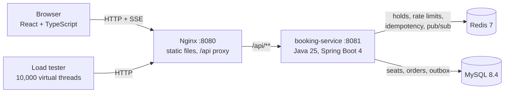
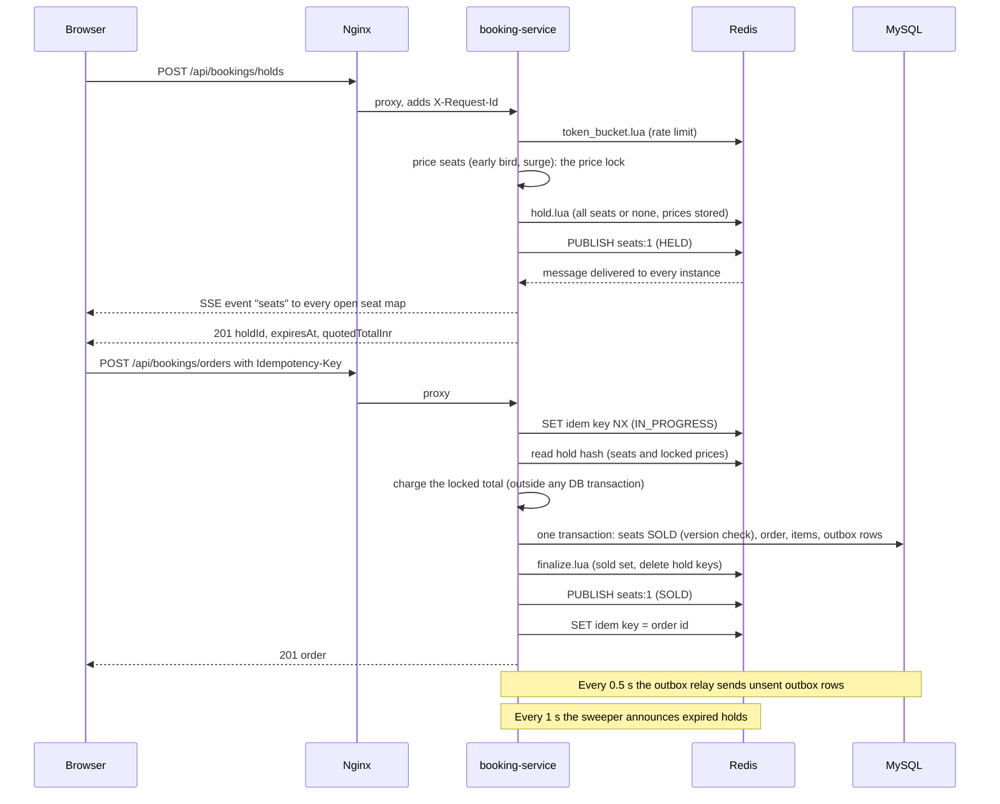

# Surge: the learning guide

This guide explains Surge phase 1 from top to bottom. For every part it answers five questions: what is it, why does Surge need it, where is it in the code, how can I see it working, and what will an interviewer ask about it.

It covers only what is **built** in phase 1. Things that are planned for later phases are listed in [section 6](#6-coming-in-later-phases) and are always marked as planned.

How to use it:

1. Read sections 1 to 3 first. Together they tell the whole story of one booking.
2. Start the stack ([section 10](#10-how-to-run-everything)) and try the "How to see it" commands as you read.
3. Before an interview, reread [section 7](#7-design-decisions-and-trade-offs) (design decisions), [section 8](#8-design-bookmyshow-interview-script) (the BookMyShow script), [section 9](#9-the-numbers-and-how-to-explain-them) (the numbers) and the Q&As of each technology.

Commands in this guide are written for **Git Bash** (or any bash shell). In Windows PowerShell, type `curl.exe` instead of `curl`, and use `.\mvnw.cmd` instead of `./mvnw`.

## Table of contents

1. [What Surge is](#1-what-surge-is)
2. [Architecture](#2-architecture)
3. [Walkthrough: one booking, end to end](#3-walkthrough-one-booking-end-to-end)
4. [Code map](#4-code-map)
5. [Technologies](#5-technologies)
   - 5.1 [Core Java and OOP](#51-core-java-and-oop)
   - 5.2 [Collections](#52-collections)
   - 5.3 [Multithreading](#53-multithreading)
   - 5.4 [Virtual threads](#54-virtual-threads)
   - 5.5 [REST API and OpenAPI](#55-rest-api-and-openapi)
   - 5.6 [Date-Time API](#56-date-time-api)
   - 5.7 [Files](#57-files)
   - 5.8 [Functional programming and Streams](#58-functional-programming-and-streams)
   - 5.9 [Spring Boot](#59-spring-boot)
   - 5.10 [MySQL, Hibernate and Flyway](#510-mysql-hibernate-and-flyway)
   - 5.11 [Redis](#511-redis)
   - 5.12 [Docker and Compose](#512-docker-and-compose)
   - 5.13 [Nginx](#513-nginx)
   - 5.14 [Testing and CI](#514-testing-and-ci)
   - 5.15 [The web app (React)](#515-the-web-app-react)
6. [Coming in later phases](#6-coming-in-later-phases)
7. [Design decisions and trade-offs](#7-design-decisions-and-trade-offs)
8. [Design BookMyShow: interview script](#8-design-bookmyshow-interview-script)
9. [The numbers and how to explain them](#9-the-numbers-and-how-to-explain-them)
10. [How to run everything](#10-how-to-run-everything)
11. [How to run the tests](#11-how-to-run-the-tests)
12. [Troubleshooting](#12-troubleshooting)
13. [Glossary](#13-glossary)

---

## 1. What Surge is

When tickets for a big concert go on sale, thousands of people click "Book" in the same second, but there are only a few hundred seats. Surge is a ticket-booking backend built for that moment.

It has one hard rule: **a seat is never sold twice** (no overselling), even when 10,000 buyers race for 500 seats. It also has to stay responsive, free up seats that people hold but never pay for, and show every buyer a live seat map.

What a user does:

1. Opens an event and sees the seat map.
2. Selects up to 8 seats and clicks **Hold**. The seats are reserved for 5 minutes.
3. Clicks **Pay**. The order is confirmed and the seats become sold.
4. Everyone else looking at the same event sees those seats turn "held", then "sold", live.

What phase 1 contains:

- **booking-service**: one Spring Boot 4 service on Java 25 with all the booking logic.
- **Redis**: takes the rush. Seat holds, rate limits, idempotency keys and live-update messages live here.
- **MySQL**: keeps the truth. Seats, orders and the outbox live here.
- **web**: a small React app, served by Nginx, which also proxies the API.
- **tools/loadtest**: a command-line tool that simulates 10,000 buyers at once.

The measured result: 10,000 buyers for 500 seats, **500 sold, 0 oversold, 0 errors**, twice in a row (run on a laptop; see [section 9](#9-the-numbers-and-how-to-explain-them)).

What phase 1 does **not** do yet: real login (a demo user id is sent in the `X-User-Id` header), real payments (a fake gateway approves everything), and real message brokers (outbox messages are only logged). Admin endpoints are open. It runs one instance of each container.

## 2. Architecture



The key idea in one sentence: **Redis absorbs the rush, MySQL keeps the truth, and MySQL still refuses a double sale even if Redis gets it wrong.**

### Containers

Every published port is bound to `127.0.0.1`, so only your own machine can reach it: Redis has no password and the admin API has no login in phase 1, so neither may be reachable from your network.

| Container | Built from | Port on your machine (127.0.0.1) | Job |
|---|---|---|---|
| `web` | [web/Dockerfile](web/Dockerfile) (Nginx 1.27) | 8080 | Serves the React app, proxies `/api` to booking-service |
| `booking-service` | [booking-service/Dockerfile](booking-service/Dockerfile) (Temurin 25 JRE) | 8081 | All booking logic |
| `mysql` | `mysql:8.4` | 3307 | Durable data |
| `redis` | `redis:7-alpine` | 6379 | Holds, sold-seat sets, rate limits, idempotency keys, pub/sub |
| `loadtest` (profile `loadtest`) | [tools/loadtest/Dockerfile](tools/loadtest/Dockerfile) | none | Runs the 10,000-buyer test, then exits |

All of them are defined in [compose.yaml](compose.yaml).

### What lives in Redis

All key names come from one class, [RedisKeys.java](booking-service/src/main/java/dev/surge/booking/hold/RedisKeys.java).

| Key | Redis type | Holds | Expires |
|---|---|---|---|
| `seat:{eventId}:{seatId}` | string | the hold id that holds this seat | after 5 min |
| `hold:{holdId}` | hash | `userId`, `eventId`, `seats`, `prices` (locked per seat), `expiresAt`, `member` | after 5 min |
| `userhold:{eventId}:{userId}` | string | the user's current hold for this event | after 5 min |
| `holds:expiry` | sorted set | one member per hold (`eventId:holdId:seatIds`), score = expiry time in ms | members removed by the sweeper or at checkout |
| `sold:{eventId}` | set | ids of sold seats (rebuilt from MySQL at startup) | never |
| `idem:{userId}:{key}` | string | `IN_PROGRESS`, then the order id | `IN_PROGRESS` after 120 s; the order id after 24 h |
| `rate:holds:{userId}` | hash | token bucket: `tokens`, `ts` | after 5 s idle |
| `seats:{eventId}` | pub/sub channel | live seat changes as JSON | (messages are not stored) |
| `loadtest:latest` | string | the latest load-test report as JSON | never |

### What lives in MySQL

Created by Flyway from [V1__schema.sql](booking-service/src/main/resources/db/migration/V1__schema.sql) and filled by [V2__seed.sql](booking-service/src/main/resources/db/migration/V2__seed.sql).

| Table | One row per | Important columns and constraints |
|---|---|---|
| `event_ref` | event | `sale_opens_at` (UTC), `zone_id` (venue time zone) |
| `seat` | seat | `status` (`AVAILABLE`/`SOLD`), `version` (optimistic lock), unique `(event_id, row_label, number)` |
| `orders` | purchase | `total_inr` `DECIMAL(12,2)`, unique `(user_id, idempotency_key)` |
| `order_item` | sold seat | **unique `seat_id`** |
| `outbox` | message to send later | `payload` JSON, `published_at` (NULL until sent) |

Seed data: three events in three time zones. Event 1 (Delhi, `Asia/Kolkata`) has 500 seats: rows A to T, 25 seats each, ids 1 to 500. Rows A to D are PLATINUM (₹4999), E to L are GOLD (₹2999), M to T are SILVER (₹1499). Events 2 (Dubai) and 3 (Singapore) have 100 seats each, ids 501 to 600 and 601 to 700. Prices come from [application.yml](booking-service/src/main/resources/application.yml).

## 3. Walkthrough: one booking, end to end

This is the most important section. If you can explain this flow on a whiteboard, you can defend the project.



### Part A: opening the event page

1. The browser opens `/events/1`. [EventPage.tsx](web/src/pages/EventPage.tsx) calls `GET /api/bookings/events/1` and opens a live stream with `new EventSource('/api/bookings/events/1/stream')` ([useSeatStream.ts](web/src/hooks/useSeatStream.ts)).
2. [SeatMapService.detail](booking-service/src/main/java/dev/surge/booking/event/SeatMapService.java) builds the seat map from three sources:
   - seat facts (row, number, tier) from [InventoryCache](booking-service/src/main/java/dev/surge/booking/inventory/InventoryCache.java), an in-memory copy of data that never changes during a sale;
   - which seats are `SOLD`, from MySQL;
   - which seats are `HELD`, from Redis, with one `MGET` over all `seat:{eventId}:{seatId}` keys.
3. [EventController.stream](booking-service/src/main/java/dev/surge/booking/event/EventController.java) registers the browser's connection in [SeatStreamRegistry](booking-service/src/main/java/dev/surge/booking/stream/SeatStreamRegistry.java), which keeps one `SseEmitter` per open page.

### Part B: holding seats

4. The user selects seats and clicks **Hold**. [client.ts](web/src/api/client.ts) sends `POST /api/bookings/holds` with body `{"eventId":1,"seatIds":[3,4]}` and the header `X-User-Id` (a random demo id from [demoUser.ts](web/src/demoUser.ts)).
5. **Nginx** ([nginx.conf](web/nginx.conf)) matches `location /api/` and proxies the request to `booking-service:8081`. It sets `X-Request-Id` to its own `$request_id`.
6. **Request id.** [RequestIdFilter](common/src/main/java/dev/surge/common/web/RequestIdFilter.java) (in the `common` module) keeps that id (or makes a UUID if there is none), puts it in the logging MDC and echoes it in the response header. Any error body will carry it as `requestId`.
7. **Controller.** [HoldController](booking-service/src/main/java/dev/surge/booking/hold/HoldController.java) runs.
   - [CurrentUserArgumentResolver](booking-service/src/main/java/dev/surge/booking/web/CurrentUserArgumentResolver.java) reads `X-User-Id` and checks it against `^[A-Za-z0-9_-]{1,64}$`. Missing or invalid: **401** `missing-user`.
   - `@Valid` checks [HoldRequest](booking-service/src/main/java/dev/surge/booking/hold/HoldRequest.java): event id present, 1 to 8 seat ids. Otherwise **400** `validation-failed`.
8. **Rate limit.** [RateLimiter](booking-service/src/main/java/dev/surge/booking/ratelimit/RateLimiter.java) runs [token_bucket.lua](booking-service/src/main/resources/redis/token_bucket.lua) on `rate:holds:{userId}`: a bucket of 10 tokens that refills at 2 per second. Empty bucket: **429** `rate-limited` with a `Retry-After` header.
9. **Checks in Java.** [HoldService](booking-service/src/main/java/dev/surge/booking/hold/HoldService.java):
   - unknown event: **404** `event-not-found`;
   - a seat that is not in this event, or the same seat twice: **400** `invalid-seats`;
   - the current time (from the injected `Clock`) is before `saleOpensAt`: **409** `sale-not-open`.

   Then it **prices every seat now** (the price lock). For each seat, [PriceCalculator](booking-service/src/main/java/dev/surge/booking/pricing/PriceCalculator.java) starts from the tier price and applies the rules in order:
   - [EarlyBirdRule](booking-service/src/main/java/dev/surge/booking/pricing/EarlyBirdRule.java): 10% off in the first 15 minutes after the sale opens;
   - [SurgeRule](booking-service/src/main/java/dev/surge/booking/pricing/SurgeRule.java): 20% more when fewer than 20% of seats are left (available = total seats minus `SCARD sold:{eventId}`);
   - then it rounds to whole rupees (`HALF_UP`). Example: a PLATINUM seat in the early-bird window costs 4999 x 0.90 = 4499.10, so ₹4499.

   The time is read once from the `Clock`, so the sale-open check and the price agree.
10. **The atomic hold.** [HoldStore.tryHold](booking-service/src/main/java/dev/surge/booking/hold/HoldStore.java) creates a hold id (a UUID) and runs [hold.lua](booking-service/src/main/resources/redis/hold.lua) with the seat ids and their prices. Redis runs the whole script without running any other command in between:
    1. If `userhold:{eventId}:{userId}` exists, the user already holds seats for this event: return `HOLD_EXISTS` (**409** `hold-exists`, with the existing `holdId`).
    2. For every seat: if it is in `sold:{eventId}` or its `seat:` key exists, it is taken. If any are taken, return `TAKEN` and the taken ids. Nothing is held (**409** `seat-taken`, with `seatIds`).
    3. Otherwise set every `seat:{eventId}:{seatId}` to the hold id with a 5-minute expiry, write the `hold:{holdId}` hash (including the locked `prices`), set `userhold:{eventId}:{userId}`, and add the hold to the `holds:expiry` sorted set. A hold therefore never exists without its prices.
11. The script's answer becomes a [HoldResult](booking-service/src/main/java/dev/surge/booking/hold/HoldResult.java), a sealed interface with three records. `HoldService` handles it with a pattern-matching `switch`.
12. **Live update.** [SeatEventPublisher](booking-service/src/main/java/dev/surge/booking/stream/SeatEventPublisher.java) publishes `{"eventId":1,"seatIds":[3,4],"state":"HELD"}` on the Redis channel `seats:1`. Every instance of booking-service is subscribed to `seats:*` ([RedisListenerConfig](booking-service/src/main/java/dev/surge/booking/config/RedisListenerConfig.java)). [SeatChannelListener](booking-service/src/main/java/dev/surge/booking/stream/SeatChannelListener.java) receives it and `SeatStreamRegistry.broadcast` sends an SSE event named `seats` to every open page for event 1. Other users' seat maps turn those seats "held".
13. The response is **201** `{"holdId":"...","eventId":1,"seatIds":[3,4],"expiresAt":"...","quotedTotalInr":9998.00,"lines":[{"seatId":3,"priceInr":4999.00},{"seatId":4,"priceInr":4999.00}]}` (two PLATINUM seats, no early bird or surge). The page starts a 5-minute [Countdown](web/src/components/Countdown.tsx), shows **Pay ₹9998** (the quote, which is exactly what checkout will charge) and creates an idempotency key with `crypto.randomUUID()` for the payment.

MySQL was not touched in steps 7 to 13. (The first request for an event loads its seat facts into `InventoryCache`; after that they come from memory.) This is how the rush is absorbed.

### Part C: paying

14. The user clicks **Pay**. The browser sends `POST /api/bookings/orders` with body `{"holdId":"..."}` and two headers: `X-User-Id` and `Idempotency-Key`. [OrderController](booking-service/src/main/java/dev/surge/booking/order/OrderController.java) rejects a missing, blank or over-64-character key with **400** `missing-idempotency-key`.
15. **Idempotency.** [CheckoutService.checkout](booking-service/src/main/java/dev/surge/booking/order/CheckoutService.java) calls [IdempotencyStore.begin](booking-service/src/main/java/dev/surge/booking/order/IdempotencyStore.java), which does `SET idem:{userId}:{key} IN_PROGRESS NX` with a 120-second expiry (short, so a crashed request frees its key soon).
    - Key already holds an order id and that order exists: this is a repeat. Return that order with **200** and the header `Idempotent-Replayed: true`. Nothing is charged again.
    - Key holds an order id but the order is gone (an admin reset deletes orders and keeps keys): the id is stale. A small Lua script swaps it for `IN_PROGRESS` only if the key still holds that id (compare-and-set), and the request continues as a new one.
    - Key holds `IN_PROGRESS`: the same request is still running. **409** `request-in-progress`.
    - Key claimed: continue.
16. **Database fallback.** Redis might have lost the key (restart, flush). So the service also looks in MySQL for an order with this `(user_id, idempotency_key)`. If one exists, it replays it.
17. **Load the hold.** The service reads the time once from the `Clock` (for `createdAt`), reads the `hold:{holdId}` hash and checks it belongs to this user. Missing, expired (Redis already deleted it) or someone else's: **404** `hold-not-found`.
18. **Price: the locked quote.** Checkout does **not** price again. It charges the per-seat prices stored in the hold hash in step 10, so the amount on the Pay button is exactly the amount charged, even if the early-bird window closed or surge started in the meantime. This is a "price lock", as real ticketing sites do while you hold seats.
19. **Payment.** [PaymentGateway.charge](booking-service/src/main/java/dev/surge/booking/payment/PaymentGateway.java) is called **before** any database transaction starts. Phase 1 uses [FakePaymentGateway](booking-service/src/main/java/dev/surge/booking/payment/FakePaymentGateway.java), which approves everything (its failure rate is `0.0` in `application.yml`). If it declines: **402** `payment-failed`. The hold stays, and the idempotency key is released so the user can retry.
20. **The one database transaction.** [OrderWriter.confirm](booking-service/src/main/java/dev/surge/booking/order/OrderWriter.java) is the only write transaction in checkout (the order lookups in [OrderReader](booking-service/src/main/java/dev/surge/booking/order/OrderReader.java) are short read-only transactions):
    1. Load the seats. Each must be `AVAILABLE` and belong to this event.
    2. Set them `SOLD` and flush. Hibernate's update includes `WHERE id = ? AND version = ?` because [Seat](booking-service/src/main/java/dev/surge/booking/event/Seat.java) has a `@Version` field. If another checkout changed the row first, zero rows match and Hibernate throws.
    3. Insert the `orders` row and one `order_item` per seat. `order_item.seat_id` is unique.
    4. Insert two `outbox` rows: `OrderConfirmed` (destination label `kafka:orders.v1`) and `TicketRequested` (`rabbit:tickets`). The payloads are the records in [common/messaging](common/src/main/java/dev/surge/common/messaging/).
    5. Commit. All of it is saved, or none of it.
21. **Losing the race.** If the version check or a unique constraint fails, `OrderWriter` turns it into a `SeatConflictException`. `CheckoutService` refunds the payment, releases the hold and returns **409** `seat-taken`. Releasing runs [release.lua](booking-service/src/main/resources/redis/release.lua): the same compare-and-delete clean-up as `finalize.lua`, but nothing is added to the sold set; open seat maps are then told the MySQL truth (sold seats `SOLD`, the rest `AVAILABLE`). So the buyer can pick other seats at once instead of waiting 5 minutes, and the web page drops the hold and reloads the map. (If the unique violation was on the idempotency key, the order already exists, so it replays that order instead.) If any other error happens, it first checks whether the commit actually succeeded before refunding.
22. **After the commit.** The database is now the source of truth, so nothing after this point may fail the request:
    - [finalize.lua](booking-service/src/main/resources/redis/finalize.lua) adds the seats to `sold:{eventId}`, deletes the seat keys that still belong to this hold, deletes the hold hash, deletes the user's `userhold` key if it still points to this hold, and removes the hold from `holds:expiry`;
    - a `SOLD` change is published, so every seat map shows the seats as sold;
    - `IdempotencyStore.complete` stores the order id under the key for 24 hours.
    Errors in these steps are logged, not thrown.
23. The response is **201** with the order. The page shows "Booked! Order #… — ₹…".

### Part D: after the response

24. **Outbox relay.** Every 0.5 s, [OutboxPoller](booking-service/src/main/java/dev/surge/booking/outbox/OutboxPoller.java) (the scheduled job) calls `relayBatch()` on [OutboxRelay](booking-service/src/main/java/dev/surge/booking/outbox/OutboxRelay.java). In one transaction, that method runs `SELECT ... WHERE published_at IS NULL ORDER BY id LIMIT 100 FOR UPDATE SKIP LOCKED` ([OutboxRepository](booking-service/src/main/java/dev/surge/booking/outbox/OutboxRepository.java)), hands each row to the [OutboxPublisher](booking-service/src/main/java/dev/surge/booking/outbox/OutboxPublisher.java) and sets `published_at`. In phase 1 the publisher is [LoggingOutboxPublisher](booking-service/src/main/java/dev/surge/booking/outbox/LoggingOutboxPublisher.java): it writes a log line. Kafka and RabbitMQ publishers are planned for phase 2.
25. **If the user never pays.** After 5 minutes Redis deletes the seat keys, the hold hash and the `userhold` key by itself. Every second, [HoldExpirySweeper](booking-service/src/main/java/dev/surge/booking/stream/HoldExpirySweeper.java) reads the `holds:expiry` members whose time has passed and runs [sweep.lua](booking-service/src/main/resources/redis/sweep.lua) for each. The script removes the member first (`ZREM`); if it was already gone, another instance or a checkout handled it, so it stops. Otherwise it returns the seats that are really free (key gone, not sold), and the sweeper publishes them as `AVAILABLE` and increments the `holds_expired_total` metric.

## 4. Code map

Paths below `booking/` mean [booking-service/src/main/java/dev/surge/booking/](booking-service/src/main/java/dev/surge/booking/).

| Where | What is in it |
|---|---|
| [BookingApplication.java](booking-service/src/main/java/dev/surge/booking/BookingApplication.java) | `main`, `@EnableScheduling` |
| [booking/hold/](booking-service/src/main/java/dev/surge/booking/hold/) | `HoldController`, `HoldService`, `HoldStore` (Redis), `HoldResult` (sealed), `RedisKeys` |
| [booking/order/](booking-service/src/main/java/dev/surge/booking/order/) | `OrderController`, `CheckoutService` (orchestration), `IdempotencyStore`, `OrderWriter` (the transaction), `OrderReader`, `Order` and `OrderItem` entities |
| [booking/event/](booking-service/src/main/java/dev/surge/booking/event/) | `EventController` (list, detail, SSE stream), `SeatMapService`, `Seat` and `EventRef` entities, enums |
| [booking/inventory/](booking-service/src/main/java/dev/surge/booking/inventory/) | `InventoryCache` (seat facts in memory), `SoldSeatsWarmer` (rebuilds sold sets at startup) |
| [booking/pricing/](booking-service/src/main/java/dev/surge/booking/pricing/) | `PricingRule`, `EarlyBirdRule`, `SurgeRule`, `PriceCalculator`, `TierPrices` |
| [booking/payment/](booking-service/src/main/java/dev/surge/booking/payment/) | `PaymentGateway` interface, `FakePaymentGateway` |
| [booking/outbox/](booking-service/src/main/java/dev/surge/booking/outbox/) | `OutboxPoller` (scheduled entry point), `OutboxRelay` (transactional batch), `OutboxRepository`, `OutboxPublisher`, `LoggingOutboxPublisher`, `OutboxMessage` entity |
| [booking/stream/](booking-service/src/main/java/dev/surge/booking/stream/) | `SeatEventPublisher`, `SeatChannelListener`, `SeatStreamRegistry` (SSE), `HoldExpirySweeper` |
| [booking/ratelimit/](booking-service/src/main/java/dev/surge/booking/ratelimit/) | `RateLimiter`, `RateLimitProperties` |
| [booking/admin/](booking-service/src/main/java/dev/surge/booking/admin/) | `AdminController` (integrity, reset, load-test report), `EventResetService` |
| [booking/error/](booking-service/src/main/java/dev/surge/booking/error/) | `ApiExceptionHandler` and one exception class per error |
| [booking/web/](booking-service/src/main/java/dev/surge/booking/web/) | `@CurrentUser` annotation and its resolver |
| [booking/config/](booking-service/src/main/java/dev/surge/booking/config/) | `ClockConfig`, `RedisScripts`, `RedisListenerConfig` |
| [resources/redis/](booking-service/src/main/resources/redis/) | The four Lua scripts |
| [resources/db/migration/](booking-service/src/main/resources/db/migration/) | Flyway migrations `V1__schema.sql`, `V2__seed.sql` |
| [application.yml](booking-service/src/main/resources/application.yml) | All configuration |
| [common/](common/src/main/java/dev/surge/common/) | `RequestIdFilter`, `Problems`, message records, auto-configuration |
| [tools/loadtest/](tools/loadtest/src/main/java/dev/surge/loadtest/) | `LoadTestMain`, `Buyer`, `BookingApi`, `SeatPicker`, `LatencyStats`, `ReportWriter` |
| [web/src/](web/src/) | React app: pages, components, the SSE hook, the API client |
| [compose.yaml](compose.yaml), the three Dockerfiles, [nginx.conf](web/nginx.conf) | How it all runs |
| [.github/workflows/ci.yml](.github/workflows/ci.yml) | CI |

---

## 5. Technologies

Each section follows the same pattern: what it is, why Surge needs it, where it is in the code, how to see it, and interview questions with answers.

### 5.1 Core Java and OOP

**What it is.** The Java language and object-oriented design: classes, interfaces, encapsulation, polymorphism. Modern Java (15 to 21) added records, sealed types, pattern-matching `switch` and text blocks. Surge uses all of them.

**Why Surge needs it.** The booking rules are plain Java objects. Clean design keeps them easy to test, and it lets later phases swap parts (for example, a real payment service) without changing the code that calls them.

**Where it is in the code.**

| Idea | Where |
|---|---|
| Interface with a swappable implementation | [PaymentGateway](booking-service/src/main/java/dev/surge/booking/payment/PaymentGateway.java) and [FakePaymentGateway](booking-service/src/main/java/dev/surge/booking/payment/FakePaymentGateway.java); [OutboxPublisher](booking-service/src/main/java/dev/surge/booking/outbox/OutboxPublisher.java) and [LoggingOutboxPublisher](booking-service/src/main/java/dev/surge/booking/outbox/LoggingOutboxPublisher.java) |
| Strategy pattern | [PricingRule](booking-service/src/main/java/dev/surge/booking/pricing/PricingRule.java), [EarlyBirdRule](booking-service/src/main/java/dev/surge/booking/pricing/EarlyBirdRule.java), [SurgeRule](booking-service/src/main/java/dev/surge/booking/pricing/SurgeRule.java), applied by [PriceCalculator](booking-service/src/main/java/dev/surge/booking/pricing/PriceCalculator.java) |
| Sealed interface + records + pattern-matching `switch` | [HoldResult](booking-service/src/main/java/dev/surge/booking/hold/HoldResult.java), handled in [HoldService](booking-service/src/main/java/dev/surge/booking/hold/HoldService.java) |
| Records as immutable data carriers | [HoldRequest](booking-service/src/main/java/dev/surge/booking/hold/HoldRequest.java), [OrderResponse](booking-service/src/main/java/dev/surge/booking/order/OrderResponse.java), [PricingContext](booking-service/src/main/java/dev/surge/booking/pricing/PricingContext.java), [ActiveHold](booking-service/src/main/java/dev/surge/booking/hold/ActiveHold.java) and more |
| Record with a compact constructor (defensive copy) | [EventInventory](booking-service/src/main/java/dev/surge/booking/inventory/EventInventory.java) |
| Enums | [Tier](booking-service/src/main/java/dev/surge/booking/event/Tier.java), [SeatStatus](booking-service/src/main/java/dev/surge/booking/event/SeatStatus.java) (stored), [SeatState](booking-service/src/main/java/dev/surge/booking/event/SeatState.java) (shown; adds `HELD`), [OrderStatus](booking-service/src/main/java/dev/surge/booking/order/OrderStatus.java) |
| Encapsulation of a parent and its children | `Order.addItem` sets both sides of the relation ([Order.java](booking-service/src/main/java/dev/surge/booking/order/Order.java)) |
| Custom unchecked exceptions mapped to HTTP | [booking/error/](booking-service/src/main/java/dev/surge/booking/error/) and [ApiExceptionHandler](booking-service/src/main/java/dev/surge/booking/error/ApiExceptionHandler.java) |
| Utility classes: `final` with a private constructor | [RedisKeys](booking-service/src/main/java/dev/surge/booking/hold/RedisKeys.java), [Problems](common/src/main/java/dev/surge/common/web/Problems.java), [ReportWriter](tools/loadtest/src/main/java/dev/surge/loadtest/ReportWriter.java) |
| `BigDecimal` for money | [PriceCalculator](booking-service/src/main/java/dev/surge/booking/pricing/PriceCalculator.java), [TierPrices](booking-service/src/main/java/dev/surge/booking/pricing/TierPrices.java), [HoldService](booking-service/src/main/java/dev/surge/booking/hold/HoldService.java) (prices the hold), [CheckoutService](booking-service/src/main/java/dev/surge/booking/order/CheckoutService.java) (sums the locked prices) |
| Text blocks | `ReportWriter.markdown`, `LoadTestConfig.USAGE` ([LoadTestConfig.java](tools/loadtest/src/main/java/dev/surge/loadtest/LoadTestConfig.java)) |
| A custom annotation | [CurrentUser](booking-service/src/main/java/dev/surge/booking/web/CurrentUser.java) |

Note the two seat enums. `SeatStatus` (`AVAILABLE`, `SOLD`) is what MySQL stores. `SeatState` (`AVAILABLE`, `HELD`, `SOLD`) is what the API shows. `HELD` exists only in Redis, so it never reaches the database.

**How to see it.** Run the pricing tests (no Docker needed):

```bash
./mvnw -B -pl booking-service -am test -Dtest=PriceCalculatorTest -Dsurefire.failIfNoSpecifiedTests=false
```

**Interview questions.**

**Q1. Why is `HoldResult` a sealed interface?**
The hold script has exactly three outcomes: held, seats taken, or the user already holds seats. `sealed ... permits Held, SeatsTaken, HoldExists` tells the compiler that list is complete. The `switch` in `HoldService` then needs no `default` branch, and if someone adds a fourth outcome, the code stops compiling until they handle it. It turns a forgotten case into a compile error instead of a runtime bug.

**Q2. Why `BigDecimal` and not `double` for prices?**
`double` is binary floating point and cannot store most decimal fractions exactly, so money sums drift (0.1 + 0.2 is not 0.3). `BigDecimal` does exact decimal arithmetic, and the rounding is explicit: `PriceCalculator` rounds to whole rupees with `RoundingMode.HALF_UP`. The database column is `DECIMAL(12,2)` to match.

**Q3. Which design pattern is the pricing?**
Strategy. Each rule implements one interface, `PricingRule`, and `PriceCalculator` applies all of them in order, each one taking the previous price. To add a rule you write a new `@Component` class; you do not edit `PriceCalculator` (open/closed principle). The order comes from `@Order(1)` and `@Order(2)`.

**Q4. Why depend on a `PaymentGateway` interface?**
`CheckoutService` only knows the interface. Phase 1 plugs in a fake; phase 2 plans an HTTP client for a payment service. Tests wrap the gateway in a Mockito spy to simulate a decline and to check that a refund happened. This is dependency inversion: high-level code depends on an abstraction, not on a concrete class.

**Q5. When do you use a record, and why are the JPA entities not records?**
Records are for immutable data: request and response bodies, messages, results. You get the constructor, accessors, `equals`, `hashCode` and `toString` for free. JPA entities like `Seat` and `Order` must be mutable (Hibernate changes `status` and `version`), need a no-argument constructor (here `protected`), and may be proxied by Hibernate, so they stay normal classes.

### 5.2 Collections

**What it is.** The `java.util` data structures (lists, sets, maps) and their thread-safe versions in `java.util.concurrent`.

**Why Surge needs it.** The right structure makes code simpler and safe under concurrency. Surge has shared in-memory state (a cache, a list of open SSE connections) read by many request threads at the same time.

**Where it is in the code.**

| Collection | Where | Why this one |
|---|---|---|
| `EnumMap<Tier, BigDecimal>` | [TierPrices](booking-service/src/main/java/dev/surge/booking/pricing/TierPrices.java) | Keys are an enum: compact, fast, type-safe |
| `ConcurrentHashMap` | [InventoryCache](booking-service/src/main/java/dev/surge/booking/inventory/InventoryCache.java), [SeatStreamRegistry](booking-service/src/main/java/dev/surge/booking/stream/SeatStreamRegistry.java) | Many threads read and write at once |
| `CopyOnWriteArrayList` | [SeatStreamRegistry](booking-service/src/main/java/dev/surge/booking/stream/SeatStreamRegistry.java) | Iterated on every broadcast, changed rarely |
| `LinkedHashMap` | [EventInventory](booking-service/src/main/java/dev/surge/booking/inventory/EventInventory.java), `CheckoutService.priceSeats` | Keeps seats in display order |
| `HashSet` + `LinkedHashSet` | [HoldService](booking-service/src/main/java/dev/surge/booking/hold/HoldService.java) | Spot duplicate seat ids; report offenders in request order |
| `List.of`, `List.copyOf`, `Stream.toList()`, `Collections.unmodifiableMap` | everywhere | Immutable results that nobody can change by accident |

**How to see it.** Open two tabs on the same event. Each tab's stream is one `SseEmitter` in the `CopyOnWriteArrayList` for that event. A hold in one tab is broadcast to both.

**Interview questions.**

**Q1. Why `ConcurrentHashMap` in `InventoryCache`?**
Thousands of request threads call `get(eventId)` at the same time. A plain `HashMap` is not safe for concurrent writes and can corrupt itself. `ConcurrentHashMap` allows concurrent reads without locking and locks only a small part of the map on writes. `computeIfAbsent` loads an event's seats once and stores the result atomically.

**Q2. Why a `CopyOnWriteArrayList` for SSE connections?**
The list is read far more often than it changes: every seat change and every 20-second heartbeat walks it, while it changes only when a page opens or closes. Copy-on-write makes a fresh copy on each change, so readers iterate a stable snapshot with no locks and no `ConcurrentModificationException`.

**Q3. `HashMap` vs `LinkedHashMap` vs `TreeMap`?**
`HashMap` has no order. `LinkedHashMap` keeps insertion order; Surge uses it because the database already returns seats sorted by row and number, and that order must survive. `TreeMap` sorts by key in O(log n); Surge does not need it because the data arrives sorted.

**Q4. Why does `EventInventory` copy the map in its constructor?**
The record is cached and shared by every thread. The compact constructor wraps a copy in `Collections.unmodifiableMap`, so neither the caller (who might change the original map later) nor any reader can change the cached data. Immutable shared data needs no locks.

**Q5. Why `EnumMap` for tier prices?**
The keys are a fixed enum. `EnumMap` is backed by an array indexed by the enum's ordinal, so it is smaller and faster than a `HashMap`, keeps enum order, and rejects keys of the wrong type.

### 5.3 Multithreading

**What it is.** Running work at the same time on several threads, and keeping shared data correct while doing it.

**Why Surge needs it.** A sale is many requests at once, plus background jobs (outbox relay, hold-expiry sweeper, SSE heartbeat). The load tester also needs thousands of buyers running at the same moment.

**Where it is in the code.**

| Tool | Where |
|---|---|
| `CountDownLatch` as a start gate | [LoadTestMain](tools/loadtest/src/main/java/dev/surge/loadtest/LoadTestMain.java), [Buyer](tools/loadtest/src/main/java/dev/surge/loadtest/Buyer.java) (`startGate.await()`), [ConcurrentBookingTest](booking-service/src/test/java/dev/surge/booking/order/ConcurrentBookingTest.java) |
| `ExecutorService` + `Future` | `LoadTestMain` submits 10,000 `Buyer` tasks and collects results with `f.get()` |
| `@Scheduled` background jobs | [OutboxPoller.poll](booking-service/src/main/java/dev/surge/booking/outbox/OutboxPoller.java) (every 0.5 s), `HoldExpirySweeper.scheduledSweep` (every 1 s), `SeatStreamRegistry.heartbeat` (every 20 s); enabled by `@EnableScheduling` in [BookingApplication](booking-service/src/main/java/dev/surge/booking/BookingApplication.java) |
| Thread-safe collections | `ConcurrentHashMap`, `CopyOnWriteArrayList` (see 5.2) |
| `ThreadLocalRandom` | [FakePaymentGateway](booking-service/src/main/java/dev/surge/booking/payment/FakePaymentGateway.java), `ConcurrentBookingTest` |
| Atomicity outside the JVM | Redis Lua scripts and MySQL transactions (sections 5.10 and 5.11) |

The main lesson: **Java locks protect one JVM only.** Two instances of booking-service behind Nginx would not see each other's `synchronized` blocks. So Surge puts the "check and reserve" step in Redis (one script runs at a time) and the "sell" step in MySQL (row locks and version checks). The booking code has no `synchronized` blocks at all.

**How to see it.** Run the concurrency test (needs Docker):

```bash
./mvnw -B -pl booking-service -am test -Dtest=ConcurrentBookingTest -Dsurefire.failIfNoSpecifiedTests=false
```

Look for the log line `Concurrency proof: 2000 buyers, 100 bought, ... ms`.

**Interview questions.**

**Q1. Why does the load tester use a `CountDownLatch`?**
To make all buyers start at the same instant, like a real sale opening. All 10,000 tasks are submitted first and each one waits on `startGate.await()`. Then a single `countDown()` releases them together. Without the gate, early buyers would finish before late ones started, and there would be much less contention to test.

**Q2. Why not use `synchronized` to stop double booking?**
It only works inside one JVM. With two instances, two requests for the same seat could run in different JVMs at the same time. It also makes threads wait in line. Surge uses a Redis Lua script, which is atomic for every instance that talks to that Redis, and the database version check as a backup.

**Q3. What race condition does Surge prevent, exactly?**
"Check then act". Two buyers both ask "is seat 42 free?", both hear "yes", and both reserve it. Surge removes the gap between the check and the write: in `hold.lua` the check and the reservation happen in one atomic script, and in MySQL the `UPDATE ... WHERE version = ?` checks and writes in one statement.

**Q4. What happens if a scheduled job throws an exception?**
`OutboxPoller.poll` and `HoldExpirySweeper.scheduledSweep` catch `RuntimeException` and log a warning (`WARN`). That run is skipped and the next run tries again, for example after Redis or MySQL comes back. The relay also stops a batch at the first failed message and keeps the rest for the next poll, so messages stay in order.

**Q5. `fixedDelay` or `fixedRate`?**
`fixedDelay` waits the given time after the previous run finishes, so runs never overlap. The outbox relay and the sweeper use it. `fixedRate` starts a run every N milliseconds regardless; the SSE heartbeat uses it because it only needs a rough beat.

### 5.4 Virtual threads

**What it is.** Since Java 21, the JVM can run millions of cheap "virtual" threads on a few operating-system threads (called carrier threads). When a virtual thread waits for I/O (an HTTP call, a Redis reply, a database query), the JVM takes it off its carrier and runs another virtual thread there. You write normal blocking code and still handle a huge number of concurrent requests.

**Why Surge needs it.** In a flash sale, thousands of requests arrive together and spend most of their time waiting on Redis or MySQL. Tomcat's classic pool of 200 platform threads would make the rest queue up. With virtual threads, each request gets its own thread, and a waiting thread costs very little. The load tester needs 10,000 buyers running at once: 10,000 virtual threads are cheap, 10,000 platform threads are not.

**Where it is in the code.**

| What | Where |
|---|---|
| `spring.threads.virtual.enabled: true`, so Tomcat runs each request on a virtual thread | [application.yml](booking-service/src/main/resources/application.yml) |
| `server.tomcat.max-connections: 20000` and `accept-count: 1000`, so Tomcat accepts the burst | [application.yml](booking-service/src/main/resources/application.yml) |
| `Executors.newVirtualThreadPerTaskExecutor()` | [LoadTestMain](tools/loadtest/src/main/java/dev/surge/loadtest/LoadTestMain.java) (one per buyer), [BookingApi](tools/loadtest/src/main/java/dev/surge/loadtest/BookingApi.java) (the `HttpClient`'s executor), [ConcurrentBookingTest](booking-service/src/test/java/dev/surge/booking/order/ConcurrentBookingTest.java) |

**Why Java 25 matters here (JEP 491).** Up to JDK 23, a virtual thread that blocked while inside a `synchronized` block stayed "pinned" to its carrier thread, so that carrier could not run anything else. Many libraries (drivers, pools, logging) use `synchronized`, so under load pinning could use up every carrier and stall the app. JDK 24 shipped JEP 491, which lets virtual threads release their carrier even inside `synchronized`. Surge runs on Java 25, the LTS release after that fix, so this problem is gone.

**The limit to remember.** Virtual threads do not create database connections. The Hikari pool has 30 (`maximum-pool-size: 30`). If 10,000 requests needed MySQL at once, almost all of them would wait for a connection (up to the 10 s `connection-timeout`). That is why holds use only Redis, and only buyers who already hold a seat ever reach MySQL. Virtual threads make waiting cheap; they do not make the database bigger.

**How to see it.** Run the load test ([section 10](#10-how-to-run-everything)), or the concurrency test above, which runs 2,000 buyers on virtual threads in a few seconds. You can also compare `jvm_threads_live_threads` in http://localhost:8081/actuator/prometheus: that metric counts platform threads only, so it stays small even when thousands of requests are in flight.

**Interview questions.**

**Q1. What is the difference between a virtual thread and a platform thread?**
A platform thread is a wrapper around an OS thread: about a megabyte of stack reserved up front, and creating thousands is expensive. A virtual thread is a JVM object whose stack lives on the heap and grows as needed. The JVM mounts it on a carrier thread to run and unmounts it while it waits. Millions can exist.

**Q2. Why virtual threads and not reactive programming (WebFlux)?**
Both handle many waiting requests with few OS threads. Virtual threads let Surge keep plain blocking code: JPA, JDBC, `RedisTemplate`, normal stack traces, normal debugging. JDBC is blocking anyway, so a reactive stack would need a different database driver. For I/O-bound work like this, virtual threads give similar scalability with simpler code.

**Q3. What is pinning, and what changed in JDK 24?**
Pinning is when a virtual thread cannot unmount from its carrier while it blocks. Before JDK 24 this happened inside `synchronized` blocks (and still happens in native code). JEP 491 in JDK 24 removed the `synchronized` case. Surge runs on Java 25 and has no `synchronized` blocks of its own.

**Q4. If threads are cheap now, what still limits checkout?**
The database connection pool (30 connections) and the database itself. Virtual threads move the bottleneck; they do not remove it. Surge's design keeps the flood away from MySQL: holds are Redis-only, and only buyers with a hold reach the single checkout transaction.

**Q5. Should you put virtual threads in a pool?**
No. They are meant to be created per task (`newVirtualThreadPerTaskExecutor`). If you need to limit how many tasks do something at once, limit the resource (a connection pool, a `Semaphore`), not the threads.

### 5.5 REST API and OpenAPI

**What it is.** REST models the system as resources (events, holds, orders) handled with HTTP methods and status codes. OpenAPI is a standard, machine-readable description of an API; Swagger UI turns it into an interactive web page.

**Why Surge needs it.** The browser and the load tester talk to booking-service over HTTP. Clear status codes let each client react correctly: on `409 seat-taken` pick another seat, on `429` wait for `Retry-After`, on a replayed `200` show the existing order.

**Where it is in the code.**

| What | Where |
|---|---|
| Controllers | [EventController](booking-service/src/main/java/dev/surge/booking/event/EventController.java), [HoldController](booking-service/src/main/java/dev/surge/booking/hold/HoldController.java), [OrderController](booking-service/src/main/java/dev/surge/booking/order/OrderController.java), [AdminController](booking-service/src/main/java/dev/surge/booking/admin/AdminController.java) |
| Input validation | `@NotNull`, `@NotEmpty`, `@Size(max = 8)` on [HoldRequest](booking-service/src/main/java/dev/surge/booking/hold/HoldRequest.java), `@NotBlank` on [CheckoutRequest](booking-service/src/main/java/dev/surge/booking/order/CheckoutRequest.java) |
| Errors as Problem Details | [ApiExceptionHandler](booking-service/src/main/java/dev/surge/booking/error/ApiExceptionHandler.java), [Problems](common/src/main/java/dev/surge/common/web/Problems.java) |
| Swagger UI and the OpenAPI spec | springdoc, configured under `springdoc:` in [application.yml](booking-service/src/main/resources/application.yml) |

The status codes Surge uses:

| Status | Problem `type` ends with | When |
|---|---|---|
| 201 | | Hold created; order created |
| 200 + `Idempotent-Replayed: true` | | Same `Idempotency-Key` sent again; returns the same order |
| 204 | | Admin reset; report upload |
| 400 | `validation-failed`, `invalid-seats`, `missing-idempotency-key`, `malformed-request` | Bad input, including a value of the wrong type (`/events/abc`, `?opensInSeconds=abc`) |
| 401 | `missing-user` | Missing or invalid `X-User-Id` |
| 402 | `payment-failed` | Payment declined |
| 404 | `event-not-found`, `hold-not-found`, `order-not-found`, `report-not-found`; `not-found` for an unknown route | Not there (or not yours) |
| 405 | `method-not-allowed` | Wrong HTTP method for the path (the `Allow` header lists the right ones) |
| 409 | `seat-taken`, `hold-exists`, `sale-not-open`, `request-in-progress` | Conflicts with the current state |
| 413 | `report-too-large` | Report over 256 KB |
| 415 | `unsupported-media-type` | `Content-Type` is not JSON |
| 429 | `rate-limited` | Too many hold attempts; see `Retry-After` |
| 500 | `internal-error` | A bug or an infrastructure failure; logged in full, but the body never contains the exception message |

`ApiExceptionHandler` extends Spring's `ResponseEntityExceptionHandler`. Surge's own exceptions have explicit handlers with the slugs above. Errors that Spring MVC raises by itself (unknown route, wrong method, bad parameter) are built by the base class and pass through one overridden method, `createResponseEntity`, which gives them a Surge `type` derived from the status, the `requestId` and `application/problem+json`. So every error has the same shape, whoever raised it. `ApiErrorsTest` checks the 400, 404, 405 and 500 cases.

A real error body, taken from the running stack:

```json
{"detail":"Seats already taken: [601]","instance":"/api/bookings/holds","status":409,
 "title":"Seat taken","type":"https://surge.dev/problems/seat-taken",
 "requestId":"5ef975b3417e430f841520b6f83f04a1","seatIds":[601]}
```

**How to see it.** Open Swagger UI at http://localhost:8080/api/bookings/docs. Or hold and buy two seats with curl:

```bash
HOLD=$(curl -s -X POST localhost:8080/api/bookings/holds \
  -H "X-User-Id: alice" -H "Content-Type: application/json" \
  -d '{"eventId":1,"seatIds":[3,4]}' | sed -E 's/.*"holdId":"([^"]+)".*/\1/')
echo "$HOLD"

curl -s -i -X POST localhost:8080/api/bookings/orders \
  -H "X-User-Id: alice" -H "Idempotency-Key: try-1" -H "Content-Type: application/json" \
  -d "{\"holdId\":\"$HOLD\"}"
```

The first checkout returns `201`. Run the last command again: you get `200`, the header `Idempotent-Replayed: true` and the same order. (If event 1 is sold out after a load test, reset it first; see [section 10](#10-how-to-run-everything).)

**Interview questions.**

**Q1. Why does a repeated checkout return 200 and not 201?**
`201 Created` means this request created something. A replay creates nothing; it returns the order the first request created. The `Idempotent-Replayed: true` header tells the client so. The body is byte-for-byte the same as the first response; `CheckoutTest.replayReturnsSameOrder` checks that.

**Q2. Why 409 for "seat taken" and not 400?**
`400` means the request itself is wrong. Here the request is fine; it conflicts with the current state of the seat. `409 Conflict` says exactly that, and the body lists the conflicting `seatIds` so the client can update its seat map.

**Q3. What are Problem Details?**
A standard JSON shape for HTTP errors, defined in RFC 7807 and updated by RFC 9457. It has `type` (a URI naming the error kind), `title`, `status`, `detail` and `instance`, and you can add fields. Surge adds `requestId` to every error, plus fields like `seatIds`, `holdId` or `reason`. Clients branch on `type`; the web app reads the last part of it.

**Q4. How is input validated?**
With Jakarta Bean Validation annotations on the request records and `@Valid` on the controller parameter. A failure throws `MethodArgumentNotValidException`, which `ApiExceptionHandler` turns into a `400` with a map of field errors. Rules that need data (does this seat belong to this event?) are checked in `HoldService` and return `400 invalid-seats`.

**Q5. What does a client get for an error Spring raises itself, or for a bug?**
The same Problem Details shape. Try `curl -s localhost:8080/api/bookings/events/abc`: a `400` with `type` `.../validation-failed`, `detail` `Invalid value for 'eventId'` and a `requestId`. An unknown path gives `404 not-found`, a wrong method `405 method-not-allowed`. An unexpected exception becomes `500 internal-error` with a generic `detail`: the stack trace goes to the log (with the same request id), never to the client, because exception messages can contain internals such as SQL or hostnames.

**Q6. How do you know who the user is?**
In phase 1, from the `X-User-Id` header, resolved into any controller parameter marked `@CurrentUser` by `CurrentUserArgumentResolver`. It is a stand-in for real login; anyone can send any id. The plan for phase 2 is a gateway that verifies a JWT and sets this header itself, with the service not reachable from outside. The parameter is declared before the request body, so a missing user (`401`) is reported before a bad body (`400`).

### 5.6 Date-Time API

**What it is.** The `java.time` package: `Instant` (a point on the UTC timeline), `Duration` (an amount of time), `ZoneId` (a time zone), `LocalDateTime` (a date and time with no zone), `Clock` (a source of the current time) and formatters.

**Why Surge needs it.** Holds expire after a duration. Sales open at an instant. Venues are in different time zones. Prices depend on the current time. Mixing these up causes bugs that only show at midnight or across zones.

**Where it is in the code.**

| What | Where |
|---|---|
| `Instant` for every timestamp | `HoldResponse.expiresAt`, `EventRef.saleOpensAt`, `Order.createdAt`, `PricingContext.now` |
| `Duration` from config | `surge.hold.ttl: PT5M` is injected as a `Duration` into [HoldService](booking-service/src/main/java/dev/surge/booking/hold/HoldService.java); the 15-minute window in [EarlyBirdRule](booking-service/src/main/java/dev/surge/booking/pricing/EarlyBirdRule.java); the 120 s `IN_PROGRESS` and 24 h order-id lifetimes in [IdempotencyStore](booking-service/src/main/java/dev/surge/booking/order/IdempotencyStore.java) |
| One injected `Clock` | [ClockConfig](booking-service/src/main/java/dev/surge/booking/config/ClockConfig.java) (`Clock.systemUTC()`), used by `HoldService`, `HoldStore`, `CheckoutService`, `OutboxRelay`, `HoldExpirySweeper`, `EventResetService` |
| `ZoneId` per venue | `event_ref.zone_id`, loaded into [EventInventory](booking-service/src/main/java/dev/surge/booking/inventory/EventInventory.java) |
| Show times in the venue's zone | [format.ts](web/src/format.ts) (`Intl.DateTimeFormat` with `timeZone`) |
| `DateTimeFormatter` with a zone | [ReportWriter](tools/loadtest/src/main/java/dev/surge/loadtest/ReportWriter.java): file names like `loadtest-20261113-142133` in `Asia/Kolkata` |
| UTC in the database | `hibernate.jdbc.time_zone: UTC` in [application.yml](booking-service/src/main/resources/application.yml); `LocalDateTime.ofInstant(..., ZoneOffset.UTC)` in [EventResetService](booking-service/src/main/java/dev/surge/booking/admin/EventResetService.java) |
| `truncatedTo(ChronoUnit.MICROS)` | [CheckoutService](booking-service/src/main/java/dev/surge/booking/order/CheckoutService.java) |

**How to see it.** On the Ops page (http://localhost:8080/ops), pick event 1, set **opens in (seconds)** to 60 and click **Reset event**. The event page shows a countdown. When it reaches zero you can hold seats, and for the next 15 minutes the early-bird price applies (a ₹4999 seat costs ₹4499).

**Interview questions.**

**Q1. Why inject a `Clock` instead of calling `Instant.now()`?**
All time reads go through one bean, so a test or a later phase can swap in a fixed or shifted clock without touching the services. It also makes the dependency on time visible in each constructor. (Today's tests use the real UTC clock and move the sale time with `TestData.setSaleOpensAt` instead.) `CheckoutService` reads the clock once per checkout, so the price and the order's `createdAt` use the same instant.

**Q2. `Instant` vs `LocalDateTime` vs `ZonedDateTime`?**
`Instant` is an exact moment in UTC; use it for storage and logic. `LocalDateTime` has no zone, so it is ambiguous on its own; Surge only uses it to write UTC values into MySQL `DATETIME` columns. `ZonedDateTime` is an instant seen in a specific zone; it is for display.

**Q3. How do you handle events in different time zones?**
Store the moment in UTC (`sale_opens_at`) and the venue's zone separately (`zone_id`, for example `Asia/Dubai`). Logic compares instants. Only the display converts to the venue's local time. The web app does that with `Intl.DateTimeFormat`.

**Q4. Why is `createdAt` truncated to microseconds?**
MySQL `DATETIME(6)` stores microseconds, but `Instant` can carry nanoseconds. If the first response used the full value and a replay read the stored value, the two `createdAt` strings would differ. Truncating before saving keeps the replay identical to the first response.

**Q5. Why is the hold time `PT5M` in config?**
It is an ISO-8601 duration that Spring converts straight into a `Duration`. Changing it needs no code change, and the integration tests override a similar setting (`surge.hold.sweep-interval`) the same way.

### 5.7 Files

**What it is.** Reading and writing files with `java.nio.file` (`Path`, `Files`), and loading files packaged inside the application (classpath resources).

**Why Surge needs it.** The load tester saves every run as a JSON file and a Markdown report, so results can be compared and quoted. The service ships its Lua scripts and SQL migrations as files inside the jar. Phase 1 uses files only for these jobs; file-heavy features such as CSV import and PDF tickets are planned for later phases.

**Where it is in the code.**

| What | Where |
|---|---|
| `Files.createDirectories`, `Files.writeString`, `Path.resolve` | [ReportWriter.write](tools/loadtest/src/main/java/dev/surge/loadtest/ReportWriter.java) |
| Timestamped file names | `loadtest-yyyyMMdd-HHmmss.json` and `.md` in `reports/` |
| Container writes reach your disk | `./reports:/app/reports` volume in [compose.yaml](compose.yaml) |
| Reports stay out of git | [.gitignore](.gitignore): `reports/*` but keep `reports/.gitkeep` |
| Classpath resources | [RedisScripts](booking-service/src/main/java/dev/surge/booking/config/RedisScripts.java) loads `redis/*.lua` with `ClassPathResource`; Flyway reads `db/migration/*.sql` |

**How to see it.** After a load test, list `reports/`:

```bash
ls reports/
cat reports/loadtest-*.md
```

**Interview questions.**

**Q1. Why `Files.writeString` instead of `FileWriter`?**
It is one call, uses UTF-8 by default, opens and closes the file for you, and reports problems as `IOException`. `ReportWriter.write` lets that `IOException` through, and [LoadTestMain](tools/loadtest/src/main/java/dev/surge/loadtest/LoadTestMain.java) treats it as a warning, not a failure: by then the report has already been printed and stored for the Ops page, so a full disk or a read-only folder must not throw away a finished 10,000-buyer run. It prints `WARN: could not write the report files ...` with a hint and still exits with the run's verdict.

**Q2. Why `Path.resolve` instead of string concatenation?**
It builds a correct path for the operating system (Windows and Linux use different separators) and handles trailing slashes.

**Q3. The load tester runs in a container. How does its report reach your machine?**
Through a bind mount: `./reports:/app/reports` maps the container's folder onto the repo's `reports/` folder. The Dockerfile also creates `/app/reports` and gives it to the non-root user, so the process can write there. On Docker Desktop (Windows, macOS) that is enough. On native Linux the bind mount keeps the host folder's owner, so user 10001 may not be allowed to write it. `compose.yaml` therefore runs the container as `${UID:-10001}`: run `export UID` first and it writes as you, or make the folder writable with `chmod o+w reports`.

**Q4. Why are the Lua scripts separate files instead of Java strings?**
They are easier to read and review, and editors highlight them. Spring loads each once from the classpath. The one-line "compare and delete" and "compare and set" scripts in `IdempotencyStore` are kept inline because they are tiny.

### 5.8 Functional programming and Streams

**What it is.** Treating behaviour as values (lambdas, method references, functional interfaces) and processing collections as a pipeline of steps (`map`, `filter`, `reduce`) with the Streams API.

**Why Surge needs it.** It keeps transformations short and readable: summing prices, parsing ids, building responses. Pricing rules are small functions applied in sequence.

**Where it is in the code.**

| Idea | Where |
|---|---|
| A functional interface | [PricingRule](booking-service/src/main/java/dev/surge/booking/pricing/PricingRule.java) is a `@FunctionalInterface`: one method, `apply(current, ctx)` |
| Applying functions in sequence | `PriceCalculator.price` passes each rule's result to the next |
| `reduce` to sum money | `prices.values().stream().reduce(BigDecimal.ZERO, BigDecimal::add)` in [CheckoutService](booking-service/src/main/java/dev/surge/booking/order/CheckoutService.java) and [OrderWriter](booking-service/src/main/java/dev/surge/booking/order/OrderWriter.java) |
| `filter` + `map` + `toArray` | [SoldSeatsWarmer](booking-service/src/main/java/dev/surge/booking/inventory/SoldSeatsWarmer.java) |
| `map` + `toList` | [HoldStore.find](booking-service/src/main/java/dev/surge/booking/hold/HoldStore.java), `OrderResponse.from` |
| `sorted` for percentiles | [LatencyStats.of](tools/loadtest/src/main/java/dev/surge/loadtest/LatencyStats.java) |
| `Optional` chaining | `holds.find(holdId).filter(h -> h.userId().equals(userId)).orElseThrow(HoldNotFoundException::new)` in `CheckoutService` |
| Lambdas as callbacks | `emitter.onCompletion(remove)` in [SeatStreamRegistry](booking-service/src/main/java/dev/surge/booking/stream/SeatStreamRegistry.java); `Thread::sleep` passed as a `Sleeper` in [Buyer](tools/loadtest/src/main/java/dev/surge/loadtest/Buyer.java) |
| Switch expressions and arrow-form `switch` | `HoldService.hold` (pattern matching), `HoldStore.tryHold`, `LoadTestConfig.parse` |

**How to see it.** Read `PriceCalculator.price` and `PricingRule` side by side: the calculator is a fold over a list of functions.

**Interview questions.**

**Q1. What is a functional interface? Show one from Surge.**
An interface with exactly one abstract method, so a lambda can implement it. `PricingRule` has `BigDecimal apply(BigDecimal current, PricingContext ctx)`. The real rules are classes (they are Spring beans with an order), but a test could pass `(price, ctx) -> price.add(BigDecimal.TEN)` as a rule.

**Q2. How does `reduce` sum the prices?**
`reduce(BigDecimal.ZERO, BigDecimal::add)` starts from zero (the identity) and combines each price into the running total with `add`. `BigDecimal` is immutable, so each step returns a new value; nothing is shared or mutated.

**Q3. Why does `CheckoutService` filter the `Optional` by owner?**
So another user's hold looks exactly like a missing hold: both give `404 hold-not-found`. The service does not reveal that someone else's hold id exists.

**Q4. When does Surge use a loop instead of a stream?**
When there are side effects or early exits. `HoldService` collects invalid seat ids in a loop, and `OrderWriter` throws on the first unavailable seat. A plain loop says that more clearly than a stream would.

**Q5. Is the list from `Stream.toList()` mutable?**
No. Since Java 16, `Stream.toList()` returns an unmodifiable list. Adding to it throws `UnsupportedOperationException`. `Collectors.toList()` does not promise that.

### 5.9 Spring Boot

**What it is.** A framework on top of Spring that wires your objects together (dependency injection), configures common pieces automatically (web server, database, Redis, JSON) and adds production features (health checks, metrics).

**Why Surge needs it.** It gives Surge an HTTP server, transactions, JPA, Redis access, scheduling, validation and metrics with very little setup code, so the code can focus on booking logic.

**Where it is in the code.**

| Feature | Where |
|---|---|
| Constructor injection (no field injection in main code) | every service, for example [CheckoutService](booking-service/src/main/java/dev/surge/booking/order/CheckoutService.java) |
| Your own auto-configuration | [CommonAutoConfiguration](common/src/main/java/dev/surge/common/CommonAutoConfiguration.java), registered in [AutoConfiguration.imports](common/src/main/resources/META-INF/spring/org.springframework.boot.autoconfigure.AutoConfiguration.imports): any servlet app that depends on `common` gets the request-id filter |
| `@ConfigurationProperties` | [TierPrices](booking-service/src/main/java/dev/surge/booking/pricing/TierPrices.java) (`surge.pricing`), [RateLimitProperties](booking-service/src/main/java/dev/surge/booking/ratelimit/RateLimitProperties.java) (a record) |
| `@Value` | `surge.hold.ttl` in `HoldService`, `surge.outbox.batch-size` in `OutboxRelay` |
| `@Transactional` | [OrderWriter.confirm](booking-service/src/main/java/dev/surge/booking/order/OrderWriter.java), [OrderReader](booking-service/src/main/java/dev/surge/booking/order/OrderReader.java) (`readOnly`), [OutboxRelay.relayBatch](booking-service/src/main/java/dev/surge/booking/outbox/OutboxRelay.java) |
| Injecting a list of beans in order | `PriceCalculator(List<PricingRule> rules)` with `@Order` on each rule |
| Work at startup | [SoldSeatsWarmer](booking-service/src/main/java/dev/surge/booking/inventory/SoldSeatsWarmer.java) implements `ApplicationRunner` |
| Global error handling | [ApiExceptionHandler](booking-service/src/main/java/dev/surge/booking/error/ApiExceptionHandler.java) (`@RestControllerAdvice`) |
| Custom argument resolver | [CurrentUserArgumentResolver](booking-service/src/main/java/dev/surge/booking/web/CurrentUserArgumentResolver.java), registered in [WebConfig](booking-service/src/main/java/dev/surge/booking/web/WebConfig.java) |
| Redis pub/sub listener | [RedisListenerConfig](booking-service/src/main/java/dev/surge/booking/config/RedisListenerConfig.java) |
| Actuator and Micrometer metrics | `health,info,prometheus` exposed in [application.yml](booking-service/src/main/resources/application.yml); counter `holds_expired_total` in `HoldExpirySweeper`; gauge `outbox_backlog` in `OutboxRelay` |
| Config from environment variables with defaults | `${MYSQL_URL:jdbc:mysql://localhost:3307/booking}`, `${REDIS_HOST:localhost}` in `application.yml` |
| Jackson 3 | Spring Boot 4 uses Jackson 3 (package `tools.jackson`); Surge injects its `JsonMapper` |

**Why `CheckoutService` is not `@Transactional`.** Payment and the Redis calls must stay outside the database transaction (see [section 7.3](#73-payment-outside-the-database-transaction)). Only `OrderWriter.confirm` is transactional, and it lives in a separate bean on purpose. Spring applies `@Transactional` through a proxy around the bean. A call from one method to another inside the same class skips the proxy, so it would run without a transaction. Calling another bean goes through its proxy, so the transaction starts. The outbox uses the same split: `OutboxPoller` (scheduled) calls `OutboxRelay.relayBatch()` (transactional). Q1 below tells the bug that taught this.

**How to see it.**

```bash
curl -s localhost:8081/actuator/health
curl -s localhost:8081/actuator/prometheus | grep -E "holds_expired_total|outbox_backlog|hikaricp_connections_max"
```

**Interview questions.**

**Q1. How does `@Transactional` work, and what is the self-invocation trap?**
Spring wraps the bean in a proxy. When a caller invokes a `@Transactional` method through the proxy, it opens a transaction, calls the real method, and commits, or rolls back on a `RuntimeException`. A call from inside the same object does not pass through the proxy, so no transaction starts. That is why the transactional step of checkout is its own bean, `OrderWriter`.

Surge hit this trap for real. In the first version, the `@Scheduled` method lived inside `OutboxRelay` and called `this.relayBatch()`. The proxy was skipped, so `relayBatch()` ran without its transaction: `published_at` was set on entities that were no longer managed, and the change was never saved. Every poll re-sent the same rows; the running stack showed all 1,004 outbox rows still unpublished and the `outbox_backlog` gauge stuck at 1004. The unit test missed it because it called `relayBatch()` through the proxy. The fix moved the schedule into a separate bean, [OutboxPoller](booking-service/src/main/java/dev/surge/booking/outbox/OutboxPoller.java), which calls `relay.relayBatch()` through the injected proxy. A regression test, `OutboxRelayTest.scheduledEntryPointCommitsPublishedRows`, now calls `poller.poll()` (the scheduler's entry point) and checks that the rows are marked published. The lesson: test the method the framework actually calls.

**Q2. What is auto-configuration? Did you write any?**
Spring Boot looks at what is on the classpath and creates sensible beans (a `DataSource` if there is a JDBC driver, and so on). Surge's `common` module has its own: `CommonAutoConfiguration` is listed in `META-INF/spring/...AutoConfiguration.imports` and registers the `RequestIdFilter`, only in servlet web apps (`@ConditionalOnWebApplication`). Services get it just by adding the dependency.

**Q3. `@ConfigurationProperties` or `@Value`?**
`@ConfigurationProperties` binds a whole group of settings into a typed object, which suits structured config like tier prices (`EnumMap<Tier, BigDecimal>`) or the rate-limit bucket record. `@Value` is fine for one value, like the hold TTL. `PricingBindingTest` checks that the real `application.yml` prices bind correctly.

**Q4. Why `spring.jpa.open-in-view: false`?**
With open-in-view on, a database session stays open for the whole web request, so lazy loading can quietly run queries while the response is being written, and a connection is held longer than needed. With it off, data access must happen inside a transaction. That is why `OrderReader` is `@Transactional(readOnly = true)`: it loads the lazy order items inside the transaction.

**Q5. What does `ddl-auto: validate` do?**
At startup Hibernate checks that the entities match the tables Flyway created, and fails fast if they do not. It never changes the schema; only Flyway migrations do.

**Q6. How would you add a new pricing rule?**
Write a class that implements `PricingRule`, mark it `@Component` and `@Order(3)`. Spring injects it into `PriceCalculator`'s list in that order. No existing class changes.

### 5.10 MySQL, Hibernate and Flyway

**What it is.** MySQL is the relational database. Hibernate is the JPA implementation that maps Java entities to tables. Spring Data JPA writes repository code for you. Flyway applies versioned SQL migrations so every database has the same schema.

**Why Surge needs it.** Orders are money and must never be lost or duplicated. MySQL gives transactions, row locks and unique constraints, which are the final guarantee against overselling.

**Where it is in the code.**

| What | Where |
|---|---|
| Entities | [Seat](booking-service/src/main/java/dev/surge/booking/event/Seat.java) (with `@Version`), [EventRef](booking-service/src/main/java/dev/surge/booking/event/EventRef.java), [Order](booking-service/src/main/java/dev/surge/booking/order/Order.java) (`@OneToMany`, cascade, orphan removal), [OrderItem](booking-service/src/main/java/dev/surge/booking/order/OrderItem.java) (lazy `@ManyToOne`), [OutboxMessage](booking-service/src/main/java/dev/surge/booking/outbox/OutboxMessage.java) (JSON column) |
| Repositories with derived queries | [SeatRepository](booking-service/src/main/java/dev/surge/booking/event/SeatRepository.java) (`countByEventIdAndStatus`), [OrderRepository](booking-service/src/main/java/dev/surge/booking/order/OrderRepository.java) (`findByUserIdAndIdempotencyKey`) |
| A native locking query | [OutboxRepository.lockUnpublished](booking-service/src/main/java/dev/surge/booking/outbox/OutboxRepository.java) (`FOR UPDATE SKIP LOCKED`) |
| The selling transaction | [OrderWriter](booking-service/src/main/java/dev/surge/booking/order/OrderWriter.java) |
| Constraints and indexes | [V1__schema.sql](booking-service/src/main/resources/db/migration/V1__schema.sql): `uq_order_item_seat`, `uq_orders_user_idem`, `uq_seat_position`, `idx_seat_event_status`, `idx_outbox_published_id` |
| Seed data with a recursive CTE | [V2__seed.sql](booking-service/src/main/resources/db/migration/V2__seed.sql) generates all 700 seats |
| Plain SQL with `JdbcTemplate` | [AdminController.integrity](booking-service/src/main/java/dev/surge/booking/admin/AdminController.java), [EventResetService](booking-service/src/main/java/dev/surge/booking/admin/EventResetService.java) |
| Connection pool | Hikari, `maximum-pool-size: 30` in [application.yml](booking-service/src/main/resources/application.yml) |

**Optimistic locking, step by step.** `Seat` has `@Version private long version`. When `OrderWriter` sets a seat to `SOLD` and flushes, Hibernate sends an update shaped like this:

```sql
UPDATE seat SET status = 'SOLD', version = 1, ... WHERE id = 42 AND version = 0;
```

Suppose two checkouts both read seat 42 at version 0. MySQL (InnoDB) lets the first `UPDATE` lock the row; the second waits. The first commits, so the row now has version 1. The second `UPDATE` then finds no row with `version = 0`, updates zero rows, and Hibernate throws an optimistic-locking exception. `OrderWriter` turns that into `SeatConflictException`, the transaction rolls back, the payment is refunded and the buyer gets `409`. One seat, one sale.

**The last safety net.** `order_item.seat_id` is `UNIQUE`. Even if a bug skipped both the Redis hold and the version check, MySQL would reject a second order line for the same seat. `SchemaSeedTest.orderItemSeatIsUnique` proves the constraint exists.

**How to see it.**

```bash
# Which migrations ran
docker compose --profile core exec mysql mysql -usurge -psurge booking -e "SELECT version, description, success FROM flyway_schema_history;"

# Sold seats and their version numbers
docker compose --profile core exec mysql mysql -usurge -psurge booking -e "SELECT id, row_label, number, status, version FROM seat WHERE event_id = 1 AND status = 'SOLD' LIMIT 10;"

# The oversell check the load tester uses: oversold must be 0 and consistent true
curl -s localhost:8080/api/bookings/admin/events/1/integrity
```

The integrity endpoint counts with plain SQL: `soldSeats` (seats with status `SOLD`), `orderItems`, `distinctSeatsSold` (distinct seats in order lines), `oversold = orderItems - distinctSeatsSold`, and `consistent = (soldSeats == distinctSeatsSold)`. Section 9 explains why both numbers are there.

**Interview questions.**

**Q1. Optimistic or pessimistic locking? Which did you choose and why?**
Pessimistic locking (`SELECT ... FOR UPDATE`) locks the row when you read it, and others wait. Optimistic locking does not lock on read; it checks a version number when writing and fails if someone else changed the row. Surge uses optimistic locking at checkout because the conflicts left at that point are rare (Redis holds already separated buyers), the transaction is short, and no lock is held while a buyer thinks or pays. A pessimistic lock held for the 5-minute hold would tie up rows and connections.

**Q2. Walk me through two checkouts racing for the same seat.**
Both read version 0. The first `UPDATE ... WHERE version = 0` locks the row and succeeds. The second waits for that lock. After the first commits, the second sees version 1, updates zero rows and fails. Its transaction rolls back (no order, no outbox rows), the payment is refunded, and the client gets `409 seat-taken`. `CheckoutTest.redisFlushCannotCauseDoubleSale` covers the database side of this: it wipes Redis after a sale so a second buyer can hold the same seat, and checks that MySQL refuses the second sale and that a refund happened. (In that test the first sale has already committed, so the `AVAILABLE` status check catches it; the version check covers the case where both checkouts are in flight at once.)

**Q3. Why a unique constraint on `order_item.seat_id` when you already have the version check?**
Defence in depth. The version check depends on the code doing the right thing. The constraint is enforced by the database for every writer: a future bug, a manual script, a new code path. It is the cheapest and strongest guarantee you can have.

**Q4. What does `FOR UPDATE SKIP LOCKED` do in the outbox query?**
`FOR UPDATE` locks the selected rows until the transaction ends. `SKIP LOCKED` makes another relay skip rows that are already locked instead of waiting for them. So several relay instances can share the work, each taking a different batch, without sending the same row twice.

**Q5. How do you change the schema safely?**
Add a new Flyway file, for example `V3__add_column.sql`. Never edit a migration that has already run: Flyway stores a checksum of each applied file in `flyway_schema_history` and refuses to start if one changes. Hibernate's `ddl-auto: validate` then confirms the entities still match.

**Q6. Why do the entities use `GenerationType.IDENTITY`, and what is the cost?**
The ids come from MySQL's `AUTO_INCREMENT`, which is simple and fits the schema. The cost: Hibernate has to run each `INSERT` right away to learn the id, so it cannot batch inserts for those entities. With at most 8 seats per order, that does not matter here.

### 5.11 Redis

**What it is.** An in-memory data store with rich data types (strings, hashes, sets, sorted sets), key expiry, server-side Lua scripts and publish/subscribe messaging. It executes commands one at a time, which makes each command, and each script, atomic.

**Why Surge needs it.** It is the shock absorber. Every hold attempt, every rate-limit check and every live seat update goes to Redis, which keeps its data in memory, so each of these is a small, fast operation. MySQL only sees the few requests that turn into orders.

**Where it is in the code.**

| Use | Where |
|---|---|
| Key names | [RedisKeys](booking-service/src/main/java/dev/surge/booking/hold/RedisKeys.java) |
| Atomic hold of several seats | [hold.lua](booking-service/src/main/resources/redis/hold.lua), called from [HoldStore.tryHold](booking-service/src/main/java/dev/surge/booking/hold/HoldStore.java) |
| Mark sold and clean up after checkout | [finalize.lua](booking-service/src/main/resources/redis/finalize.lua), called from `HoldStore.finalizeSold` |
| Give a hold back without selling it (checkout lost the seats) | [release.lua](booking-service/src/main/resources/redis/release.lua), called from `HoldStore.release` |
| Announce expired holds exactly once | [sweep.lua](booking-service/src/main/resources/redis/sweep.lua), called from [HoldExpirySweeper](booking-service/src/main/java/dev/surge/booking/stream/HoldExpirySweeper.java) |
| Token-bucket rate limit | [token_bucket.lua](booking-service/src/main/resources/redis/token_bucket.lua), called from [RateLimiter](booking-service/src/main/java/dev/surge/booking/ratelimit/RateLimiter.java) |
| Idempotency keys (`SET NX`, compare-and-delete, compare-and-set) | [IdempotencyStore](booking-service/src/main/java/dev/surge/booking/order/IdempotencyStore.java) |
| Pub/sub for live seat updates | [SeatEventPublisher](booking-service/src/main/java/dev/surge/booking/stream/SeatEventPublisher.java) (publish), [SeatChannelListener](booking-service/src/main/java/dev/surge/booking/stream/SeatChannelListener.java) (subscribe) |
| Rebuild sold sets from MySQL at startup | [SoldSeatsWarmer](booking-service/src/main/java/dev/surge/booking/inventory/SoldSeatsWarmer.java) |
| Read all hold states in one round trip (`MGET`) | [SeatMapService.detail](booking-service/src/main/java/dev/surge/booking/event/SeatMapService.java) |
| Script registration | [RedisScripts](booking-service/src/main/java/dev/surge/booking/config/RedisScripts.java) |

**Lua atomicity.** Redis runs a Lua script as one unit: no other client's command runs in the middle of it. `hold.lua` first checks every requested seat, and only if all are free does it write every key. Two buyers asking for the same seat at the same moment are simply run one after the other; the second sees the first one's keys and gets `TAKEN`. All seats or none, with no partial holds to clean up.

**Expiry (TTL).** Every hold key is written with a 5-minute expiry (`PX` on `SET`, `PEXPIRE` on the hash). Redis deletes them by itself, so an abandoned hold frees its seats even if the service crashes. The sweeper does not free anything; it only notices expiries so it can tell browsers.

**Exactly-once expiry announcements.** `holds:expiry` is a sorted set scored by expiry time. The sweeper asks for members with a score up to now (`ZRANGEBYSCORE`, at most 500 at a time). For each one, `sweep.lua` first runs `ZREM`. If that removed nothing, someone else already handled this hold (another instance's sweeper, or a checkout's `finalize.lua` or `release.lua`), so it returns nothing. Only the caller whose `ZREM` succeeded announces it. The script also leaves out seats that someone has re-held or bought since, so a seat is never wrongly shown as free.

**Pub/sub for SSE.** A browser's SSE connection lives on one instance, but the hold that changes a seat may be handled by another. So every change goes through Redis: `PUBLISH seats:{eventId}`, and each instance listens on the pattern `seats:*` and forwards to its own open connections. This is designed to work with several instances; phase 1 runs one. Pub/sub is fire-and-forget: a message is lost if nobody listens, which is fine because a page loads the full seat map when it opens. Publishing never fails a request (`SeatEventPublisherTest` checks that).

**Token bucket.** Each user has a bucket of 10 tokens that refills at 2 tokens per second. Each hold attempt takes one token; an empty bucket means `429`. The script reads the time with Redis `TIME`, never from the app server, so several instances share one clock and their clock drift does not matter. An idle bucket key expires after 5 seconds, the time it takes to refill completely. The token is taken before the hold runs, so failed holds cost a token too.

**Idempotency keys.** `SET idem:{userId}:{key} IN_PROGRESS NX` with a 120-second expiry claims a key; it succeeds for exactly one request. The short expiry means a request that crashed half-way frees its key within two minutes. On success the value becomes the order id, kept for 24 hours. On failure a tiny Lua script deletes the key **only if** it still says `IN_PROGRESS` (compare-and-delete), so a finished order id can never be deleted by a late error. If the stored order id points at an order that no longer exists (an admin reset deletes orders but leaves these keys), a second tiny script swaps it for `IN_PROGRESS` **only if** it still holds that id (compare-and-set), and the request runs as a new one. If Redis loses the key, MySQL's unique `(user_id, idempotency_key)` is the backstop.

**What if Redis loses its data?** Holds disappear and buyers hold again. The sold sets come back from MySQL at the next startup (`SoldSeatsWarmer`). In between, a buyer could hold a seat that is already sold, but the checkout would fail at MySQL with `409`, a refund and the hold released at once. Redis protects MySQL from load; it is not the source of truth.

**How to see it.**

```bash
docker compose --profile core exec redis redis-cli --scan --pattern 'seat:1:*'          # seats held right now
docker compose --profile core exec redis redis-cli ZRANGE holds:expiry 0 -1 WITHSCORES  # holds waiting to expire
docker compose --profile core exec redis redis-cli SCARD sold:1                          # sold seats in event 1
docker compose --profile core exec redis redis-cli SUBSCRIBE seats:1                     # live seat messages (Ctrl+C to stop)
docker compose --profile core exec redis redis-cli MONITOR                               # every command, live (Ctrl+C to stop)
```

Watch the rate limiter: 12 quick holds as one user. The first succeeds, the next ones get `409 hold-exists`, and after about 10 attempts the bucket is empty and you get `429`.

```bash
for i in $(seq 1 12); do
  curl -s -o /dev/null -w "%{http_code} " -X POST localhost:8080/api/bookings/holds \
    -H "X-User-Id: rl-demo" -H "Content-Type: application/json" -d '{"eventId":2,"seatIds":[501]}'
done; echo
```

**Interview questions.**

**Q1. How do you guarantee only one person holds a seat?**
The check ("is every seat free?") and the write ("reserve them all") run in one Lua script, `hold.lua`. Redis runs scripts one at a time, so no other request can change those keys between the check and the write. If any seat is taken, nothing is reserved.

**Q2. Why a Lua script and not `SETNX` per seat, or `MULTI`/`EXEC`?**
`SETNX` per seat would hold seats one by one; if the third seat was taken you would have to undo the first two, and another buyer could see them in between. `MULTI`/`EXEC` queues commands but cannot decide anything based on values read inside it; you would need `WATCH` and retries, which loop badly under heavy contention. A script can read, decide and write in one atomic step.

**Q3. How do holds expire, and how do other users find out?**
Redis deletes the keys after the TTL. That alone frees the seat. To update open seat maps, the hold is also in the `holds:expiry` sorted set. A sweeper runs every second, and `sweep.lua` removes each due member with `ZREM` first, so only one instance announces it. Then it publishes `AVAILABLE` over pub/sub, and every open page updates.

**Q4. Explain your rate limiter.**
A token bucket per user, in `token_bucket.lua`: capacity 10, refill 2 per second. The script computes how many tokens have refilled since the last call, takes one if it can, and saves the new state, all atomically. It returns how long to wait, which becomes the `Retry-After` header. It uses Redis `TIME` so all instances agree on the clock.

**Q5. Why route SSE updates through Redis pub/sub?**
Because the browser that needs the update may be connected to a different instance than the one that handled the hold. Every instance subscribes to `seats:*` and forwards messages to its own connections, so it does not matter which instance did the work.

**Q6. What would you change to run on Redis Cluster?**
In a cluster, all keys used by one script must live in the same hash slot. Surge's keys would need hash tags, for example `seat:{1}:42` and `sold:{1}`, so one event's keys stay together, and the single `holds:expiry` set would become one set per event. Phase 1 runs a single Redis node, so this is not done yet.

### 5.12 Docker and Compose

**What it is.** Docker packages an application and everything it needs into an image that runs the same way everywhere. Compose describes several containers (and how they connect) in one file and starts them with one command.

**Why Surge needs it.** Surge needs MySQL, Redis, the service and Nginx running together with the right versions and settings. With Compose, anyone with Docker Desktop can start the whole stack with one command. Testcontainers also uses Docker to give the tests real databases.

**Where it is in the code.**

| What | Where |
|---|---|
| Service image: multi-stage build, layered jar, non-root user | [booking-service/Dockerfile](booking-service/Dockerfile) |
| Load tester image | [tools/loadtest/Dockerfile](tools/loadtest/Dockerfile) |
| Web image: Node build stage, then Nginx | [web/Dockerfile](web/Dockerfile) |
| The stack: profiles, health checks, ports, volumes | [compose.yaml](compose.yaml) |
| Keep the build context small | [.dockerignore](.dockerignore), [web/.dockerignore](web/.dockerignore) |
| Local-only defaults for passwords | [.env.example](.env.example) |

How the service image is built:

1. **Build stage** on `eclipse-temurin:25-jdk`: runs `./mvnw -pl booking-service -am package -DskipTests`. `RUN --mount=type=cache,target=/root/.m2` keeps the Maven download cache between builds.
2. It splits the jar into layers with `java -Djarmode=tools -jar app.jar extract --layers --launcher`: `dependencies`, `spring-boot-loader`, `snapshot-dependencies`, `application`.
3. **Run stage** on `eclipse-temurin:25-jre` (no compiler, smaller): copies the layers in that order, creates user `surge` (uid 10001), switches to it with `USER surge`, and starts `JarLauncher`.

How Compose starts things in the right order: MySQL and Redis have health checks (`mysqladmin ping`, `redis-cli ping`). booking-service starts only when both are healthy (`depends_on: condition: service_healthy`), and has its own health check on `/actuator/health`. The JRE image has no `curl` or `wget`, so that check opens a TCP connection with bash's `/dev/tcp`. The web container waits for booking-service to be healthy.

**How to see it.**

```bash
docker compose --profile core ps                  # every container and its health
docker compose --profile core logs -f booking-service            # follow the service log (Ctrl+C to stop)
docker compose --profile core exec booking-service id            # shows uid=10001(surge): not root
docker image history surge-booking-service        # one image layer per COPY of a jar layer
```

**Interview questions.**

**Q1. Why a multi-stage Dockerfile?**
The build needs a JDK and Maven; running needs only a JRE and the app. The first stage builds, the second copies only the result. The final image is smaller and has no build tools in it, which also means less to attack.

**Q2. What are layered jars, and why bother?**
A Spring Boot jar holds your code plus many library jars (booking-service's jar has 122). Copied as one file, any code change makes Docker rebuild and push that whole layer. Extracted into layers ordered from "changes rarely" (dependencies) to "changes often" (your classes), a code change only rebuilds the small last layer; the big dependency layer comes from cache. In Surge's image, `docker image history` shows the dependencies layer at 78.4 MB and the application layer at 659 kB.

**Q3. Why run as a non-root user?**
If an attacker breaks into the process, they get the rights of that user. As root inside the container they would have much more power, and container escapes are worse. The Java images create `surge` (uid 10001) and switch to it.

**Q4. How do containers find each other?**
Compose puts them on one network where each service name is a hostname: the service connects to `mysql:3306` and `redis`, and Nginx proxies to `booking-service:8081`. Your machine uses the published ports instead: 3307 for MySQL, 6379 for Redis, 8081 and 8080. MySQL is published on 3307 rather than 3306 so it does not clash with a MySQL you may already have installed.

**Q5. Why are the ports written as `"127.0.0.1:6379:6379"`?**
A plain `"6379:6379"` publishes on every network interface (`0.0.0.0`), so anyone on the same Wi-Fi could reach Redis (no password), MySQL and the admin API (no login in phase 1). Prefixing `127.0.0.1` binds the port to the loopback interface only: your browser and tools on this machine still work, and the rest of the network sees nothing. Check it with `docker compose --profile core port redis 6379`, which prints `127.0.0.1:6379`. Containers still talk to each other over the Compose network, which this does not affect.

**Q6. `entrypoint` or `command` for the load tester?**
Arguments given to `docker compose run loadtest ...` replace the service's `command`. Surge first put `--base-url http://web` in `command`, so `--users 10000` wiped it out and the tester called the wrong address. The fix (see the comment in `compose.yaml`) puts the fixed arguments in `entrypoint`, so your arguments are added after them.

### 5.13 Nginx

**What it is.** A fast web server and reverse proxy. It serves files and forwards requests to backend servers.

**Why Surge needs it.** One front door on port 8080: it serves the built React app and forwards `/api` calls to booking-service. Because the page and the API share one origin, the browser needs no CORS setup. The load tester also goes through Nginx, so the test sees the same path as real users.

**Where it is in the code.** [web/nginx.conf](web/nginx.conf), copied into the image by [web/Dockerfile](web/Dockerfile).

| Setting | Why |
|---|---|
| `location / { try_files $uri /index.html; }` | Single-page app: any unknown path (like `/events/1` after a refresh) gets `index.html`, and React's router takes over |
| `location /api/ { proxy_pass http://booking; }` | Reverse proxy to booking-service |
| `upstream booking { server booking-service:8081; keepalive 256; }` + `proxy_http_version 1.1` + `proxy_set_header Connection ""` | Reuse TCP connections to the backend instead of opening one per request |
| A regex `location` for `/api/bookings/events/{id}/stream` with `proxy_buffering off`, `proxy_cache off`, `proxy_read_timeout 1h` | SSE must reach the browser immediately and stay open |
| `proxy_set_header X-Request-Id $request_id` | Nginx creates a request id that the service keeps and returns |
| `worker_connections 16384`, `worker_rlimit_nofile 65536` | Enough open connections for the 10,000-buyer test |
| `access_log off` | No log write per request during the load test |

**How to see it.** Watch the raw stream through Nginx, then hold a seat in the browser:

```bash
curl -N --max-time 60 localhost:8080/api/bookings/events/1/stream
```

You will see `:connected`, then lines like `event:seats` and `data:{"eventId":1,"seatIds":[3],"state":"HELD"}`, and a `:hb` heartbeat comment every 20 seconds. To see the request id: `curl -si localhost:8080/api/bookings/events | grep -i x-request-id`.

**Interview questions.**

**Q1. Why turn off proxy buffering for SSE?**
By default Nginx collects the backend's response in a buffer before sending it on. For a normal response that is fine. For a stream that never ends, events would sit in the buffer and arrive late or in bursts. `proxy_buffering off` sends each event the moment it arrives.

**Q2. Why `proxy_read_timeout 1h`, and how do you keep the stream alive?**
Nginx closes a proxied connection after 60 seconds of silence by default, which would cut quiet streams. The longer timeout plus a heartbeat comment every 20 seconds from `SeatStreamRegistry.heartbeat` keeps the connection open. The server ends a stream after 30 minutes (the `SseEmitter` timeout), and the browser's `EventSource` reconnects by itself.

**Q3. What does `keepalive` in the upstream do, and why the two extra settings?**
It keeps up to 256 idle connections to booking-service open for reuse. Upstream keep-alive only works with HTTP/1.1 and without a `Connection: close` header, hence `proxy_http_version 1.1` and `proxy_set_header Connection ""`. Without it, each of the ~96,000 test requests would open and close its own TCP connection.

**Q4. Why does the React app need `try_files $uri /index.html`?**
Routes like `/events/1` exist only in the browser. On a refresh, the browser asks the server for `/events/1`, which is not a file. The fallback returns `index.html`, the app loads, and its router shows the right page.

### 5.14 Testing and CI

**What it is.** Automated tests at several levels (unit tests for pure logic, integration tests against real databases, a concurrency test) and a CI pipeline that runs them on every change.

**Why Surge needs it.** The core claim, "no seat is sold twice", must be proven, not just stated. The tests run against real MySQL and Redis, because Lua scripts, `SKIP LOCKED` and MySQL's locking cannot be faked convincingly.

**Where it is in the code.**

Test counts at the end of phase 1. This table is the one place the counts are kept; the rest of the repo refers here.

| Module | Tests | What kind |
|---|---|---|
| `common` | 7 | Unit: request-id filter, Problem Details helper, message JSON round trip |
| `booking-service` | 81 | Unit (pricing) and integration (real MySQL and Redis via Testcontainers, HTTP via MockMvc) |
| `tools/loadtest` | 23 | Unit, plus a small stub HTTP server ([StubServer](tools/loadtest/src/test/java/dev/surge/loadtest/StubServer.java)) |
| `web` | 30 | Vitest and Testing Library in jsdom |
| **Total** | **141** | 111 backend (`./mvnw -B verify`) + 30 web (`npx vitest run`) |

**One shared Spring context.** Every integration test class is annotated with [@IntegrationTest](booking-service/src/test/java/dev/surge/booking/support/IntegrationTest.java), a meta-annotation that bundles `@SpringBootTest`, `@AutoConfigureMockMvc`, Mockito spies on `PaymentGateway` and `OutboxPublisher`, and `@Import` of [TestcontainersConfig](booking-service/src/test/java/dev/surge/booking/support/TestcontainersConfig.java) and [TestData](booking-service/src/test/java/dev/surge/booking/support/TestData.java). Because every class uses exactly the same configuration, Spring's test-context cache builds the application context **once** and reuses it, with one MySQL container and one Redis container for the whole run. `@ServiceConnection` points Spring at the containers automatically. The annotation also pushes the outbox relay and the sweeper intervals to one hour, so background jobs never race the tests. Tests trigger the jobs themselves: `OutboxRelayTest` calls `relayBatch()`, and in one test the scheduler's entry point `OutboxPoller.poll()`; `HoldExpirySweeperTest` calls `sweep()`. Most test classes call `TestData.resetEvent` in `@BeforeEach` to put the database and Redis back to a clean state; `OutboxRelayTest` clears the outbox table instead. On the laptop, `./mvnw -B verify` ran the whole backend suite in 30 seconds in one run and about 1.5 minutes in two later runs.

The tests worth showing an interviewer:

| Test | What it proves |
|---|---|
| [ConcurrentBookingTest](booking-service/src/test/java/dev/surge/booking/order/ConcurrentBookingTest.java) | 2,000 buyers on virtual threads, 100 seats: exactly 100 sold, 100 distinct seats (5 to 18 s on the laptop) |
| [CheckoutTest](booking-service/src/test/java/dev/surge/booking/order/CheckoutTest.java) `redisFlushCannotCauseDoubleSale` | With Redis wiped after a sale, MySQL still refuses a second sale, and the payment is refunded |
| `CheckoutTest.replayReturnsSameOrder` | Same key, same body, charged once |
| `CheckoutTest.redisFlushedKeyStillReplaysFromDatabase` | Idempotency survives Redis losing the key |
| `CheckoutTest.declinedPaymentKeepsHold` | `402`, the hold survives, a retry with a new key succeeds |
| [SchemaSeedTest](booking-service/src/test/java/dev/surge/booking/SchemaSeedTest.java) `orderItemSeatIsUnique` | The database rejects a second order line for one seat |
| [OutboxRelayTest](booking-service/src/test/java/dev/surge/booking/outbox/OutboxRelayTest.java) `scheduledEntryPointCommitsPublishedRows` | Calling the scheduler's entry point (`OutboxPoller.poll()`) really marks rows published; the regression test for the self-invocation bug in [section 5.9](#59-spring-boot) |
| [HoldExpirySweeperTest](booking-service/src/test/java/dev/surge/booking/stream/HoldExpirySweeperTest.java) | Expired seats are announced; re-held or bought seats are not |
| [RateLimiterTest](booking-service/src/test/java/dev/surge/booking/ratelimit/RateLimiterTest.java) | Burst up to capacity, then blocked, then refilled |
| [SeatStreamTest](booking-service/src/test/java/dev/surge/booking/stream/SeatStreamTest.java) | A hold reaches an open SSE stream |
| [PricingBindingTest](booking-service/src/test/java/dev/surge/booking/pricing/PricingBindingTest.java) | Real `application.yml` prices bind; rules run in the right order |
| `CheckoutTest.priceIsLockedAtHoldTimeAndNotRepriced` | A hold made in the early-bird window is charged the early-bird price even after the window closes |
| [AdminControllerTest](booking-service/src/test/java/dev/surge/booking/admin/AdminControllerTest.java) `sameIdempotencyKeyBuysAgainAfterReset` | After a real admin reset, the same key buys again: `201`, a new order, no stuck hold |
| [ApiErrorsTest](booking-service/src/test/java/dev/surge/booking/error/ApiErrorsTest.java) | Spring's own errors (400, 404, 405) and a forced 500 all come back as Problem Details with `type` and `requestId`, and the 500 hides the exception message |
| [LoadTestMainTest](tools/loadtest/src/test/java/dev/surge/loadtest/LoadTestMainTest.java) | Exit code 1 if anything is oversold, sold seats do not match order lines, or the 201 count differs from the seats sold; fresh idempotency keys per run; an unwritable report folder is only a warning |

**CI.** [.github/workflows/ci.yml](.github/workflows/ci.yml) runs on every push and pull request to `main`, with read-only permissions:

- `backend`: Temurin JDK 25 with a Maven cache, then `./mvnw -B verify` (GitHub's Ubuntu runners have Docker, so Testcontainers works);
- `web`: Node 24, `npm ci`, `npx vitest run`, `npm run build` in `web/`;
- `images`: after both pass, `docker compose --profile core --profile loadtest build` builds every image.

**How to see it.** See [section 11](#11-how-to-run-the-tests).

**Interview questions.**

**Q1. Why Testcontainers instead of H2 or an embedded Redis?**
Surge depends on behaviour only the real engines have: Redis Lua scripts, MySQL row locking, `FOR UPDATE SKIP LOCKED`, a JSON column and a recursive CTE in the seed. H2 would let tests pass that fail in production. Testcontainers starts the same `mysql:8.4` and `redis:7-alpine` images that Compose uses.

**Q2. How do you keep integration tests fast with real databases?**
One shared Spring context and one set of containers for the whole run, thanks to the identical `@IntegrationTest` configuration. Tests reset the data they use instead of restarting anything.

**Q3. How do you test concurrency?**
`ConcurrentBookingTest` releases 2,000 virtual threads through a `CountDownLatch`, each trying up to 10 random seats out of 100. Afterwards it checks the database directly: exactly 100 order items, 100 distinct seats, 100 seats with status `SOLD`. Any double sale would make the counts differ.

**Q4. How do you test a payment failure without a real provider?**
`PaymentGateway` is a Mockito spy around the fake gateway. A test stubs `charge` to return a decline, checks the `402` and that the hold survives, and in the race test verifies that `refund` was called exactly once.

**Q5. What does CI check before a change is merged?**
That the backend compiles and every backend test passes against real containers, that the web tests pass and the production build works, and that every Docker image still builds.

### 5.15 The web app (React)

A small single-page app built with Vite, React 19 and TypeScript, kept deliberately simple. It exists to demo the backend.

| Piece | What it does |
|---|---|
| [App.tsx](web/src/App.tsx) | Routes (`/`, `/events/:id`, `/ops`) and the demo-user box |
| [demoUser.ts](web/src/demoUser.ts) | A random demo id kept in `sessionStorage`, so each new tab is a different user |
| [api/client.ts](web/src/api/client.ts) | `fetch` wrapper: adds `X-User-Id`, turns Problem Details into an `ApiError` |
| [EventPage.tsx](web/src/pages/EventPage.tsx) | Seat selection, hold, countdown, pay the locked quote; one idempotency key per hold; on `seat-taken` at checkout it drops the hold and reloads the map |
| [SeatMap.tsx](web/src/components/SeatMap.tsx) | Seat grid, at most 8 selected |
| [Countdown.tsx](web/src/components/Countdown.tsx) | Sale-opens and hold-expires timers |
| [useSeatStream.ts](web/src/hooks/useSeatStream.ts) | Opens the `EventSource`, applies `seats` events, closes on unmount |
| [OpsPage.tsx](web/src/pages/OpsPage.tsx) | Integrity check (oversold and consistency), event reset, latest load-test report with its PASS/FAIL verdict |
| [vite.config.ts](web/vite.config.ts) | In `npm run dev`, proxies `/api` to `localhost:8081` |

**Q1. How does the seat map update live?**
`useSeatStream` opens an `EventSource` on the event's stream URL and listens for `seats` events. Each event lists seat ids and a new state, and the page updates just those seats. `EventSource` reconnects by itself if the connection drops.

**Q2. What stops a double payment from a double click?**
The Pay button is disabled while a request is in flight, and every attempt for the same hold sends the same `Idempotency-Key` (made once with `crypto.randomUUID()` when the hold succeeds). If two requests still reach the server, the second one gets either the same order back or `409 request-in-progress`.

**Q3. The Pay button shows a price. Is that what the user pays?**
Yes, exactly. The button shows `quotedTotalInr` from the hold response: the server priced each seat (early bird, surge) when the hold was made and stored those prices with the hold. Checkout charges the stored prices and never re-prices, so the amount cannot change between the click on Pay and the charge. `EventPage.test.tsx` uses a quote that differs from the seat's base price to prove the button shows the quote.

---

## 6. Coming in later phases

None of this is built yet. It is designed in the [spec](docs/superpowers/specs/2026-11-12-surge-design.md), and this guide will grow a section for each piece as it lands.

| Technology | Phase | Planned role |
|---|---|---|
| Spring Cloud Gateway | 2 | One entry point: routing, JWT check, rate limiting, circuit-breaker fallbacks |
| Eureka, Spring Cloud Config | 2 | Service discovery and central configuration |
| JWT (auth-service) | 2 | Login; the gateway verifies tokens and sets `X-User-Id` |
| Kafka | 2 | `orders.v1` events from the outbox to catalog and notification services |
| RabbitMQ | 2 | `tickets` work queue with retries and a dead-letter queue |
| Resilience4j | 2 | Circuit breaker and retries around a separate payment-service |
| Elasticsearch | 2 to 4 | Event search, log storage, vector store for RAG |
| S3-compatible storage, Mailpit | 2 | PDF tickets and emails |
| Prometheus, Grafana, Alertmanager | 3 | Dashboards and alerts on the metrics booking-service already exposes |
| Logstash, Kibana, Zipkin | 3 | Central logs and distributed traces |
| LLM, RAG, MCP, agents | 4 | Customer assistant and an AI on-call agent |
| Kubernetes (kind), Jenkins, AWS EC2/S3 | 5 | Deployment manifests, pipeline, cloud guide |

Phase 1 already leaves the seams these will plug into:

- the `PaymentGateway` interface (an HTTP client for payment-service will implement it);
- the `OutboxPublisher` interface and the `destination` column (`kafka:orders.v1`, `rabbit:tickets`);
- the `X-User-Id` header (the gateway will set it after checking a JWT);
- the `event_ref` table (the catalog service will feed it);
- the Actuator `/actuator/prometheus` endpoint with custom metrics.

## 7. Design decisions and trade-offs

### 7.1 Three layers against overselling

| Layer | Where | What it stops | If it fails |
|---|---|---|---|
| 1. Redis hold (atomic Lua) | [hold.lua](booking-service/src/main/resources/redis/hold.lua) | Two buyers holding the same seat; keeps the rush off MySQL | If Redis loses data, layer 2 still stops a double sale |
| 2. Status check + optimistic lock in one transaction | [OrderWriter](booking-service/src/main/java/dev/surge/booking/order/OrderWriter.java), `@Version` on [Seat](booking-service/src/main/java/dev/surge/booking/event/Seat.java) | Two checkouts for the same seat both committing | If code skips it, layer 3 still stops it |
| 3. `UNIQUE (seat_id)` on `order_item` | [V1__schema.sql](booking-service/src/main/resources/db/migration/V1__schema.sql) | Any second order line for a seat, from any code path | This is the last line |

Why not rely on layer 2 alone? It would be correct, but every click would become a database transaction. With 10,000 buyers and a pool of 30 connections, most requests would queue for a connection and could time out. Layer 1 answers the losing attempts from Redis without touching MySQL (in the recorded load test, 95,045 conflicts were answered with zero errors).

### 7.2 Holds in Redis instead of row locks in MySQL

| | Redis hold with TTL (chosen) | `SELECT ... FOR UPDATE` in MySQL |
|---|---|---|
| Cost per attempt | One in-memory script | A connection and a row lock |
| Lasts 5 minutes? | Yes, the TTL handles it | Would hold a lock and a connection for minutes, or need a separate "held until" column and a cleanup job |
| Abandoned holds | Expire by themselves | Need cleanup |
| Source of truth? | No, MySQL is | Yes |

The trade-off: there are now two stores to keep in step. Surge handles that by treating MySQL as the truth (layers 2 and 3), rebuilding the sold sets from MySQL at startup, and finishing the Redis side only after the database commit.

### 7.3 Payment outside the database transaction

Calling a payment provider can take seconds. Doing it inside the transaction would keep a connection (and row locks) busy for that whole time, out of a pool of 30. So `CheckoutService` charges first, then runs the short transaction in `OrderWriter`.

The cost: the buyer can be charged and then lose the race for the seat. In that case `CheckoutService` refunds immediately. If the refund call itself fails, it logs `REFUND FAILED, manual action needed` with the payment id. If an unexpected error surfaces, it first checks whether the order was in fact committed before deciding to refund.

### 7.4 Transactional outbox instead of publishing directly

After an order commits, other systems need to hear about it (in phase 2: Kafka for search and stats, RabbitMQ for tickets). Publishing straight to a broker after the commit has the dual-write problem: the commit can succeed and the publish fail (or the other way round), and the two systems disagree.

With the outbox, the message is a row written **in the same transaction** as the order: both are saved or neither is. A separate relay reads unsent rows in id order, publishes them, and marks them sent: [OutboxPoller](booking-service/src/main/java/dev/surge/booking/outbox/OutboxPoller.java) triggers it every 0.5 s, and [OutboxRelay](booking-service/src/main/java/dev/surge/booking/outbox/OutboxRelay.java) does each batch in one transaction. If publishing fails, it stops the batch and retries on the next poll, so order is kept **within one relay instance**. With several instances, `SKIP LOCKED` lets each take a different batch at the same moment, so messages from different batches can be published in parallel and arrive interleaved; consumers that need strict order would have to rely on a per-aggregate key (for example Kafka partitioned by order id) rather than on global order.

The trade-off is **at-least-once** delivery: if the relay publishes and then crashes before marking the row, the message is sent again. Consumers must ignore duplicates; each message carries a unique `messageId` ([OrderConfirmed](common/src/main/java/dev/surge/common/messaging/OrderConfirmed.java), [TicketRequested](common/src/main/java/dev/surge/common/messaging/TicketRequested.java)) for that. Messages also arrive a little later (up to one poll interval, 0.5 s). In phase 1 the publisher only logs; the broker publishers come in phase 2.

### 7.5 Why virtual threads

See [section 5.4](#54-virtual-threads). In short: the work is I/O-bound (Redis, MySQL, HTTP), so most of each request's time is waiting. Virtual threads make waiting nearly free while keeping simple blocking code, and Java 25 includes the JEP 491 fix for pinning. The design still limits what matters (30 database connections), and that is why holds avoid MySQL.

### 7.6 One hold per user per event, at most 8 seats

`hold.lua` refuses a second hold if `userhold:{eventId}:{userId}` exists, and the request is limited to 8 seats. This stops one person from locking many seats with many parallel holds, which matters most in a flash sale. It also keeps the user experience simple: one countdown, one payment. The `409 hold-exists` reply includes the existing `holdId`, so a client can continue with it. The cost: a user who wants to change seats must pay or wait for the hold to expire.

### 7.7 Idempotency keys

Networks fail. A user may click Pay twice, or the response may be lost and the client retries. Without protection, that could charge twice or create two orders.

| Situation | What happens |
|---|---|
| First request | `SET NX` stores `IN_PROGRESS`; on success the value becomes the order id |
| Repeat after success | Redis has the order id: `200`, `Idempotent-Replayed: true`, same body, no new charge |
| Repeat while the first is still running | `409 request-in-progress` |
| First request failed (for example `402` or `409`) | Compare-and-delete removes the `IN_PROGRESS` marker only, so a retry can run |
| Redis lost the key | Lookup in MySQL by `(user_id, idempotency_key)` finds the order and replays it |
| The key holds an order id but that order is gone (an admin reset deleted it) | The id is stale: a compare-and-set script swaps it for `IN_PROGRESS` and the request runs as a new one (before this fix it answered `404 order-not-found` and left the new hold stuck for 5 minutes) |
| The first request crashed half-way | The `IN_PROGRESS` marker expires after 120 s, so the key can be used again |
| Two requests got past Redis at the same moment | The unique `(user_id, idempotency_key)` constraint fails the second insert; it is refunded and replays the first order |

Keys are scoped per user (`idem:{userId}:{key}`), so two users cannot collide. A completed key (the order id) lives 24 hours in Redis; an `IN_PROGRESS` marker only 120 seconds.

The load tester makes its keys unique per run: each run creates a `runId` (a UUID) and every buyer sends `runId + "-" + userId` (at most 50 characters, under the 64 limit). Its user ids (`lt-0` to `lt-9999`) repeat from run to run, so fixed keys would have pointed at the previous run's deleted orders.

### 7.8 Cache the facts, never the status

[InventoryCache](booking-service/src/main/java/dev/surge/booking/inventory/InventoryCache.java) keeps each event's seat facts (row, number, tier, sale time) in memory, because they do not change during a sale. Seat **status** is never cached in the JVM: sold comes from MySQL (or the Redis sold set), held comes from Redis. A stale cache can therefore never sell a seat. The cache is evicted when an event is reset.

### 7.9 Smaller decisions

- **Request ids everywhere.** Nginx creates one, the service keeps it, puts it in the logging MDC and the response header, and every error body includes it, so a user can quote it. Note the limit: the MDC holds `requestId`, but Spring Boot's default log pattern does not print it, so today's log lines do not show it. Printing it in every log line comes with the JSON logs planned for phase 3.
- **Price locked when the hold is made.** The seats are priced (early bird, surge) when the hold succeeds and the prices are stored in the hold; checkout charges exactly that quote. The alternative, pricing at checkout, meant the Pay button could show one amount and the charge be up to 20% higher if surge started while the user was paying. Real ticketing sites lock the price for the length of the hold too. The cost: surge and early bird are judged at hold time, so a hold made one second before surge starts keeps the lower price for up to 5 minutes.
- **Problem Details for every error** (`application/problem+json`), including errors Spring raises itself and unexpected 500s, so clients branch on a stable `type` instead of parsing messages.
- **Best-effort side effects.** Publishing seat changes and the Redis cleanup after a commit never fail a request; they log instead. The database result is what counts.
- **Flyway owns the schema**; Hibernate only validates it.

### 7.10 Known limits of phase 1

Say these yourself before an interviewer finds them:

- **No authentication.** `X-User-Id` trusts the client, and the admin endpoints (reset, integrity, report upload) are open. Phase 2 plans JWT login and a gateway. To keep that safe locally, every published port is bound to `127.0.0.1`, so nothing (Redis without a password, MySQL, the admin API) is reachable from your network.
- **Fake payment.** It approves everything (configurable failure rate), and refunds only write a log line.
- **No real broker.** The outbox relay logs messages instead of sending them.
- **Single instances.** One service instance, one Redis node, one MySQL. The pub/sub design supports more service instances, but that has not been run.
- **Redis Cluster not supported yet.** Script keys have no hash tags, and `holds:expiry` is one global sorted set.
- **No cancellations.** `order_item.seat_id` is unique for good, so a cancelled seat could not be sold again without a schema change (for example, uniqueness only over active orders).
- **A hold can expire during checkout.** If someone else then buys the seat first, this buyer gets `409` and a refund. No oversell, but a bad experience; a real system might extend the hold while payment runs.
- **A hold is lost on page refresh.** The web app keeps the hold only in the page's memory. After a refresh the seats still show as held, like anyone else's, and the page no longer knows the hold id, so there is no Pay button, and a new hold gets `409 hold-exists` until the old one expires (up to 5 minutes). The `hold-exists` reply carries the `holdId`, so a fix would be to resume it (or store it in `sessionStorage`); phase 1 does not.
- **The load test ran on one laptop.** It shows correctness under contention, not production capacity.

## 8. Design BookMyShow: interview script

A first draft for the classic system-design question "Design BookMyShow (or Ticketmaster)", using Surge as the answer. Points marked **(built)** exist in this repo; points marked **(would add)** are design talk only.

**1. Clarify the requirements (2 minutes).**
- Functional: browse events, see a seat map, choose seats, pay, get a ticket.
- The hard non-functional ones: never sell a seat twice; survive a spike when a popular sale opens; free seats that are not paid for; show seat changes live; never charge twice for one order.
- Ask about scale: "How many seats per show, and how many people at sale open?" Then use Surge's numbers as the example: 500 seats, 10,000 buyers.

**2. Estimate the load (1 minute).**
- If 10,000 people each try about 10 seats, that is about 100,000 requests in a few seconds. Surge's recorded load test made 96,045 requests in 20.6 s on a laptop **(built)**.
- Almost all of them fail (only 500 can win). So the system must make failing cheap.

**3. API (2 minutes).**
- `GET /events/{id}` with the seat map; `GET /events/{id}/stream` for live updates; `POST /holds`; `POST /orders` with an `Idempotency-Key` **(built)**.
- Status codes: `409` for a taken seat, `429` for too many attempts, `402` for a failed payment **(built)**.

**4. Data model (2 minutes).**
- `seat` with a status and a version; `orders` and `order_item`, with `UNIQUE(seat_id)`; `outbox` **(built)**.
- Event data with times in UTC plus the venue's time zone **(built)**.

**5. The core problem: concurrency (5 minutes). Spend the most time here.**
- Two-step flow: hold, then pay. The hold is a temporary reservation with a TTL **(built)**.
- Layer 1: an atomic Redis Lua script holds all requested seats or none **(built)**.
- Layer 2: checkout's database transaction with optimistic locking (`@Version`) **(built)**.
- Layer 3: a unique constraint on the sold seat **(built)**.
- Why not database row locks for the hold: a lock held for minutes ties up connections; the pool would run out **(built: pool of 30)**.

**6. Checkout details (3 minutes).**
- Idempotency keys in Redis (`SET NX`), with the database as a fallback **(built)**.
- Payment outside the transaction; refund and release the hold if the seat is lost **(built)**.
- Price locked when the hold is made, so the amount shown is the amount charged **(built)**.
- One hold per user per event and at most 8 seats, to stop hoarding **(built)**.
- Rate limiting with a token bucket per user **(built)**.

**7. After the order (2 minutes).**
- Transactional outbox, so "order saved" and "message sent" cannot disagree **(built: outbox and relay; publishing only logs)**.
- Kafka for order events, RabbitMQ for ticket generation and email **(would add, planned phase 2)**.

**8. Live seat map (2 minutes).**
- Server-Sent Events: one-way, over plain HTTP, auto-reconnect; enough because the server only pushes **(built)**.
- Redis pub/sub so every instance can push to its own clients **(built)**.
- Nginx with buffering off for the stream **(built)**.

**9. Scaling out (3 minutes).**
- Stateless service instances behind a load balancer; state lives in Redis and MySQL **(built: stateless; run as one instance)**.
- Virtual threads for cheap concurrency, with the connection pool as the real limit **(built)**.
- A virtual waiting room that lets buyers in at a fixed rate when a sale opens **(would add)**.
- Partition by event: very hot events get their own Redis keys or shards; Redis Cluster with hash tags **(would add)**.
- Read replicas and a CDN for the event pages; catalog search in Elasticsearch **(would add)**.

**10. Failure modes (2 minutes).**
- Redis loses data: holds are lost, but MySQL still prevents overselling; sold sets are rebuilt from MySQL on startup **(built and tested)**.
- Redis down: holds and checkouts fail with errors, but nothing is oversold **(built: no fallback; would add replication or Sentinel)**.
- Slow payment provider: circuit breaker, retries only on safe errors, timeouts **(would add, planned phase 2)**.
- A hold expires mid-checkout: the database decides; the loser gets `409` and a refund **(built)**.

**11. Proof (1 minute).**
- "I load-tested it: 10,000 concurrent buyers for 500 seats, 500 sold, 0 oversold, 0 errors, twice in a row, on a laptop. A smaller version, 2,000 buyers for 100 seats, runs in CI on every push." **(built)**

**12. What I would do next.** Login and a gateway, real brokers behind the outbox, metrics dashboards and alerts, then a waiting room for very large sales.

## 9. The numbers and how to explain them

### The 10,000-buyer load test

Command: `docker compose --profile core --profile loadtest run --rm loadtest --users 10000 --event 1`

The recorded run is the second of two runs made back to back with that command (no manual clean-up in between; each run resets event 1 itself). Both passed every check.

| Check | Result |
|---|---|
| Oversold (a seat in two order lines) | 0 |
| Seats marked SOLD = distinct seats in orders | yes |
| Buyers who got a 201 = seats sold | 500 = 500 |

| Metric | Value |
|---|---|
| Buyers | 10,000 |
| Seats | 500 |
| Sold | 500 |
| Oversold | 0 |
| Errors | 0 |
| Requests | 96,045 |
| Conflicts | 95,045 |
| Rate limited | 0 |
| Duration | 20.6 s |

| Latency (ms) | p50 | p95 | p99 | max |
|---|---|---|---|---|
| Hold | 1675 | 3740 | 5975 | 7376 |
| Checkout | 2652 | 5367 | 6035 | 6739 |

The first run of the pair, started about a minute after the service, sold 500 with 0 oversold and 0 errors too, in 28.1 s (96,001 requests); the JVM was still warming up.

**Where it ran.** One laptop: Docker Desktop on WSL2, 12 GB of memory given to Docker, 24 CPU threads. The load generator, Nginx, booking-service, MySQL and Redis all ran on that one machine at the same time. The traffic went through Nginx, like browser traffic.

**What each buyer does** ([Buyer](tools/loadtest/src/main/java/dev/surge/loadtest/Buyer.java), [SeatPicker](tools/loadtest/src/main/java/dev/surge/loadtest/SeatPicker.java)): waits at the start gate, then tries to hold one seat. 70% of picks aim at the first 100 seats (the "best rows") to create heavy contention; the rest are spread over all seats. On `409 seat-taken` it tries another seat, up to 10 attempts. With a hold, it checks out once. Each buyer has its own user id, so the per-user rate limit (10 tokens) never triggers, which is why "rate limited" is 0.

**How to read the totals.** The report gives totals, not per-buyer counts, but the totals imply how the attempts split:
- 500 buyers won. Errors and rate limits were both 0, so a buyer could only stop without a seat by using all 10 attempts. That implies the other 9,500 each got `409` ten times: 9,500 x 10 = 95,000 conflicts.
- That leaves 45 conflicts for the 500 winners: they made 545 hold attempts in total (45 extra), then 500 checkouts with no conflict (a hold reserves its seat, so a winner's checkout cannot lose it).
- Check: hold requests 95,000 + 545 = 95,545, plus 500 checkouts = **96,045 requests**. Conflicts: 95,000 + 45 = **95,045**. Both match the report.
- On average that is about 4,700 requests per second (96,045 / 20.6 s).

**Why the latencies are in seconds.** All 10,000 buyers start in the same instant on one laptop that also runs the databases and the load generator, and nothing was tuned for speed. Checkout is slower than hold because it runs the database transaction, with 30 connections shared by everyone who got a hold. The run proves **correctness under extreme contention**, not speed. Do not quote these numbers as production performance.

**Run-to-run variation.** The very first recorded run of phase 1, earlier the same day, took 11.2 s (96,002 requests, hold p50 718 ms). The runs above took 28.1 s and 20.6 s. To check whether the price-lock change made holds slower, the code from before this change was rebuilt and run on the same laptop right afterwards: 27.0 s cold and 19.6 s warm, the same as the new code. So the difference comes from the laptop's state at the time, not from the code. This is one more reason to quote the counts, not the times.

**Isn't "oversold" always 0 by construction?** Yes, and it is worth saying so before an interviewer does. `oversold` is `orderItems - distinctSeatsSold`, the number of extra order lines for a seat that already has one. `order_item.seat_id` is `UNIQUE`, so MySQL can never store such a line, and that number cannot be anything but 0. It is still reported, because it proves the constraint exists in the running database. The checks that can actually fail are the other two. `consistent` compares the seats whose status is `SOLD` with the distinct seats in order lines, so it would catch a seat marked sold without an order, or an order line on a seat still marked available. The load tester also counts, on the client side, the buyers who got `201` for their one seat and requires that number to equal the seats sold: every `201` the users saw must be a distinct seat in the database. The run fails (exit code 1) if any of the three checks fails.

**Running it again.** Each run creates a fresh run id and sends `Idempotency-Key: <runId>-<userId>`, so a second run within 24 hours never reuses the first run's keys (whose orders the reset deleted). The service also copes if a client does reuse such a key: it treats a key that points at a deleted order as new.

**How to say it on a resume or in an interview.** "In a local load test, 10,000 concurrent buyers raced for 500 seats: exactly 500 sold, 0 oversold, 0 errors, and every successful checkout was a distinct seat." Say "10,000 concurrent buyers", not "10,000 checkouts": only 500 buyers could ever reach checkout. If asked about latency, explain the laptop setup and that the test was about correctness.

### The concurrency test in CI

[ConcurrentBookingTest](booking-service/src/test/java/dev/surge/booking/order/ConcurrentBookingTest.java): 2,000 virtual-thread buyers, 100 seats (event 2), each trying up to 10 random seats. Result: exactly 100 sold, 100 distinct seats. The test logs its own time. On the laptop that was 4,997 ms and 5,076 ms in the first two runs and 18,219 ms and 17,909 ms in the two later ones, so expect anywhere from about 5 to 18 seconds. The count is what matters, not the time. It calls the services directly (no HTTP) against real MySQL and Redis containers, and runs on every CI build.

### The manual browser check

- Two demo users in two tabs: holding seat A1 in one tab turned it "held" in the other tab live, over SSE.
- Paying showed "Booked! Order #501 — ₹4499": the early-bird 10% off the ₹4999 PLATINUM price.
- No sideways scrolling at 375 px and 320 px wide screens.

## 10. How to run everything

**You need:** Docker Desktop (on Windows, with WSL2). To run the tests outside Docker you also need JDK 25 and Node 24.

```bash
cp .env.example .env                          # optional: local-only passwords; the defaults work
docker compose --profile core up -d --build   # start MySQL, Redis, booking-service, web
docker compose --profile core ps              # wait until booking-service shows "healthy"
```

Then:

| Open | What you get |
|---|---|
| http://localhost:8080 | The app: events, seat map, hold, pay |
| http://localhost:8080/ops | Ops page: integrity check, event reset, latest load-test report |
| http://localhost:8080/api/bookings/docs | Swagger UI |
| http://localhost:8081/actuator/health | Service health |
| http://localhost:8081/actuator/prometheus | Metrics |

Things to try:

1. **Live updates.** Open event 1 in two tabs (new tabs, so they get different demo users). Hold a seat in one; it turns "held" in the other.
2. **Countdown and early bird.** On the Ops page, pick event 1, set **opens in (seconds)** to 60 and click **Reset event**. The event page counts down; then for 15 minutes the early-bird price applies.
3. **Hold expiry.** Hold seats and do not pay. After 5 minutes the countdown ends and the seats turn available again in every tab.
4. **The load test.**

   ```bash
   docker compose --profile core --profile loadtest run --rm loadtest --users 10000 --event 1
   ```

   It resets event 1 first, prints the report, stores it for the Ops page, then saves it in `reports/`. The process exits with code 1 if any check fails: a seat oversold, sold seats not matching order lines, or the number of `201`s differing from the seats sold. You can run it again straight away: each run uses fresh idempotency keys. On native Linux, run `export UID` first (or `chmod o+w reports`) so the container may write `reports/`; if it cannot, it prints a warning and the run still counts. Other options: `--users`, `--event`, `--hot-share` (0 to 1), `--max-attempts`, `--no-reset` (see [LoadTestConfig](tools/loadtest/src/main/java/dev/surge/loadtest/LoadTestConfig.java)).
5. **Reset after the load test** (it leaves event 1 sold out): use the Ops page, or

   ```bash
   curl -X POST "http://localhost:8080/api/bookings/admin/events/1/reset?opensInSeconds=0"
   ```

6. **Work on the web app with live reload.** Keep the stack running, then `cd web && npm ci && npm run dev`. Vite proxies `/api` to `localhost:8081`.

Stop: `docker compose --profile core down`. Add `-v` to delete the database data and start fresh next time.

## 11. How to run the tests

Docker must be running for the backend tests (Testcontainers starts MySQL and Redis).

```bash
./mvnw -B verify                    # every backend test (counts in section 5.14)
```

```bash
cd web
npm ci                              # install exactly what package-lock.json says
npx vitest run                      # web tests
npm run build                       # type-check and production build
```

Run one test class:

```bash
./mvnw -B -pl booking-service -am test -Dtest=ConcurrentBookingTest -Dsurefire.failIfNoSpecifiedTests=false
```

`-pl booking-service -am` builds booking-service and the `common` module it needs. `-Dsurefire.failIfNoSpecifiedTests=false` stops the build from failing in `common`, which has no test with that name. Test reports are written to `booking-service/target/surefire-reports/`.

On Windows PowerShell, use `.\mvnw.cmd` instead of `./mvnw`.

## 12. Troubleshooting

| Symptom | Likely cause | Fix |
|---|---|---|
| `Cannot connect to the Docker daemon` / `docker: command not found` | Docker Desktop is not running | Start Docker Desktop and wait until it says the engine is running |
| Tests fail with "Could not find a valid Docker environment" | Same: Testcontainers needs Docker | Start Docker Desktop, run the tests again |
| `port is already allocated` / `bind: address already in use` for 8080, 8081, 3307 or 6379 | Another program (or another stack) uses the port | Find it: `netstat -ano \| findstr :8080` in PowerShell, then stop it. Or change the host port in [compose.yaml](compose.yaml), for example `"127.0.0.1:8090:80"` |
| Containers exit or restart, builds crawl, the load test errors | Docker does not have enough memory | Give Docker more memory. With WSL2, set `memory=` under `[wsl2]` in `%UserProfile%\.wslconfig`, run `wsl --shutdown`, restart Docker Desktop. The recorded run used 12 GB |
| First `up --build` is slow | Maven and npm download everything once | Wait; later builds use the cache |
| `the input device is not a TTY` from `docker compose exec` in Git Bash | Git Bash's terminal and Docker's TTY mode disagree | Add `-T` after `exec` (for example `docker compose --profile core exec -T redis redis-cli PING`), or use PowerShell |
| Hold returns `409 sale-not-open` | The event was reset with "opens in N seconds" | Wait for the countdown, or reset with `opensInSeconds=0` |
| Hold returns `409 hold-exists` | You already hold seats for this event. After a page refresh the page no longer shows that hold or its Pay button (see [section 7.10](#710-known-limits-of-phase-1)) | Wait up to 5 minutes for the old hold to expire, or click **Random** for a new demo user |
| Load test prints `WARN: could not write the report files` | On native Linux the container user cannot write the bind-mounted `reports/` folder | The run is not lost (the report was printed and is on the Ops page). For next time: `export UID` before `docker compose`, or `chmod o+w reports` |
| The app or Redis cannot be reached from another device | By design: every port is bound to `127.0.0.1` | Use the machine itself; do not change this while the admin API and Redis have no authentication |
| Hold returns `429` | More than about 10 hold attempts in a few seconds as one user | Wait the `Retry-After` seconds |
| Everything is sold after the load test | The load test sells all 500 seats | Reset event 1 (Ops page or the curl command in [section 10](#10-how-to-run-everything)) |
| Seat map does not update live | The SSE stream is blocked or buffered | Check `curl -N localhost:8080/api/bookings/events/1/stream` prints `:connected`; the stream location in [nginx.conf](web/nginx.conf) must keep `proxy_buffering off` |
| Swagger UI gives 404 | Wrong path | Use http://localhost:8080/api/bookings/docs (it redirects to `/api/bookings/swagger-ui/index.html`) |
| booking-service never becomes healthy | MySQL or Redis not healthy yet, or a startup error | `docker compose --profile core logs booking-service`; `docker compose --profile core ps` |
| Want a clean database | Old data from earlier runs | `docker compose --profile core down -v`, then `up -d --build` again |
| `./mvnw: Permission denied` on Linux or macOS | The executable bit was lost | `chmod +x mvnw` ([.gitattributes](.gitattributes) keeps its line endings as LF) |

## 13. Glossary

| Term | Meaning |
|---|---|
| Overselling | Selling the same seat to two people, or more seats than exist |
| Hold | A temporary reservation of seats (5 minutes) before payment |
| Price lock | Pricing the seats when they are held and charging exactly that price at checkout, whatever happens to prices meanwhile |
| TTL | Time to live: Redis deletes the key when it runs out |
| Atomic | Happens completely or not at all, with nothing else running in the middle |
| Lua script (Redis) | A small program Redis runs as one atomic step |
| Optimistic locking | Detect conflicts at write time with a version number, instead of locking at read time |
| Pessimistic locking | Lock the row when reading it (`SELECT ... FOR UPDATE`) so others wait |
| Idempotency key | A client-chosen id that makes a repeated request return the first result instead of acting twice |
| Transactional outbox | Saving outgoing messages as rows in the same transaction as the data, and sending them later |
| Dual-write problem | Writing to two systems (database and broker) without a shared transaction, so they can disagree |
| At-least-once delivery | Every message arrives, but some may arrive more than once |
| SSE (Server-Sent Events) | A one-way stream of events from server to browser over plain HTTP |
| Pub/sub | Publish/subscribe: senders publish to a channel, every subscriber gets a copy |
| Token bucket | A rate limit where requests spend tokens and tokens refill at a fixed rate |
| Virtual thread | A cheap JVM-managed thread that releases its OS thread while it waits |
| Carrier thread | The OS-backed thread a virtual thread runs on |
| Pinning | A virtual thread stuck to its carrier while blocked; JEP 491 (JDK 24) removed the `synchronized` case |
| Problem Details | The standard JSON error format (RFC 9457, which replaced RFC 7807) |
| Flyway migration | A versioned SQL file that changes the schema exactly once |
| Testcontainers | A library that starts real databases in Docker for tests |
| Layered jar | A Spring Boot jar split into Docker layers so code changes rebuild only a small layer |
| Reverse proxy | A server (here Nginx) that receives requests and forwards them to backend servers |
| p50 / p95 / p99 | Latency percentiles: 50%, 95%, 99% of requests were at least this fast |
