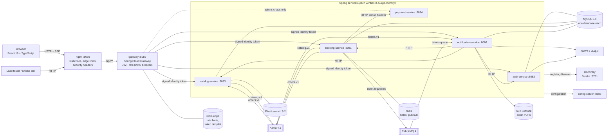

# Surge

[](https://github.com/LovjyotSingh/surge/actions/workflows/ci.yml)

Surge is a flash-sale ticket booking platform. When a big sale opens, thousands of people try to book a few hundred seats in the same second. Surge has to sell every seat exactly once and stay responsive.

- **Phase 1** built the booking core: one Spring Boot service on Java 25 that keeps the rush in Redis (atomic seat holds written in Lua), writes orders to MySQL with optimistic locking, and pushes live seat updates to the browser.
- **Phase 2** (this code) turns it into a Spring Cloud microservices platform: sign-up and login with JWTs through an API gateway, typo-tolerant event search in Elasticsearch, a separate payment service behind a circuit breaker, Kafka order events, and a RabbitMQ ticket queue that emails a PDF ticket (with a signed QR code) stored in S3. Every service verifies a gateway-signed identity token, every store and broker has its own credentials, and the whole stack runs hardened in Docker Compose.

A load tester fires 10,000 concurrent buyers at it, through nginx and the gateway like real browsers, to check that no seat is sold twice (the database's unique constraint is what guarantees it; the test shows the guarantee holds under a real sale's contention).

**New here?** Read [LEARN.md](LEARN.md). It walks through every part of the code, explains why each piece exists, and ends each topic with interview questions and answers. [SECURITY.md](SECURITY.md) describes the security design and how to report a vulnerability.

## Result

10,000 simulated buyers racing for the 500 seats of event 1, sent through nginx and the gateway with a JWT each, like real browser traffic. The final run, on 2026-11-22 against a freshly installed stack, passed every check:

| Metric | Result |
|---|---|
| Buyers / seats | 10,000 / 500 |
| **Sold** | **500** |
| **Oversold** | **0** |
| **Seats marked SOLD match order lines, seat by seat (mismatches)** | **yes (0)** |
| **Buyers who got a successful checkout = seats sold** | **500 = 500** |
| **Errors** | **1 of 10,000 buyers** |
| Rate limited (429) | 0 |
| Busy retries (503) / checkout retries | 0 / 2 |
| Requests (holds + checkouts) | 96,075 |
| Duration | 69.7 s |
| Hold latency p50 / p95 / p99 (ms) | 3,357 / 11,956 / 14,866 |
| Checkout latency p50 / p95 / p99 (ms) | 5,211 / 12,859 / 15,049 |

This ran on one Windows 11 machine with 24 logical CPUs and 24 GB of RAM, using Docker Desktop on WSL2, with the load generator and the stack's 17 long-running containers all on it (after the run the gateway used 1.27 GiB of its 2 GiB limit, booking 1.24 GiB of 2 GiB and nginx 56 MiB). The run was done on an otherwise idle machine; the same test failed once while two Maven builds ran at the same time (see [LEARN.md section 9](LEARN.md#9-the-numbers-and-how-to-explain-them)). It is a correctness test under heavy contention, not a production benchmark: the CPU was saturated, so the latencies are mostly queueing. Getting the first run through the gateway to pass took several fixes, each found after the one before (a verdict that said PASS for nothing sold, full accept queues, a hidden 25-call bulkhead, memory limits and Redis reply threads); [LEARN.md section 9](LEARN.md#9-the-numbers-and-how-to-explain-them) tells that debugging story and explains what each check proves.

The test suite also runs a smaller version on every CI build: [ConcurrentBookingTest](booking-service/src/test/java/dev/surge/booking/order/ConcurrentBookingTest.java) starts 2,000 buyers on virtual threads against 100 seats and checks that exactly 100 are sold.

## Architecture (phase 2)



| Service | What it owns |
|---|---|
| **gateway** | The only reader of the user's JWT (RS256, checked against auth's JWKS). Rate limits in Redis, circuit breakers with fallbacks, logout (token denylist). Signs a 60-second ES256 identity token for the one service each request goes to |
| **auth-service** | Users, BCrypt passwords, sign-up with a 6-digit email code, login throttling, JWT issuing and the JWKS |
| **catalog-service** | Venues and events (the source of events), CSV import, Elasticsearch search, seats left and daily sales from `orders.v1` |
| **booking-service** | The phase-1 core: Redis holds, checkout, idempotency, live seat stream. Creates events from `catalog.v1`, charges through payment-service, publishes orders and ticket requests through its outbox |
| **payment-service** | A fake payment provider with chaos settings (decline rate, error rate, latency), so the circuit breaker can be shown working |
| **notification-service** | The RabbitMQ ticket worker (PDF with a signed QR code, stored in S3, emailed), a dead-letter queue with replay, and a daily audit log of `orders.v1` |
| **discovery**, **config-server** | Eureka service registry and Spring Cloud Config (native, from [config-repo/](config-repo/)), both behind HTTP Basic |

How a booking avoids overselling, in three layers (unchanged from phase 1):

1. **Redis hold.** A Lua script ([hold.lua](booking-service/src/main/resources/redis/hold.lua)) checks and reserves all requested seats in one atomic step, with a 5-minute expiry. Holds touch only Redis, so the rush never reaches MySQL.
2. **Optimistic lock.** Checkout marks the seats sold in one MySQL transaction. Each seat row has a JPA `@Version` column, so if two checkouts race for the same seat, only one commit wins ([OrderWriter.java](booking-service/src/main/java/dev/surge/booking/order/OrderWriter.java)).
3. **Unique constraint.** `order_item.seat_id` is `UNIQUE` ([V1__schema.sql](booking-service/src/main/resources/db/migration/V1__schema.sql)), so the database itself refuses a second order line for the same seat.

The price is locked when the hold is made, and checkout charges exactly that quote. Checkout uses idempotency keys, takes payment outside the database transaction (and refunds and releases the hold if the seat is lost), and writes outgoing messages to a transactional outbox in the same transaction as the order. The shared [outbox](outbox/) module relays them to Kafka and RabbitMQ (at least once); every consumer ignores duplicates by message id.

## Tech stack

| Area | Used for |
|---|---|
| Java 25 | Records, sealed interfaces, pattern-matching `switch`, virtual threads |
| Spring Boot 4.0.9 | Web MVC, Data JPA, Data Redis, Validation, Actuator, Security (OAuth2 resource server, JOSE) |
| Spring Cloud 2025.1.4 | Gateway (WebFlux), Netflix Eureka, Config Server, CircuitBreaker (Resilience4j), LoadBalancer |
| MySQL 8.4 + Flyway | One database per service; versioned schema migrations |
| Redis 7 | Seat holds (Lua), idempotency keys, pub/sub (booking); edge rate limits and the token denylist (gateway, its own instance) |
| Kafka 4.1 (KRaft) | `orders.v1` and `catalog.v1`, keyed by event id, dead-letter topics; SASL/SCRAM and ACLs |
| RabbitMQ 4 | The `tickets` work queue with retries, a dead-letter exchange and queue; per-service users |
| Elasticsearch 9.2 | Event search: English analysers, fuzzy matching, filters, geo distance |
| AWS SDK v2 + Adobe S3Mock | Ticket PDFs in S3 (S3Mock locally) |
| OpenPDF + ZXing | PDF tickets with a QR code |
| Spring Mail + Mailpit | Verification codes and ticket emails (Mailpit catches them locally) |
| JWT (Nimbus) | RS256 user tokens with a JWKS; ES256 internal identity tokens |
| React 19 + TypeScript + Vite | Events, search, seat map, sign-up and email verification, ticket download, Ops page |
| nginx 1.30 | The only published port: static files, `/api` to the gateway, security headers, edge limits |
| Docker + Compose | One parameterised service image, hardened containers, internal networks |
| JUnit 5 + Testcontainers, Vitest | Integration tests against real MySQL, Redis, Kafka, RabbitMQ, Elasticsearch, S3Mock and Mailpit |
| GitHub Actions | CI (tests, image builds with Trivy, Compose checks), CodeQL, OSV and npm audit, Dependabot |

## Quick start

You need **Docker Desktop** (on Windows, with the WSL2 backend; give it at least 8 GB of memory, 12 GB for the load test), **Git Bash** (on Windows) with `openssl`, and **JDK 25** (the secret script runs `./mvnw` to generate keys).

```bash
docker/gen-secrets.sh    # once: user names and settings go to .env (mode 600); every password and key to its own file in docker/secrets/
docker compose -f compose.yaml -f compose.dev.yaml --profile core --profile platform up -d --build
```

- `docker/gen-secrets.sh` writes a random value for every credential (MySQL users, Redis ACL users, RabbitMQ and Kafka users, Elasticsearch, Eureka, config server, the admin password, the ticket QR key), plus the JWT signing key and the internal identity keys. User names and settings go to `.env` (mode 600); every password and key goes to its own file in `docker/secrets/` (mode 700, one file each). Nothing has a default: Compose refuses to start until the script has run. Compose mounts each file read-only into only the containers that use it, at `/run/secrets/env/<VARIABLE>`, and the services read it there ([SecretFiles](common/src/main/java/dev/surge/common/security/SecretFiles.java)), so no password is an environment variable and `docker inspect` shows none. The script never overwrites what exists: without `--force` it writes only what is missing, and `--force` replaces every generated value but keeps the provider secrets (`mail_password`, `s3_access_key`, `s3_secret_key`) and every `.env` line it does not own (read the notes at the top of the script first). `docker/set-secret.sh <name>` writes one secret file from standard input, for your provider's secrets, so a value never appears in `ps` or your shell history. How a production server stores and rotates secrets is in [docs/DEPLOY.md](docs/DEPLOY.md).
- `compose.yaml` is the platform: the `core` profile is MySQL, Redis and booking-service; `platform` is everything else (Kafka, RabbitMQ, Elasticsearch, the other services, the gateway and nginx). Every Spring service runs with `SURGE_ENV=prod`, so it refuses to start with a development key or a missing credential (the one exception: auth under the load-test overlay, see below).
- `compose.dev.yaml` adds **Mailpit** (catches every email) and **S3Mock** (fake S3), and debug ports bound to `127.0.0.1`. Never use it on a server. Without it, set the `MAIL_*` and `S3_*` settings in `.env` and the secrets with `docker/set-secret.sh`.

The first build downloads Maven and npm dependencies, so it takes a while.

Open **http://localhost:8080**. Everything below is bound to `127.0.0.1` only:

| URL | What | Sign-in |
|---|---|---|
| http://localhost:8080 | The app and the whole API (nginx, then the gateway) | Your account, or the admin below |
| http://localhost:8025 | Mailpit: every email (verification codes, tickets) | none |
| http://localhost:8761 | Eureka dashboard | `EUREKA_USER` from `.env`, password in `docker/secrets/eureka_password` |
| http://localhost:15672 | RabbitMQ management | `surge-admin`, password in `docker/secrets/rabbit_admin_password` |
| http://localhost:9200 | Elasticsearch | `elastic`, password in `docker/secrets/elastic_password` |
| `localhost:8085`, `8081`, `3307`, `6379`, `9090` | gateway, booking-service, MySQL, Redis, S3Mock (debugging) | per service |

Stop everything with `docker compose -f compose.yaml -f compose.dev.yaml --profile core --profile platform down` (add `-v` to also delete the data).

### Demo accounts

- **Admin.** `admin@surge.local`, with the password from `cat docker/secrets/surge_admin_password`. The admin's email counts as verified, it can book like any user, and it sees the **Ops** page (integrity check, event reset, payment chaos, the ticket dead-letter queue, the latest load-test report). To change it, replace that file (at least 16 characters, for example `docker/set-secret.sh surge_admin_password`) and run `docker compose -f compose.yaml -f compose.dev.yaml --profile core --profile platform up -d --force-recreate auth-service`: auth re-hashes the password at start-up, and the old one stops working.
- **Your own user.** Click **Sign up** (name: 1 to 60 letters, digits, spaces and `. ' -`, no web addresses; password: 8 to 72 characters, not a common password, not containing the part of your email before the `@`). The app then asks for a 6-digit code: open Mailpit at http://localhost:8025, read the code from the "verify your email" message and enter it. The code expires after 15 minutes and locks after 5 wrong tries; **Resend** works once a minute. You can browse and search without verifying, but holding seats needs a verified email. At most 10 verification emails go to one address per 24 hours, and an address that never verified is free for a new sign-up after 24 hours. With a real mail server, check your Spam folder too (in the Gmail app: ☰ → Spam).

Then try the flow: search for "coldply" (the typo still finds "Coldplay Tribute Live"), open event 1, select up to 8 seats, **Hold**, **Pay**. Within seconds a ticket email with a PDF arrives in Mailpit, and the event page offers **Download ticket (PDF)**. Open the same event in a second browser (or a private window) signed in as someone else: seats held in one turn "held" in the other straight away.

## Smoke test and load test

**Smoke test** ([tools/smoke](tools/smoke/)): ten end-to-end checks through nginx, like a browser. It signs up a fresh user and reads the code from Mailpit, searches with a typo, buys two seats, waits for the ticket email and PDF, checks catalog's seats-left and the audit log, drives the payment circuit breaker open with chaos and waits for it to close, hits the hold rate limit, tries forged headers and an anonymous admin call, checks the security headers and logout. It resets event 1 at the start and the end and takes about a minute. **It is destructive** (it turns payment chaos off and wipes the event's bookings), so it refuses a `--base-url` whose host is not local (`localhost`, `127.0.0.1`, `::1`, a single-label Docker name such as `web`, `*.localhost`, `*.test`) unless you pass `--destructive`; never point it at a server with real sales. Before the checks it waits (up to 120 s) until the gateway routes to booking and catalog, and prints `Waiting for the gateway to route to booking and catalog… ready after N s`; the load test does the same.

```bash
docker compose -f compose.yaml -f compose.dev.yaml --profile core --profile platform --profile smoke run --rm --build smoke
```

It exits with code 0 only if all ten checks pass. Run it without the load-test overlay: one check confirms that test tokens are off.

**Load test** ([tools/loadtest](tools/loadtest/)): 10,000 buyers through nginx and the gateway. The admin mints one JWT per synthetic buyer (`lt-*` users), so the run needs the load-test overlay, which turns on what a public deployment must keep off: test-token minting, load-test subjects in the gateway, and an nginx exemption for the load tester's address. auth refuses to mint test tokens with `SURGE_ENV=prod`, so under this overlay auth alone runs with `SURGE_ENV=dev`, which also skips its production start-up guards (it still gets every real credential and key). Use it on your own machine only.

```bash
docker compose -f compose.yaml -f compose.dev.yaml -f compose.loadtest.yaml --profile core --profile platform up -d --build
docker compose -f compose.yaml -f compose.dev.yaml -f compose.loadtest.yaml --profile core --profile platform run --rm loadtest --users 10000 --event 1
docker compose -f compose.yaml -f compose.dev.yaml --profile core --profile platform up -d   # afterwards: overlay off again
```

It resets event 1, runs, prints the report, shows it on the **Ops** page and writes it to `reports/`. It exits with code 1 unless every check passes: something sold, 0 oversold, every seat marked SOLD having an order line and every order line sitting on a SOLD seat (checked seat by seat, `seatMismatches` is 0), as many successful checkouts as seats sold in the run, and errors under 1% of buyers. A buyer that gets `503 service-busy` (the gateway's bulkhead is full) or `503 auth-unavailable` waits for `Retry-After` and resends the same step; the report counts these as `busyRetries`. A checkout that times out, or gets `502`, `504`, another `503` or `409 request-in-progress`, is resent unchanged with the same `Idempotency-Key` (at most 3 times, within the run's deadline), so booking replays the order if the first try went through; the report counts these as `checkoutRetries`. On native Linux, run `export UID` first so the container can write `reports/`. The run leaves event 1 sold out; reset it from the Ops page.

## API

Everything goes through **http://localhost:8080** (nginx, then the gateway). "User" means `Authorization: Bearer <token>` from login, sign-up or verify; "admin" means a token with the `ADMIN` role. The gateway checks the token and the role, then every service checks the gateway's identity token again.

| Method | Path | Caller | What it does | Success |
|---|---|---|---|---|
| POST | `/api/auth/signup` | anyone | `{"email","password","displayName"}`. Creates an unverified account, emails a 6-digit code, returns a token | 201 |
| POST | `/api/auth/login` | anyone | `{"email","password"}`. Returns `{token, expiresAt, user}`; the token lives 30 minutes | 200 |
| POST | `/api/auth/verify` | user | `{"code":"123456"}`. Verifies the email; returns a new token that says so | 200 |
| POST | `/api/auth/verify/resend` | user | Emails a new code | 202 |
| GET | `/api/auth/me` | user | Your id, email, display name, roles, `emailVerified` | 200 |
| POST | `/api/auth/logout` | user | Revokes this token on every gateway at once | 204 |
| GET | `/api/auth/.well-known/jwks.json` | anyone | Public keys of the user tokens (RS256) | 200 |
| GET | `/api/catalog/events?page&size` | anyone | Events with prices, seats left and the venue's time zone | 200 |
| GET | `/api/catalog/events/{id}` | anyone | One event | 200 |
| GET | `/api/catalog/events/search?q&city&category&from&to&maxPrice&lat&lon&radiusKm&page&size` | anyone | Typo-tolerant search with filters; no `q` lists by start time | 200 |
| POST | `/api/catalog/admin/events/import` | admin | Multipart CSV (at most 5 MB, 1,000 rows); bad lines are reported with their line number | 200 |
| GET | `/api/catalog/admin/stats/daily?eventId` | admin | Tickets sold and revenue per day, in the venue's time zone | 200 |
| GET | `/api/bookings/events` | anyone | Events with sold counts | 200 |
| GET | `/api/bookings/events/{eventId}` | anyone | Seat map (`AVAILABLE` / `HELD` / `SOLD`) | 200 |
| GET | `/api/bookings/events/{eventId}/stream` | anyone | Live seat changes as Server-Sent Events | 200 (stream) |
| POST | `/api/bookings/holds` | verified user | `{"eventId":1,"seatIds":[1,2]}`. Holds 1 to 8 seats for 5 minutes and locks their prices | 201 |
| POST | `/api/bookings/orders` | user, `Idempotency-Key` header | `{"holdId":"..."}`. Pays the hold's locked quote and confirms the order | 201, or 200 with `Idempotent-Replayed: true` |
| GET | `/api/bookings/orders/{orderId}` | user | Your order | 200 |
| GET | `/api/bookings/admin/events/{eventId}/integrity` | admin | Sold count and oversell checks (`oversold` must be 0, `seatMismatches` 0 and `consistent` true: seat by seat, a seat is SOLD exactly when it has an order line) | 200 |
| POST | `/api/bookings/admin/events/{eventId}/reset?opensInSeconds=N` | admin | Reset an event; the sale opens in N seconds | 204 |
| PUT, GET | `/api/bookings/admin/loadtest-reports/latest` | admin | Store / read the latest load-test report | 204 / 200 |
| GET | `/api/notifications/tickets/{orderId}.pdf` | user (the buyer) | The ticket PDF, `Cache-Control: no-store`; someone else's ticket is a 404 | 200 |
| GET | `/api/notifications/admin/dlq?limit` | admin | Ticket messages that failed every retry, with the reason | 200 |
| POST | `/api/notifications/admin/dlq/replay?limit` | admin | Move them back to the ticket queue | 200 |
| GET | `/api/notifications/admin/audit?date&tail` | admin | The day's `orders.v1` audit log: line count and the last lines | 200 |
| GET, PUT | `/api/payments/admin/chaos` | admin | Payment chaos: `{"failureRate":0..1,"latencyMs":0..10000,"errorRate":0..1}` | 200 / 204 |

Any other `/api/payments/**` path answers `404` at the gateway: only booking-service calls payment-service, inside the network, signed as `svc:booking`. The internal endpoints (`/internal/orders/{id}` on booking, `/internal/users/{id}` on auth) are never routed and accept only notification-service's signed calls.

Every error, from any service or the gateway, uses the Problem Details JSON format (RFC 9457) with a `type` under `https://surge.dev/problems/` and a `requestId`. The common ones: `400 validation-failed`, `401 unauthorized` / `bad-credentials`, `402 payment-failed`, `403 forbidden` / `email-unverified`, `404 not-found`, `409 seat-taken` / `hold-exists` / `sale-not-open` / `too-many-holds`, `413` too large, `429 rate-limited` (with `Retry-After`), `503 service-busy` (a full bulkhead, with `Retry-After: 1`), `503 auth-unavailable` (the gateway could not check the token against its denylist or key set; with `Retry-After: 1`), `503 payment-unavailable` (the hold is kept) and `503 service-unavailable` (a circuit is open, or booking's own Redis or database did not answer in time). Idempotency keys: a repeat of a completed checkout returns the same order for 24 hours.

## Security in short

- **Zero-trust identity.** Only the gateway reads the user's JWT. For every request it routes, it signs a 60-second ES256 token (`X-Surge-Identity`) for exactly the target service, and every service verifies it and trusts nothing else: a forged `X-User-*` header gets `401`, even from inside the network. Service-to-service calls are signed with the caller's own key, and each service accepts only the callers it needs. Everything is denied by default.
- **Accounts.** Tokens live 30 minutes; logout revokes a token at once through a Redis denylist that fails closed (`503 auth-unavailable`, retryable) if Redis does not answer within 3 seconds. Email verification codes, a common-password list and a per-account login throttle on top of the gateway's per-IP limits.
- **Edge.** nginx is the only published port: security headers and a strict CSP, body-size limits, timeouts, connection and request limits. The gateway meters every public route in Redis token buckets.
- **Platform.** Internal networks with one network per store, every store and broker with its own users and least-privilege ACLs, non-root read-only containers with all capabilities dropped, base and third-party images pinned by digest.
- **Supply chain.** Actions pinned to commit SHAs, Dependabot, CodeQL, OSV and npm audit, Trivy on every image.

[SECURITY.md](SECURITY.md) has the full design, with links to the code, and how to report a vulnerability. [LEARN.md section 5.31](LEARN.md#531-security) explains it with interview questions.

## Deploying

Running Surge on a public server needs TLS and production settings that the local stack does not have. `compose.prod.yaml` is the production overlay: nginx serves TLS 1.2 and 1.3 on 443 with HSTS ([web/nginx-tls.conf](web/nginx-tls.conf)) and port 80 only redirects; mail goes through your SMTP provider with AUTH and required STARTTLS, and tickets to a real private S3 bucket; and every Spring service runs with `SURGE_PUBLIC_DEPLOYMENT=true`, so it refuses to start on a development setting (a blank or too-wide trusted-proxy list, mail without AUTH or STARTTLS, development S3 keys or a plain-HTTP S3 endpoint, a non-`https://` `PUBLIC_BASE_URL`, the `@surge.local` admin email, load-test subjects). [docs/DEPLOY.md](docs/DEPLOY.md) is the step-by-step runbook (server, firewall, certificates, secrets, backups, rotation and post-deploy checks). `compose.tls-local.yaml` tries the same TLS edge on your machine with a self-signed certificate (`docker/gen-selfsigned-cert.sh`). Never deploy with `compose.dev.yaml`, `compose.loadtest.yaml` or `compose.tls-local.yaml`.

## Phase 2 limits, stated plainly

- **One instance of everything.** One gateway, one of each service, one MySQL server (a database per service), one Kafka broker (replication factor 1), one RabbitMQ node, one Elasticsearch node. payment-service keeps payments in memory and auth keeps its login throttle in memory, so both must stay single-instance until that state moves to Redis.
- **Fake payments.** payment-service is a stand-in provider with chaos settings, not a real payment gateway.
- **Local numbers.** The load test shows correctness under contention on one laptop, not production capacity. At sale start the CPU was saturated and p95 latencies were 12 to 13 seconds.
- **Retries cost rate-limit tokens.** The gateway's rate limiters run before its circuit breaker, so a client that retries `503 service-busy` too often gets `429`. A checkout that takes longer than the gateway's 10-second breaker timeout can get `503` although booking completes it; retrying with the same `Idempotency-Key` returns the order. The timeouts nest inside each other (nginx 35 s, gateway 30 s, breaker 10 s, booking's Redis 2 s and database connection 3 s) so a stuck dependency becomes a fast, retryable `503`.
- **At-least-once email.** If the notification transaction fails to commit after the email was sent, the retry sends it again (same PDF, same link).
- **No observability stack yet.** Health is open; `/actuator/prometheus` is refused to every caller until phase 3 adds a scrape identity. Request ids are propagated but not yet printed in every log line.
- **No cancellations, and a hold is lost on page refresh** (the page keeps it in memory only), as in phase 1.
- **TLS** comes only with the production overlay ([docs/DEPLOY.md](docs/DEPLOY.md)); the local stack is plain HTTP on `127.0.0.1`, and traffic between containers is not encrypted.

## Run the tests

Docker must be running: the integration tests start real MySQL, Redis, Kafka, RabbitMQ, Elasticsearch, S3Mock and Mailpit containers with Testcontainers.

```bash
./mvnw -B verify                                       # backend: all 12 modules
cd web && npm ci && npx vitest run && npm run build    # web: Vitest tests, then a production build
```

On Windows PowerShell use `.\mvnw.cmd -B verify`. You need JDK 25 and Node 24 for these. Test counts per module and the tests worth reading first are in [LEARN.md section 5.14](LEARN.md#514-testing-and-ci). CI runs the same commands on every push and pull request to `main` ([ci.yml](.github/workflows/ci.yml)), then builds every image and scans it with Trivy.

## Repository layout

| Path | What it is |
|---|---|
| [booking-service/](booking-service/) | Holds, checkout, idempotency, live seat stream, admin; consumes `catalog.v1` |
| [auth-service/](auth-service/) | Users, sign-up, email codes, login throttle, JWT and JWKS |
| [catalog-service/](catalog-service/) | Events, CSV import, Elasticsearch search, sales from `orders.v1` |
| [payment-service/](payment-service/) | Fake payment provider with chaos settings |
| [notification-service/](notification-service/) | Ticket worker (PDF, QR, S3, email), dead-letter queue, audit log |
| [gateway/](gateway/) | Spring Cloud Gateway: JWT, identity tokens, rate limits, circuit breakers |
| [discovery/](discovery/), [config-server/](config-server/), [config-repo/](config-repo/) | Eureka, Spring Cloud Config and the configuration it serves |
| [common/](common/) | Shared code: internal identity tokens and access rules, request ids, Problem Details, message records |
| [outbox/](outbox/) | The transactional outbox and its Kafka and RabbitMQ publishers, used by booking and catalog |
| [tools/loadtest/](tools/loadtest/), [tools/smoke/](tools/smoke/) | The 10,000-buyer load tester and the end-to-end smoke test (plain Java) |
| [web/](web/) | React app and the nginx config that serves it |
| [docker/](docker/) | The service Dockerfile, `gen-secrets.sh` and `set-secret.sh` (the secret files), `gen-selfsigned-cert.sh`, and the MySQL, Redis, RabbitMQ, Kafka and Elasticsearch set-up |
| [compose.yaml](compose.yaml), [compose.dev.yaml](compose.dev.yaml), [compose.loadtest.yaml](compose.loadtest.yaml), [compose.prod.yaml](compose.prod.yaml), [compose.tls-local.yaml](compose.tls-local.yaml) | The platform, the local development overlay, the load-test overlay, the production overlay, the local TLS try-out |
| [docs/DEPLOY.md](docs/DEPLOY.md) | Runbook for one internet-facing VM |
| [docs/DESIGN.md](docs/DESIGN.md) | The design for all phases: what is built and what is planned |
| [LEARN.md](LEARN.md), [SECURITY.md](SECURITY.md) | The learning guide: the security design and reporting |
