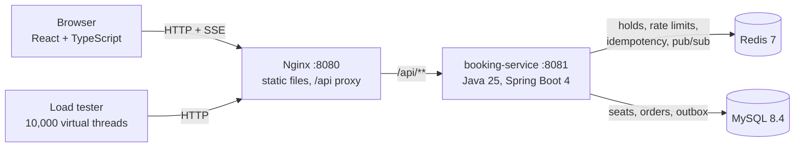

# Surge

[](https://github.com/LovjyotSingh/surge/actions/workflows/ci.yml)

Surge is a flash-sale ticket booking backend. When a big sale opens, thousands of people try to book a few hundred seats in the same second. Surge has to sell every seat exactly once and stay responsive. Phase 1 is one Spring Boot service on Java 25 that keeps the rush in Redis (atomic seat holds written in Lua), writes orders to MySQL with optimistic locking, and pushes live seat updates to the browser. A load tester fires 10,000 concurrent buyers at it to prove that no seat is ever sold twice.

**New here?** Read [LEARN.md](LEARN.md). It walks through every part of the code, explains why each piece exists, and ends with interview questions and answers.

## Result

10,000 simulated buyers racing for the 500 seats of event 1, sent through Nginx like real browser traffic. This is the second of two runs made back to back (no clean-up in between); both passed every check.

| Metric | Value |
|---|---|
| Buyers | 10,000 |
| Seats | 500 |
| **Sold** | **500** |
| **Oversold** | **0** |
| **Sold seats = distinct seats in orders** | **yes** |
| **Buyers who got a 201 = seats sold** | **500 = 500** |
| **Errors** | **0** |
| Requests (holds + checkouts) | 96,045 |
| Conflicts (409, seat already taken) | 95,045 |
| Rate limited (429) | 0 |
| Duration | 20.6 s |

| Latency (ms) | p50 | p95 | p99 | max |
|---|---|---|---|---|
| Hold | 1675 | 3740 | 5975 | 7376 |
| Checkout | 2652 | 5367 | 6035 | 6739 |

This ran on one laptop: Docker Desktop on WSL2 with 12 GB of memory for Docker, 24 CPU threads. The load generator, Nginx, the service, MySQL and Redis all shared that machine. It is a correctness test under heavy contention, not a production benchmark, and the times vary with the laptop's load (an earlier run took 11.2 s). [LEARN.md section 9](LEARN.md#9-the-numbers-and-how-to-explain-them) explains how to read these numbers and what each check proves.

The test suite also runs a smaller version on every CI build: [ConcurrentBookingTest](booking-service/src/test/java/dev/surge/booking/order/ConcurrentBookingTest.java) starts 2,000 buyers on virtual threads against 100 seats and checks that exactly 100 are sold (it took 5 to 18 s on the laptop).

## Architecture (phase 1)



How a booking avoids overselling, in three layers:

1. **Redis hold.** A Lua script ([hold.lua](booking-service/src/main/resources/redis/hold.lua)) checks and reserves all requested seats in one atomic step, with a 5-minute expiry. Holds touch only Redis, so the rush never reaches MySQL.
2. **Optimistic lock.** Checkout marks the seats sold in one MySQL transaction. Each seat row has a JPA `@Version` column, so if two checkouts race for the same seat, only one commit wins ([OrderWriter.java](booking-service/src/main/java/dev/surge/booking/order/OrderWriter.java)).
3. **Unique constraint.** `order_item.seat_id` is `UNIQUE` ([V1__schema.sql](booking-service/src/main/resources/db/migration/V1__schema.sql)), so the database itself refuses a second order line for the same seat.

The price is locked when the hold is made (early bird and surge are applied then), and checkout charges exactly that quote. Checkout also uses idempotency keys, takes payment outside the database transaction (and refunds and releases the hold if the seat is lost), and writes outgoing messages to a transactional outbox. Live seat changes go out over Server-Sent Events, fanned out through Redis pub/sub.

## Tech stack (built in phase 1)

| Area | Used for |
|---|---|
| Java 25 | Records, sealed interfaces, pattern-matching `switch`, virtual threads |
| Spring Boot 4.0.9 | Web MVC, Data JPA, Data Redis, Validation, Actuator, scheduling |
| MySQL 8.4 + Flyway | Seats, orders, outbox; versioned schema migrations |
| Redis 7 | Seat holds (Lua), sold-seat sets, token-bucket rate limit, idempotency keys, pub/sub |
| springdoc-openapi | Swagger UI and OpenAPI spec |
| React 19 + TypeScript + Vite | Events page, live seat map, hold countdown, checkout, Ops page |
| Nginx | Serves the web app, reverse-proxies `/api`, streams SSE |
| Docker + Compose | Multi-stage images, layered jars, non-root Java containers, health checks |
| JUnit 5 + Testcontainers, Vitest | Unit and integration tests against real MySQL and Redis |
| GitHub Actions | CI: backend tests, web tests and build, Docker image build |

## Quick start

You need **Docker Desktop** (on Windows, with the WSL2 backend). Nothing else is required to run the stack.

```bash
cp .env.example .env                          # optional: local-only database passwords
docker compose --profile core up -d --build   # MySQL, Redis, booking-service, web
```

The first build downloads Maven and npm dependencies, so it takes a while. Later builds reuse the cache.

Open **http://localhost:8080**. Pick event 1, select up to 8 seats, click **Hold**, then **Pay**. Now open the same event in a new browser tab. A new tab gets its own random demo user (shown in the header), and seats you hold in one tab turn "held" in the other straight away.

Run the 10,000-buyer load test:

```bash
docker compose --profile core --profile loadtest run --rm loadtest --users 10000 --event 1
```

It resets event 1, runs, prints the report, shows it on the **Ops** page (http://localhost:8080/ops) and writes it to `reports/`. It exits with code 1 unless every check passes: 0 oversold, sold seats matching order lines, and as many `201`s as seats sold. Each run uses fresh idempotency keys (`<runId>-<userId>`), so you can run it again right away. On native Linux, run `export UID` first (or `chmod o+w reports`) so the container can write `reports/`; otherwise it only prints a warning. The run leaves event 1 sold out; reset it from the Ops page or with:

```bash
curl -X POST -H "X-User-Id: u-admin" -H "X-User-Roles: ADMIN" "http://localhost:8080/api/bookings/admin/events/1/reset?opensInSeconds=0"
```

Stop everything with `docker compose --profile core down` (add `-v` to also delete the database data).

Ports on your machine, all bound to `127.0.0.1` so nothing is reachable from your network: `8080` web and API through Nginx, `8081` booking-service directly (health and metrics), `3307` MySQL, `6379` Redis.

## API

All endpoints are under `/api/bookings`. Interactive docs: **http://localhost:8080/api/bookings/docs** (Swagger UI). OpenAPI JSON: http://localhost:8080/api/bookings/v3/api-docs.

| Method | Path | Headers | What it does | Success |
|---|---|---|---|---|
| GET | `/events` | | List events with sold counts | 200 |
| GET | `/events/{eventId}` | | Event details and seat map (`AVAILABLE` / `HELD` / `SOLD`) | 200 |
| GET | `/events/{eventId}/stream` | | Live seat changes as Server-Sent Events | 200 (stream) |
| POST | `/holds` | `X-User-Id` | Hold 1 to 8 seats for 5 minutes and lock their prices. Body: `{"eventId":1,"seatIds":[1,2]}`. Returns `holdId`, `expiresAt`, `quotedTotalInr` and per-seat `lines` | 201 |
| POST | `/orders` | `X-User-Id`, `Idempotency-Key` | Pay the hold's locked quote and confirm the order. Body: `{"holdId":"..."}` | 201, or 200 with `Idempotent-Replayed: true` on a repeat |
| GET | `/orders/{orderId}` | `X-User-Id` | Your order | 200 |
| GET | `/admin/events/{eventId}/integrity` | | Sold count and oversell checks (`oversold` must be 0, `consistent` must be true) | 200 |
| POST | `/admin/events/{eventId}/reset?opensInSeconds=N` | | Reset an event; the sale opens in N seconds | 204 |
| PUT | `/admin/loadtest-reports/latest` | | Store the latest load-test report (used by the load tester) | 204 |
| GET | `/admin/loadtest-reports/latest` | | Latest load-test report (used by the Ops page) | 200 |

Every error, including the ones Spring raises itself (unknown route `404 not-found`, wrong method `405 method-not-allowed`, a value of the wrong type `400 validation-failed`) and unexpected failures (`500 internal-error`, without the exception message), uses the Problem Details JSON format (RFC 9457, the successor of RFC 7807) with a `type` under `https://surge.dev/problems/` and a `requestId` field. Common ones: `400` validation, `401` missing user, `402` payment failed, `404` not found, `409` seat taken / hold exists / sale not open, `429` rate limited (with `Retry-After`).

Idempotency keys: a repeat of a completed checkout returns the same order for 24 hours. A key whose order no longer exists (an admin reset deletes orders) is treated as a new request.

Health and metrics are on the service port: http://localhost:8081/actuator/health and http://localhost:8081/actuator/prometheus.

**Phase 1 limits, stated plainly:** there is no login yet. The web app sends a demo user id in the `X-User-Id` header, and the admin endpoints check the `ADMIN` role in the service (`X-User-Roles`, set by the gateway). Payment is a fake in-process gateway. Outbox messages are logged, not yet sent to a broker. Run it locally only: every published port is bound to `127.0.0.1`, so Redis (no password), MySQL and the admin API are not reachable from your network. A hold lives only in the open page, so refreshing the page loses its Pay button until the hold expires.

## Run the tests

Docker must be running: the integration tests start real MySQL and Redis containers with Testcontainers.

```bash
./mvnw -B verify                               # backend: unit + Testcontainers integration tests
cd web && npm ci && npx vitest run && npm run build   # web: Vitest tests, then a production build
```

On Windows PowerShell use `.\mvnw.cmd -B verify`. You need JDK 25 and Node 24 for these. Test counts per module and the tests worth reading first are in [LEARN.md section 5.14](LEARN.md#514-testing-and-ci). CI runs the same commands on every push and pull request to `main` ([ci.yml](.github/workflows/ci.yml)), plus a build of all Docker images.

## Repository layout

| Path | What it is |
|---|---|
| [booking-service/](booking-service/) | The Spring Boot service: holds, checkout, outbox, live seat stream, admin |
| [common/](common/) | Shared code: request-id filter, Problem Details helper, message records |
| [tools/loadtest/](tools/loadtest/) | The load tester (plain Java, virtual threads, `java.net.http`) |
| [web/](web/) | React app and the Nginx config that serves it |
| [compose.yaml](compose.yaml) | The local stack (`core` and `loadtest` profiles) |
| [docs/superpowers/specs/2026-11-12-surge-design.md](docs/superpowers/specs/2026-11-12-surge-design.md) | The full design spec for all phases |
| [LEARN.md](LEARN.md) | The learning guide |

## Roadmap: planned, not built yet

Phase 1 (this code) is the core booking flow. The phases below are designed in the [spec](docs/superpowers/specs/2026-11-12-surge-design.md) but **not built yet**.

| Phase | Planned scope |
|---|---|
| 2. Microservices platform | auth-service (JWT), catalog-service with Elasticsearch search, payment-service with a Resilience4j circuit breaker, notification-service (PDF tickets, S3-compatible storage, email to Mailpit), Spring Cloud Gateway, Config Server, Eureka, Kafka and RabbitMQ fed by the outbox |
| 3. Observability | Prometheus, Alertmanager, Grafana dashboards, Logstash + Elasticsearch + Kibana logs, Zipkin traces |
| 4. AI | AI customer assistant, AI on-call agent that diagnoses incidents, RAG over runbooks, an MCP server |
| 5. Delivery | Kubernetes manifests for a local kind cluster, Jenkins pipeline, AWS EC2/S3 deployment guide (documented), recorded demo |

Phase 1 already leaves the seams for this: the `PaymentGateway` and `OutboxPublisher` interfaces, the `X-User-Id` header that the gateway will set after checking a JWT, and the `event_ref` table that the catalog service will feed.
